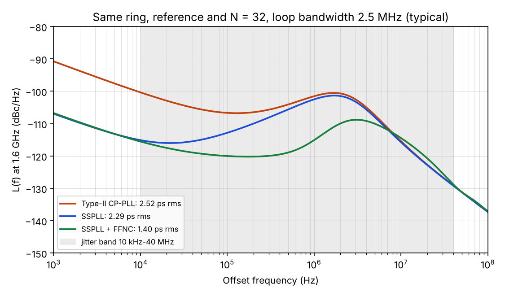

# Phase 0, step 8 - architecture decision note: variants and supplies

Date: 14 Nov 2026. Inputs: the latest proposal (final revision of 13 Nov, Proposal and Design-basis tabs of
https://claude.ai/artifact/KHovStHrgfVBviGQHPkxWL), `proposal/DECISION.md`, `audit/AUDIT.md`,
`docs/chipalooza4-constraints.md`. Numbers: `models/step8_variants.py` (phase-domain model, step 9). Its `TYP` point
is the proposal's basis (ring from the ngspice ISF, -97.35 dBc/Hz at 1 MHz) and reproduces the spec's typical
jitter, 2.29 / 1.40 ps (spec 2.3 / 1.4).

## 1. Decisions

| # | Question | Decision |
|---|---|---|
| D1 | Which variants are on silicon? | **One block with two measured modes:** SSPLL (`ffnc_en = 0`) and SSPLL + FFNC (`ffnc_en = 1`). Exactly as in the proposal. |
| D2 | Type-II charge-pump PLL baseline | **Simulation deliverable, not taped out.** Same ring, CCO, reference and N = 32; its own PFD/CP and filter for 2.5 MHz. Built in Phase 7 (step 72 onward), used in the documentation and for learning (request 13). |
| D3 | How does the ring get its supply? | **CCO:** 5-bit current DAC + 1:8 thick-oxide mirror from VDDA (3.3 V) feeding the ring node (<= 1.8 V by design). No LDO for the ring. |
| D4 | Is there an LDO at all? | **Yes, a new small one** (as in the proposal): pass device and error amplifier in 3.3 V devices, VREF = 1.2 V from the harness, 1.8 V output for the SSPD, SSPLL charge pump, FLL charge pump, clock (pulse) generator, ring output buffers and the NCB delay line; load about 1.08 mA (NCB 0.44 mA). The old `sspll_ldo` (sized for the ring, illegal 80 x 80 um MIMs) is archived, not reused. |
| D5 | What runs from VDDD (1.8 V digital)? | Dividers (/32 FLL, /2.../16 outputs, measurement divider), PFD and dead-zone logic of the FLL, control decoding, CLK_DIG. The PFD drives the FLL charge pump on the LDO rail through a same-voltage buffer (no level shifter). |

D4 corrects audit finding 1: that finding is right about the old LDO block, but the proposal still needs a
regulated analog rail. AUDIT.md is annotated accordingly.

## 2. Why: the three variants compared

Same 5-stage x1.5 ring (L(1 MHz) = -97.35 dBc/Hz typ, proposal basis), same reference, N = 32, loop bandwidth 2.5 MHz.
Type-II detector: PFD + CP normalised floor -218 dBc/Hz at 1 Hz (typ) / -212 (pess), which refers to the output as
-218 + 10 log10(50 MHz) + 20 log10(32) = **-110.9 dBc/Hz**. The SSPLL detector + CP floor is -130 dBc/Hz at the output.

| Variant | Jitter typ (pess), 10 kHz-40 MHz | VCO part | PD + CP part | L(100 kHz) typ | L(1 MHz) typ |
|---|---|---|---|---|---|
| Type-II CP-PLL | 2.52 ps (4.37) | 2.27 | 1.05 | -106.7 | -101.5 |
| SSPLL | 2.29 ps (3.71) | 2.27 | 0.11 | -112.8 | -102.5 |
| SSPLL + FFNC | **1.40 ps (2.25)** | 1.32 | 0.17 | -120.0 | -115.1 |

What the numbers say, and why:

1. **Inside the loop bandwidth the SSPLL is about 6 dB quieter** (-112.8 vs -106.7 dBc/Hz at 100 kHz, where the ring
   still contributes; the detector floors themselves differ by 19 dB, -130 vs -110.9 dBc/Hz). A PFD compares
   the reference with the *divided* clock, so its noise is multiplied by N^2 (30 dB for N = 32). The SSPD samples
   the 1.6 GHz output directly; there is no divider in the loop and no N^2.
2. **But with a ring oscillator, the total jitter is dominated by the VCO** (2.27 ps of 2.29). At the same bandwidth
   the SSPLL alone only gains 0.23 ps (typ) to 0.66 ps (pess) over a good CP-PLL. The SSPLL's low detector noise is
   what *allows* a wider loop, but the loop bandwidth is capped near f_ref/20 by sampling delay, so it cannot keep
   widening the loop to suppress the ring.
3. **FFNC is where the big gain comes from** (-39% jitter, spec minimum 20%), and **FFNC needs the SSPLL.** The cancellation uses the
   *held voltage* of the sub-sampling detector as a direct, continuous measure of the ring's phase error. A PFD
   only produces pulse widths, which cannot drive a delay line without extra conversion and noise. This is the
   reason the architecture is "SSPLL + FFNC" and not "CP-PLL + something".

So the Type-II baseline is worth *simulating*: it shows the N^2 effect and justifies the SSPLL in the report.
It is not worth *taping out*, for these reasons:

- **Rule 9 binds every taped-out mode.** A CP-PLL mode would need its own guaranteed specification, measured
  post-layout over PVT - a second PLL to verify inside 13 weeks, with a team of two.
- **It is not a cheap mode switch.** The FLL already has a PFD, a CP and the /32 divider, but it is designed to be
  weak and to go quiet inside a dead zone. As the main loop it would need matched UP/DOWN currents, no dead zone,
  low CP noise, and a loop gain set for 2.5 MHz. The SSPLL path and a CP-PLL path have very different gains for the
  same filter: equal bandwidth needs I_cp = 2 pi N G_m A (T_p / T_ref), where G_m, A (ring amplitude at the sampler)
  and T_p (CP pulse width) belong to the SSPLL charge pump. That means either a much larger CP current or a second
  filter, i.e. more area in a 0.13 mm2 slot and more risk.
- **The measured comparison that matters is already on silicon:** FFNC on vs off, same die, same corner, same
  reference. That isolates the contribution of this project's main idea.

## 3. Why: CCO for the ring, LDO for the rest

| Option | Ring | SSPD, CP, buffers, NCB |
|---|---|---|
| **Chosen** | **CCO from VDDA** | **new LDO from VDDA** |
| LDO for everything (old design) | rejected: +0.04 mm2 (LDO + MIM decap), worse supply noise (1.36 ps vs 1.0-1.2 ps contribution), worse rejection at 1 MHz (old README v3 numbers) | - |
| CCO only, analog on VDDD | - | rejected: VDDD carries the switching current of the 1.6 GHz dividers; that noise lands directly on the sampled phase error and on the delay line |
| Analog directly on VDDA via 3.3 V devices | - | rejected: SSPD switches and the delay line need fast 1.8 V devices; 3.3 V devices have thicker oxide and a 0.5 um minimum length, so they are much slower |

Why a current feed suits the ring: a ring's frequency is set by how fast its stages charge their load,
f ~ I / (C V). Fed by a current, the ring settles at the voltage that carries that current, so supply noise on
VDDA is rejected by the mirror's output resistance instead of by an amplifier loop.

Why the delay line must be on a clean rail: the NCB sits **after** the loop. Any delay change it picks up from its
supply goes to the output as jitter that the loop never sees and never corrects. The LDO protects it.

What the new LDO has to deliver (to be sized in Phase 7):
- Output 1.71-1.80-1.89 V (spec row "Regulated analog rail", absolute max 1.95 V) from VDDA 2.97-3.63 V, referenced to
  VREF = 1.2 V (1.14-1.26 V); load about 1.08 mA (proposal estimate: NCB 0.44 mA, rest SSPD, CPs, pulser, buffers);
  quiescent about 0.15 mW.
- Decoupling only from legal devices: MIM tiles of at most 30 x 30 um, or 1.8 V MOS caps kept above ~0.6 V
  (cheat sheet section 3).
- `ldo_ok` digital test output (already in the proposal).

## 4. Consequences and follow-up

| Item | Where |
|---|---|
| `proposal/DECISION.md`: add the LDO line and the Type-II statement | done in this step |
| `audit/AUDIT.md` finding 1: old LDO archived, new LDO required | annotated in this step |
| Proposal text: architecture needs no change (it already describes CCO + LDO and FFNC on/off) | - |
| **Proposal verification paragraph (recommended before 23 Nov):** it lists the corners as tt, ss, ff, sf, fs. Step 7 found those do not move R or C. Add "with the low/high resistor and capacitor corners (ll, hh, hl, lh)", or reviewers can later hold the R/C-sensitive rows (loop filter, CP gain, pulse width, lock time) to MOS-only corners while sign-off actually needs both | before 23 Nov, your choice |
| Type-II CP-PLL schematic and benches | Phase 7 |
| LDO specification and design | Phase 7 |
| Model parameters (detector floors, gain error) replaced by simulated values as blocks are designed | each block step; `models/pllmodel` |

Reproduce: `python3 models/step8_variants.py` (prints the table, writes `models/out/step8_variants.csv` and the figure).
