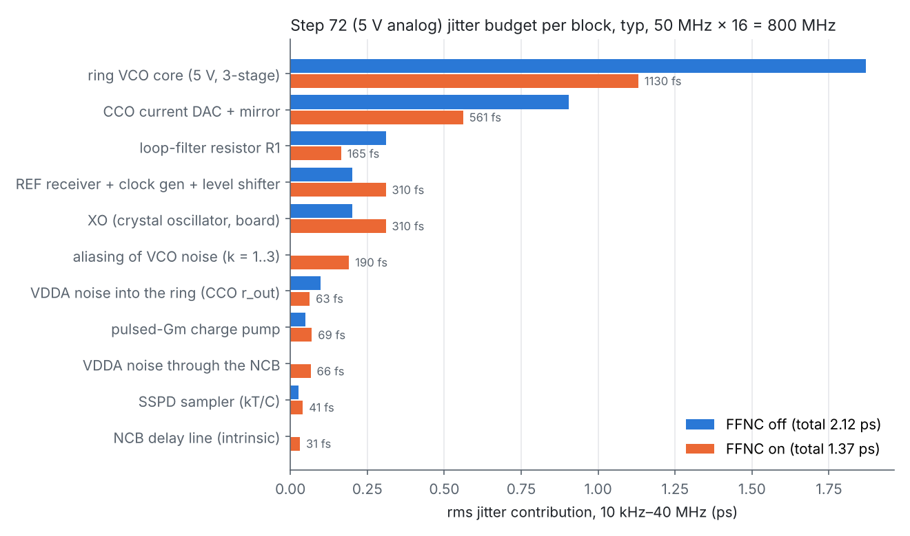
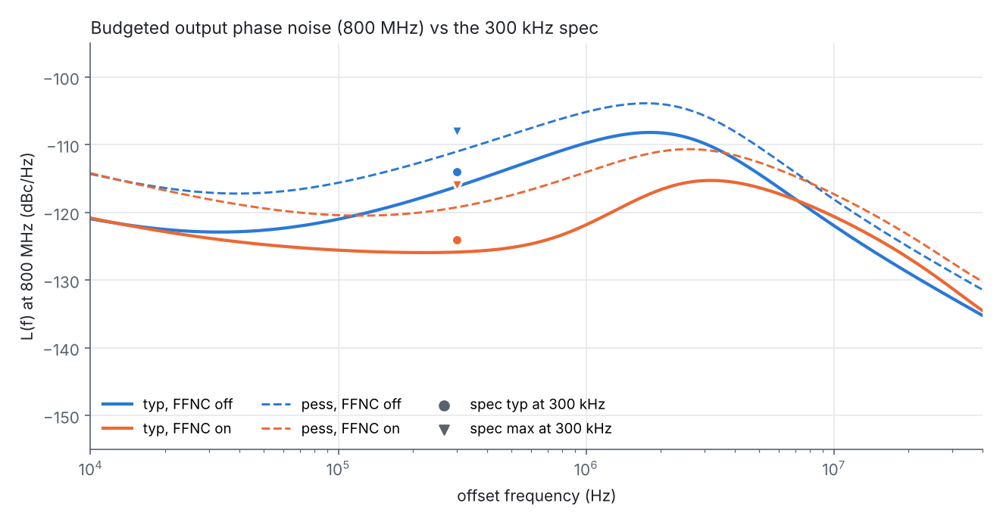

# Budget for 800 MHz with 5 V analog devices

*Phase 7, redone for the device-rule migration (18 Nov 2026).*

**Basis**
- 50 MHz × 16 = 800 MHz (720–880 MHz over a 45–55 MHz reference).
- Every analog block in `nfet/pfet_g5v0d10v5` on VDDA 3.3 V; logic in 1.8 V devices.
- 3-stage pseudo-differential ring (ring B) fed by the CCO.
- No LDO: the NCB and the buffers sit on VDDA.
- Loop: f_c = 2.5 MHz, PM 50°.

The 1.6 GHz budget (archived note, the archived 1.6 GHz budget script, SSPLL_Personal design/budget/) is kept unchanged for the record.

Reproduce everything on this page:

```bash
python3 design/feas/hv_noise.py             # device thermal / flicker noise, 5 V vs 1.8 V  -> design/feas/hv_noise.json
python3 design/budget/budget_hv.py   # all tables below -> design/budget/budget_hv.csv, budget_hv.json
python3 design/budget/budget_hv_plots.py    # docs/img/budget_hv_jitter_blocks.png, budget_hv_phase_noise.png
```

## Result in one paragraph

The migration costs no jitter. The budget closes at:

| Case | FFNC off | FFNC on |
|---|---|---|
| Typical | 2.12 ps | 1.37 ps |
| Pessimistic | 3.44 ps | 2.20 ps |

These are within 0.01 ps of the 1.6 GHz budget (2.11 / 1.36 ps typ).

The reason is that a ring's timing jitter depends on its power and figure of merit, not on its frequency. The ring and CCO keep the VCO/75 power (1.47 mA from 3.3 V, 4.86 mW). Their phase noise in dBc/Hz is 6 dB lower at half the carrier, and their jitter in seconds stays the same.

| | Typical | Total power |
|---|---|---|
| FFNC on | 1.37 ps, FoM −227.7 dB | 9.13 mW |
| FFNC off | 2.12 ps, FoM −224.6 dB | 7.67 mW |

Phase noise at 300 kHz is −116.2 dBc/Hz (FFNC off) and −125.8 dBc/Hz (on) typical; −111.0 / −119.2 pessimistic.

**What the budget changes for later steps**
- **Two VDDA terms replace the LDO term.** They set new block targets:
  - NCB supply sensitivity K_s ≤ 104 ps/V.
  - Ring pushing through the CCO K_vdd ≤ 5 MHz/V. This one matters: at 20 MHz/V with 300 nV/√Hz on VDDA, it adds 1.17 ps with FFNC off.
- **The proposal can keep the submitted maximum:** FFNC on 1.6 ps typ / 3.2 ps max.



## What happens, how, why

### What happens

**Same method as the first (1.6 GHz) budget.** Every block adds an independent timing error. The output jitter is the root-sum-square of all of them, each one shaped by its path to the output. The budget gives each block a number in its own units, which its design step must meet.

**What changed is the technology under the blocks.**
- 5 V (thick-oxide) transistors are about 5× slower (f_T 10.9 GHz vs 58 GHz at g_m/I_D = 10). Their noise is also different.
- The output frequency halves to 800 MHz.
- The regulated 1.8 V rail is gone.

### How it happens

**1. Frequency scaling of a ring.** For a ring, Hajimiri's and Abidi's results give, in the 1/f² region:

$$\mathcal{L}(\Delta f) \approx \frac{2kT}{P}\,\eta\,\frac{V_{DD}}{V_{char}}\left(\frac{f_0}{\Delta f}\right)^2
\quad\Rightarrow\quad \text{FoM} = \mathcal{L}(\Delta f) + 10\log\frac{P}{1\,\text{mW}} - 20\log\frac{f_0}{\Delta f}$$

At fixed P and FoM, L ∝ f₀². The timing jitter integrates L·(Δf)² over offset and divides by (2πf₀)², so f₀ cancels:

$$\sigma_t^2 = \frac{\int 2\cdot10^{\mathcal{L}/10}\,d\Delta f}{(2\pi f_0)^2} \propto \frac{f_0^2}{f_0^2}\cdot\frac{1}{P}$$

So every VCO-side allocation is written 20·log(1.6/0.8) = 6.02 dB lower in dBc/Hz than at 1.6 GHz. This covers the ring, the CCO and the NCB's own timing noise. The seconds are unchanged.

**2. Reference-side terms.**
- XO, receiver and the new level shifters scale by N² = 256 (it was 1024). In seconds they are unchanged: a reference edge error is a timing error.
- The SSPD gain per VCO radian A = slope/ω₀ doubles at half the carrier. A = 0.8 V/rad typ is assumed, against 0.51 V/rad measured at 1.6 GHz in the SSPD design. The kT/C and Gm terms therefore fall in rad², and they stay negligible.

**3. Raw VDDA.** Two paths replace "LDO noise through the NCB".
- *Through the NCB delay* (only when FFNC is on). It adds directly at the output:

$$S_\phi(f) = (2\pi f_0 K_s)^2\, S_{v,DD}(f)$$

- *Into the ring through the CCO's output impedance.* It is VCO-like: high-passed by the loop and cancelled by the FFNC like any VCO noise:

$$S_\phi(f) = \frac{K_{vdd}^2\, S_{v,DD}(f)}{f^2}\,\big|(1-G_c)(1-H)\big|^2$$

- The VDDA noise at the die is set by the board regulator plus on-chip decoupling: 100 nV/√Hz typ, 300 nV/√Hz pessimistic, with a 10 kHz 1/f corner.

### Why it happens this way

**Thick-oxide devices are slow but quiet.** `hv_noise.py` biases each device at g_m/I_D = 10, I_D = 100 µA and simulates its drain-current noise:

| Device | L (µm) | W (µm) | γ (thermal) | 1/f corner | v_n at 10 kHz |
|---|---|---|---|---|---|
| nfet_01v8 | 0.15 | 3.7 | 1.87 | 158 MHz | 367 nV/√Hz |
| nfet_01v8 | 0.50 | 10.4 | 2.09 | 20 MHz | 144 nV/√Hz |
| **nfet_g5v0d10v5** | 0.50 | 17.2 | **1.10** | 50 MHz | 189 nV/√Hz |
| **nfet_g5v0d10v5** | 1.00 | 50.3 | 1.46 | **2.5 MHz** | 59 nV/√Hz |
| pfet_01v8 | 0.15 | 19.1 | 1.22 | 1.0 MHz | 44 nV/√Hz |
| **pfet_g5v0d10v5** | 0.50 | 52.1 | **0.53** | 2.0 MHz | 30 nV/√Hz |
| **pfet_g5v0d10v5** | 1.00 | 114.6 | 0.55 | **0.2 MHz** | 12 nV/√Hz |

**Thermal noise.** Per unit g_m, the thermal current noise of the 5 V devices is 2.3 dB (nMOS) to 3.6 dB (pMOS) lower: long-channel γ instead of short-channel excess noise. That is why the typical case keeps the VCO FoM.

**Flicker noise.** Per unit gate area the 5 V nMOS is about 3× noisier, but at equal g_m it is wider and comes out quieter. Going to L = 1 µm cuts its corner 20×. The CCO mirror and the NCB current sources should use L ≥ 1 µm.

**The pessimistic case** covers a thick-oxide ring that misses the FoM by 3 dB with a 1.2 MHz 1/f³ corner.

**Supply terms.** A ring fed from a current source pushes only through the source's finite output impedance, so K_vdd can be small. A cascoded CCO at L ≥ 1 µm gives r_out > 100 kΩ, enough for 5 MHz/V.

## A. Jitter budget per block (10 kHz–40 MHz, f_REF = 50 MHz, 800 MHz out)

| Block | typ off (ps) | typ on (ps) | pess off (ps) | pess on (ps) |
|---|---|---|---|---|
| ring VCO core (5 V, 3-stage) | 1.869 | 1.130 | 2.896 | 1.757 |
| CCO current DAC + mirror | 0.904 | 0.561 | 1.346 | 0.844 |
| loop-filter resistor R1 | 0.311 | 0.165 | 0.311 | 0.176 |
| XO (crystal oscillator, board) | 0.202 | 0.310 | 0.210 | 0.277 |
| REF receiver + clock gen + level shifter | 0.202 | 0.310 | 0.333 | 0.439 |
| aliasing of VCO noise (k = 1..3) | — | 0.190 | — | 0.229 |
| VDDA noise into the ring (CCO r_out) | 0.098 | 0.063 | 1.174 | 0.770 |
| VDDA noise through the NCB | — | 0.066 | — | 0.228 |
| pulsed-Gm charge pump | 0.048 | 0.069 | 0.090 | 0.115 |
| SSPD sampler (kT/C) | 0.026 | 0.041 | 0.048 | 0.065 |
| NCB delay line (intrinsic) | — | 0.031 | — | 0.057 |
| **TOTAL** | **2.12** | **1.37** | **3.44** | **2.20** |

Over the reference range (ps, typ off / on | pess off / on):

| Reference | Output | Typical | Pessimistic |
|---|---|---|---|
| 45 MHz | 720 MHz | 2.13 / 1.45 | 3.50 / 2.34 |
| 50 MHz | 800 MHz | 2.12 / 1.37 | 3.44 / 2.20 |
| 55 MHz | 880 MHz | 2.11 / 1.29 | 3.40 / 2.08 |

**Loop at 800 MHz**

| Quantity | Value |
|---|---|
| Detector gain β | 1.60 µA/rad |
| R1 | 12.0 kΩ |
| C1 | 14.6 pF |
| C2 | 2.22 pF |
| Zero | 0.91 MHz |
| Pole | 6.87 MHz |
| K_VCO (fine) | 150 MHz/V, assumed; the VCO design sets it |

The filter capacitance scales with β·K_VCO; N cancels because the charge-pump current is 2πNβ. Here β is 1.6× and K_VCO 0.5× the 1.6 GHz values, so the capacitance falls to 0.8×: 16.8 pF instead of 21.0 pF. R1 rises from 9.6 kΩ to 12.0 kΩ. Its noise term barely changes, at 0.31 ps off.

## B. Phase noise at 300 kHz and 1 MHz (dBc/Hz at 800 MHz)

| | typ off | typ on | pess off | pess on |
|---|---|---|---|---|
| L(300 kHz) | −116.2 | −125.8 | −111.0 | −119.2 |
| L(1 MHz) | −109.7 | −121.8 | — | — |



## C. Block targets that come out of the budget (each block's design must meet these)

| Block | Typical target | Pessimistic limit | Designed in |
|---|---|---|---|
| Ring VCO core (5 V, 3-stage) | L(1 MHz) ≤ −104.4 dBc/Hz at 800 MHz (FoM −155.6 dB with the 4.86 mW CCO supply power); 1/f³ corner ≤ 0.6 MHz | −101.4 dBc/Hz, 1.2 MHz | VCO |
| CCO current DAC + mirror | L ≤ −110.2 dBc/Hz (i_n ≤ 7.2 pA/√Hz at 1 MHz, K_I = 0.61 GHz/A); flicker corner ≤ 0.3 MHz | −107.2 (10.1 pA/√Hz), 0.6 MHz | CCO |
| CCO output impedance → VDDA pushing | K_vdd ≤ 5 MHz/V | 20 MHz/V | VCO, CCO |
| REF receiver + clock gen + level shifters | floor ≤ −155 dBc/Hz at 50 MHz, corner ≤ 30 kHz | −151, 100 kHz | receiver, clock generator, SSPD |
| NCB intrinsic | ≤ −156 dBc/Hz at 800 MHz, corner ≤ 1 MHz | −152, 3 MHz | NCB |
| NCB VDDA sensitivity | K_s ≤ 104 ps/V | 120 ps/V | NCB |
| Board VDDA at the die | ≤ 100 nV/√Hz (10 kHz corner) | 300 nV/√Hz | test plan |
| SSPD | A ≥ 0.5 V/rad, C_s ≥ 35 fF | — | SSPD |

## D. Power budget (mW, P worst = I × 1.3 at 3.63 V / 1.89 V; ring from the VCO CCO limit)

| Block | Supply | I typ (mA) | P typ | P worst |
|---|---|---|---|---|
| ring VCO via CCO (1:8 mirror + DAC), 5 V devices | VDDA | 1.474 | 4.86 | 7.46 |
| ring output buffers (to SSPD, NCB, divider LS) | VDDA | 0.300 | 0.99 | 1.42 |
| SSPD (5 V sampler + dummy, shaping buffers) | VDDA | 0.150 | 0.49 | 0.71 |
| level shifters 1.8 ↔ 3.3 V | VDDA | 0.100 | 0.33 | 0.47 |
| pulsed-Gm charge pump | VDDA | 0.050 | 0.17 | 0.24 |
| FLL charge pump | VDDA | 0.020 | 0.07 | 0.09 |
| bias distribution | VDDA | 0.050 | 0.17 | 0.24 |
| NCB delay line | VDDA | 0.440 | 1.45 | 2.08 |
| REF receiver | VDDA | 0.061 | 0.20 | 0.29 |
| clock generator (1.8 V logic) | VDDD | 0.044 | 0.08 | 0.11 |
| /16 TSPC divider, PFD, FLL logic, decode | VDDD | 0.111 | 0.20 | 0.27 |
| output divider ÷1–÷16 + glitch-free mux | VDDD | 0.067 | 0.12 | 0.16 |
| **TOTAL, FFNC on / off** | | | **9.13 / 7.67** | **13.53 / 11.45** |

- **What went:** the LDO (0.48 mW).
- **What came in:**
  - level shifters (0.33 mW)
  - the output divider (0.12 mW)
  - the SSPD measured in 0.47 mW, above its old 0.40 mW allocation
- **Net:** the total is unchanged at about 9 mW.

## E. Area budget (µm²)

| Block | Area (µm²) |
|---|---|
| ring VCO (3-stage, 5 V) | 4 000 |
| CCO DAC + mirror | 6 000 |
| SSPD, REF receiver, pulser | 4 000 |
| level shifters | 1 000 |
| pulsed-Gm CP + loop filter | 5 000 |
| FLL | 3 000 |
| NCB (5 V) | 4 000 |
| output divider + mux | 1 000 |
| dividers, bias, control, pad interface | 4 000 |
| decoupling | 15 000 |
| routing / guard rings | 13 000 |
| **Total** | **60 000 (0.060 mm²)** |

5 V devices need wider spacing and guard rings. The LDO's 4 000 µm² is gone. The proposal keeps 0.10 mm² typ / 0.15 mm² max, for margin.

## F. Sensitivity: which allocations are critical

Effect of each block being 3 dB worse (total ps, typ, off / on):

| Block | off / on |
|---|---|
| ring | 2.83 / 1.77 |
| CCO | 2.31 / 1.48 |
| XO or REF | 2.13 / 1.40 |
| R1 | 2.14 / 1.38 |
| each of the others | ≤ 0.02 ps change |

As before, the ring is the whole budget. The FFNC exists to cancel it.

## G. Findings and decisions

1. **800 MHz in 5 V devices costs no jitter.** Jitter is 2.12 / 1.37 ps typ against 2.11 / 1.36 ps at 1.6 GHz, at the same 9.1 mW. This holds if the ring reaches the VCO FoM. The γ data say this is realistic; the pessimistic case covers 3 dB less.
2. **New targets from removing the LDO:**
   - K_vdd ≤ 5 MHz/V (CCO cascoded, L ≥ 1 µm).
   - K_s ≤ 104 ps/V for the NCB.
   - A clean board regulator on VDDA (≤ 100 nV/√Hz) goes into the test plan.
3. **Long-channel current sources:** L ≥ 1 µm for the CCO mirror, the NCB current sources and the Gm tail. In the 5 V devices this cuts the 1/f corner 20× (nMOS) to 10× (pMOS).
4. **Proposal targets from this budget:**

   | Parameter | Typical | Maximum | Budget |
   |---|---|---|---|
   | Jitter, FFNC on | 1.6 ps | 3.2 ps | 1.37 / 2.20 |
   | Jitter, FFNC off | 2.6 ps | 5.0 ps | 2.12 / 3.44 |
   | L(300 kHz), FFNC on | −124 dBc/Hz | −116 dBc/Hz | −125.8 / −119.2 |
   | L(300 kHz), FFNC off | −114 dBc/Hz | −108 dBc/Hz | −116.2 / −111.0 |
   | Power | about 9 mW | 15 mW | |
   | FoM | −226.3 dB | | 1.6 ps at 9.1 mW |

   The "Budget" column is typical / pessimistic. The typical targets hold even if the 5 V ring misses the VCO FoM by 2 dB (1.62 / 2.56 ps). The maxima hold at a 6 dB miss (2.40 / 3.86 ps) and leave room for PVT corners beyond the pessimistic case.

## Interview questions (answers in the learning notebook, phase 7)

1. Why is a ring's timing jitter independent of its frequency at fixed power and FoM, while its phase noise in dBc/Hz is not?
2. Why does the reference-side noise get 6 dB less N² amplification at N = 16, but contribute the same jitter in seconds?
3. Thick-oxide devices are 5× slower. Why can they still give the same or better ring phase noise per milliwatt?
4. What does γ = 1.1 vs 1.87 mean physically, and why do short-channel devices have higher γ?
5. Why does supply noise through the NCB add directly at the output, while supply noise into the ring is cancelled by the FFNC?
6. How would you measure K_vdd and K_s in simulation, and why must K_vdd be small even though the loop high-passes it?
7. Why does going from L = 0.5 µm to 1 µm cut the 5 V nMOS 1/f corner by 20× when the gate area grows only 6×?
8. Why does A per VCO radian double at half the carrier, and what does that do to the SSPD kT/C contribution?
