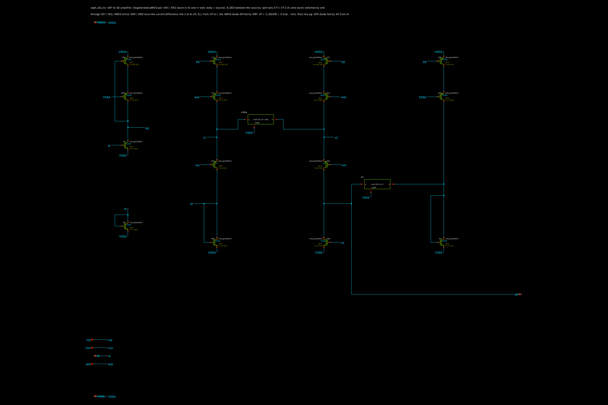
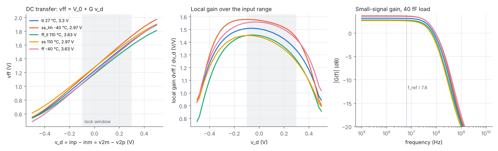
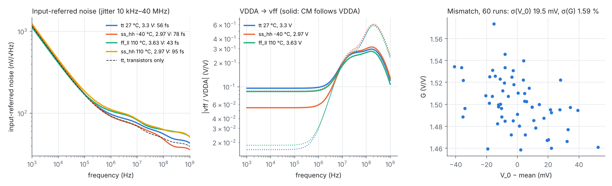
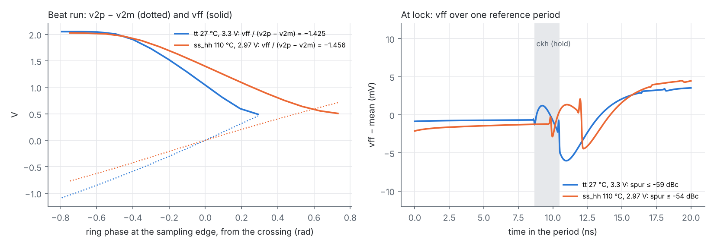
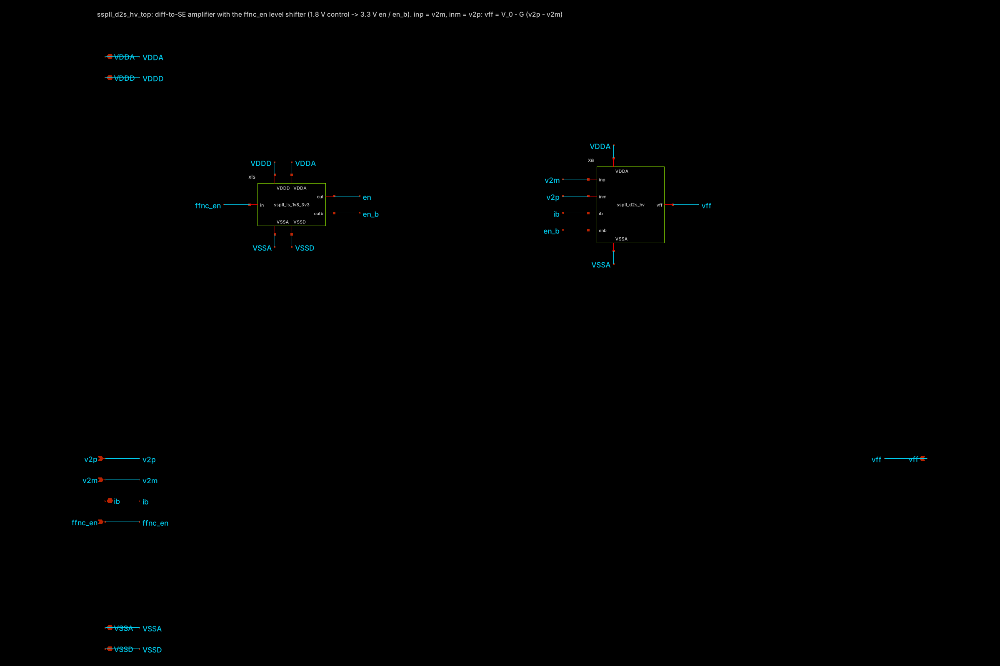

# The differential-to-single-ended amplifier (D2S) between the SSPD and the NCB

*Phase 7 (26 Nov 2026).* Deliverable: the amplifier that turns the SSPD's held differential sample v2p − v2m into
the single control voltage vff of the noise-cancellation block (NCB), in 5 V devices on VDDA, verified over PVT, with
schematic (xschem, hierarchical, LVS-clean) and sizing table. Design files `design/d2s/d2s_hv.py`, `d2s_hv_sim.py`,
`d2s_hv_system.py`, `d2s_hv_plots.py`, `schematics_hv.py`; schematics `xschem/d2s_hv/`; data
`design/d2s/data/d2s_hv_*.json`; methods M28, M29, M30 (new) and M9, M18, M19, M21 (explained in `docs/testbench_guide.md`).

Reproduce (in `design/d2s`):

```bash
python3 d2s_hv_sim.py A B C D F G   # DC transfer, AC + input capacitance, noise, VDDA / CM, mismatch, enable (M28-M30, M21)
python3 d2s_hv_sim.py E H           # whole path: SSPD + clock generator + D2S, beat run and at lock (M18, M19)
python3 d2s_hv_system.py            # system jitter with the D2S pole, noise and gain drift (M9)
python3 d2s_hv_plots.py             # docs/img/d2s_hv_*.png
python3 schematics_hv.py            # xschem/d2s_hv/*, drawing checks, LVS reference (M5)
cd ../.. && python3 tools/lvs_hv_all.py                                               # M4, every block
```

## Result in one paragraph

A **degenerated pMOS pair** (8/1 µm, each device in its own n-well tied to its source) with **R_DEG = 2 × 20 kΩ**
between the sources and **8 µA split tails** feeds an **nMOS current mirror**, which delivers 2·Δi to vff. vff sees
**R_L = 2 × 20 kΩ** to node r, which is the drain of an **nMOS diode (2/1 µm) fed by about 20 µA**. With no input, no
current flows in R_L and vff rests at V_GS of that diode: **V_0 = 1.23 V** at tt (1.13–1.34 V over 15 conditions).
This level follows the nMOS threshold, so the NCB's input device, a replica of that diode, carries the same current at
every corner. The gain is **G = 2 (R_L + 1/g_m,r)/(R_DEG + 2/g_m) = 1.50** at tt (1.44–1.57; ≥ 1.25 anywhere in the
lock window); it was raised from 1.10 in the NCB design so that the delay line needs less gain. It holds over
+0.25 / −0.30 V of input at every corner (the lock point needs +0.14…+0.23 V) and moves **±3.3 %** from −40 to 110 °C.
The small-signal **f_3dB is 79 MHz with 40 fF** (67–84 MHz) and **188 MHz with the real NCB load** (5.6 fF + wiring,
15 fF). The input capacitance is **6.1 / 7.0 fF**, so the SSPD's C2 shrank from 34.6 to 32.2 fF. Noise adds **56 fs** at
the output (43–95 fs), and VDDA moves the output timing by **15–32 ps/V** (allocation 52 ps/V); its ripple at lock is a reference spur of at most -54 dBc. Mismatch
gives σ(V_0) = 19.5 mV and σ(G) = 1.6 % (60 runs). It draws **41 µA, 0.14 mW**. `ffnc_en = 0` holds vff at V_0, which
is FFNC off at the same NCB operating point. System, FFNC on with the D2S alone: **1.34 → 1.40 ps** typ with the
budget's cancellation model, **1.24 ps** with the real hold of this SSPD (D2S and NCB together: `ncb_hv.md`, section F).



## What happens, how, why

### What happens
After every reference edge the SSPD shares its fresh sample onto C2. Until the next edge, v2p − v2m is a held
voltage proportional to the ring's timing error, about 8.2 mV per ps. The NCB is a delay line whose delay is set
by one voltage. The D2S makes that voltage, vff = V_0 − G·(v2p − v2m), so that a late ring edge shortens the NCB
delay by exactly the lateness. The cancellation needs the whole chain's gain to be one:

$$G\cdot K_{d}\cdot K_{t}=1,\qquad K_t = 2\,\frac{dv}{dt}\Big|_{cross}= 8.17\ \text{mV/ps (tt)},\qquad
K_d=\frac{1}{G K_t}= 81\ \text{ps/V at tt}$$

K_d (s/V) is the NCB's delay gain; its 4-bit capacitor bank calibrates the product. The D2S therefore does not need
an exact G. It needs a G that is steady (temperature, input level), a clean and fast path, and a vff whose rest level
suits the NCB.

### How it happens
- **Degenerated pair.** A small input v_d splits as ±v_d/2 on the gates. Each source follows its gate through the
  device's 1/g_m, and the voltage left across R_DEG drives a current Δi = v_d/(R_DEG + 2/g_m) from one side to the
  other. With R_DEG much larger than 2/g_m, the transconductance is set by a resistor.
- **No body effect.** Each input pMOS sits in its own n-well tied to its source, so the source can follow the gate
  without raising V_T. (Section A shows what the body effect did to an nMOS pair.)
- **Mirror.** MN1's current (I_T + Δi) is copied to vff by the nMOS mirror. MN2 delivers I_T − Δi into the same node.
  The difference, 2Δi, is the only current left for R_L. The two tails' common noise cancels here.
- **Output level without DC current.** R_L returns to node r, the drain of the diode-connected nMOS XR fed by ~20 µA.
  At v_d = 0 the mirror balances, R_L carries nothing, and vff = V_r = V_GS(XR). The signal current sees R_L plus the
  diode's 1/g_m,r (11.7 kΩ):

$$G = \frac{2\,(R_L + 1/g_{m,r})}{R_{DEG} + 2/g_m} = \frac{2\,(40.0 + 11.7)\,\text{k}\Omega}{(40.0 + 27.2)\,\text{k}\Omega} = 1.54\quad(\text{simulated } 1.50)$$

- **Enable.** en_b drives series pMOS switches in the tails. With the tails off, the mirror carries nothing and
  vff = V_r. The NCB keeps its operating point, so out2 is a delayed out1: the "FFNC off" measurement.

### Why it happens this way
- **Why a gate input:** C2 holds the sample for a whole period. A resistive input would discharge it; a gate draws no
  current, and its capacitance becomes part of C2 (sized for it).
- **Why the output level is a V_GS and not I·R:** a level made as I_0·R_L carries the relative noise of the bias current
  times the full 1.5 V (section C); a V_GS carries it times V_ov/2 ≈ 0.1 V. It also tracks the nMOS threshold, which
  is what an nMOS-starved NCB needs, and it costs no current in R_L.
- **Why the bandwidth matters:** the D2S sits inside the cancellation path. Every bit of delay there turns the
  cancellation into a partial one at the upper end of its band (section E).

## A. Requirements and the topologies that failed first

| Requirement | Where it comes from | Target |
|---|---|---|
| Input load per side | it is part of the SSPD hold node (α, kT/C) | ≈ 4 fF, or resize C2 |
| Input window | lock point 2A·(74…129 mrad) = +0.14…+0.23 V (v_d = v2m − v2p), ±0.05 V signal | −0.10…+0.30 V with G within ±10 % |
| Gain stability | the NCB is calibrated once; drift becomes the cancellation gain error | spread ≤ ±15 %, drift ≤ ±5 % |
| f_3dB (40 fF load) | its phase lag eats cancellation (section E) | ≥ 50 MHz tt |
| Noise | added directly at the output when FFNC is on | ≤ 100 fs typ, ≤ 150 fs worst |
| VDDA → output timing | half of the NCB's K_s ≤ 104 ps/V | ≤ 52 ps/V |
| Output | NCB control: gate input (no DC current), ≤ 40 fF | V_0 at an nMOS V_GS, ±0.3 V swing |
| Power | NCB allocation 1.45 mW for D2S + delay line | ≤ 0.15 mW |

**First try: nMOS pair, pMOS mirror, R_L to VSSA, a pMOS source I_0 for the output level.**
- **Body effect.** G stayed at 0.74–0.81 however wide the pair was. The 5 V nMOS has a thick oxide, so its body
  factor is large (η ≈ 0.5 with the sources at 0.5–1 V). When the source follows the gate, V_T rises with it, and the
  degenerated transconductance tends to 1/((1 + η)·R_DEG/2) instead of 2/R_DEG. η itself moves with V_SB and process.
- **Slow.** The 19-unit I_0 source put about 45 fF of drain on vff: f_3dB was 40 MHz.
- **Noisy.** A gate filter (0.5 MΩ, 1.15 pF) on the I_0 source made it worse: below its 276 kHz corner the resistor's
  91 nV/√Hz reaches the gate unfiltered, and the source's g_m·R_L ≈ 11 multiplies it. The output had 1 µV/√Hz at 100 kHz.

**Second try: pMOS pair (body = source), still I_0·R_L.** G rose to 0.85 and became steady. The noise floor remained:
V_0 = I_0·R_L carries V_0·(δI/I) of the 2 µA reference, about 260 nV/√Hz. At ss −40 °C, 2.97 V the tails ran with
0.16 V across them: in triode.

**Final: R_L to a diode, weak-inversion tail units.** It is quieter (70 fs instead of 111 fs), the power is 38 µA
instead of 56 µA, and V_0 is a replica level. That version had G = 1.10 with 6 µA tails, R_DEG = 3 × 20 kΩ and 8/2 µm
bias units.

**Gain raised to 1.5 for the NCB.** The delay line then needed up to 195 ps/V at the slow corners, more than it can
give at 800 MHz. Only G·K_d matters, so the D2S took more of it: R_DEG = 2 × 20 kΩ and 8 µA tails. A first attempt with
12 µA tails (G 1.6) put the high-side tail into triode at ss_hh −40 °C, 2.97 V with the lock-point input, and the input
common mode then reached vff with a gain of 0.8. With 8 µA tails and 16/2 µm bias units (weak inversion, lower
V_SD,sat) it is 0.10. The level source uses 8/1 µm units (same W/L as 16/2, half the drain capacitance on r), 7 of them.

## B. DC transfer over PVT (method M28)

15 conditions: 5 MOS × R/C corner sections, −40 / 27 / 110 °C, VDDA 2.97 / 3.3 / 3.63 V. The input common mode is
the SSPD's measured sampled CM at that condition (1.43–1.90 V).

| Condition | V_0 (V) | G at 0 | G in window | ±10 % range (V) | vff in window (V) | I (µA) |
|---|---|---|---|---|---|---|
| tt 27 °C, 3.3 V | 1.226 | 1.505 | 1.34–1.51 | -0.335 / +0.280 | 1.08–1.66 | 41.2 |
| tt 27 °C, 2.97 V | 1.221 | 1.500 | 1.32–1.51 | -0.335 / +0.275 | 1.07–1.65 | 40.5 |
| tt 27 °C, 3.63 V | 1.230 | 1.510 | 1.35–1.51 | -0.340 / +0.290 | 1.08–1.67 | 41.8 |
| tt -40 °C, 3.3 V | 1.233 | 1.552 | 1.41–1.55 | -0.340 / +0.305 | 1.08–1.68 | 40.8 |
| tt 110 °C, 3.3 V | 1.227 | 1.455 | 1.27–1.46 | -0.325 / +0.260 | 1.08–1.64 | 42.1 |
| ss_hh 110 °C, 2.97 V | 1.278 | 1.453 | 1.27–1.46 | -0.350 / +0.260 | 1.13–1.69 | 40.5 |
| ss_hh -40 °C, 2.97 V | 1.275 | 1.572 | 1.43–1.58 | -0.350 / +0.310 | 1.12–1.73 | 38.5 |
| ff_ll -40 °C, 3.63 V | 1.195 | 1.547 | 1.40–1.55 | -0.320 / +0.305 | 1.04–1.64 | 43.6 |
| ff_ll 110 °C, 3.63 V | 1.181 | 1.452 | 1.26–1.46 | -0.305 / +0.255 | 1.04–1.60 | 44.2 |
| ss 110 °C, 2.97 V | 1.278 | 1.442 | 1.25–1.45 | -0.350 / +0.250 | 1.13–1.69 | 40.5 |
| ff -40 °C, 3.63 V | 1.195 | 1.558 | 1.42–1.56 | -0.330 / +0.315 | 1.04–1.65 | 43.6 |
| sf 27 °C, 3.3 V | 1.127 | 1.464 | 1.31–1.47 | -0.335 / +0.285 | 0.98–1.55 | 39.4 |
| fs 27 °C, 3.3 V | 1.335 | 1.537 | 1.36–1.54 | -0.335 / +0.280 | 1.18–1.78 | 43.3 |
| hl 27 °C, 3.3 V | 1.226 | 1.515 | 1.36–1.52 | -0.340 / +0.290 | 1.07–1.66 | 41.1 |
| lh 27 °C, 3.3 V | 1.226 | 1.493 | 1.31–1.50 | -0.330 / +0.270 | 1.08–1.65 | 41.2 |

**G spread 1.44–1.57 (±4 %), drift with temperature at tt ±3.3 %, window ≥ 1.25.** V_0 follows the nMOS threshold:
lowest at sf / ff (fast nMOS), highest at fs / ss.



## C. Noise (method M29)

`.noise` of the core, input = one differential source, resistors replaced by ideal ones of the same value (the PDK poly
resistors are noiseless in ngspice). Input-referred spectrum → output timing through the calibrated chain:
S_t(f) = S_v,in(f)/K_t², then integrated from 10 kHz to 40 MHz.

| Condition | white (20 MHz) | at 1 MHz | 1/f corner | jitter added |
|---|---|---|---|---|
| tt 27 °C, 3.3 V | 68 nV/√Hz | 97 nV/√Hz | 1.0 MHz | **56 fs** |
| ss_hh -40 °C, 2.97 V | 63 nV/√Hz | 92 nV/√Hz | 1.1 MHz | 78 fs |
| ff_ll 110 °C, 3.63 V | 72 nV/√Hz | 106 nV/√Hz | 1.6 MHz | 43 fs |
| ss_hh 110 °C, 2.97 V | 74 nV/√Hz | 111 nV/√Hz | 1.6 MHz | 95 fs |

(K_t differs per condition: the same voltage noise is more time at a slow, small-A corner.) As a phase noise at
800 MHz it is -147.5 dBc/Hz at 1 MHz (tt). Below 1 MHz the tail-unit and mirror flicker dominate; above, R_DEG,
R_L and the mirror. Added in quadrature to 1.4 ps, 56 fs is +0.001 ps.

## D. VDDA, common mode, mismatch, enable (methods M21, M30, M28)

| Condition | VDDA → vff, CM fixed (LF / max ≤ 40 MHz) | CM following VDDA (LF / max) | CM → vff (LF) | K_s = max / (G K_t) |
|---|---|---|---|---|
| tt 27 °C, 3.3 V | 0.016 / 0.302 | 0.096 / 0.269 | 0.002 | **21.9 ps/V** |
| ss_hh -40 °C, 2.97 V | 0.088 / 0.317 | 0.054 / 0.278 | 0.105 | 32.4 ps/V |
| ff_ll 110 °C, 3.63 V | 0.018 / 0.287 | 0.087 / 0.248 | 0.001 | 15.0 ps/V |

The low-frequency rejection is good. The rise above 3 MHz is capacitive: the drain–n-well junctions of the level
source (well = VDDA) inject into node r, whose impedance is 11.7 kΩ. A 0.57 pF capacitor on r cut K_s by a quarter, but
it shorts the 1/g_m,r part of G above ~30 MHz: a gain step inside the band where the cancellation works, so it was
left out (`NCR = 0`). At ss_hh −40 °C a common-mode step alone reaches vff with 0.10 (the tails have the least
headroom there); with the CM following VDDA, as the SSPD's does, it is 0.05.

**Mismatch** (mc_mm_switch = 1, 60 runs, tt): σ(V_0) = **19.5 mV**, σ(G) = **1.59 %**. The
offset only moves the NCB's operating point; calibration absorbs the gain.

**Enable:** with ffnc_en = 0 vff = V_0 within 1.1 mV, flat against the input; the current
falls from 41 to 26 µA (the bias and the level source stay on).



## E. In the system (method M9)

The D2S pole multiplies the cancellation transfer G_c(f). With the budget's cancellation model (Nagam's: −60° at
f_ref/7.8), and with the hold this SSPD actually has (first-order memory, α = 0.451, v2[k] = (1 − α)v1[k] + αv2[k−1]):

| Cancellation path | no D2S pole | pole at tt (79 MHz, 40 fF) | slowest (67 MHz) |
|---|---|---|---|
| budget model, FFNC on typ / pess | 1.342 / 2.158 ps | 1.399 / 2.216 ps | 1.408 / 2.226 ps |
| real hold (α = 0.451), typ / pess | 1.178 / 1.984 ps | 1.240 / 2.052 ps | 1.251 / 2.064 ps |

**The budget model was pessimistic.** At f_ref/7.8 the real hold lags 25.3°, the model's pole 36.9°: 11.6° of slack,
more than the D2S's 5–6°. With the D2S noise added in quadrature: **1.40 / 2.22 ps** (model). These use the
40 fF load; with the real NCB load the pole is at 188 MHz and costs less. A pole at 40 MHz would have cost 0.10 ps in
the model, which is why f_3dB ≥ 50 MHz is the requirement. The NCB's own control pole is the next item in the same
path (`ncb_hv.md`, section F).

**Gain drift.** In the model the FFNC-on jitter is 1.378 / 1.364 / 1.342 ps at a gain error of 0 / 3.3 / 10 %. The
cancellation over-shoots slightly above f_ref/7.8, so a few per cent less gain does no harm. The D2S's ±3.3 % drift
is far below the 10 % calibration resolution the budget allows.

## F. Whole path: SSPD + D2S in one run (method M18)

**Beat run (part E).** The SSPD bench with the D2S core on v2 instead of the 4 fF placeholder (C2 already 3.85 µm):
the ring runs at (16 + 1/64)·f_ref, so the sampling phase walks 2π/64 per period. Read just before each new hold:

| Condition | slope of v2p − v2m (V/rad) | 2A (SSPD design) | slope of vff (V/rad) | gain of the path |
|---|---|---|---|---|
| tt 27 °C, 3.3 V | 1.541 | 1.621 | -2.196 | 1.425 |
| ss_hh 110 °C, 2.97 V | 1.032 | 1.071 | -1.502 | 1.456 |

The path gain is close to the D2S's own gain over the same ±0.35 rad span (1.50 / 1.45 at the crossing, lower toward
the ends): the D2S behaves the same with the real hold in front of it. The v2 slope is 95–96 % of 2A because the fit
spans ±0.35 rad of the sine-like characteristic.

**At lock (part H).** Ring at exactly 16·f_ref, sampling phase set so that v2p − v2m is at the lock side of the crossing
(-274 / -204 mV). Over one period vff moves 33 / 48 mV p-p: a dip while the hold switch
shares C1 onto C2, recovering in about 5 ns, plus the last of the hold's settling (8 periods simulated). Its f_ref
component, 5.2 / 6.5 mV, moves the calibrated NCB delay by a1/(G K_t) = 424 fs, a reference spur of at most
**-59 / -54 dBc** (proposal limit −45 dBc). It is an upper bound: the settling trend is counted in it.



## G. Schematics (hierarchical, real wiring, LVS-clean)

- `sspll_d2s_hv_rdeg`, `sspll_d2s_hv_rl`: the resistor strings drawn as their layout meander, a dummy at each end.
- `sspll_d2s_hv`: bias column (XB, XK, XPD, XPDS), pair column (tails XT, switches XE, pair XN, mirror XM, R_DEG),
  output-level column (XRP, XRS, diode XR, R_L).
- `sspll_d2s_hv_top`: level shifter `sspll_ls_1v8_3v3` (from the CCO design) for ffnc_en, the core with inp = v2m,
  inm = v2p.

`python3 tools/lvs_hv_all.py`: all 51 cells of the ten blocks match (the four D2S cells and the SSPD with its new C2).



## H. Sizing table (all devices pass `tools/pdk_limits.py`)

| Device | Model | W / L (µm) | m | Role |
|---|---|---|---|---|
| XN1, XN2 | pfet_g5v0d10v5 | 8 / 1.0 | 1 | input pair, each in its own n-well (body = source) |
| XT1, XT2 | pfet_g5v0d10v5 | 16 / 2.0 | 4 | tails, 4 × 2 µA |
| XE1, XE2 | pfet_g5v0d10v5 | 2 / 0.5 | 4 | tail switches (en_b) |
| XM1, XM2 | nfet_g5v0d10v5 | 2 / 2.0 | 1 | mirror |
| XR | nfet_g5v0d10v5 | 2 / 1.0 | 1 | output-level diode (~20 µA) |
| XRP / XRS | pfet_g5v0d10v5 | 8 / 1.0, 2 / 0.5 | 7 | level source and its always-on switch copy |
| XPD / XPDS | pfet_g5v0d10v5 | 16 / 2.0, 2 / 0.5 | 2 | bias diode (line pg) |
| XK, XB | nfet_g5v0d10v5 | 1 / 8.0 | 2, 1 | from ib (2 µA unit) |
| R_DEG | res_xhigh_po_0p69 | L 6.76 | 2 in series | 40.0 kΩ, + 2 dummies |
| R_L | res_xhigh_po_0p69 | L 6.76 | 2 in series | 40.0 kΩ, + 2 dummies |
| level shifter | (CCO design) | — | 1 | ffnc_en → en / en_b |

Estimated area about 60 × 50 µm.

## I. Layout guidance

- XN1 / XN2 in two separate n-wells, common-centroid with the tails; each well tied to its source. Keep the wells
  small: their capacitance to the substrate sits on s1 / s2.
- R_DEG and R_L from one row of identical 0.69 × 6.76 µm units with dummies at both ends: G is a ratio of them.
- Keep v2p / v2m short and shielded from the SSPD to the gates (they are hold nodes); route them symmetric, since
  their capacitance is part of C2.
- XR next to the NCB's input device XI (same geometry and orientation): XI is its replica.

## J. Requirements handed on

1. **NCB:** control input vff, gate only (no DC current); the NCB design measured 5.6 fF. Rest level 1.13–1.34 V
   (V_GS of a 2/1 µm 5 V nMOS at ~20 µA), swing −0.16…+0.46 V around it over the lock window. Delay gain
   K_d = 1/(G K_t): 81 ps/V at tt; the NCB design checks the calibration per corner section. The NCB's control pole is
   in the same path: keep it ≥ 50 MHz as well.
2. **SSPD:** C2 = 3.85 × 3.85 µm (done here).
3. **Bias design:** ib = 2 µA; vff does not depend on its absolute value (only through V_GS(XR)).
4. **Control:** ffnc_en (1.8 V) off holds vff at V_0.

## K. Problems met and how they were solved

| Problem | Cause | Fix |
|---|---|---|
| G stuck at 0.74–0.81 (nMOS pair) | thick-oxide body effect: the degenerated pair gives 1/((1 + η) R_DEG/2) | pMOS pair, each in its own n-well tied to its source |
| f_3dB 40 MHz | 19-unit level source drain on vff | level source removed (R_L to a diode) |
| 1 µV/√Hz at 100 kHz | gate-filter resistor noise below the filter corner, × g_m R_L ≈ 11 | filter removed; then the level made as V_GS, not I·R |
| V_0 noise 260 nV/√Hz (I_0·R_L) | V_0 carries the bias current's relative noise × 1.5 V | R_L to an nMOS diode: × V_ov/2 instead |
| tails in triode at ss −40 °C, 2.97 V | |V_T,p| ≈ 1.2 V cold: 0.16 V left for the tail | 8/2 µm tail units near weak inversion |
| NCB needed up to 195 ps/V | G = 1.10 | G = 1.50: R_DEG 2 units, 8 µA tails |
| CM → vff 0.8 at ss_hh −40 °C with 12 µA tails | the high-side tail in triode at the lock-point input | 8 µA tails, 16/2 µm bias units: 0.10 |
| VDDA coupling 0.25–0.28 above 3 MHz | drain–well junctions of the level source into r | accepted (≤ 32 ps/V); a cap on r would put a gain step in-band |
| noise analysis aborted | ngspice's KLU does not support noise | `option sparse` |
| whole-path bench: no crossing / bad fit | 32 beat points (0.2 rad apart) and a one-sided search | 64 points, either crossing direction, fit ±0.35 rad |

## Testbenches

See `docs/testbench_guide.md`, "Diff-to-SE amplifier benches (M28–M30, M18)".

## Interview questions (diff-to-SE amplifier design)

**1. Why does a feed-forward noise canceller need a differential-to-single-ended stage at all?**

*Short answer.* The SSPD's output is differential, and the delay line is steered by one voltage.

*In detail.* The SSPD is differential to cancel clock feed-through and charge injection and to lock at the ring's crossing. The D2S takes the difference and rejects the common mode, which carries the hold's ripple and VDDA.

**2. The chain gain must be one. Why can the D2S have G = 1.5 instead of exactly 1?**

*Short answer.* Only the product G·K_d·K_t matters, and the NCB's capacitor bank calibrates it after fabrication.

*In detail.* What the D2S must guarantee is a G that does not move after the calibration: with temperature (±3.3 %), with the input level (≥ 1.25 in the window) and with supply. Its value was even raised from 1.1 to 1.5 to take gain off the NCB.

**3. Derive the gain of the degenerated pair with a mirror and the diode load.**

*Short answer.* Δi = v_d/(R_DEG + 2/g_m); the mirror makes 2Δi; vff − V_r = 2Δi·R_L and V_r moves by 2Δi/g_m,r, so G = 2(R_L + 1/g_m,r)/(R_DEG + 2/g_m) = 2(40 + 11.7)/(40 + 27.2) = 1.54 with the tt values (simulated 1.50).

**4. What did the body effect do to the nMOS pair, and why is it worse in thick-oxide devices?**

*Short answer.* With the source following the gate, V_T rises by η·Δv_s, so the current is g_m v_gs − g_mb v_s and the degenerated transconductance saturates at 1/((1 + η)R/2). η = γ/(2√(2φ_F + V_SB)) and γ ∝ 1/C_ox: a thick oxide gives a large γ.

*In detail.* Here η ≈ 0.5, and it varies with V_SB.

**5. How does putting each pMOS in its own n-well remove it, and what does it cost?**

*Short answer.* Body = source means V_SB = 0 at all times.

*In detail.* The cost: two wells instead of one, n-well spacing in the layout, and the well-to-substrate capacitance on s1 / s2.

**6. Why is the output level made as V_GS of a diode instead of I_0·R_L?**

*Short answer.* Noise:

*In detail.* I·R carries (δI/I)·V_0, a V_GS carries (δI/I)·V_ov/2, 10–15 × less. Power: no DC current in R_L. Function: the level tracks the nMOS threshold, so an nMOS-starved NCB biased by vff gets the same current at every corner.

**7. The RC filter on the bias gate made the noise worse. Explain.**

*Short answer.* An RC low-pass filters what comes in, but its own resistor adds 4kTR at the gate.

*In detail.* Below the corner nothing filters that. 0.5 MΩ is 91 nV/√Hz, five times the diode's own noise, and the current source's g_m·R_L ≈ 11 amplified it.

**8. Why does the tail noise not reach the output?**

*Short answer.* Both tails are biased from one line, so their bias noise is a common-mode current.

*In detail.* MN1's share returns through the mirror, MN2's subtracts directly at vff: it cancels to the extent the mirror and the devices match.

**9. How was the bandwidth requirement of 50 MHz derived?**

*Short answer.* The D2S is in the cancellation path G_c.

*In detail.* A pole at f_p adds atan(f/f_p) of lag, which turns cancellation into partial cancellation at the top of the band. The system model gave +0.046 / +0.06 / +0.10 ps (FFNC on) for poles at 100 / 70 / 40 MHz. 50 MHz keeps the cost below about 0.08 ps.

**10. The real hold has less phase lag than the budget model. How do you know, and why does it matter?**

*Short answer.* The hold is v2[k] = (1 − α)v1[k] + αv2[k−1].

*In detail.* At f_ref/7.8 that is −25.3°, against −36.9° for the model's pole. The 11.6° of slack absorbs the D2S's 5–6°, so the system with the real hold (1.24 ps) is better than the budget even with the D2S in place.

**11. How is the amplifier's voltage noise turned into jitter?**

*Short answer.* The calibrated chain turns a voltage at the D2S input into time with 1/K_t.

*In detail.* So S_t(f) = S_v,in(f)/K_t², integrated over the jitter band; it adds at the output with transfer one (it is not in the loop).

**12. Why does VDDA reach vff at high frequency although the bias is supply-independent?**

*Short answer.* Capacitance: the level source's drain–n-well junctions (well = VDDA) inject into node r, whose impedance is 11.7 kΩ.

*In detail.* Above a few MHz that capacitive divider, not the bias, sets the rejection: 0.25–0.28 V/V, i.e. 15–32 ps/V of output timing.

**13. Why not put a large capacitor on r to fix that?**

*Short answer.* It shorts 1/g_m,r above g_m,r/(2πC) ≈ 30 MHz.

*In detail.* G then has one value at low frequency (where calibration happens) and another at the top of the cancellation band: a frequency-dependent gain error.

**14. What does ffnc_en do, and why keep vff at V_0 instead of letting it drift?**

*Short answer.* It switches the tails off. vff becomes V_r, the same rest level as in operation, so the NCB delay is unchanged and out2 differs from out1 only by the cancellation.

*In detail.* That is a clean A/B measurement of FFNC.

**15. Which SSPD parameter had to change because of this block, and why?**

*Short answer.* C2: the D2S's 6.1 / 7.0 fF input is part of the hold node.

*In detail.* Shrinking C2 by the mean, 2.4 fF (34.6 → 32.2 fF, 3.85 µm), keeps α, the hold's DC gain and kT/C where the SSPD design put them.
