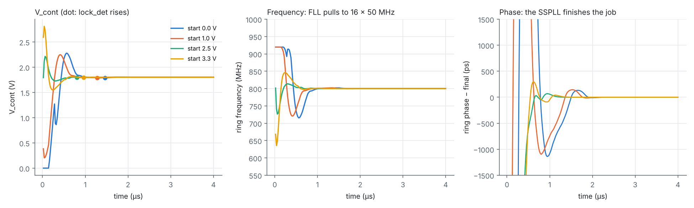
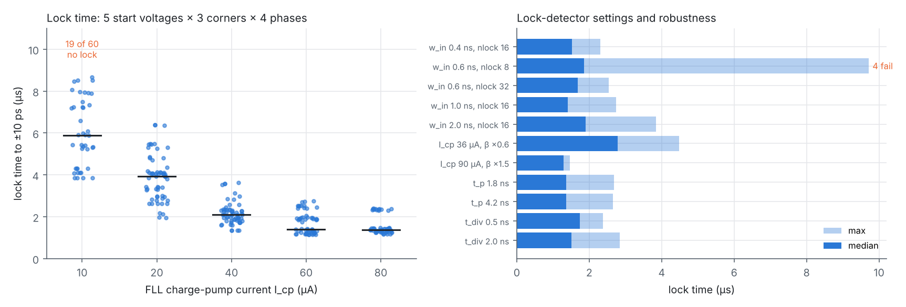
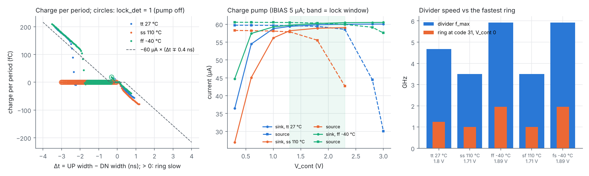
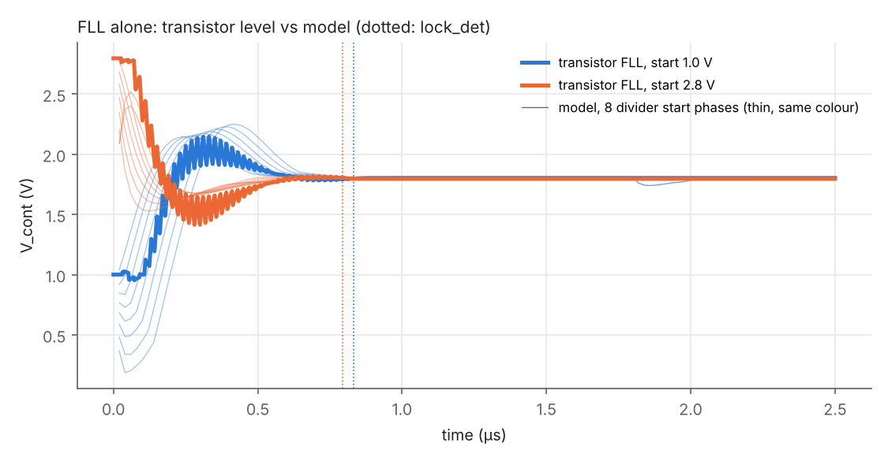
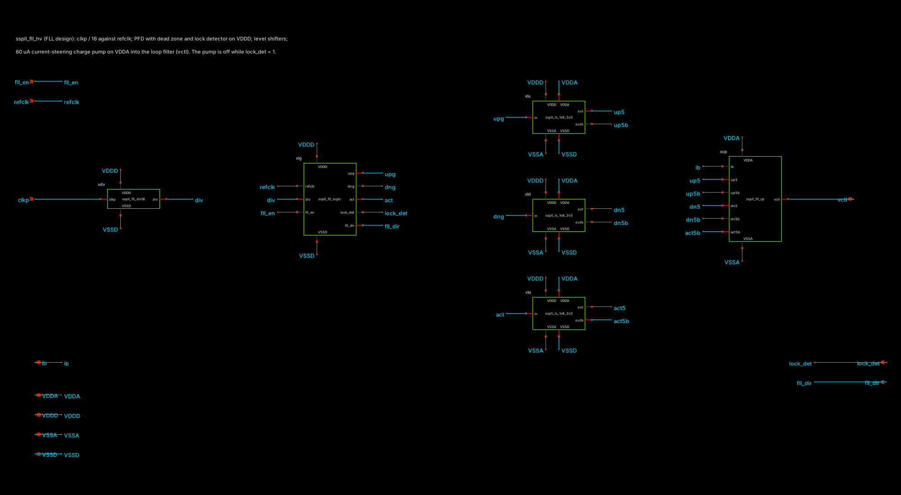
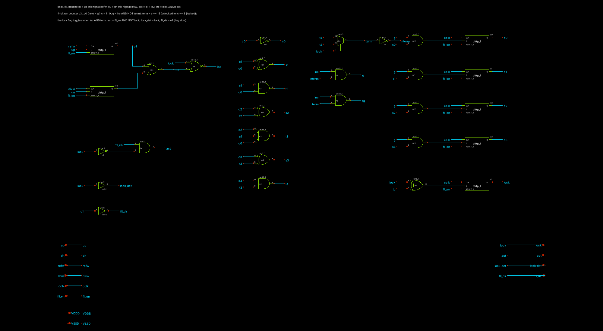
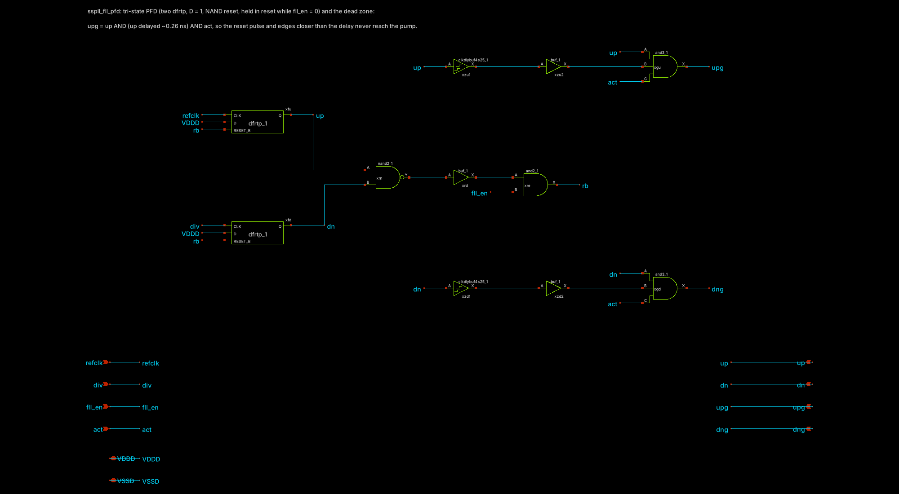
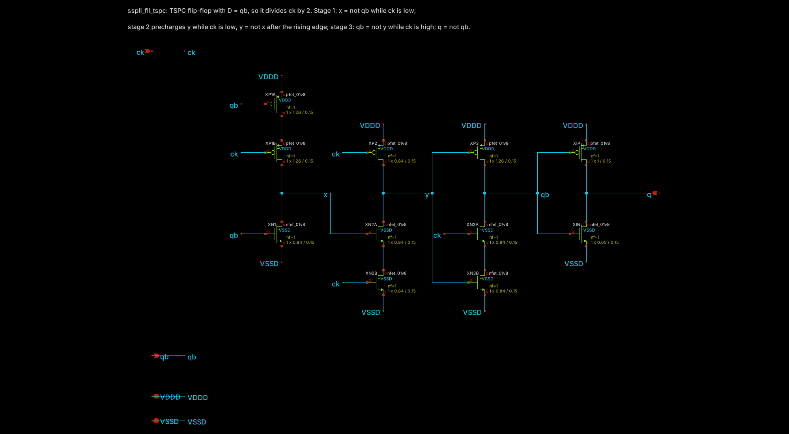
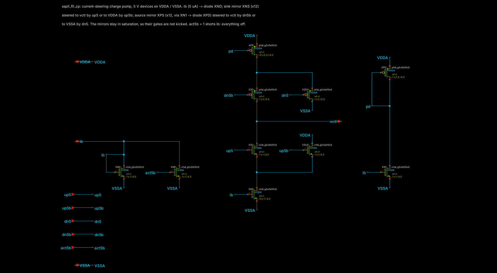

# The frequency-locked loop (FLL)

*Phase 7 (26 Nov 2026).* Deliverable: the loop that brings the ring to exactly 16 × f_ref from any
start, then steps aside for the sub-sampling loop. Transistor-level design (divider, PFD with dead zone, lock detector,
5 V charge pump), a time-domain model of the dual-loop acquisition, verification over PVT, hierarchical schematics
(LVS-clean) and sizing table. Design files `design/fll/fll_hv.py`, `fll_hv_model.py`, `fll_hv_acq.py`,
`fll_hv_sim.py`, `fll_hv_closed.py`, `fll_hv_plots.py`, `schematics_hv.py`; standard cells
`design/fll/stdcells/sky130_fd_sc_hd_fll.spice`; schematics `xschem/fll_hv/`; data `design/fll/data/fll_hv_*.json`;
methods M26 and M27 (new, explained in `docs/testbench_guide.md`).

Reproduce (in `design/fll`):

```bash
python3 fll_hv_acq.py            # dual-loop acquisition model: I_cp, lock detector, robustness, harmonic test     (M26)
python3 fll_hv_sim.py div cp open  # divider f_max, charge pump, open-loop transfer + lock detector (transistor level)
python3 fll_hv_closed.py         # transistor FLL + drawn filter + behavioural ring, against the model           (M27)
python3 fll_hv_plots.py          # docs/img/fll_hv_*.png
python3 schematics_hv.py         # xschem/fll_hv/*, drawing checks, LVS reference                                  (M5)
cd ../../xschem && ./lvs.sh fll_hv/sspll_fll_hv.sch netlist/ref_fll_hv.spice sspll_fll_hv                         # M4
```

## Result in one paragraph

The FLL divides the ring by 16 (a 5 V down-shifter on VDDD and four TSPC ÷2 cells, f_max ≥ 3.5 GHz at every
corner), compares it with the reference in a standard-cell PFD with a 0.4 ns dead zone, and drives the loop filter
with a **60 µA current-steering 5 V charge pump**. A lock detector with hysteresis switches the pump off once the
divided edge has stayed within ±0.6 ns for 16 periods, and back on only after 4 periods beyond ±2 ns. In lock the
FLL injects nothing; leakage is ≤ 12 pA, and it draws ≈ 0.20 mW.

**Why it is needed.** The sub-sampling loop alone, started near 700, 750 or 850 MHz, locks exactly there: every
multiple of 50 MHz looks locked to it.

**Results**
- **Time-domain model (dual loop, 900+ starts):** every start, at every corner and phase, ends at 800.000 MHz.
  Lock time is **1.41 µs typical and 2.76 µs worst** at nominal gain, and at most **4.48 µs** with all loop gains
  ×0.6. The specification is 5 µs typical / 20 µs maximum.
- **Transistor level, FLL in closed loop:** lock_det rises at 0.83 µs and 0.79 µs, inside the model's spread
  (0.76–1.24 µs and 0.74–0.90 µs).
- **Schematics:** nine hierarchical cells, all LVS-clean.

**Three design errors were found and fixed by simulation:**
- a lock detector without hysteresis that chattered;
- a drain-switched pump whose current overshot by 75 %;
- window taps too short to cover the PFD reset and the flip-flop setup, so lock_det never rose.

## What happens, how, why

### What happens

The sub-sampling loop cannot find the right frequency by itself. Its detector samples the ring once per reference
period and sees only the ring's phase modulo one ring cycle. Any ring frequency that is an exact multiple of 50 MHz
gives the same sampled phase every period, so it looks "locked". Started near 750 or 850 MHz, the sub-sampling loop
locks there. The FLL is a second, ordinary PLL that runs in parallel:

- It divides the ring by 16 and compares the result with the reference in a phase-frequency detector (PFD).
- The PFD sees the true frequency, not the frequency modulo 50 MHz.
- Its charge pump pulls V_cont until the divided clock lines up with the reference.
- Then a lock detector switches the FLL off, and the sub-sampling loop takes over.



### How it happens

1. **Frequency detection.** A tri-state PFD sets UP at a reference edge and DN at a divider edge, and clears both when
   both are set. If the divided clock is slow, reference edges come more often, so UP is high for most of the time.
   The average pump current is then about +I_cp/2 whatever the phase: this is what makes it a *frequency* detector.
   Near lock the pulse width equals the time offset Δt, so the average current is

   $$\bar i = I_{cp}\,\frac{\Delta t - t_{dz}}{T}\quad(|\Delta t| > t_{dz}),\qquad 0\ \text{inside the dead zone}$$

2. **The FLL as a loop.** With the same filter Z(s) and a ring of gain K_VCO, the FLL loop gain is

   $$L_{FLL}(s) = \frac{I_{cp}}{2\pi}\cdot Z(s)\cdot\frac{K_{VCO}}{N\,s},\qquad N = 16$$

   This is the sub-sampling loop's gain with β replaced by I_cp/(2πN). At I_cp = 60 µA, I_cp/(2πN) = 0.60 µA/rad,
   against β = 0.79 µA/rad, so the FLL is a slightly slower copy of the main loop: f_c 1.4–2.7 MHz, PM 46–50°.

3. **Dead zone.** The pump only sees the part of each UP / DN pulse that is longer than t_dz ≈ 0.26 ns (an AND with a
   delayed copy). This removes the PFD's own reset pulse (both UP and DN for about 0.2 ns every period), so the pump
   is completely silent when the edges are aligned.

4. **Lock detector with hysteresis.**
   - **Acquiring (narrow window).** Count periods in which neither pulse is still high w_in ≈ 0.6 ns after its edge.
     After 16 in a row, set lock_det: the pump is switched off and its bias is shorted.
   - **Locked (wide window).** The window widens to w_out ≈ 2 ns, and only 4 out-of-window periods in a row clear
     lock_det.
   - **Why the wide window.** The sub-sampling loop may move the divided edge by up to half a ring period (0.625 ns)
     when it picks its lock edge, and that must not count as losing lock.

### Why it happens this way

- **Why not just make the sub-sampling loop's capture range wide?** Its detector is periodic in the ring phase with
  period 1/f_ring. Any ring frequency f = k·f_ref is a stable point, whatever the loop does. Only a divider brings in
  the information "which k".
- **Why switch the FLL off after lock?** Two loops with different lock points fight. The FLL wants the divided edge
  exactly on the reference; the sub-sampling loop wants a ring edge (any one) at the sample instant. They agree only
  to within ±T_VCO/2. Left on, the FLL would pump a small charge every period, and the sub-sampling loop would cancel
  it every period. The result is a static phase offset and a reference spur. Switched off, the FLL costs nothing in
  lock: no pump current, no spur, no added noise.
- **Why a 16-period count and not 8?** During acquisition the FLL's own phase loop rings. A count of 8 can pass while
  the frequency is still 3–4 MHz off. The FLL then stops, the sub-sampling loop cannot capture that offset, the phase
  drifts out, and lock_det toggles. The model found 4 failures in 60 starts with 8 and none with 16 or 32.

## A. Why an FLL: the sub-sampling loop locks to any multiple of f_ref

The SSPD samples the ring at t_k = k·T. The sampled phase is φ_k = 2π·f_ring·k·T mod 2π. If f_ring = m·f_ref for any
integer m, then φ_k is the same every period: to the detector the loop is locked. The model (method M26, part E),
with the FLL switched off:

| Start | Sub-sampling loop alone | With the FLL |
|---|---|---|
| 701 MHz | locks at **700.000 MHz** (m = 14) | 800.000 MHz in 1.18 µs |
| 752 MHz | locks at **750.000 MHz** (m = 15) | 800.000 MHz in 1.48 µs |
| 849 MHz | locks at **850.000 MHz** (m = 17) | 800.000 MHz in 1.76 µs |
| 851 MHz | locks at **850.000 MHz** | 800.000 MHz in 1.88 µs |
| 898 MHz | does not lock in 4 µs (898.05 MHz, cycle slipping) | 800.000 MHz in 1.90 µs |

So the FLL is not an option. Without it the PLL comes up at the wrong frequency whenever the start is closer to
another multiple of 50 MHz.

## B. Architecture and the choices behind it

| Block | Choice | Why |
|---|---|---|
| 3.3 → 1.8 V down-shifter | 5 V inverter (nfet/pfet_g5v0d10v5, L 0.5 µm) supplied from VDDD, then two 1.8 V inverters | the ring buffers swing to VDDA; a 1.8 V gate must never see 3.3 V. The thick gate takes it; its output only swings to VDDD |
| ÷16 | four TSPC ÷2 cells (1.8 V devices) | the fastest divider per transistor; one clock phase, no clock inverter. Its weakness (dynamic nodes leak below a few MHz) does not matter at ≥ 50 MHz |
| PFD | two `dfrtp` flip-flops + NAND reset (standard cells), held in reset while fll_en = 0 | the textbook tri-state PFD: a true frequency detector; standard cells make the layout a placement job and come with characterised timing |
| dead zone | AND of UP with UP delayed by `clkdlybuf4s25` + `buf` (≈ 0.26 ns at tt) | removes the 0.2 ns reset pulse of both outputs, so the pump is silent at alignment |
| lock detector | effective windows about 0.6 ns (acquiring) / 2 ns (locked), 16 periods to lock, 4 to unlock; taps of 3 / 7 × clkdlybuf4s50 | hysteresis: the sub-sampling loop may shift the divided edge by up to T_VCO/2 = 0.625 ns. The tap must also cover the PFD reset time and the flip-flop setup time |
| charge pump | 5 V current-steering mirrors, 60 µA, off when locked | drain-switched mirrors gave +75 % current overshoot from the gate kick; steering keeps the mirrors in saturation |
| level shifters | three `sspll_ls_1v8_3v3` (CCO design) for upg, dng, act | same cell as the rest of the chip; its outb gives the complementary steering signals for free |

The lock point is shared with the sub-sampling loop through **one** filter (loop-filter design). No switch is in the filter path.

## C. Sizing with the time-domain model (method M26)

Each setting was run from 5 start voltages (0, 0.8, 1.6, 2.4, 3.3 V) × 3 corners (tt, ss 110 °C, ff −40 °C tuning
curves, coarse code at 1.8 V) × 4 start phases: 60 starts per setting. Lock time is measured to ±10 ps of the final
phase.



**I_cp.** The FLL loop gain grows with I_cp; the exact sampled model gives (same filter, N = 16):

| I_cp | f_c (K_VCO 110 / 173 / 250 MHz/V) | PM | lock time median / max | fails of 60 |
|---|---|---|---|---|
| 10 µA | 0.44 / 0.57 / 0.71 MHz | 23–33° | 5.88 / 8.68 µs | **19** |
| 20 µA | 0.66 / 0.88 / 1.13 MHz | 31–43° | 3.94 / 6.40 µs | 0 |
| 40 µA | 1.03 / 1.44 / 1.92 MHz | 41–50° | 2.10 / 3.64 µs | 0 |
| **60 µA** | **1.39 / 1.98 / 2.70 MHz** | **46–50°** | **1.41 / 2.76 µs** | **0** |
| 80 µA | 1.74 / 2.52 / 3.43 MHz | 49–51° | 1.38 / 2.40 µs | 0 |

At 10 µA the FLL loop sits below the filter zero (0.89 MHz) with PM 23–33°: it rings so long that 19 starts are not
locked after 12 µs. 60 µA is chosen: the same damping as the main loop, lock 1.4 µs typical. 80 µA buys only 0.36 µs
of worst case for 33 % more pump current.

**Lock detector.** With I_cp = 60 µA:

| w_in | count | lock time median / max | fails | lock_det toggles |
|---|---|---|---|---|
| 0.4 ns | 16 | 1.52 / 2.30 µs | 0 | 1 |
| **0.6 ns** | **16** | **1.41 / 2.76 µs** | **0** | **1** |
| 0.6 ns | 8 | 1.86 / 9.72 µs | **4** | **33** |
| 0.6 ns | 32 | 1.68 / 2.54 µs | 0 | 1 |
| 1.0 ns | 16 | 1.41 / 2.74 µs | 0 | 1 |
| 2.0 ns | 16 | 1.90 / 3.84 µs | 0 | 3 |

The rule behind the table: a frequency error Δf moves the divided edge by T·Δf/f every period, so N periods inside a
±w window are possible only if

$$\frac{\Delta f}{f} < \frac{2w}{N\,T}$$

With w = 0.6 ns and N = 16 that is 0.38 % (3 MHz), and the FLL has already converged far below it by the time its
phase sits that still. With N = 8 the bound is 6 MHz, which the ringing FLL passes through. The detector fires, the
pump stops at a frequency error the sub-sampling loop cannot capture, and lock_det toggles until chance helps.

**Robustness** (I_cp 60 µA, w_in 0.6 ns, count 16):

| Change | lock time median / max | fails |
|---|---|---|
| I_cp and β × 0.6 (slow corner, low IBIAS) | 2.79 / 4.48 µs | 0 |
| I_cp and β × 1.5 | 1.29 / 1.46 µs | 0 |
| packet delay t_p 1.8 ns / 4.2 ns | 1.36 / 2.68 µs; 1.36 / 2.66 µs | 0 |
| divider delay 0.5 ns / 2 ns | 1.74 / 2.38 µs; 1.51 / 2.84 µs | 0 |

Every start locks at 800.000 MHz, lock_det rises once and stays. Worst lock time 4.48 µs, against the 5 µs typical /
20 µs maximum lock-time specification.

## D. The circuits, one by one (transistor level)

**Divider (`fll_hv_sim.py div`).** Highest input frequency that still divides by exactly 16 (0..VDDA square, 60 ps
edges), and the VDDD current at 800 MHz:

| Corner | VDDD | f_max | I(VDDD) at 800 MHz |
|---|---|---|---|
| tt 27 °C | 1.80 V | 4.67 GHz | 67 µA |
| ss 110 °C | 1.71 V | 3.50 GHz | 68 µA |
| ff −40 °C | 1.89 V | 5.92 GHz | 90 µA |
| sf 110 °C | 1.71 V | 3.50 GHz | 74 µA |
| fs −40 °C | 1.89 V | 5.92 GHz | 76 µA |

The fastest the ring can run is at code 31 with V_cont = 0: about 1.25 GHz (tt), 1.0 GHz (ss) and 2 GHz (ff). The
divider is at least 2.8× faster at every corner, so the lock-up of section "Interview question 4" cannot happen. The
first sizing (a 12 µm pMOS in the down-shifter) reached 4.3 GHz at ss but drew 103 µA; halving it kept 3.5 GHz and
saved 36 µA.

**Charge pump (`fll_hv_sim.py cp`).** Sink / source current at V_cont 1.3 / 1.8 / 2.3 V (IBIAS 5 µA):

| Corner | sink (µA) | source (µA) |
|---|---|---|
| tt 27 °C, 3.3 V | 59.4 / 59.9 / 60.0 | 59.6 / 59.4 / 58.6 |
| ss 110 °C, 2.97 V | 58.2 / 58.9 / 59.0 | 57.9 / 55.5 / **42.7** |
| ff −40 °C, 3.63 V | 59.7 / 60.2 / 60.4 | 60.5 / 60.3 / 59.9 |

- **Gain tracking.** IBIAS ±20 % moves both currents by ±20 %, which is inside the model's ×0.6–×1.5 robustness
  range.
- **Source current at the ss corner.** At ss / 2.97 V the source loses headroom at the top of the window: 0.67 V
  must carry the pMOS mirror and its switch. This only slows the FLL there; it is not used in lock.
- **Off-state leakage into vctl at 110 °C** (pump disabled, as in lock): at most 12 pA. That makes a static phase
  offset of 12 pA / 0.79 µA/rad = 15 µrad. Negligible.

**Why current steering.** The first pump switched the mirror drains. When a switch closed, the mirror's drain jumped
from 0 V to V_cont, and its gate–drain capacitance kicked the high-impedance gate (5 µA diode). The current started
at 104 µA and decayed to 60 µA over 10 ns, which is +36 % charge per period. Steering the mirror current to VDDA
(sink) or VSSA (source) when it is not wanted keeps every mirror in saturation, and the current is flat at 58–59 µA.

**Open loop, whole FLL (`fll_hv_sim.py open`).** The ring runs 0.25 % fast, so the PFD pulse width sweeps from
+2.2 ns (UP) through zero to −2.3 ns (DN) at 50 ps per period. vctl is held at 1.8 V.



| Corner | PFD reset pulse | lock_det rises at Δt | → effective acquire window | lock_det falls at Δt | → effective hold window |
|---|---|---|---|---|---|
| tt 27 °C, VDDD 1.8 V | 0.31 ns | -0.20 ns | ±0.60 ns | -2.19 ns | ±1.99 ns |
| ss 110 °C, VDDD 1.71 V | 0.56 ns | -0.06 ns | ±0.74 ns | -3.06 ns | ±2.86 ns |
| ff -40 °C, VDDD 1.89 V | 0.20 ns | -0.32 ns | ±0.48 ns | -1.65 ns | ±1.45 ns |

How to read the table:
- **Acquire window.** The edge enters the window, lock_det rises 16 periods (16 × 50 ps = 0.8 ns of drift) later.
  The effective acquire window is therefore the Δt where lock_det rose, plus 0.8 ns.
- **Hold window.** lock_det falls 4 periods after the edge leaves the wider hold window.
- **Pump off.** While lock_det = 1 the charge per period is exactly zero, even at Δt = −2 ns: the pump is off. Before
  lock the pump charge follows I_cp·(Δt − t_dz) with a slope of 60 µA.
- **Dead zone.** Pulses up to the PFD reset width (0.31 ns tt, 0.56 ns ss, 0.20 ns ff) never reach the pump. The
  effective dead zone is about 0.4 ns at tt, 0.65 ns at ss and 0.3 ns at ff.
- **The hold window always exceeds the sub-sampling loop's possible shift** (T_VCO/2 = 0.625 ns): it is 1.45 ns even
  at ff.
- **The model was rerun with the three measured sets** (dead zone, reset, acquire and hold windows): 60 starts each,
  no failures, lock time 1.44–1.49 µs median and 2.24–2.70 µs worst.

## E. Closed loop at transistor level (method M27)

The transistor-level FLL (divider, PFD, dead zone, lock detector, level shifters, charge pump) and the drawn
loop filter, around the behavioural ring (tt tuning curve), started at V_cont = 1.0 V and 2.8 V. The sub-sampling
loop is not in this run, so it shows the FLL alone up to lock_det.

| Start | lock_det, transistor level | lock_det, model (8 divider start phases) | V_cont at lock_det |
|---|---|---|---|
| 1.0 V | 0.83 µs | 0.76–1.24 µs | 1.797 V |
| 2.8 V | 0.79 µs | 0.74–0.90 µs | 1.808 V |

- **The model's spread comes from the divider's random start state.** The first PFD period can be a 20 ns UP or a
  short DN pulse, depending on where the divider starts relative to the reference.
- **The transistor runs fall inside that spread.** The trajectories have the same time constants: the FLL rings
  about 1.5 times before it settles.
- **The saw-tooth on the transistor curves is real:** it is the per-period charge packet on C2 (60 µA × Δt / C2).




## F. Power and area

| State | VDDA (3.3 V) | VDDD (1.8 V) | Power |
|---|---|---|---|
| acquiring (pump steering 2 × 60 µA + bias) | ≈ 130 µA | ≈ 103 µA | ≈ 0.62 mW, for 1–5 µs |
| locked (pump off, divider and logic running) | ≈ 5 µA (ib, shorted) | 103 µA at tt (67 divider + 36 logic) | **≈ 0.20 mW** |
| allocation (system budget) | FLL pump 0.07 mW | divider, PFD, FLL logic, decode 0.20 mW | 0.27 mW |

The open-loop run (pump active about 40 % of the time) averaged 72 µA on VDDA and 103 µA on VDDD at tt.

**Area estimate:**
- divider ≈ 250 µm²;
- about 60 standard cells ≈ 900 µm² of cell area, ≈ 1 300 µm² placed;
- charge pump ≈ 700 µm² (two 12-unit L = 4 µm mirrors with dummies);
- three level shifters ≈ 150 µm².

That is **≈ 2 400 µm²** against the 3 000 µm² allocation.


## G. Schematics (hierarchical, real wiring, LVS-clean)

| Cell | Content |
|---|---|
| `sspll_fll_hv` | top: div16, logic, three level shifters, charge pump |
| `sspll_fll_div16` | down-shifter + four TSPC ÷2 |
| `sspll_fll_ds` | 5 V inverter on VDDD + two 1.8 V inverters |
| `sspll_fll_tspc` | TSPC ÷2 (9 transistors) + output inverter |
| `sspll_fll_logic` | pfd + win + lockdet |
| `sspll_fll_win` | 2 × (7 × clkdlybuf4s50, taps 3 and 7, mux2); counter clock clkdlybuf4s25 + buf |
| `sspll_fll_pfd` | 2 × dfrtp, nand2, buf, and2 (reset); dead zone: 2 × (clkdlybuf4s25 + buf), 2 × and3 |
| `sspll_fll_win` | 2 × (clkdlybuf4s50, clkdlybuf4s25, 4 × clkdlybuf4s50, mux2); counter clock clkdlybuf4s25 + buf |
| `sspll_fll_lockdet` | window flip-flops o1 / o2, or2, xnor2; incrementer; terminal mux; 4 + 1 dfrtp; act and outputs |
| `sspll_fll_cp` | 5 V current-steering pump |







The standard-cell sheets wire the data paths (PFD to reset, delay chains, flip-flop to counter logic) and use net
labels for the nets that fan out across the sheet (counter state, lock, fll_en). All nine cells pass the drawing
checks and match the simulated netlist in netgen (`tools/lvs_hv_all.py`: 41 cells, all match). The standard
cells are black boxes to netgen (pin-matched); their transistor netlists are the PDK's.

## H. Sizing table (all transistors pass `tools/pdk_limits.py`)

| Instance | Device | W per finger × fingers | L | Role |
|---|---|---|---|---|
| ds: XDN / XDP | nfet / pfet_g5v0d10v5 | 1.0 / 3.0 × 2 µm | 0.5 µm | 3.3 → 1.8 V input inverter on VDDD |
| ds: XI1, XI2 | nfet / pfet_01v8 | 1.0 / 2.0 µm | 0.15 µm | edge restoring |
| tspc: XP1A, XP1B, XN1 | pfet / pfet / nfet_01v8 | 1.26 / 1.26 / 0.84 µm | 0.15 µm | stage 1 |
| tspc: XP2, XN2A, XN2B | pfet / nfet / nfet_01v8 | 0.84 µm | 0.15 µm | stage 2 (precharge) |
| tspc: XP3, XN3A, XN3B | pfet / nfet / nfet_01v8 | 1.26 / 0.84 / 0.84 µm | 0.15 µm | stage 3 |
| tspc: XIN / XIP | nfet / pfet_01v8 | 0.65 / 1.0 µm | 0.15 µm | output inverter |
| cp: XND, XN1, XNS | nfet_g5v0d10v5 | 1.0 µm (XNS m = 12) | 4.0 µm | nMOS mirror, 5 µA unit |
| cp: XPD, XPS | pfet_g5v0d10v5 | 2.5 µm (XPS m = 12) | 4.0 µm | pMOS mirror |
| cp: XSU, XSUX, XNK | nfet_g5v0d10v5 | 1.0 µm | 0.5 µm | steering switches, bias kill |
| cp: XSD, XSDX | pfet_g5v0d10v5 | 2.0 µm | 0.5 µm | steering switches |
| logic | sky130_fd_sc_hd | 9 × dfrtp_1, 14 × clkdlybuf4s50, 3 × clkdlybuf4s25, 3 × mux2, and2/and3/or2/xor2/xnor2/inv/buf/nand2 | | PFD, dead zone, windows, counter |

## I. Layout guidance (for layout)

- **Down-shifter.** Put it right next to the ring buffer that drives it: clkp is a 3.3 V, 800 MHz net. The 5 V
  inverter needs the high-voltage spacing rules: its N-well on VDDD is a 1.8 V well holding a thick-oxide device.
- **Divider.** The four TSPC cells form one row of 1.8 V devices. Keep the first stage short-wired to the
  down-shifter.
- **Logic.** About 60 standard cells (≈ 900 µm² of cell area): one placed row block with tap cells, VDDD / VSSD
  rails, and decap fill.
- **Charge pump.** The mirrors (L = 4 µm, 12 units each) are interdigitated with dummies, with the steering switches
  at the vctl side. vctl from the pump joins the filter's C2 at the same point as the Gm's output (the loop-filter design, section J).
- **Level shifters.** On the VDDD / VDDA boundary, as in the CCO and clock-generator designs.

## J. Requirements handed on

1. **Top-level integration.**
   - Connect clkp to the ring buffer reserved for the divider (VCO design), refclk to the receiver's 1.8 V output
     (reference-receiver design), ib to a 5 µA bias leg (bias design), and fll_en to the control register.
   - Bring lock_det and fll_dir to test outputs.
   - The output divider (÷1–÷16) may tap c1–c4 of `sspll_fll_div16` instead of building its own chain.
2. **Bias.** One 5 µA sink leg into ib, always on while pll_en = 1.
3. **Test plan.** The coarse-code sweep (cco_code 0–31 with the FLL on, recording lock_det) works as planned. Sweep
   from low codes up: at code 31 the ring may run above 1 GHz; the divider still follows (≥ 3.5 GHz).
4. **Known limit.** lock_det is clocked by the reference. If the reference stops, lock_det holds its last value. A
   missing-reference flag would need a counter clocked by the ring. It is listed as future work, not needed for the
   challenge measurements.

## K. Problems met and how they were solved

| Problem | Found by | Cause | Solution |
|---|---|---|---|
| lock_det toggled forever from some starts | model, first lock-detector version (one 2 ns window, count 15, no hysteresis) | lock_det fired while the FLL still rang 4 MHz off; the sub-sampling loop could not capture that | narrow window to acquire (0.6 ns) + wide window to hold (2 ns), 16 periods in / 4 out |
| 4 of 60 starts failed with an 8-period count | model sweep B | false lock bound 2w/(NT) = 0.75 % | 16-period count |
| pump current 104 → 60 µA within each pulse | first open-loop run | drain switching kicked the mirror gate through C_gd | current-steering pump |
| divider path drew 103 µA | divider bench | oversized down-shifter (12 µm pMOS) | 6 µm: 67 µA, f_max still ≥ 3.5 GHz |
| open-loop and closed-loop runs gave no data | first runs | ngspice saved every node of ~1 000 transistors for 2 µs (2+ GB per run) and was killed for memory; the deck also started the PFD 13 ns from alignment | `save` only the needed vectors (370 MB), start offset chosen so the sweep passes through zero, results saved per corner |
| lock_det never rose in the transistor-level run | open-loop bench, then a debug run at alignment (o1 = 1 every period) | the effective window is the tap delay minus the PFD reset time (0.31 ns at tt) and the flip-flop setup (~0.2 ns): 0.56 ns of delay left about 0.1 ns | taps of three / seven clkdlybuf4s50 (1.07 / 2.5 ns at tt): lock after exactly 16 aligned periods |
| shorted nets in the lock-detector drawing (LVS mismatch) | netgen | a label stub ended exactly on the corner of another net's wire | cells placed so the wire runs straight to the pin; stubs never end on a wire corner |

## Testbenches

See `docs/testbench_guide.md`, "FLL benches (M26, M27)".

## Interview questions (FLL design)

**1. A sub-sampling PLL has no divider in the loop. Why does it still need one?**

*Short answer.* Its detector sees the ring phase only modulo one ring cycle, once per reference period, so every
ring frequency that is a multiple of f_ref looks locked. A divider-based frequency loop is the only part that knows
which multiple.

*In detail.* The SSPD output in period k is a function of φ_k = 2π f_ring kT mod 2π. For f_ring = m/T, φ_k is constant
for every integer m: 700, 750, 800, 850 MHz are all stable points. The model shows it: started at 752 MHz, the
sub-sampling loop alone locks at exactly 750.000 MHz, and started at 849 MHz at 850.000 MHz. The FLL compares
f_ring/16 with f_ref in a PFD, whose output keeps one sign for any frequency error. It drives the ring to the right
multiple; then it switches off.

**2. How does a tri-state PFD detect frequency, not just phase?**

*Short answer.* When the divided clock is slow, two reference edges can arrive between divider edges. The second
finds UP already set, so UP stays high most of the time. The output never changes sign while the frequency error
keeps its sign.

*In detail.* The PFD is a 3-state machine (UP, 0, DN), and the state moves only toward the faster input. Its
characteristic is linear over ±2π (±T) of phase. When the phase wraps, it does not jump to the opposite sign, as an
XOR would; it restarts on the same side. Averaged over the cycle slips, the current is between I_cp/2 (small Δf) and
I_cp (large Δf), always pushing the right way. That is why the pull-in range of a PFD loop is limited only by the
VCO's range and the divider's speed.

**3. A dead zone is a bug in a main CP-PLL. Why is it a feature here?**

*Short answer.* In a main loop, a dead zone means no correction for small errors: the phase wanders inside it, giving
jitter and limit cycles. Here the FLL must be silent at lock, and the dead zone, together with the lock detector,
guarantees that.

*In detail.* A tri-state PFD produces both UP and DN for the reset time (≈ 0.2 ns) every period, even at perfect
alignment. In a main loop you *want* that (it removes the dead zone caused by switch turn-on times). Here every such
pulse would be a mismatched charge packet into vctl at 50 MHz, a reference spur. The AND with a 0.26 ns delayed copy
removes them. The real silencing is done by the lock detector, which turns the whole pump off.

**4. What happens if the divider cannot keep up with the VCO?**

*Short answer.* It drops pulses, so the divided frequency reads low. The PFD says "too slow", the loop pushes the VCO
faster, the divider fails worse, and the loop locks up at the rail.

*In detail.* This is positive feedback through a failing block, the classic PLL lock-up. The cure is a guarantee:
divider f_max above the VCO's fastest possible frequency at every corner, including the extreme control voltage and
coarse code. Here the ring's fastest is about 2 GHz (ff, code 31, V_cont = 0) and the divider's slowest f_max is
3.5 GHz (ss / sf, 110 °C, 1.71 V). Some designs add a frequency clamp or a ring-clocked "VCO too fast" detector for
extra safety.

**5. Why TSPC for the divider, and what are its limitations?**

*Short answer.* It is the fastest flip-flop per transistor (9 transistors, a single clock phase, no clock inverter).
Its limitations are dynamic nodes, which leak, so it has a minimum frequency, and sensitivity to slow clock edges.

*In detail.* Each stage evaluates or holds on one clock level. Precharged node y holds its charge for half a period,
so leakage at 110 °C sets a minimum frequency of a few MHz, irrelevant at ≥ 50 MHz. Slow clock edges let both
stacks conduct at once, which can corrupt the state. The down-shifter's two 1.8 V inverters restore fast edges for
that reason. TSPC also burns power in every cycle (precharge), and the first stage runs at the full 800 MHz: 67 µA
for the whole divider path at tt.

**6. How do you shift a 3.3 V clock down to 1.8 V logic without stressing thin oxide?**

*Short answer.* Receive it on a thick-oxide (5 V) gate whose source sits on the 1.8 V supply. The input may swing to
3.3 V; the output only to 1.8 V.

*In detail.* A thin-oxide (1.8 V) gate tolerates about 1.98 V. A 5 V inverter on VDDD has V_GS up to 3.3 V on its
nMOS, which is fine for the 5 V devices' thick oxide (about 12 nm), and its pMOS turns off hard when the input exceeds VDDD.
Speed: the pMOS sees only V_SG = 1.8 V against V_th ≈ −1 V, so it is slower than a thin device. It still handles
3.5 GHz here. An alternative is an nMOS pass gate with its gate at VDDD (clamps at VDDD − V_th) followed by a
keeper, but it is slower.

**7. Your charge pump first showed 104 µA instead of 60 µA. Why, and how did you fix it?**

*Short answer.* Charge injection into the current mirror's gate. When the switch closed, the mirror drain jumped by
about 1.4 V, and C_gd coupled that into the high-impedance gate node. The fix is current steering, so the drain
never collapses.

*In detail.* ΔV_gate ≈ C_gd·ΔV_drain/(C_gate,total). The 12 parallel thick-oxide units (48 µm² of gate) and their
overlap capacitance gave tens of mV on a 5 µA diode in moderate inversion, where current depends exponentially on
V_GS, and the gate recovers only with τ ≈ C/g_m ≈ 10 ns. Steering the current to VDDA / VSSA when it is not wanted
keeps the drain within a few hundred mV of V_cont: flat 58–59 µA. Other fixes are a bias-node decoupling capacitor,
source switching, a cascode, or a unity-gain buffer holding the dump node at V_cont (the usual choice in a main
CP-PLL, where mismatch matters).

**8. How do you design a lock detector that never declares lock falsely and never chatters?**

*Short answer.* Count consecutive periods with small phase error (rejects passing alignments), and use hysteresis:
a narrow window to declare lock, a wider one to declare loss.

*In detail.* A frequency error Δf moves the divided edge by T·Δf/f per period, so N consecutive periods within ±w
bound the error to 2w/(NT): 0.38 % for w = 0.6 ns, N = 16. The window must also exceed the static error that the
detector sees in true lock. Here the sub-sampling loop may shift the divided edge by up to T_VCO/2 = 0.625 ns, so the
hold window is 2 ns. Leaving lock needs 4 bad periods in a row, so a single noise event does not flip it.

**9. Two loops share one filter. How do you stop them from fighting?**

*Short answer.* Make their lock points compatible, or switch one off. Here the FLL is switched off once locked,
because the two lock points can differ by up to half a ring period.

*In detail.* The FLL wants the divided edge on the reference edge; the sub-sampling loop wants a ring edge at the
sampling instant. Both on, the FLL would push I_cp·Δt per period (60 µA × 0.1 ns = 6 fC) against the sub-sampling
loop's restoring charge (at most 6 fC). The result is a static phase offset and a reference spur. With the pump off
in lock, the FLL contributes no charge, no noise and no spur. During acquisition they do fight briefly: the FLL wins
(its charge grows without limit with Δt), and the sub-sampling loop takes the nearest ring edge once the FLL stops.

**10. How did you choose the FLL charge-pump current?**

*Short answer.* From the FLL's own loop dynamics: I_cp/(2πN) plays the role of β, so I_cp = 60 µA gives an FLL
crossover of 1.4–2.7 MHz with PM 46–50°. Lower currents ring and lock slowly; higher ones buy little.

*In detail.* The FLL loop gain is (I_cp/2π)·Z(s)·K_VCO/(Ns). Below the filter zero (0.89 MHz) the loop has no phase
lead: at 10 µA, PM is 23–33° and 19 of 60 starts were not locked after 12 µs. At 60 µA the median lock time is
1.41 µs (worst 2.76 µs). Slew is not the limit: I_cp/C_tot = 6 V/µs. Power only flows during acquisition.

**11. What sets the lock time, and how would you make it shorter?**

*Short answer.* The FLL's settling (about 3–4 of its loop time constants), plus the 16-period lock count, plus the
sub-sampling loop's final phase settling (0.4 µs).

*In detail.* Typical is 1.4 µs and worst 4.5 µs (I_cp and β both at ×0.6). Ways to shorten it:
- a larger I_cp with a bigger filter zero, to keep the phase margin;
- pre-charge V_cont to the expected lock voltage at power-up;
- a digitally pre-set coarse code, so the frequency error at start is small;
- a two-step FLL: a fast, coarse frequency counter first, then the PFD.
Each costs area, power or complexity; the 5 µs specification does not need them.

**12. Why build the FLL logic from standard cells instead of custom transistors?**

*Short answer.* It is ordinary synchronous logic at 50 MHz. Standard cells are characterised, DRC/LVS-clean, and can
be placed and routed, so the layout effort goes where it matters (ring, SSPD, Gm, filter).

*In detail.* Only the divider's first stages run fast enough to need custom cells (TSPC at 800 MHz). The PFD and the
counter run at 50 MHz, where a `dfrtp_1` has nanoseconds of slack. The delay cells (`clkdlybuf4s50/25`) give the
dead zone and windows, which track process roughly ×0.7–×1.5. The design checks they stay above their floors at the
fast corner (dead zone > reset pulse, w_in > the fight offset 0.3 ns) and below their ceilings at the slow corner
(w_out < 10 ns).

**13. How do you know your behavioural acquisition model is right?**

*Short answer.* Every law in it comes from a transistor-level measurement, and one full case was rerun at transistor
level and compared.

*In detail.* The block laws come from the benches: tuning curve (VCO design), detector charge curve (Gm design), packet
timing (clock-generator design), filter (loop-filter design), and charge-pump current, dead zone and windows (this step). The closed-loop run
(M27) puts the real FLL and the drawn filter around a behavioural ring and is compared with the model for the same
start (section E). Where the model is only an approximation (it treats the pump current as constant inside the
window, for example), the robustness sweeps scale it by ×0.6 and ×1.5.

**14. What happens at power-up, and what if the reference disappears?**

*Short answer.* At power-up fll_en = 0 holds the PFD and counters in reset; when it rises, the FLL starts from
whatever V_cont is. If the reference stops, the counter clock stops, so lock_det holds its value: a known limit.

*In detail.* The divider runs as soon as the ring does; the TSPC state is random but harmless. With no reference
edges, the PFD sees only divider edges, so DN stays high. In lock the pump is off, so V_cont holds (leakage 12 pA)
and the ring stays near 800 MHz. The flag, though, does not drop. A missing-reference detector (a few ring-clocked
counter bits reset by refclk) would fix that; it is noted as future work.

