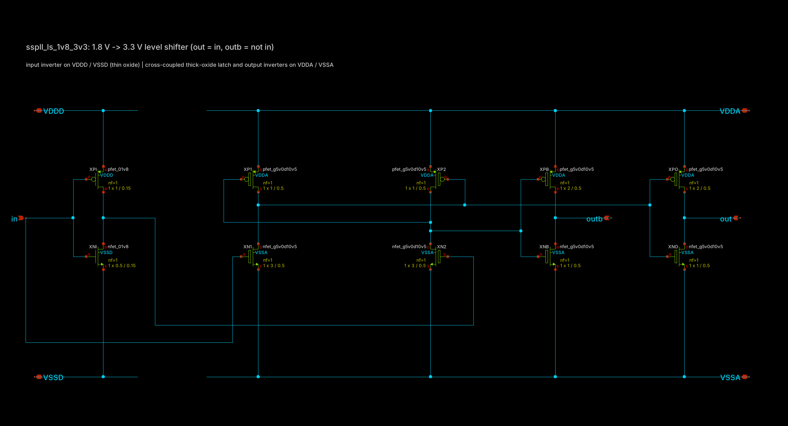
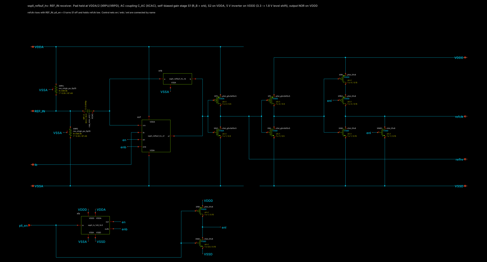

# Ground split: VSSA and VSSD (24 Nov 2026, before step 80)

## What changed

Until now every 5 V block used one ground net, `VSS`. The proposal's pin list has two grounds:

- **VSSA** returns the analog supply VDDA (3.3 V).
- **VSSD** returns the digital supply VDDD (1.8 V).

Every cell now uses the ground of its own domain. Nothing else changed: no device, size or value.

| Rule | Ground |
|---|---|
| Every device of the VDDA domain (all 5 V devices on VDDA, MIM bottom plates, resistor bodies in analog cells) | VSSA |
| Every 1.8 V device, and the R / C timing parts of the 1.8 V cells | VSSD |
| A 5 V device supplied from VDDD (the receiver's 3.3 → 1.8 V inverter `XNL`) | VSSD: its output lives in the VDDD domain |
| Level shifter `sspll_ls_1v8_3v3` | both: input inverter on VDDD / VSSD, latch and output inverters on VDDA / VSSA |

| Block | Cells | Ground(s) |
|---|---|---|
| SSPD (step 78) | `sspll_sspd_hv*` | VSSA |
| Ring VCO (step 74) | `sspll_vco_hv*` | VSSA |
| Pulsed-Gm core (step 79) | `sspll_sscp_hv`, `_slice`, `_rs`, `_buf`, `_tg` | VSSA |
| Clock generator 1.8 V cells (step 77) | `sspll_ckg_edges_g/h`, `_dly`, `_hlatch` | VSSD |
| Clock generator 5 V cells | `sspll_ckg_drv5`, `_drv5t`, `_pout5` | VSSA |
| Mixed cells | `sspll_ls_1v8_3v3`, `sspll_refbuf_hv`, `sspll_clkgen_hv`, `sspll_cco_hv`, `sspll_sscp_hv_dec`, `sspll_sscp_hv_top` | VSSA and VSSD |

Port order of a mixed cell: the two grounds sit side by side, `... VSSA VSSD`. For example:

```
.subckt sspll_ls_1v8_3v3 in out outb VDDD VDDA VSSA VSSD
.subckt sspll_refbuf_hv REF_IN refclk refhv ib pll_en VDDA VDDD VSSA VSSD
.subckt sspll_clkgen_hv refclk refhv cks cksb ckg ckgb ckh ckhb VDDD VDDA VSSA VSSD
.subckt sspll_cco_hv VDDA VDDD VSSA VSSD vring ibias vtest code0 ... code4 pll_en vtest_en
.subckt sspll_sscp_hv_top v1p v1m vctl ckg ckgb ib icp0 icp1 pll_en VDDA VDDD VSSA VSSD
```

## Why

**Separate return paths.** Digital switching current flows in VSSD and produces voltage drops on that net: ground bounce. If the sampling edge, the charge-pump bias or the ring current shared that net, the bounce would move them. With two nets, the layout can route each ground to its own pads. The two only meet where the harness joins them.

**The layout needs it anyway.** Each cell's pins, its symbol and its LVS reference must name the grounds the layout will have. Splitting later would mean redoing every symbol and LVS run after layout has started.

**The substrate.** In SKY130 every nMOS body sits in the same p-substrate, so the two grounds are joined through it on silicon (a resistive path). The schematic ties each nMOS body to its own domain ground, and in layout each domain gets its own substrate taps. The top-level LVS will then see VSSA and VSSD joined through the substrate, and must be set up to accept that one connection (step: top-level layout).

## How it was checked (no simulation needed)

Every pre-layout bench ties both grounds to the same ideal 0 V. So the split circuit is exactly the circuit that was simulated **if and only if** merging the two nets gives back the old netlist. That is a text comparison, which is exact and takes seconds. Re-running the simulations would only reproduce the same numbers.

**Method M23** (`tools/ground_split_check.py`):

1. `snap DIR`: before the change, write the 10 netlists that can be built without running ngspice (6 LVS references, 4 benches).
2. `check DIR`: after the change, build them again, then merge the grounds:
   - rename VSSA and VSSD to VSS;
   - in each mixed cell, merge the adjacent `VSSA VSSD` port pair into one port;
   - in every instance of a mixed cell, merge the matching node pair (`0 0` → `0` in a bench);
   - replace port names by their positions, because a port renamed consistently inside a cell is the same circuit;
   - drop comment lines.

   Then compare each merged netlist with the snapshot line by line.
3. Count the nodes of every `sspll_` instance written in the 5 V design scripts against the cell's port count. This catches a bench that still passes one ground to a cell that now has two.
4. **Domain audit:** no thin-oxide (1.8 V) device may touch VDDA or VSSA. Every 5 V device on VSSD is listed.

Result:

```
ref_cco_hv / ref_clkgen_hv / ref_refbuf_hv / ref_sspd_hv / ref_sscp_hv / ref_vco_hv   IDENTICAL with VSSA = VSSD
tb_cco_hv / tb_refbuf_hv / tb_sspd_hv / tb_sscp_hv                                     IDENTICAL with VSSA = VSSD
domain audit: thin-oxide devices on VDDA / VSSA: 0
5 V devices returning to VSSD: ref_refbuf_hv xnl (the 3.3 -> 1.8 V inverter, supplied from VDDD)
instance lines checked: 49; node-count mismatches: 0
```

**Benches.** Benches that instantiate a mixed cell now pass two ground nodes (`... 0 0 sspll_clkgen_hv`). The three benches that flatten a cell body into the top level got 0 V sources `vssa VSSA 0 0` and `vssd VSSD 0 0`:
- `step76hv_noise.py`
- `step77hv_sim.py`
- `step77hv_size.py`

All results of steps 74–79 therefore stand unchanged.

**Schematics and LVS** (`tools/lvs_hv_all.py`):
- All six schematic generators were updated. Mixed cells have separate VSSA and VSSD rails and pins; the level shifter's input inverter has its own short VSSD rail.
- All 29 cells are LVS clean: `Circuits match uniquely`, `Cell pin lists are equivalent`, with VSSA and VSSD as separate nets in both the drawing and the reference.

**Drawing check.** The check in `tools/xsch.py` now also catches overlapping net labels. Two ground labels under the level-shifter symbol had run into each other ("VSSDSA") without being flagged. A VDDD / VDDA label overlap in the charge-pump top cell, there before the split, is fixed too.




## Reproduce

```
python3 tools/ground_split_check.py snap /tmp/gs_old     # on the old code (git stash first)
python3 tools/ground_split_check.py check /tmp/gs_old    # on the new code
for b in cco clkgen refbuf sspd sscp vco; do (cd design/$b && python3 schematics_hv.py); done
python3 tools/lvs_hv_all.py                              # writes xschem/netlist/ref_*_hv.spice, LVS of every cell
```

## What is deferred (post-layout)

Ground bounce is not modelled before layout. A pre-layout model would be a guess: the ground resistance, how the ground current divides and the package are not known yet. The VDDD-noise benches (steps 76, 77) already show how sensitive the 1.8 V switching points are; VSSD bounce moves the same switching points.

After layout, the top-level bench gets:
- the extracted VSSA and VSSD;
- a package model on each ground: bond wire about 1–2 nH plus its resistance;
- the real digital switching current.

That bench then measures the sampling-edge jitter and the charge-pump error. Magic's extraction does not include the package and, by default, does not model coupling through the substrate, so both have to be added in the bench.

## Interview questions

1. Why give the analog and digital blocks separate grounds when the two are joined somewhere anyway?
2. Where should VSSA and VSSD be joined, and why at one point only?
3. What is ground bounce? Estimate it for a 1 nH bond wire carrying a 10 mA, 100 ps current edge. (L·di/dt = 100 mV.)
4. In SKY130 without a deep n-well, are VSSA and VSSD really separate on silicon? What path joins them?
5. How does substrate noise couple into an nMOS? Name the body effect and the drain-junction capacitance.
6. Which ground does the input inverter of a 1.8 → 3.3 V level shifter use, and why not VSSA?
7. Why does the receiver's 3.3 → 1.8 V inverter use a 5 V device, yet return to VSSD?
8. Why is a merged-netlist comparison a proof that no re-simulation is needed? When would it not be?
9. Why do the two grounds of a mixed cell sit side by side in the port list? (It makes the merge rule simple and the instance lines readable.)
10. LVS says "Circuits match uniquely" but a ground label is wrong. How can that happen? (Symmetric nets, or pins matched by topology.) How do you catch it? (Pin-list check, property errors, a domain audit.)
11. A testbench ties VSSA and VSSD to the same ideal 0 V source. What can such a bench never show?
12. What must a post-layout bench add so ground bounce becomes visible? (Package R-L, the digital current, the extracted grounds, the substrate.)
13. How does Magic extract a substrate tap labelled VSSD next to one labelled VSSA, and what does netgen then report?
14. What is a deep n-well for, and when would you put the digital nMOS in one?
15. Why is VSSD noise on a level shifter's input similar to VDDD noise?
16. Should the pad ESD clamps of VSSA and VSSD be connected to each other? Why are back-to-back diodes used between grounds?
17. Why do MIM bottom plates and resistor bodies of a 1.8 V RC delay go to VSSD rather than VSSA?
