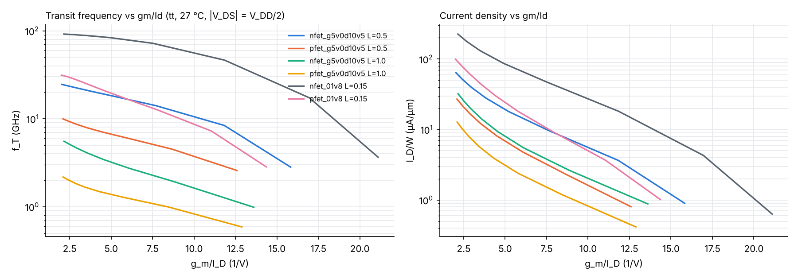

# Device-rule migration — characterisation of the allowed devices (18 Nov 2026)

New rule: analog blocks use only `nfet_g5v0d10v5` / `pfet_g5v0d10v5` (5 V gate rating, L ≥ 0.5 µm) on VDDA 3.3 V;
digital blocks use the 1.8 V devices on VCCD. Script `design/feas/devchar.py`, data `design/feas/devchar.json`.

**Method.** One W = 4 µm device, |V_DS| = V_DD/2 (1.65 V or 0.9 V), V_GS swept; BSIM operating-point values g_m, I_D,
C_gg, g_ds. f_T = g_m/(2π C_gg), intrinsic gain g_m/g_ds. The switch resistance is measured with source and drain
at V_DD/2 (the worst point of a sampling switch) and the gate fully on, given as R·W.

| Device | Corner | V_th (V) | I_D/W at g_m/I_D = 10 (µA/µm) | f_T at g_m/I_D = 10 (GHz) | g_m/g_ds | f_T max (GHz) | switch R·W at V_DD/2 (kΩ·µm) |
|---|---|---|---|---|---|---|---|
| nfet_g5v0d10v5 L 0.5 | tt 27 °C | 0.84 | 5.6 | **10.9** | 36 | 27 | **6.6** |
| | ss 110 °C | 0.81 | 2.8 | 5.4 | 37 | 21 | 11.4 |
| pfet_g5v0d10v5 L 0.5 | tt 27 °C | 0.93 | 1.6 | 3.8 | 42 | 13 | 33.5 |
| | ss 110 °C | 0.84 | 1.0 | 2.4 | 44 | 10 | 43.7 |
| nfet_g5v0d10v5 L 1.0 | tt 27 °C | 0.82 | 2.0 | 1.7 | 222 | 8.4 | 21.9 |
| pfet_g5v0d10v5 L 1.0 | ss 110 °C | 0.87 | 0.5 | 0.5 | 160 | 2.5 | 121 |
| nfet_01v8 L 0.15 (digital) | tt 27 °C | 0.72 | 27.6 | 57.9 | 19 | 92 | 9.1 |
| pfet_01v8 L 0.15 (digital) | tt 27 °C | 0.69 | 5.0 | 8.8 | 8 | 32 | 82.5 |

(V_th is the BSIM value at |V_DS| = V_DD/2, so it includes DIBL. The pfet L = 1 µm tt point at g_m/I_D = 10 is not
listed: the coarse sweep did not resolve it.)

**What it means for the design.**
- **Speed.** The 5 V nMOS is ~5× slower than the 1.8 V nMOS at the same bias (f_T 11 vs 58 GHz), the 5 V pMOS ~3× slower
  again. That is why the ring tops out near 1.1 GHz at the worst corner (`hv_vco_feasibility.md`). Analog blocks at
  800 MHz must be nMOS-heavy and use minimum L (0.5 µm) wherever speed matters.
- **Gain.** g_m/g_ds is 36–42 at L = 0.5 µm and > 150 at L = 1 µm: the thick devices make better amplifiers (LDO-free
  bias, Gm cell, diff-to-SE amplifier) than the 1.8 V ones.
- **Switches.** At mid-rail a 5 V nMOS needs W ≈ 4 µm for 1.65 kΩ; the 5 V pMOS is 5× worse. Sampling and hold switches
  will be nMOS-dominated transmission gates biased with a 3.3 V gate swing, or bootstrapped if the SSPD needs it.
- **Capacitance.** The 5 V gate capacitance per area is lower (2.87 fF/µm²) but L ≥ 0.5 µm, so per µm of width it is
  about the same as a 1.8 V device (≈ 1.4 fF/µm).
- **Digital** stays on fast 1.8 V devices: the clock generator is unchanged; its outputs need level shifters
  up to 3.3 V for the analog switches.
