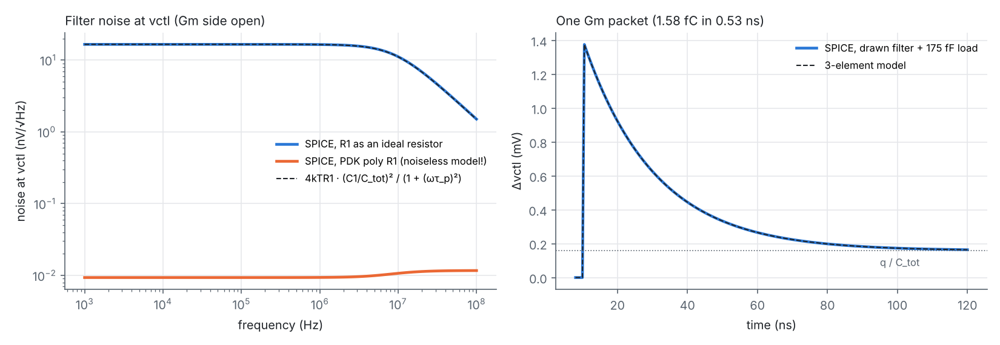
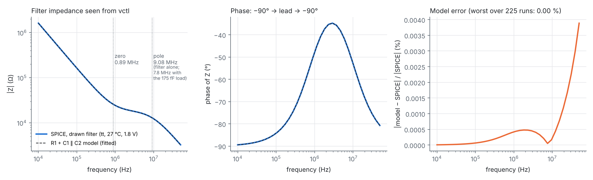
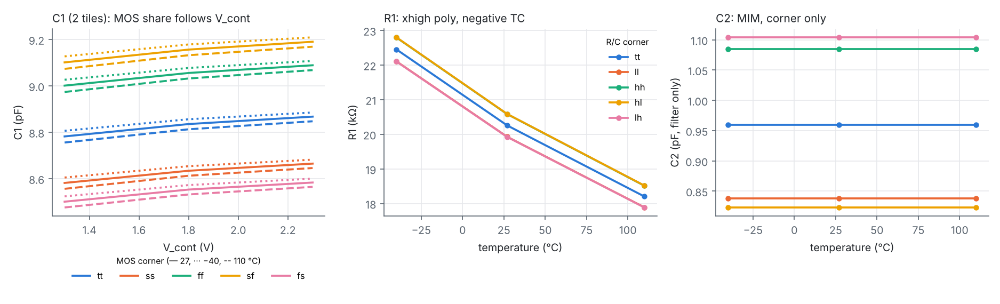
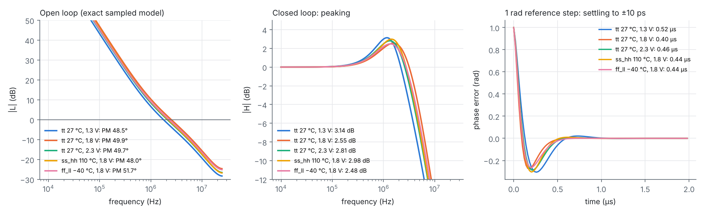
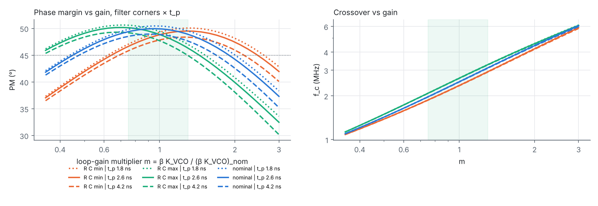
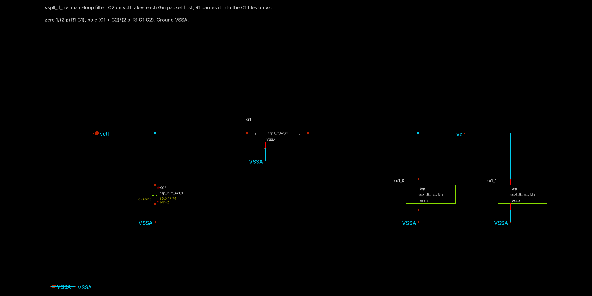
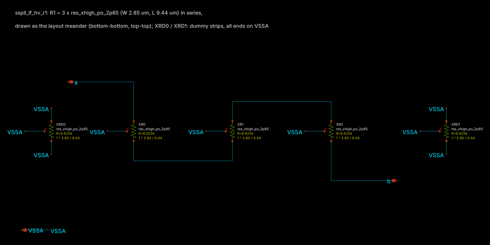
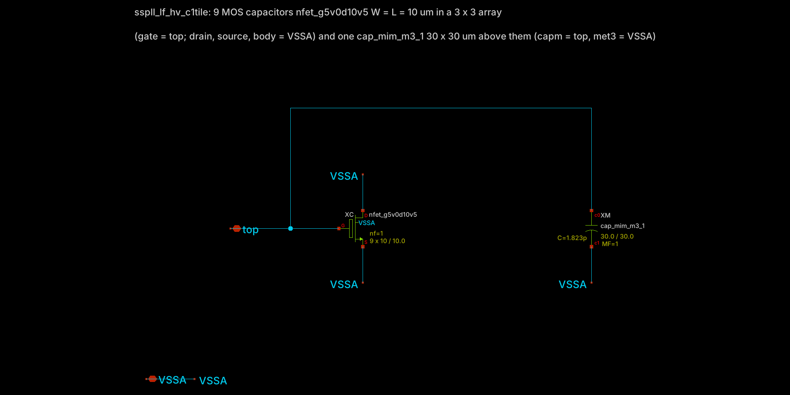

# The main-loop filter in real SKY130 devices

*Phase 7 (26 Nov 2026).* Deliverable: the loop filter of the loop design built from PDK devices
(thick-oxide MOS capacitors, MIM capacitors, xhigh poly resistor), resized for what the VCO, clock-generator and Gm designs measured, and
verified over PVT, with schematic (xschem, hierarchical, LVS-clean) and sizing table. Design files
`design/loop/lf_hv.py`, `lf_hv_sim.py`, `lf_hv_plots.py`, `schematics_hv.py`; schematics `xschem/lf_hv/`; data
`design/loop/data/lf_hv_*.json`; methods M24 and M25 (new, explained in `docs/testbench_guide.md`).

Reproduce (in `design/loop`):

```bash
python3 lf_hv_sim.py load         # what else hangs on vctl: ring tuning gates (lock-in on the running ring) + Gm port  (M24)
python3 lf_hv_sim.py size         # R1 length and C2 width for f_c 2.5 MHz / PM 50 deg with the measured beta, K_VCO, t_p (M25)
python3 lf_hv_sim.py corners      # AC of the drawn filter, 25 corners x 3 temperatures x 3 V_cont, R1/C1/C2 extracted (M25)
python3 lf_hv_sim.py loop noise leak pulse   # loop at PVT, robustness, noise, leakage, one Gm packet
python3 lf_hv_plots.py            # docs/img/lf_hv_*.png
python3 schematics_hv.py             # xschem/lf_hv/*, drawing checks, LVS reference                        (M5)
cd ../../xschem && ./lvs.sh lf_hv/sspll_lf_hv.sch netlist/ref_lf_hv.spice sspll_lf_hv                      # M4
```

## Result in one paragraph

The filter is **C2 = 2 × cap_mim_m3_1 30 × 7.74 µm (0.960 pF)** on vctl, **R1 = 3 × res_xhigh_po_2p85, L = 9.44 µm
each, in series (20.26 kΩ at tt 27 °C)** from vctl to vz, and **C1 = 2 tiles of 9 nfet_g5v0d10v5 MOS capacitors
(W = L = 10 µm) under a 30 × 30 µm cap_mim_m3_1 (8.84 pF at 1.8 V)** on vz. It occupies about 3 800 µm². Two things
that the loop design could not know moved the design. First, the Gm packet arrives **2.62 ns** after the sample (clock-generator design),
not 0.5 ns. Second, the ring's six tuning gates, the Gm's port and the wiring add **175 fF** on vctl. Built as handed
on, the loop-design filter would have given f_c 2.42 MHz and PM 46.6°. So R1 was shortened by 1.7 % and C2 drawn 22 %
smaller. With the measured β = 0.79 µA/rad, K_VCO = 175 MHz/V (local slope at 1.8 V) and t_p = 2.62 ns, the loop is
**f_c 2.52 MHz, PM 49.9°, 2.55 dB peaking, settling to ±10 ps in 0.40 µs**. At the five PVT points where every
block has been measured, after the Gm trim, PM is 48.0–51.7° and f_c 1.77–2.52 MHz. The 3-element model R1 +
C1 ∥ C2 matches SPICE within 0.004 % over all 225 corner runs. One Gm packet gives the same vctl waveform in SPICE
and in the model, to 0.1 %. **One finding matters beyond this step:** the SKY130 ngspice poly resistors are
behavioural (voltage-dependent) resistors, which ngspice treats as **noiseless**. The R1 noise (16.5 nV/√Hz at vctl,
0.42 ps of jitter with FFNC off) exists only in the hand model. Every noise simulation with a poly resistor in this
PDK must add it by hand.

## What happens, how, why

### What happens

Once per reference period the pulsed Gm pushes a charge packet q = β·T·φ_e into vctl. The filter turns
that packet into the VCO's control voltage in two parts:

- **A fast step**, the proportional path. The packet lands on C2 first, so vctl jumps by q/C2 and the VCO frequency
  jumps with it. This is what damps the loop.
- **A slow, permanent step**, the integral path. Through R1 the charge spreads into C1 with the time constant
  τ_p = R1·C1·C2/(C1 + C2) ≈ 18 ns. What stays is q/C_tot. C1 remembers the sum of all packets, which makes the
  loop type 2: zero static phase error for a frequency offset.



### How it happens

The impedance seen from vctl is C2 in parallel with the series branch R1 + C1:

$$Z(s) = \frac{1 + sR_1C_1}{s\,(C_1 + C_2)\,(1 + s\,R_1 C_1 C_2/(C_1 + C_2))}$$

- At low frequency Z ≈ 1/(s·C_tot), an integrator. Phase −90°.
- At the **zero** f_z = 1/(2π R1 C1) = 0.889 MHz, the resistor starts to dominate. |Z| flattens at about R1·C1/C_tot
  and the phase rises toward 0°. This is the phase lead that makes the loop stable.
- At the **pole** f_p = C_tot/(2π R1 C1 C2) = 7.81 MHz (with the 175 fF load), C2 takes over and the phase goes back
  to −90°. The pole filters the reference ripple.
- The crossover f_c = 2.5 MHz sits between them, near the geometric mean √(f_z f_p) = 2.6 MHz. That is where the lead
  is largest. The sampled model then subtracts the delay t_p and the sample-and-hold, giving PM 50°.



### Why it happens this way

- **Why a resistor in series with the big capacitor.** A type-2 loop has two integrators (VCO and C1), so it has −180°
  of phase everywhere. Without R1 it would oscillate. R1 adds a zero, and so +lead phase, near the crossover.
- **Why C2 at all.** Without C2 each packet would make vctl jump by q·R1/τ for the duration of the pulse. That is a
  large spike at f_ref, which phase-modulates the VCO and makes reference spurs. C2 holds the packet and spreads the
  correction over τ_p.
- **Why MOS capacitors under the MIM.** C1 must be large: 8.8 pF. In SKY130 a MIM gives 2.0 fF/µm² and a thick-oxide
  MOS capacitor in inversion gives 2.87 fF/µm². Stacking them in one footprint gives 4.4 pF per 35 × 35 µm tile. The
  MOS capacitor is non-linear, but only in depletion below about 1 V, and the V_cont window is 1.3–2.3 V.
- **Why C2 is pure MIM.** C2 sets the pole and the step size; it must not change with V_cont. The MIM is linear.

## A. What changed against the loop design, and why

The loop design designed the filter before the blocks around it existed. It assumed β = 0.911 µA/rad with K_VCO = 150
MHz/V, a packet delay t_p = 0.5 ns, and no load on vctl. The block designs have now measured all of these:

| Quantity | Assumed | Measured | Effect on the loop-design filter |
|---|---|---|---|
| β · K_VCO | 0.911 µA/rad × 150 MHz/V | 0.79 µA/rad × 173 MHz/V (the Gm design) | same product (136.7 vs 136.6): none |
| Packet delay t_p | 0.5 ns | **2.62 ns** at tt (1.83–4.15 ns over PVT) | PM 50.0° → 48.6° |
| Load on vctl | 0 | **175 fF** (ring 124, Gm 31, wiring 20) | with it: f_c 2.42 MHz, **PM 46.6°** |

**Why the delay grew.** The Gm design found that the Gm needs about 2 ns to recover after the SSPD's tracking phase, so
the clock-generator design delays the Gm pulse by gap 1 = 2.36 ns. The packet then reaches the filter 2.62 ns after the sample, and every
nanosecond of delay costs 360°·f_c·t_p ≈ 0.9° of phase at 2.5 MHz.

**Why the load matters.** C2 is only about 1 pF, so 175 fF is 15 % of it. The load moves the pole down (9.08 → 7.81
MHz with the loop-design values), and the pole eats phase at f_c.

**What was kept and what was changed.**

- **C1 was kept:** 2 tiles. It is set by area and the R1 noise trade (the loop design section C), and β is already built
  for it.
- **R1 and C2 were re-solved.** With C1 fixed, the two knobs R1 and C2 meet the two targets f_c = 2.5 MHz and
  PM = 50°. The solver works on the SPICE-extracted values (method M25), not on hand values. Result: R1 20.60 →
  20.26 kΩ, and C2 total 1.236 → 1.135 pF, of which 175 fF is the load, so **the drawn C2 is 0.960 pF**.

## B. What else hangs on vctl (method M24)

The filter does not see only itself. Three other things load vctl, and all three go into C2's budget.

**1. The ring's tuning gates (VCO design).** vctl drives the gates of the six fine-tuning switches (nfet_g5v0d10v5,
2 × 5 µm / 1 µm each). Their capacitance depends on the ring's node voltages, which swing at 800 MHz. So a small-signal
AC at a DC operating point is wrong: the switch is on for part of the cycle and off for the rest. The bench measures
the **cycle-averaged** capacitance on the running ring. A 50 mV, 25 MHz sine rides on vtune, and the current component
at 25 MHz in phase with dv/dt is read out by a lock-in over 400 ns (10 periods of the sine, about 320 ring cycles):

$$C = \frac{2}{T_w}\int i(t)\cos(\omega t)\,dt \Big/ (\omega \cdot 50\,\text{mV})$$

| Corner | V_cont 1.3 V | 1.8 V | 2.3 V |
|---|---|---|---|
| tt 27 °C | 115.6 fF | 124.4 fF | 135.6 fF |
| ss 110 °C | 116.7 fF | 119.8 fF | 133.1 fF |
| ff −40 °C | 116.1 fF | 127.0 fF | 136.4 fF |

The capacitance rises with V_cont because a higher gate voltage keeps the switch on for a larger part of the cycle.
The in-quadrature part is a conductance of at most 75 nS (13 MΩ), negligible beside the filter.

**2. The Gm's port (Gm design).** At vctl the Gm shows the drain of its steering TG and the gate of the dump buffer's
input. AC at 25 MHz, at the Gm's operating point: 26–34 fF with the TG off and 63–91 fF with it on. The TG is on for
τ/T = 2.7 % of the period, so the average is 27–35 fF.

**3. Wiring.** About 300 µm of met2/met3 from the Gm through the filter to the ring: 20 fF, an estimate until
the parasitic extraction extracts it.

Total at tt, 1.8 V: **175 fF** (170–184 fF over the window and corners).

## C. Sizing against SPICE (method M25)

The sizing loop: simulate the drawn filter (AC, tt 27 °C, V_cont 1.8 V), extract R1, C1 and C2 by fitting
Y(f) = sC2 + 1/(R1 + 1/(sC1)) from 10 kHz to 50 MHz, add the load, solve the exact sampled loop
(`sampled_loop.py`), then change R1's length and C2's width and repeat.

| Iteration | R1 segment L | C2 MIM width | R1 (fit) | C1 (fit) | C2 (fit) + load | f_c | PM |
|---|---|---|---|---|---|---|---|
| 0 (the loop design values) | 9.30 µm | 9.30 µm | 19.96 kΩ | 8.835 pF | 1.148 + 0.175 pF | 2.41 MHz | 47.7° |
| 1 (final) | **9.44 µm** | **7.74 µm** | **20.26 kΩ** | **8.836 pF** | **0.960 + 0.175 pF** | **2.50 MHz** | **49.9°** |

**Why three segments of 9.44 µm and not one of 29.2 µm.** The poly strip is folded into three for a compact,
square layout. Each segment carries its own two contact heads (about 160 Ω per segment in the SPICE fit:
R = 699.2 Ω/µm · L + 159.6 Ω). The folded resistor therefore needs 28.3 µm of body instead of 29.2 µm for the
same value.

**The MOS capacitor's channel resistance.** C1's MOS units have a channel between gate charge and the source/drain
contacts, which adds a resistance in series with C1. The fit gives R(fit) − R1(alone) = −8 Ω, which is zero within
the fit's accuracy. The reason: BSIM4 in ngspice is quasi-static by default; the channel charge is lumped at the
terminals, with no resistance in series. The hand estimate for W = L = 10 µm thick-oxide units at V_ov ≈ 1 V,
contacted on both sides, is R_ch ≈ L/(12·W·µC_ox·V_ov) ≈ 1.6 kΩ per unit, so about 90 Ω for 18 units in parallel.
That is 0.4 % of R1, which moves the zero by 0.4 %. It can be neglected.

## D. R1, C1 and C2 over PVT (method M25)

The drawn filter was simulated at 5 MOS corners (tt, ss, ff, sf, fs) × 5 R/C corners (tt, ll, hh, hl, lh) ×
−40 / 27 / 110 °C × V_cont 1.3 / 1.8 / 2.3 V: 225 runs. R1, C1 and C2 were extracted from each run.



| Element | tt 27 °C 1.8 V | min (where) | max (where) | spread | dominant cause |
|---|---|---|---|---|---|
| R1 | 20.26 kΩ | 17.88 kΩ (lh, 110 °C) | 22.80 kΩ (hl, −40 °C) | ×0.88 – ×1.13 | temperature: −1.3 %/10 °C; R corner only ±2.5 % |
| C1 | 8.836 pF | 8.02 pF (fs_hl, 110 °C, 1.3 V) | 9.69 pF (sf_lh, −40 °C, 2.3 V) | ×0.91 – ×1.10 | MIM corner (±12 %, 41 % of C1) and MOS corner (−4 / +4 %) |
| C2 | 0.960 pF | 0.823 pF (hl) | 1.104 pF (lh) | ×0.86 – ×1.15 | MIM corner only; no temperature or voltage dependence |

- **C1 vs V_cont** at tt 27 °C: 8.782 / 8.836 / 8.868 pF at 1.3 / 1.8 / 2.3 V, so +1 % over the window. The MOS
  units are in strong inversion and the MIM is flat.
- **The 3-element model holds everywhere.** Its worst error against SPICE from 10 kHz to 25 MHz is 0.004 %
  over all 225 runs. There is no distributed behaviour to worry about at these frequencies (the poly resistor's
  own capacitance to the substrate is 27 fF, split across its ends, and it is on VSSA).
- **What moves f_c.** Above the zero f_c ∝ β K_VCO R1 C1/C_tot, so f_c follows R1: it falls as the chip heats up,
  at fixed β·K_VCO. The zero and the pole move together with R1·C, so their ratio, and with it the maximum phase lead,
  hardly changes.

## E. The loop at PVT, and robustness

**The five points where every block has been measured.** β is the Gm whole-detector value at lock (cubic fit,
corrected for the final C1 node), times the Gm trim code. K_VCO is the local slope of the VCO tuning curve
at V_cont. t_p is the clock-generator packet delay at that corner. The filter values are extracted at the same corner,
temperature and V_cont, with the load of section B.

| Condition | code | β (µA/rad) | K_VCO (MHz/V) | t_p (ns) | m | f_c (MHz) | PM | peak (dB) | f_3dB (MHz) | settle ±10 ps |
|---|---|---|---|---|---|---|---|---|---|---|
| tt 27 °C, V_cont 1.3 V | 00 | 0.783 | 114 | 2.62 | 0.66 | 1.77 | 48.5° | 3.14 | 2.93 | 0.52 µs |
| tt 27 °C, V_cont 1.8 V | 00 | 0.788 | 175 | 2.62 | 1.01 | **2.52** | **49.9°** | **2.55** | 4.33 | **0.40 µs** |
| tt 27 °C, V_cont 2.3 V | 00 | 0.722 | 154 | 2.62 | 0.81 | 2.10 | 49.7° | 2.81 | 3.56 | 0.46 µs |
| ss_hh 110 °C, 2.97 V, 1.8 V | 11 | 1.131 | 112 | 3.34 | 0.93 | 2.18 | 48.0° | 2.98 | 3.75 | 0.44 µs |
| ff_ll −40 °C, 3.63 V, 1.8 V | 10 | 0.447 | 250 | 2.14 | 0.82 | 2.28 | 51.7° | 2.48 | 3.85 | 0.44 µs |

(m = β·K_VCO divided by the nominal 0.79 µA/rad × 173 MHz/V.) At 1.3 V the ring's tuning curve bends: the switch
starts to conduct there, so the local K_VCO is only 114 MHz/V. The loop is slower but still well damped. FLL
places the lock point near the middle of the window.



**Robustness.** PM vs the loop-gain multiplier m for the nominal filter and the two extreme filter corners (the
smallest and largest R1·C_tot), each with t_p = 1.8, 2.6 and 4.2 ns (the clock-generator range):



| Filter corner | t_p | PM ≥ 45° for m in | inside m 0.75–1.3 (after trim): PM, f_c |
|---|---|---|---|
| nominal (tt 27 °C 1.8 V) | 2.6 ns | 0.47 – 1.82 | 49.0–49.9°, 2.01–3.05 MHz |
| R·C min (fs_ll 110 °C 1.3 V) | 2.6 ns | 0.67 – 2.42 | 46.9–49.5°, 1.91–2.87 MHz |
| R·C max (sf_hh −40 °C 2.3 V) | 2.6 ns | 0.35 – 1.36 | 46.6–50.1°, 2.13–3.21 MHz |
| R·C max, worst delay | 4.2 ns | 0.35 – 1.27 | **45.2°** – 49.1°, 2.12–3.20 MHz |

After the trim, m is 0.82–1.01 at the measured corners at V_cont 1.8 V (0.66 at the 1.3 V edge, from the ring's
knee). The trim budget is 0.75–1.3, and inside it PM stays ≥ 45° for every combination of filter corner and packet
delay.

## F. Noise: the PDK resistor is noiseless in ngspice

The noise bench drives vctl from an ideal current source (the Gm is a current source, so the filter's own noise
appears at vctl unloaded) and runs `.noise` from 1 kHz to 100 MHz. It was run twice: with the drawn R1, and with R1
replaced by an ideal resistor of the fitted value.

| | at 100 kHz | at 5 MHz | at 20 MHz |
|---|---|---|---|
| SPICE, PDK res_xhigh_po_2p85 | 0.009 nV/√Hz | 0.010 | 0.011 |
| SPICE, ideal 20.26 kΩ | 16.54 nV/√Hz | 14.50 | 6.88 |
| Theory 4kTR1 · (C1/C_tot)² / (1 + (ωτ_p)²) | 16.53 nV/√Hz | 14.47 | 6.84 |

**Why.** The PDK model is
`rbody ra r2 r = {rbody*(1 + |v(r1,r2)|·vc1 + ...)}`: the resistance depends on the voltage across it, so ngspice
makes it a behavioural element, and behavioural elements have no thermal noise. The same holds for every
res_high_po / res_xhigh_po device in this PDK. **Consequences:**

- This step's R1 noise is correct only because the budget system model adds 4kTR1 by hand. With the final values it
  gives **0.42 ps (FFNC off) and 0.23 ps (on)** of R1 jitter in totals of 2.14 / 1.37 ps (typ), the same as the loop design.
- Any earlier `.noise` or transient-noise run with a poly resistor in the signal path (the Gm's R_S in the Gm design,
  the receiver in the reference-receiver design, the bias dividers) may have left that resistor's noise out. **Hand-off to Full
  noise sign-off:** re-run each such bench with the poly resistors swapped for ideal noisy ones of the same value,
  and check the same in Spectre with the Cadence kit.

## G. Leakage and one packet

**Leakage.** DC current into the filter at V_cont 1.3 and 2.3 V, tt / ff / ss / ff_hh / ss_hh, 27 and 110 °C:
below 1e-17 A everywhere. The models have no gate tunnelling for the thick oxide (it is negligible through 12 nm),
and the MIM is ideal. The real leakage on vctl is the junction leakage of the Gm's TG drains (Gm design). For scale:
a leakage I gives a static phase offset I/β (1 nA → 1.3 mrad, 0.25 ps) and a reference spur, because the leakage drains vctl continuously and the Gm refills it once per period. The
sawtooth's fundamental is about (I/π)·|Z(f_ref)| = 0.9 µV for 1 nA (|Z| = 2.8 kΩ at 50 MHz). The spur is
20 log(K_VCO·V₁/(2 f_ref)) ≈ −116 dBc. Spurs uses the post-layout value.

**One packet.** A 0.53 ns current pulse carrying 1.58 fC (the packet at 0.1 rad of phase error) into the drawn filter
with the 175 fF load. SPICE peak 1.376 mV, model 1.377 mV; final 0.1585 mV in both, which is q/C_tot. The MOS
capacitor's non-linearity is invisible at these amplitudes (figure in "What happens").

## H. Schematics (hierarchical, real wiring, LVS-clean)

| Cell | Content |
|---|---|
| `sspll_lf_hv_r1` | three res_xhigh_po_2p85 segments, drawn as the layout's meander (bottom-to-bottom, top-to-top), two dummy strips with all ends on VSSA |
| `sspll_lf_hv_c1tile` | 9 nfet_g5v0d10v5 MOS capacitors (gate = top; D, S, B = VSSA) and the 30 × 30 µm cap_mim_m3_1 above them |
| `sspll_lf_hv` | C2 on vctl, R1 from vctl to vz, two C1 tiles on vz; ports vctl, VSSA |





All three cells pass the drawing checks and match the simulated netlist in netgen (`tools/lvs_hv_all.py`: 32 cells,
all match).

## I. Sizing table (all devices pass `tools/pdk_limits.py`)

| Instance | Device | W | L | count | role |
|---|---|---|---|---|---|
| XR0–XR2 | res_xhigh_po_2p85 | 2.85 µm | 9.44 µm | 3 in series | R1 = 20.26 kΩ (tt 27 °C) |
| XRD0, XRD1 | res_xhigh_po_2p85 | 2.85 µm | 9.44 µm | 2 | dummies, all ends on VSSA |
| XC (per tile) | nfet_g5v0d10v5 | 10 µm | 10 µm | 9 per tile, 2 tiles | C1 MOS part, 5.17 pF |
| XM (per tile) | cap_mim_m3_1 | 30 µm | 30 µm | 1 per tile, 2 tiles | C1 MIM part, 3.65 pF |
| XC2 | cap_mim_m3_1 | 30 µm | 7.74 µm | 2 | C2 = 0.960 pF |

C1 = 8.836 pF, C2 = 0.960 pF (+0.175 pF load), C_tot = 9.97 pF. The FLL slews V_cont at 10 µA / 9.97 pF =
1.0 V/µs.

## J. Layout guidance (for layout)

- **C1 tiles:** 3 × 3 MOS units (10 × 10 µm, gates strapped in met1/met2 to vz) with the 30 × 30 µm MIM on met3/capm
  above. The MIM's bottom plate (met3) is VSSA and also shields the MOS gates from routing above. Two tiles side by
  side, about 75 × 35 µm.
- **R1:** three strips at a 6 µm pitch, connected by met1 at alternate ends, plus one dummy strip each side. Keep it
  away from the ring and the clock generator. Its body sits over the substrate (VSSA), and its 27 fF to the substrate
  is part of the simulated model.
- **C2:** two 30 × 7.74 µm MIMs, as close to the Gm's vctl pin as possible. The packet should see C2 before any
  wiring resistance.
- **vctl** is the most sensitive analog net of the PLL: 1 mV is 175 kHz of VCO frequency. Route it in met2/met3
  with a VSSA shield on both sides, never parallel to clocks. The parasitic extraction replaces the 20 fF wiring estimate with the
  extracted value, and the sizing loop of section C absorbs it in C2's width.
- Area: C1 2 × 35² + C2 2 × 35 × 12.7 + R1 5 × 6 × 15.4 ≈ **3 800 µm²**.

## K. Requirements handed on

1. **FLL:** C_tot 9.97 pF; 10 µA slews 1.0 V/µs. Place the lock point near 1.8 V: at 1.3 V the local
   K_VCO falls to 114 MHz/V (f_c 1.77 MHz).
2. **Spurs:** leakage on vctl from the Gm's TG junctions, post-layout.
3. **Noise sign-off:** add poly-resistor thermal noise by hand or with ideal resistors (section F); check
   in Spectre.
4. **Extraction:** replace the 20 fF wiring estimate with the extracted vctl capacitance and re-run
   `lf_hv_sim.py size`.

## L. Problems met and how they were solved

| Problem | Found by | Cause | Solution |
|---|---|---|---|
| loop-design filter gives PM 46.6° with the real blocks | `lf_hv_sim.py size`, iteration 0 | t_p 2.62 ns instead of 0.5 ns, 175 fF load on vctl not counted | re-solve R1 and C2 with C1 fixed, on SPICE-extracted values |
| The ring's tuning-port capacitance has no meaningful AC value | first attempt: AC at a DC point of the ring | the switch's gate capacitance follows the 800 MHz swing | lock-in of a 25 MHz sine on the running ring (M24) |
| Packet run drifted by −1.9 mV | `lf_hv_sim.py pulse`, first run | `uic` with node `.ic` left the MOS capacitor's internal charge out of equilibrium | start from the operating point (no `uic`) |
| `.noise` aborted | first noise run | ngspice's KLU solver does not support noise analysis | `option sparse` in the control block |
| R1 noise 2 000× below 4kTR | noise run | PDK poly resistors are behavioural, so noiseless in ngspice | second run with an ideal R; hand-off to the noise sign-off |

## Testbenches

See `docs/testbench_guide.md`, "5 V loop-filter benches (M24, M25)".

## Interview questions (loop-filter design)

**1. Why does a charge-pump PLL with a lone R–C (no C2) suffer reference spurs, and what does C2 cost you?**

*Short answer.* Without C2, each packet makes vctl jump by I·R1 for the length of the pulse. C2 smooths that, but
adds a pole that costs phase margin.

*In detail.* With the pump current I_p flowing for τ each period into R1 + C1, vctl = I_p·R1 + (integral on C1). The
I_p·R1 term is a pulse of height I_p R1 and width τ at f_ref. Its Fourier series has lines at every multiple of f_ref,
and they frequency-modulate the VCO: a line of amplitude ΔV at f_ref gives a spur of
20 log(K_VCO·ΔV/(2 f_ref)) dBc. Here the packet current is β·T/τ = 30 µA per radian of phase error, so I_p·R1 would be
0.6 V per radian for 0.53 ns: 60 mV spikes at only 0.1 rad. C2 turns
the pulse into a step of q/C2 that decays with τ_p = R1 C1 C2/C_tot (≈ 18 ns). The cost is a pole at
f_p = 1/(2π τ_p). With b = f_p/f_z, the maximum lead is arctan(√b) − arctan(1/√b):
b = 8.8 gives about 53°. A larger b (smaller C2) means more phase but less filtering. The usual choice is
b = 8–16, with f_c near √(f_z f_p).

**2. In a sampled loop, why does the delay between the phase sample and the charge packet matter, and how much?**

*Short answer.* A delay t_p is a phase lag of 360°·f·t_p at frequency f. At f_c = 2.5 MHz each nanosecond costs 0.9°.

*In detail.* The packet that corrects the error sampled at kT is delivered at kT + t_p. In the z-domain the loop is
exact if the filter's state is propagated over T − t_p after the packet and t_p before it, which is what
`sampled_loop.py` does with the matrix exponential. Linearised, the delay multiplies L(jω) by e^(−jωt_p), so
ΔPM = −360°·f_c·t_p: 2.62 ns at 2.5 MHz costs 2.4°. Going from the assumed 0.5 ns to 2.62 ns costs 1.9° in this
linear estimate; the exact sampled model gives 50.0° → 48.6°, because f_c also shifts a little. There is a
second, smaller lag from sampling itself, the zero-order hold e^(−jωT/2), worth 9° at f_c/f_ref = 1/20. Delay
grows in importance as f_c/f_ref grows, so sub-sampling PLLs, which run wide loops, watch it closely.

**3. How do you size a loop filter when the blocks around it change?**

*Short answer.* Keep the products that define the loop, not the components. Only β·K_VCO/C sets f_c, and only the
ratios set the phase. When C1 is fixed by area, R1 and C2 are the two knobs for the two targets f_c and PM.

*In detail.* Scaling all capacitances by k, R1 by 1/k and β by k leaves the loop unchanged. That is how the loop design chose
C1 (area against R1 noise, since 4kTR1 grows as 1/k). Here β·K_VCO stayed the same, but t_p and the load changed. The
solver therefore re-solved R1 and C2 on SPICE-extracted values: simulate, fit, add the load, solve the sampled loop,
change the geometry, repeat. Two iterations converged, R1 −1.7 % and C2 −22 % (drawn).

**4. What is the capacitance seen at a VCO's tuning input, and how do you measure it while the VCO runs?**

*Short answer.* It is the average, over the oscillation cycle, of a capacitance that changes within the cycle.
Measure it with a small slow sine and a lock-in on the transient.

*In detail.* The tuning switches' gate-to-channel capacitance depends on the ring node voltages, which swing at
800 MHz. A linear AC analysis at one DC point picks one instant of the cycle. What the loop filter sees at f ≪ f_osc is
the average charge per volt. The bench adds 50 mV at 25 MHz on vtune and integrates i(t)·cos(ωt) over an integer
number of sine periods (400 ns, about 320 ring periods, so the 800 MHz current averages out). C = in-phase current /
(ω·50 mV) = 124 fF at tt 1.8 V. The in-quadrature part is the conductance, here negligible. This is the
large-signal-averaged (describing-function) capacitance, the same idea as the effective capacitance of a varactor in
an LC VCO.

**5. Why use a MOS capacitor in a loop filter at all, and what can go wrong?**

*Short answer.* It has the highest density in the process, but it is non-linear, leaky in thin oxide, and has
channel resistance.

*In detail.*
- **Density.** In SKY130 the 5 V nMOS in inversion gives 2.87 fF/µm², the MIM 2.0 fF/µm². Stacked they give
  4.9 fF/µm² of footprint.
- **Non-linearity.** C_gate goes from C_ox (inversion) through a minimum (depletion) to C_ox (accumulation). Keep the
  gate above V_T + a few hundred mV over the whole V_cont window: here 1.3–2.3 V against V_T ≈ 0.8 V, so C1 changes by
  1 %.
- **Leakage.** Thin oxide (1.8 V devices, about 4 nm) leaks by gate tunnelling, and on a large capacitor that
  current makes a static phase offset and reference spurs. The 5 V thick oxide (about 12 nm) does not leak
  measurably.
- **Channel resistance.** It adds in series with C1 (≈ 90 Ω here, 0.4 % of R1). Quasi-static SPICE models do not
  show it; NQS models (acnqsmod) or a hand estimate do.
- **Use only for C1.** C1 is in series with R1, so its tolerance moves the zero a little. C2, which sets the pole and
  the step, should be the linear MIM.

**6. The PDK's poly resistor gave 2 000× less noise than 4kTR in .noise. What happened, and how do you protect a
design from this?**

*Short answer.* The resistor is a behavioural, voltage-dependent element, and ngspice gives behavioural elements no
thermal noise.

*In detail.* `r = {rbody*(1 + |v|·vc1 + ...)}` makes ngspice build a B-source-like resistor. Its noise is not
modelled. The fix is to know your models: compare one `.noise` run against 4kT/R on a lone resistor whenever you
use a new PDK or simulator. Replace the resistor by an ideal one of the same value for noise runs, or add the noise
in a system model. Then repeat in a second simulator, such as Spectre with the Cadence kit. Here the budget model
already carried 4kTR1, so the jitter numbers stand. But every other poly resistor in the design is now on a noise
checklist.

**7. How do process and temperature move f_c and PM of a type-2 loop, and what does a trim fix?**

*Short answer.* Above the zero f_c ≈ β K_VCO R1 C1/(2π C_tot), so f_c follows the product of gain and R1. PM follows
where f_c lands between the zero and the pole. A gain trim fixes β·K_VCO but not the filter's R1 and C spread.

*In detail.* Here R1 spans ×0.88–1.13 (mostly temperature), C1 ×0.91–1.10, C2 ×0.86–1.15. The zero and pole move
together with R1·C, so the ratio b stays about 8.8 and the maximum lead stays about the same. The lead just occurs at
a different frequency. So the PM-vs-m curve shifts sideways (figure in section E), and the robustness criterion is a
range of m with PM ≥ 45° for each filter corner. The trim's job is to land m inside the overlap of those ranges:
0.75–1.3 gives PM ≥ 45.2° even with the worst t_p of 4.2 ns.

**8. Why can't you just make R1 bigger and C1 smaller to save area?**

*Short answer.* The loop stays the same if β scales with C1, but R1's noise grows: its voltage noise is 4kTR1, and it
reaches the VCO without being divided down.

*In detail.* The R1 noise at vctl is 4kTR1 (C1/C_tot)² up to the pole. The VCO turns it into phase noise
K_VCO²·v_n²/f² within the loop bandwidth, where the loop suppresses it only partly. Its jitter grows as √R1. The loop design
compared 1–6 tiles: 2 tiles cost 0.013 ps against 3 tiles and saved 1 500 µm². A lower β also makes the Gm's and
SSPD's noise refer more strongly to the phase, so a smaller C1 is never free.

**9. What does a single-packet transient test tell you that AC analysis does not?**

*Short answer.* That the filter is linear at the actual signal size and time scale: no MOS non-linearity, no charge
sharing, no distributed effects, no initial-condition errors.

*In detail.* The 1.58 fC packet in 0.53 ns gives a 1.38 mV step that decays to 0.159 mV in about 3 τ_p. SPICE and the
3-element model agree to 0.1 % in peak and final value. That also verified the bench: a first run with `uic` drifted
by −1.9 mV, because the MOS capacitor's charge was not at equilibrium. Always start transient benches of MOS
capacitors from an operating point.

**10. Where should C2 be placed in the layout, and why does vctl need shielding?**

*Short answer.* Right at the charge pump's output, so that the packet sees C2 before any wiring resistance. vctl
must be shielded because K_VCO turns every millivolt of coupled noise into 175 kHz of frequency error.

*In detail.* Between the pump and C2, wiring resistance would make a small R in series, adding a spike to vctl at
every packet. Coupling from an 800 MHz or 50 MHz clock through even 1 fF into a 1.1 pF node gives about 1 mV per volt
of clock edge. At K_VCO 175 MHz/V that is a deterministic frequency kick every period, so a reference spur. Put VSSA
shields on both sides, in a different metal layer from the clocks, and route the net short and away from the ring.

**11. Why measure the filter's R and C by fitting the AC response instead of reading the device values?**

*Short answer.* The fit gives what the circuit really is, including heads, parasitic capacitance, model corners and
bias dependence, in the form the loop model uses.

*In detail.* The poly resistor's value includes two contact heads per segment (≈ 160 Ω each segment) and a voltage
coefficient. The MOS capacitor's value depends on V_cont and corner. The MIM has a perimeter term. Fitting
Y(f) = sC2 + 1/(R1 + 1/(sC1)) over 10 kHz–50 MHz returns three numbers and the worst model error. A 0.004 % error
proves that three elements describe the network at these frequencies. If it were large, the loop model would need
more states.

**12. What does a type-2 sampled loop with 2.5 MHz bandwidth at 50 MHz reference look like in settling, and what
sets it?**

*Short answer.* About 0.4 µs to ±10 ps after a 1 rad step, set by f_c and the damping: t_s ≈ few/(ζ ω_n).

*In detail.* With PM 50° the closed loop peaks by 2.5 dB and the step response overshoots by 28 %. The settling to
±10 ps (0.05 rad at 800 MHz) takes about 20 reference periods. Lower PM rings longer, and lower f_c settles slower
(0.52 µs at V_cont 1.3 V with f_c 1.77 MHz). Frequency acquisition is not done by this loop: the FLL
first slews V_cont at 1 V/µs, then hands over.
