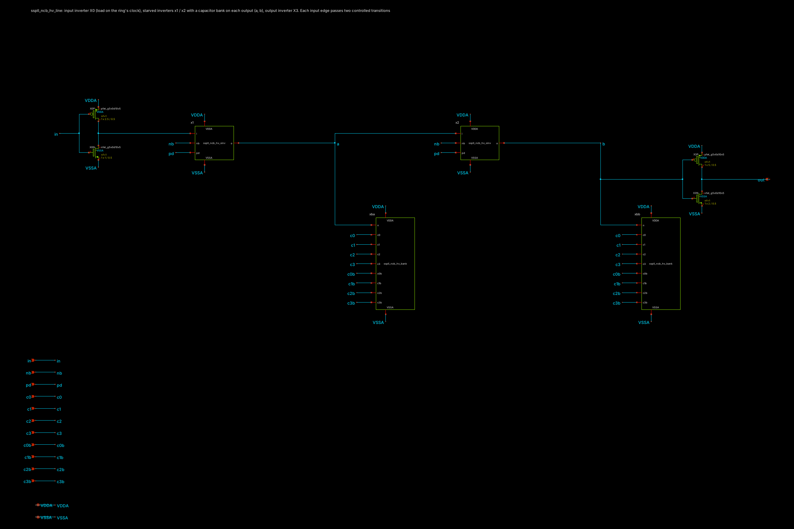
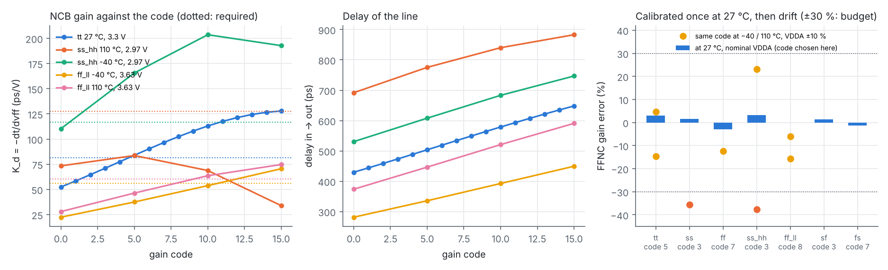
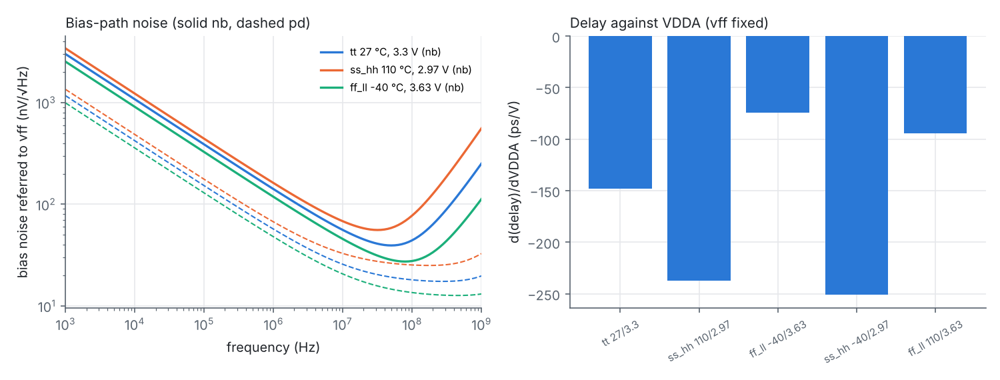
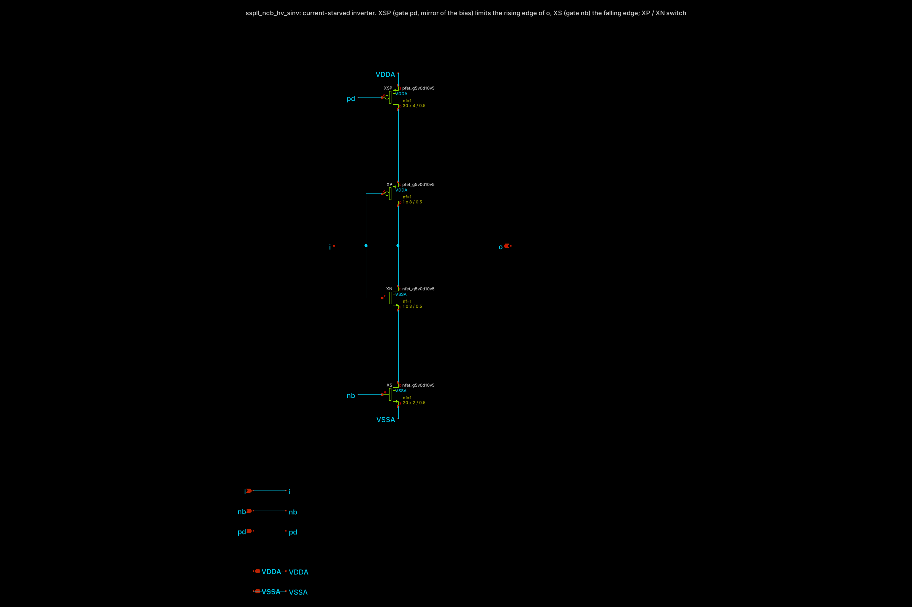
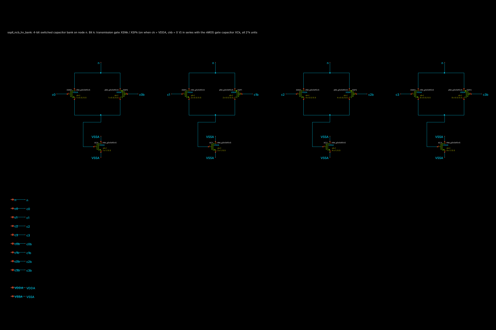

# The noise-cancellation block (NCB): a current-starved delay line with a 4-bit capacitor bank

*Phase 7 (26 Nov 2026).* Deliverable: the voltage-controlled delay line that turns vff (from the diff-to-SE amplifier)
into a delay correction of the ring's clock, with the 4-bit gain code that calibrates the feed-forward cancellation;
5 V devices on VDDA, verified over PVT, schematic (xschem, hierarchical, LVS-clean) and sizing table. Design files
`design/ncb/ncb_hv.py`, `ncb_hv_sim.py`, `ncb_hv_system.py`, `ncb_hv_plots.py`, `schematics_hv.py`; schematics
`xschem/ncb_hv/`; data `design/ncb/data/ncb_hv_*.json`; methods M31 (new), M9, M18, M21, M28–M30 (explained in
`docs/testbench_guide.md`).

Reproduce (in `design/ncb`):

```bash
python3 ncb_hv_sim.py P A    # SSPD + D2S at 27 C for four corner sections (M18), then K_d vs code at 15 conditions (M31)
python3 ncb_hv_sim.py B C D E   # control-path bandwidth and vff load, VDDA, bias-path noise, mismatch (M28, M21, M29, M30)
python3 ncb_hv_system.py     # the FFNC path (D2S + NCB) in the system model (M9)
python3 ncb_hv_plots.py      # docs/img/ncb_hv_*.png
python3 schematics_hv.py     # xschem/ncb_hv/*, drawing checks, LVS reference (M5)
cd ../.. && python3 tools/lvs_hv_all.py                                                     # M4, every block
```

## Result in one paragraph

One line from clkp to out: an input inverter, **two current-starved inverters**, each with a **4-bit switched
capacitor bank** on its output, and an output inverter. Each input edge passes two controlled transitions, one rising
and one falling, so both edges move by the same amount (duty error ≤ 10 ps at tt). The starving currents are
mirrored from one nMOS, **MI, a replica of the D2S's level diode (2/1 µm) with its gate on vff**. At rest
vff = V_GS of that diode, so MI's current is the same at every corner, and a higher vff shortens the delay:
**K_d = −dt/dvff = 52…128 ps/V over the 16 codes at tt** (84 ps/V at code 5, where 81 ps/V is needed). Calibrated once
at 27 °C, the code reaches the required gain within **±3.2 % in all seven corner sections**. With that code fixed,
temperature and VDDA move the gain by −16…+23 % in every section except the slow ones at 110 °C, 2.97 V (−36 / −38 %).
vff sees **5.6 fF**; the control path's own pole is at **71 / 79 MHz** (tt; 50 MHz at the slowest corner). The delay
falls with VDDA by **148 ps/V** (75–251), more than the budget's 104 ps/V; the system cost is in section F. The bias
noise referred to vff is 36 nV/√Hz white. Power is **1.65 mW** at tt and code 5 (1.07–2.86 mW over codes and corners).
On the way, the diff-to-SE amplifier's gain was raised from 1.1 to 1.5 (section B).



## What happens, how, why

### What happens
The SSPD measures, at every reference edge, how far the ring's edge is from where it should be. The D2S turns that
into vff. The NCB delays the ring's clock by an amount that depends on vff, so that an edge which came late is
passed on a little earlier, and an early one a little later. If the chain's gain is exactly one, the ring's phase
noise (above the loop bandwidth, up to about f_ref/8) is subtracted from the output:

$$G_{D2S}\cdot K_t\cdot K_d = 1\qquad\Rightarrow\qquad K_d = \frac{1}{G_{D2S} K_t} = \frac{1}{1.505 \times 8.17\ \text{mV/ps}} = 81\ \text{ps/V (tt)}$$

### How it happens
- **Current-starved inverter.** The switching pair XP / XN sits between two current sources: the pMOS starver XSP
  (gate pd) sets the rising current, the nMOS starver XS (gate nb) the falling one. A node of capacitance C that
  swings to the next stage's threshold ΔV takes t ≈ C·ΔV/I_s.
- **Gain of one stage.** I_s is a copy of MI's current, so

$$K_d = -\frac{dt}{dv_{ff}} = t\,\frac{1}{I_s}\frac{dI_s}{dv_{ff}} = t\,\frac{g_{m,MI}}{I_{MI}}$$

  Every input edge passes two such transitions (one in each starved stage), so the line's K_d is the sum of two.
- **The capacitor bank** adds 2^k unit capacitors (nMOS gate capacitors behind transmission gates) to each starved
  node for bit k. A larger C lengthens t, and with it K_d: the 4-bit code is the gain calibration.
- **Replica bias.** MI has the geometry and current density of the D2S's level diode XR, whose V_GS is vff's rest
  level. So I_MI(vff = V_0) is the same 22 µA at every corner, and only the signal changes it.

### Why it happens this way
- **Why starve both edges, in two stages:** if only one edge per line were controlled, the duty cycle would change with
  vff, and a single-ended load would see one edge move and the other not. Two inverting starved stages give every
  input edge one rising and one falling controlled transition.
- **Why mirrors and not vff on the starvers:** the starvers carry about 0.4–0.6 mA at the transitions; on vff they
  would load the D2S with about 170 fF. Through the mirror, vff sees only MI (5.6 fF).
- **Why the bank uses transmission gates:** a MOS capacitor switched by its source/drain voltage has an on/off ratio of
  only about 2 in the thick oxide (the depletion capacitance stays), and the gain range came out at 1.5×. Series
  switches give the range the calibration needs.

## A. Requirements

| Requirement | Where it comes from | Target |
|---|---|---|
| K_d at the calibration point | 1/(G_D2S K_t) at 27 °C per corner section | 67–101 ps/V, reached within ±5 % |
| Gain drift after calibration | budget: gain error 10 % typ, 30 % pessimistic | within ±30 % |
| Full swings at 800 MHz | every controlled node must settle within half a period | at all codes, all corners |
| Load on vff | the D2S's bandwidth | ≤ 40 fF |
| Control-path pole | it sits in the cancellation path with the D2S's | ≥ 50 MHz |
| VDDA → delay | budget K_s ≤ 104 ps/V (with the D2S's 19 ps/V) | ≤ 90 ps/V |
| Own noise | budget: −156 dBc/Hz at 800 MHz, corner 1 MHz | ≤ 31 fs typ |
| Power | budget 1.45 mW for D2S + NCB, 0.7 mW of slack in the chip total | ≤ 2 mW typ |

## B. The designs that did not work, and the change to the D2S

| Try | What happened | Why |
|---|---|---|
| Two lines (p and m), nMOS starvers on vff | 3.7 mW; t_d 540–670 ps, K_d 300–460 ps/V | every 5 V node at 3.3 V costs C·V²·f; slow, loaded stages |
| One line, starvers only on falling edges | 1.2 mW, but the unstarved rising edges were 130–290 ps and K_s −133 ps/V | half the transitions uncontrolled; their delay falls with VDDA |
| Bank as source/drain-switched MOS capacitors | K_d range 1.5× only | the thick-oxide gate keeps ~46 % of its capacitance when "off" |
| pMOS / nMOS series switches | K_d fell at high codes; node a swung 1.0–2.4 V only | the switch passed only part of the swing; the node could not finish within a half period |
| One fully starved stage | duty error up to 140 ps, no full swing at code 15 | one node had to carry all the gain |
| Two fully starved stages (final) | K_d 52–128 ps/V at tt, full swings, duty ≤ 10 ps | gain shared by two nodes, both edges controlled |

**The D2S gain.** With the D2S's first gain (1.10), the NCB needed 115 ps/V at tt and up to 195 ps/V at the slow
corners. That much gain means ~300 ps of current-controlled delay per edge, which at 800 MHz in 5 V devices does not
fit in a half period at the slow corners. The D2S had headroom for more gain: tails 8 µA instead of 6, R_DEG 2 × 20 kΩ
instead of 3, pMOS bias units 16/2 µm (lower V_SD,sat), so **G = 1.50 (1.44–1.57)**. Its f_3dB is unchanged with the
real 5.6 fF NCB load (the 40 fF assumed in the D2S design was conservative). A higher gain still (R_L 60 kΩ, G 2.1)
was tried and dropped: more vff swing gave the fast corners so much starving current that their gain fell out of the
bank's range. The D2S document has the revised numbers.

## C. Gain against the code, and calibration (method M31)

**M31:** a transient of the whole line (ring buffer → NCB → 20 fF), 10 periods at 800 MHz, delay of every edge from
in to out at VDDA/2 over the last four periods; vff at its lock value (V_0 + G·2A·0.1 rad of the condition) ±20 mV;
K_d from the difference. tt: all 16 codes; other conditions codes 0, 5, 10, 15 (interpolated between).

| Condition | needed K_d (ps/V) | K_d over the codes (ps/V) | best code | error |
|---|---|---|---|---|
| tt 27 °C, 3.3 V | 81 | 52–128 | 5 | +3.1 % |
| tt -40 °C, 3.3 V | 80 | 51–150 | 4 | -3.5 % |
| tt 110 °C, 3.3 V | 85 | 48–86 | 11 | +0.6 % |
| ss_hh 110 °C, 2.97 V | 128 | 34–84 | 5 | -34.5 % |
| ss_hh -40 °C, 2.97 V | 117 | 110–204 | 1 | +4.1 % |
| ff_ll -40 °C, 3.63 V | 56 | 22–71 | 11 | +1.9 % |
| ff_ll 110 °C, 3.63 V | 60 | 28–75 | 9 | -0.3 % |
| ss 110 °C, 2.97 V | 117 | 35–79 | 5 | -32.3 % |
| ff -40 °C, 3.63 V | 65 | 28–94 | 9 | +1.4 % |
| sf 27 °C, 3.3 V | 87 | 65–154 | 3 | +1.5 % |
| fs 27 °C, 3.3 V | 78 | 43–101 | 7 | -1.3 % |
| ss 27 °C, 3.3 V | 90 | 72–124 | 3 | +1.6 % |
| ff 27 °C, 3.3 V | 74 | 36–109 | 7 | -2.9 % |
| ss_hh 27 °C, 3.3 V | 101 | 81–142 | 3 | +3.2 % |
| ff_ll 27 °C, 3.3 V | 67 | 32–94 | 8 | -0.0 % |

(Each row picks its own best code: what calibration could do if it were repeated at that condition.)

**Calibration as it would happen on the chip.** Once, at 27 °C and nominal VDDA, the code that best cancels a supply
tone is chosen (the calibration loop is a later block). Then temperature and supply move:

| Corner section | code at 27 °C | error at 27 °C | the same code at other temperatures / VDDA |
|---|---|---|---|
| tt | 5 | +3.1 % | -40 °C, 3.3 V: +5 %, 110 °C, 3.3 V: -15 % |
| ss | 3 | +1.6 % | 110 °C, 2.97 V: -36 % |
| ff | 7 | -2.9 % | -40 °C, 3.63 V: -12 % |
| ss_hh | 3 | +3.2 % | 110 °C, 2.97 V: -38 %, -40 °C, 2.97 V: +23 % |
| ff_ll | 8 | -0.0 % | -40 °C, 3.63 V: -16 %, 110 °C, 3.63 V: -6 % |
| sf | 3 | +1.5 % | — |
| fs | 7 | -1.3 % | — |

Every section calibrates within ±3.2 %. The drift stays within the budget's ±30 % except for the slow sections at
110 °C with VDDA −10 % (−36 %, −38 %): there the line slows down, the stages become partly switch-limited and the gain
falls. Nagam & Kinget show that 30 % of gain error still gives about 8 dB of cancellation at 300 kHz; a re-calibration
when the temperature has moved would remove it.



## D. Control path and the load on vff (method M28)

| Condition | vff → nb f_3dB | vff → pd f_3dB | capacitance on vff |
|---|---|---|---|
| tt 27 °C, 3.3 V | 71 MHz | 79 MHz | 5.6 fF |
| tt -40 °C, 3.3 V | 89 MHz | 100 MHz | 5.7 fF |
| tt 110 °C, 3.3 V | 63 MHz | 71 MHz | 5.6 fF |
| ss_hh 110 °C, 2.97 V | 50 MHz | 50 MHz | 5.6 fF |
| ss_hh -40 °C, 2.97 V | 71 MHz | 71 MHz | 5.7 fF |
| ff_ll -40 °C, 3.63 V | 112 MHz | 126 MHz | 5.7 fF |
| ff_ll 110 °C, 3.63 V | 79 MHz | 89 MHz | 5.6 fF |
| ss 110 °C, 2.97 V | 50 MHz | 56 MHz | 5.6 fF |
| ff -40 °C, 3.63 V | 112 MHz | 126 MHz | 5.7 fF |
| sf 27 °C, 3.3 V | 63 MHz | 63 MHz | 5.7 fF |
| fs 27 °C, 3.3 V | 79 MHz | 100 MHz | 5.6 fF |

## E. VDDA, noise, mismatch (methods M21, M29, M30)

**VDDA (vff fixed, as the D2S holds it to VSSA):** tt 27 °C, 3.3 V: -148 ps/V, ss_hh 110 °C, 2.97 V: -238 ps/V, ff_ll -40 °C, 3.63 V: -75 ps/V, ss_hh -40 °C, 2.97 V: -251 ps/V, ff_ll 110 °C, 3.63 V: -95 ps/V. The starved transitions get slower with VDDA (more
charge at a fixed current), the switching transistors and the two plain inverters get faster; the second wins. This
is above the budget's 104 ps/V; section F gives the cost.

**Bias-path noise**, referred to vff (MI, the mirrors and the diodes; .noise on nb and pd): tt 27 °C, 3.3 V: 818 / 108 / 36 nV/√Hz at 10 kHz / 1 MHz / 20 MHz; ss_hh 110 °C, 2.97 V: 932 / 124 / 46 nV/√Hz at 10 kHz / 1 MHz / 20 MHz; ff_ll -40 °C, 3.63 V: 690 / 90 / 28 nV/√Hz at 10 kHz / 1 MHz / 20 MHz. Through K_d this is **27 fs** at tt (52 fs worst) in 10 kHz–40 MHz, mostly MI's flicker noise. It adds at the
output through K_d, like the D2S's own noise.

**Switching noise of the line (hand estimate).** A starver's noise current over one transition of duration t gives a
timing error σ ≈ √(4kTγ·t/(I·V_ov)): with t ≈ 150 ps, I ≈ 0.6 mA, V_ov ≈ 0.4 V that is about 80 fs per controlled
transition. With two per edge, edges at 1.6 GHz and the band 10 kHz–40 MHz this is about 30 fs, close to the
budget's 31 fs. A transient-noise simulation of the line is left for the top-level verification.

**Mismatch** (M30, 24 runs, tt, code 8): delay 547.6 ps, σ 3.5 ps; K_d 101 ps/V, σ 12.6 ps/V (12.5 %, partly the
measurement: 0.5 ps on a 4 ps difference); duty error −10 ps, σ 6 ps (worst 22 ps). The gain spread is static per
die, so the calibration takes it out; it uses up about ±25 % (2σ) of the bank's range, which the codes 3–8 chosen at
27 °C leave free at both ends.

## F. In the system (method M9)

The cancellation path now has three parts after the hold: the D2S pole (188 MHz with its real load, tt;
133 MHz slowest), the NCB's mirror pole (71 / 50 MHz), and the measured VDDA
sensitivity of both blocks added (170 ps/V tt, 284 ps/V worst, against the budget's 104 / 120 ps/V).
The D2S noise (56 fs) and the NCB bias noise (27 fs) add at the output.

| Cancellation path | FFNC on, typ | FFNC on, pessimistic |
|---|---|---|
| budget (allocations) | 1.342 ps | 2.158 ps |
| budget model, measured poles, K_s and noise | 1.433 ps | 2.333 ps |
| real hold (α = 0.451), measured poles, K_s and noise | **1.278 ps** | **2.184 ps** |

With the worst gain drift after calibration (−38 %) instead of the budget's 30 %: 2.217 ps pessimistic. The
proposal's FFNC-on targets are 1.6 ps typ / 3.2 ps max: met with margin. The supply term is the largest new cost: at
the pessimistic VDDA noise (300 nV/√Hz) and 284 ps/V it is about 0.5 ps by itself; keeping the line's local VDDA
quiet (decoupling, separate pad) is the cheapest lever.



## G. Power

The line takes C·V²·f on every node plus the crowbar current of its slow (starved) edges; the bias takes 2·I_MI.
At tt: 1.37 mW at code 0, 1.65 mW at code 5, 2.16 mW at code 15; over all conditions 1.07–2.86 mW (ff_ll −40 °C,
3.63 V, code 15). The chip total with D2S + NCB at tt is about 8.7 mW against the proposal's 9.1 mW.

## H. Schematics (hierarchical, real wiring, LVS-clean)

- `sspll_ncb_hv_bank`: four bits, each a transmission gate (nMOS 0.5/0.5, pMOS 0.5/0.5) in series with an nMOS gate
  capacitor (1/0.5 µm), all 2^k units.
- `sspll_ncb_hv_sinv`: pMOS starver, switching pair, nMOS starver.
- `sspll_ncb_hv_line`: X0, x1 + bank, x2 + bank, X3.
- `sspll_ncb_hv_bias`: MI, pMOS mirror (pd), nMOS diode (nb).
- `sspll_ncb_hv`, `sspll_ncb_hv_top` (four level shifters g0–g3 → c_k / c_kb).

`python3 tools/lvs_hv_all.py`: all 51 cells of the ten blocks match.




## I. Sizing table (all devices pass `tools/pdk_limits.py`)

| Device | Model | W / L (µm) | m | Role |
|---|---|---|---|---|
| X0 (n / p) | g5v0d10v5 | 1 / 0.5, 2.5 / 0.5 | 1 | input inverter (load on clkp) |
| XN / XP (each starved stage) | g5v0d10v5 | 3 / 0.5, 8 / 0.5 | 1 | switching pair |
| XS (each starved stage) | nfet_g5v0d10v5 | 2 / 0.5 | 20 | nMOS starver (gate nb) |
| XSP (each starved stage) | pfet_g5v0d10v5 | 4 / 0.5 | 30 | pMOS starver (gate pd) |
| XSN_k / XSP_k / XC_k (each bank) | g5v0d10v5 | 0.5 / 0.5, 0.5 / 0.5, 1 / 0.5 | 2^k | switch and unit capacitor |
| X3 (n / p) | g5v0d10v5 | 2 / 0.5, 5 / 0.5 | 1 | output inverter |
| XI | nfet_g5v0d10v5 | 2 / 1 | 1 | replica of the D2S level diode, gate vff |
| XPD / XPO | pfet_g5v0d10v5 | 4 / 0.5 | 1 | pMOS mirror (pd) |
| XND | nfet_g5v0d10v5 | 2 / 0.5 | 1 | nMOS diode (nb) |
| level shifters | (CCO design) | — | 4 | g0–g3 → c_k, c_kb |

## J. Layout guidance

- XI next to the D2S's XR, same orientation: the replica only works if they match.
- The two banks identical and close to their starved nodes; the code lines c_k / c_kb are static, route them away from
  clkp and out.
- pd and nb are bias lines into ~30 starver units: short, wide, away from the switching nodes a and b (their C_gd kicks
  the lines).
- Keep the line's VDDA / VSSA separate from the ring's to the pad, and decouple it locally (its K_s is large).

## K. Requirements handed on

1. **Top level:** in = clkp (one line). out2 = NCB out, in phase with clkp. Sign: vff rises when v2p − v2m falls; the
   integration checks with a supply tone that the correction has the right sign (swap v2p / v2m at the D2S if not).
2. **Calibration block:** a 4-bit code g0–g3; at 27 °C codes 3–8 for the seven corner sections (5 at tt). The search
   needs ≥ 15 % of range left at each end: it has it everywhere.
3. **Output path:** NCB out drives ≤ 20 fF.
4. **Power plan:** 1.65 mW typ (≤ 2.9 mW worst) on VDDA.

## L. Problems met and how they were solved

| Problem | Cause | Fix |
|---|---|---|
| 3.7 mW for two lines | 5 V nodes at 3.3 V | one line (out2 is single-ended) |
| duty error up to 140 ps | one controlled edge per stage | two fully starved stages |
| gain range 1.5× | thick-oxide MOS capacitor keeps ~46 % "off" | transmission-gate switched bank |
| K_d falling at high codes, incomplete swings | starving current too low for the bank | starvers 20 / 30 units, switches 3 / 8 µm |
| K_d needed up to 195 ps/V | D2S gain 1.1 | D2S gain 1.5 |
| CM gain 0.8 in the D2S at ss −40 °C with 12 µA tails | tails in triode on the high input side | 8 µA tails, 16/2 µm bias units |
| hot slow corners outside the range when each condition was calibrated alone | the line becomes switch-limited | calibration defined once at 27 °C; drift reported (−38 % worst) |
| workers lost the 27 °C SSPD data | the data file was written after the pool was forked | run P, then A |
| Monte Carlo K_d from −126 to +400 ps/V | the two vff runs were two processes, i.e. two different mismatch draws | both runs in one session (alter + second tran) |

## Testbenches

See `docs/testbench_guide.md`, "NCB benches (M31, M28–M30, M21)".

## Interview questions (NCB design)

**1. What does the NCB do, in one sentence?**

*Short answer.* It delays the ring's clock by an amount that follows the phase error the SSPD just measured, so the
error is removed from the output clock.

*In detail.* After each reference edge the SSPD holds the timing error of the ring's edge. The D2S turns it into vff,
and the NCB shortens its delay when the ring was late and lengthens it when it was early. With the chain's gain at one,
the ring's phase noise up to about f_ref/8 cancels at out2.

**2. Derive K_d of a current-starved stage.**

*Short answer.* For the current-limited part of a transition, t = C·ΔV/I_s, so K_d = −dt/dvff = t·(1/I_s)(dI_s/dvff) =
t·g_m/I of the device that sets I_s.

*In detail.* I_s is a mirror copy of MI's current, so the relative change is MI's g_m/I, about 3/V at the lock point.
Only part of each transition is current-limited: at tt, code 5 the line's K_d is 84 ps/V and its delay 504 ps, i.e.
about 28 ps of the delay responds to the current. The rest is the switching devices and the plain inverters.

**3. Why is the gain trimmed with capacitors and not with currents?**

*Short answer.* K_d is proportional to C at a fixed starving current, and a capacitor bank changes it without touching
the bias that sets the operating point and the noise.

*In detail.* Changing I_s also changes K_d (∝ 1/I_s), but it moves the delay, the power, the bias noise and the
mirror's pole together. Capacitors change only the slope. The bank is binary (1, 2, 4, 8 units), on both starved
nodes, so one code scales both stages.

**4. Why are both edges starved, and in two stages?**

*Short answer.* So that both edges of the clock move by the same amount: no duty-cycle change with vff.

*In detail.* An inverter starved only on its falling transition controls only one input edge. Two inverting stages,
each starved on both sides, give every input edge one controlled rising and one controlled falling transition. The
measured duty error is ≤ 10 ps at tt.

**5. Why does vff drive a small replica device and not the starvers directly?**

*Short answer.* The starvers carry ~0.5 mA at the transitions; their gates on vff would be ~170 fF and slow the D2S.

*In detail.* MI (2/1 µm) loads vff with 5.6 fF. Its current is mirrored up to the starvers. The price is a pole in
the mirror (71 / 79 MHz at tt), which sits in the cancellation path next to the D2S's.

**6. What is "replica bias" here and what does it buy?**

*Short answer.* MI has the same geometry and current density as the D2S's level diode, whose V_GS is vff's rest level,
so MI carries the same current at every corner when the input is zero.

*In detail.* Without it, the starving current at rest would follow the nMOS threshold over PVT (tens of %), and with it
the delay and K_d. The remaining spread comes from the lock point (G·2A·φ differs per corner) and the line itself.

**7. Why did the source/drain-switched MOS capacitor bank fail?**

*Short answer.* In a thick-oxide device the "off" state still has ~46 % of the capacitance (depletion), so the bank
changed the gain only 1.5×.

*In detail.* With the code line at VDDA the channel cannot form, but the gate still sees the depletion capacitance to
the body. A series transmission gate removes the unit completely when off, which gave 52–128 ps/V at tt (2.5×).

**8. What limits how much K_d the line can give at 800 MHz?**

*Short answer.* Each controlled node must swing fully within half a period (625 ps); more bank capacitance raises K_d
only while it still does.

*In detail.* K_d and the delay grow together with C. At tt the gain rises over all 16 codes (52 → 128 ps/V, delay
430 → 650 ps); at ss 110 °C, 2.97 V the delay reaches 880 ps and the gain falls again above code 5. That is why the
D2S gain was raised (less K_d needed) and why the gain is shared by two starved stages.

**9. How is the calibration supposed to work, and how was it checked?**

*Short answer.* Once per chip, at room temperature: inject a supply tone, choose the code with the smallest residue at
out2, keep it. The check picks the best code at 27 °C per corner section and then evaluates that code at −40 / 110 °C
and VDDA ±10 %.

*In detail.* At 27 °C every section reaches the required gain within ±3.2 % (codes 3–8). The drift stays within ±30 %
except the slow sections at 110 °C and 2.97 V (−36 / −38 %), where the stages become partly switch-limited.

**10. Why is the delay so sensitive to VDDA (−148 ps/V), and why is that hard to fix here?**

*Short answer.* Most of the ~500 ps of delay is in transitions whose speed grows with VDDA; the current-limited part
gets slower with VDDA, but it is the smaller part.

*In detail.* The starving current is fixed by vff (referred to VSSA), so the starved part rises as C·ΔV/I with
ΔV ∝ VDDA. The switching devices and the two plain inverters speed up faster. Shifting the balance means either more
starved delay (more K_d than needed) or a regulated supply (no LDO in this design).

**11. Which noise sources does the NCB add, and where do they appear?**

*Short answer.* The bias path's noise (MI, mirrors, diodes), referred to vff and multiplied by K_d, and the switching
noise of each transition; both add directly to out2.

*In detail.* The cancellation subtracts the ring's noise, but anything generated after the SSPD's measurement cannot
be cancelled. That is why the budget gives the NCB its own −156 dBc/Hz allocation.

**12. How did the NCB change the design of the D2S?**

*Short answer.* The D2S's gain went from 1.1 to 1.5, so the NCB needs 1.4× less K_d.

*In detail.* Only the product G·K_d matters. The D2S could raise its gain cheaply (8 µA tails, R_DEG 40 kΩ) while the
NCB could not add delay at the slow corners. Its 5.6 fF load also let the D2S keep its bandwidth.

**13. What would you change with more time?**

*Short answer.* A background calibration that follows temperature, and a quieter, less supply-sensitive bias.

*In detail.* The hot-slow drift (−38 %) is the largest error left; a slow background loop on the supply tone would
remove it. A larger MI (same W/L) lowers its flicker noise; a local decoupled supply for the line would cut K_s.

**14. How do you measure the NCB's gain in silicon?**

*Short answer.* Through the cancellation itself: a 50 kHz tone on VDDA (or on the ring) and the spur at out2 against
the code; the minimum is where G·K_d·K_t = 1.

*In detail.* The NCB alone could be measured by stepping vff with the FFNC loop open (ffnc_en low holds vff at V_0)
and reading the delay out1 → out2 on a scope, but the tone method calibrates the whole chain at once.
