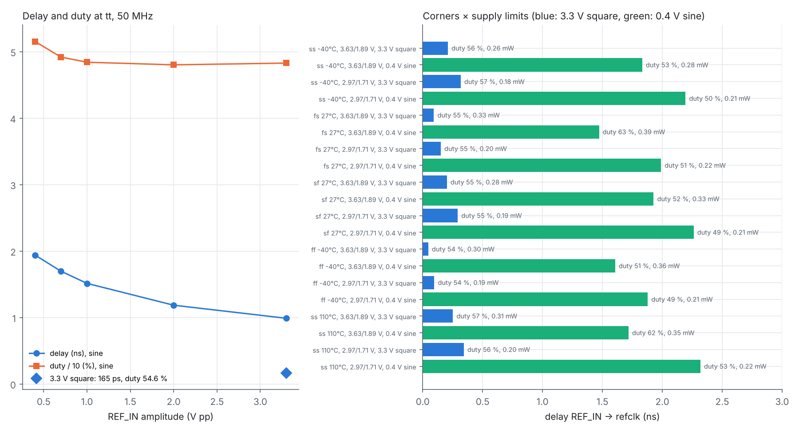
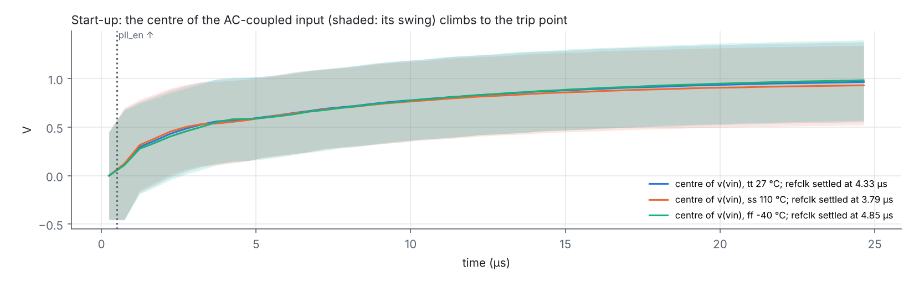
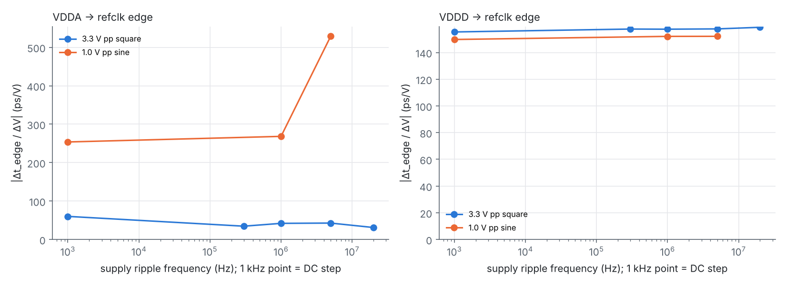
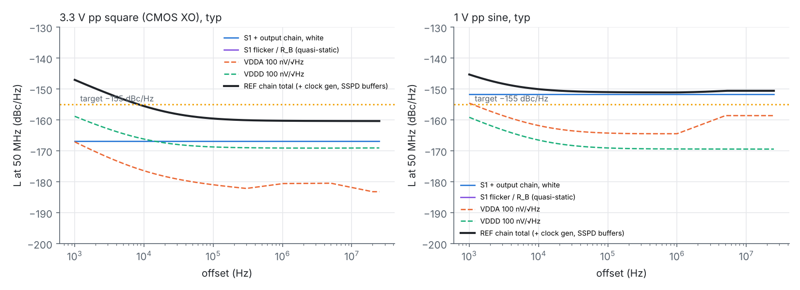
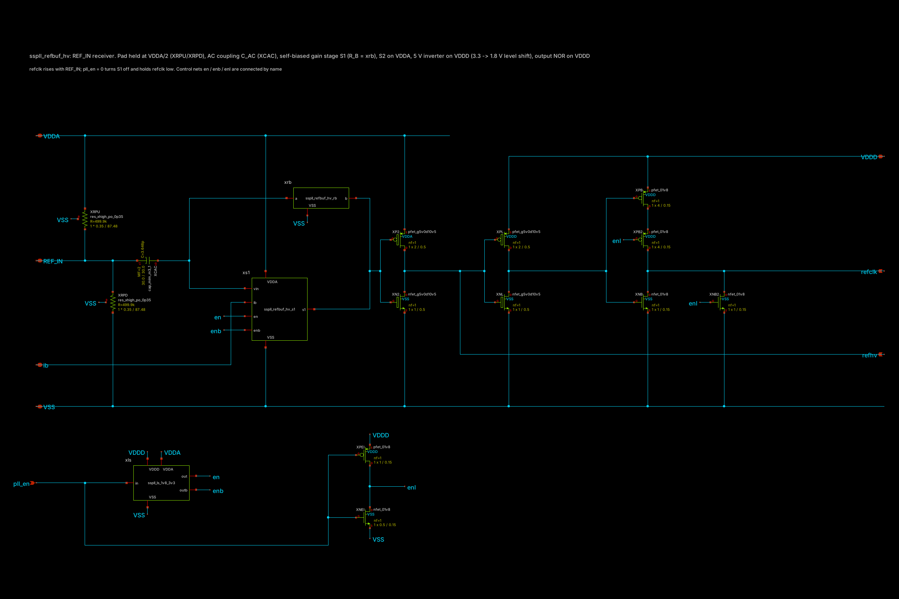
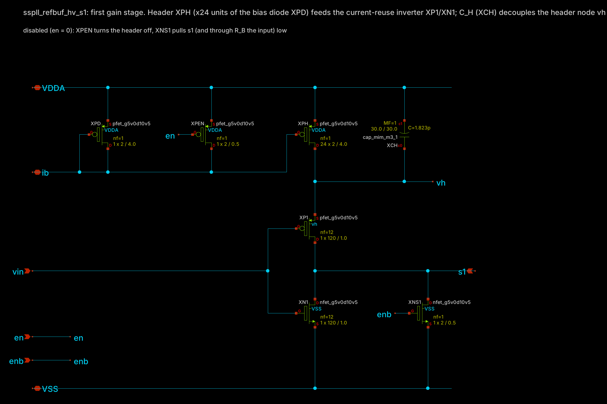

# Step 76 (redo): REF receiver in 5 V devices, with a 3.3 → 1.8 V level shifter on VDDD

*Phase 7, roadmap step 76, redone for the device-rule migration (19 Nov 2026).*

**Basis**
- The 13 Nov receiver (archived note, `design/refbuf/refbuf.py`). Its analog part (S1, S2, bias, R_B, C_AC, C_H) was already built from 5 V devices on VDDA, and it is kept unchanged.
- The device-rule migration removed the LDO and its 1.8 V output VDDL. The receiver's 1.8 V side (level-shift inverter, output NOR, pll_en inverter) now runs on **VDDD**, the harness digital supply.
- Step-72 HV budget: the whole REF chain (receiver + clock generator + level shifters + SSPD buffers) ≤ **−155 dBc/Hz** at 50 MHz typ, −151 pess; receiver power 0.20 mW.
- N = 16 now: reference noise reaches 800 MHz with +24 dB (was +30 dB at 1.6 GHz).
- Proposal: reference amplitude 0.4 / **1.0** / 3.3 V pp (min / typ / max); VDDA ±10 %, VDDD ±5 %.

Reproduce (in `design/refbuf`):

```bash
python3 refbuf_hv_sim.py              # A bias, B large signal over corners/supplies/amplitude, D start-up   (M10, M16) ~30 min
python3 refbuf_hv_supply.py --diff    # supply-to-edge sensitivity, VDDA and VDDD, DC + 0.3-20 MHz          (M21)       ~2 h
python3 refbuf_hv_noise.py            # S1 noise (M14, M15), output chain (M17), supply terms, system (M9)  ~1.5 h, cached
python3 refbuf_hv_plots.py            # docs/img/refbuf_hv_*.png
python3 schematics_hv.py             # xschem/refbuf_hv/*.sch + *.sym, drawing checks, LVS reference        (M5)
cd ../../xschem && ./lvs.sh refbuf_hv/sspll_refbuf_hv.sch netlist/ref_refbuf_hv.spice sspll_refbuf_hv   # M4
```

The system numbers come from `design/budget/hv_system.py`. It is new in this step: the step-72 HV model with every block measured so far (step-73 filter, step-74 ring, step-75 CCO and K_vdd(f)) in place of its allocation. From now on every step reports the same cumulative system figure.

> **Revised in step 77 (19 Nov 2026): new output `refhv`.** S2's 0–3.3 V output (VDDA domain) is now also a pin of the cell. The clock generator takes the SSPD sampling edge from it instead of from refclk.
> - **Why:** through refclk the sampling edge crossed two VDDD gates here and three more in the clock generator, and moved by **376 ps per volt of VDDD** (`design/clkgen/data/clkgen_hv_supply_via_vddd.json`). Through refhv it never touches VDDD.
> - **What did not change:** refclk is still made the same way for the clock generator's 1.8 V core (Gm and hold pulses).
> - S2 now also drives the 5 V sampling driver's input (≈ 10 fF); the step-77 timing benches include this load.
> - Ports: `REF_IN refclk refhv ib pll_en VDDA VDDD VSS`. The schematic and LVS were redone and give *Circuits match uniquely*.

## Result in one paragraph

The receiver keeps its 13 Nov analog core. The only circuit change is that the level shifter (a 5 V inverter whose gate takes S2's 0–3.3 V swing) and the output NOR now run on VDDD.

- **Large signal**, over 6 corners (incl. ss/−40 °C for the slow thick-oxide level shifter), VDDA 2.97–3.63 V and VDDD 1.71–1.89 V:
  - delay 46–343 ps with a 3.3 V square input, 1.0–2.3 ns with a sine;
  - duty 48–63 %;
  - power **0.23 mW** typ (0.18–0.39 mW).
- **Start-up:** refclk is stable 3.8–4.9 µs after pll_en.
- **Supply sensitivity** (new method M21):
  - VDDA moves the edge by 31–60 ps/V with a square input, and by 254–530 ps/V with a 1 V pp sine;
  - VDDD moves it by **157 ps/V**, flat from DC to 20 MHz.
- **Noise at 50 MHz, typ, 3.3 V square:**
  - receiver floor **−164.7 dBc/Hz** (white −166.8, VDDD −169.0, VDDA −183.2);
  - REF chain −160.3, inside the −155 target.

**System:**

| Reference | FFNC off | FFNC on | L(300 kHz) off / on |
|---|---|---|---|
| 3.3 V square, typ | 1.98 ps | **1.32 ps** | −117.2 / **−125.4** dBc/Hz |
| 1.0 V sine, typ | 2.00 ps | 1.40 ps | −116.8 / −123.3 |
| 0.4 V sine, typ | 2.06 ps | 1.60 ps | −115.7 / −120.0 |
| 3.3 V square, worst (ss/110 °C, VDDA 2.97 V, 300 nV/√Hz) | 3.70 ps | 2.50 ps | −111.7 / −118.4 |

Every proposal maximum is met over the whole input range. With a 1.0 V pp sine (the proposal's first typical reference) L(300 kHz) FFNC on was −123.3 dBc/Hz against −124 typ; the typical condition is now a 3.3 V CMOS square, which gives −125.4 (see "Does the proposal need an update?").

## The design sheet

| Parameter | This redo (5 V, VDDD) | 13 Nov (1.6 GHz) | Requirement |
|---|---|---|---|
| Analog core (S1, S2, bias, R_B, C_AC, C_H) | unchanged, 5 V devices on VDDA | same | 5 V devices for analog |
| Level shifter 3.3 → 1.8 V | 5 V inverter on **VDDD** | 5 V inverter on VDDL (LDO) | gate takes 3.3 V |
| Output NOR, pll_en inverter | 1.8 V devices on **VDDD** | on VDDL | digital on VDDD |
| Self-bias (trip point) over corners | 0.81–0.98 V | 0.80–0.92 V | centred input |
| Delay, 3.3 V square / sine (all cases) | **46–343 ps / 0.99–2.32 ns** | 0.16 / 1.0–2.3 ns | (refclk edge only) |
| Duty (all cases) | 48–63 % | 47–65 % | ≥ 45 % |
| Rise 10–90 % (all cases) | 208–491 ps (ss/−40 °C, 1.71 V slowest) | 230–410 ps | clock-generator input |
| Power typ / range | **0.233 mW** (square) – 0.254 (1 V sine); 0.18–0.39 mW | 0.233–0.254 | 0.20 mW (budget) |
| VDDD current | 5.6–6.9 µA | — (VDDL) | |
| Start-up (periods within 2 %) | 3.8 / 4.3 / 4.9 µs (ss / tt / ff) | ≈ 4 µs | < FLL wait |
| Disabled | refclk ≤ 2 µV; I(VDDA) 5.9 µA (pad divider + bias pull), I(VDDD) < 2 nA | same | quiet |
| VDDA → edge (square / 1 V sine) | **31–60 / 254–530 ps/V** | 119 (3.3 V sine) / 254 ps/V, DC only | — |
| VDDD → refclk edge | **157 ps/V**, DC–20 MHz | VDDL 150 ps/V (DC) | none since step 77: the sampling edge comes from refhv |
| S1 per-edge white jitter (square / 1 V / 0.4 V) | **0.034 / 0.556 / 1.162 ps** | 0.23 (3.3 V sine) / 0.61 / 1.15 | |
| Output chain jitter (M17, square / 1 V sine) | 0.097 / 0.173 ps | not estimated | |
| Receiver floor, typ (square / 1 V / 0.4 V) | **−164.7 / −150.9 / −145.4 dBc/Hz** | −159.9 (3.3 V sine) / −151.4 / −145.8 | chain ≤ −155 |

## What happens, how, why

### What happens

The crystal oscillator's waveform (0.4 V pp sine up to a 0–3.3 V square) becomes a sharp 1.8 V edge, refclk, which the clock generator turns into the sampling pulse of the SSPD. The instant of that edge *is* the reference phase. Anything that moves it is reference noise, and inside the loop bandwidth it reaches the 800 MHz output 16 times larger in phase (+24 dB).

Three things can move it:
1. The receiver's own device noise (S1 dominates with a sine input; with a square input the output chain does).
2. VDDA noise, through S1's trip point.
3. VDDD noise, through the level shifter and the NOR, whose delay depends on their supply.

The third is new in this redo, because the clean LDO output VDDL is gone.

### How it happens

**Voltage noise at a crossing → time noise:**

$$\sigma_t = \frac{\sigma_v}{s},\qquad s_{gate} = \pi f_{ref}V_{pp}\,\Big|\tfrac{v_{gate}}{v_{pad}}\Big|\ (\text{sine}),\qquad s_{gate} \approx \frac{V_{pp}}{t_{edge}}\Big|\tfrac{v_{gate}}{v_{pad}}\Big|\ (\text{square})$$

**Supply → edge.** If a supply ripple of ΔV moves the edge by Δt = K_s·ΔV, a supply noise density S_v gives a reference phase noise of

$$\mathcal{L}_{sup}(f) = \frac{(2\pi f_{ref})^2\,K_s(f)^2\,S_v(f)}{2}\quad\text{(at the reference)},\qquad \mathcal{L}_{out} = \mathcal{L}_{ref} + 20\log_{10}N \ \ \text{(in band)}.$$

**White per-edge jitter → floor.** Independent jitter σ on every edge gives L = (2π f_ref σ)²/f_ref.

### Why it happens this way

1. **Square beats sine.** A square input with 0.5 ns edges is ≈ 40× steeper at the gate than a 1 V pp sine at 50 MHz. The same noise voltage, or the same supply-induced trip-point shift, costs 40× less time. That is why S1's jitter falls from 0.556 to 0.034 ps and the VDDA sensitivity from 254 to 60 ps/V.
2. **VDDA reaches the edge through the header node.** S1 is fed by a pMOS current source whose output node vh is held to VDDA by C_H at high frequency. Above about 1 MHz, vh follows VDDA, so S1's trip point follows part of the ripple. With a sine input the VDDA sensitivity rises to 530 ps/V at 5 MHz; with a square input it stays at 31–43 ps/V.
3. **VDDD reaches the edge through gate delay.** A CMOS gate's delay ∝ C·V/I(V); for the thick-oxide inverter on 1.8 V (V_T ≈ 1 V) the current changes strongly with VDDD. The level shifter and NOR give 157 ps/V. There are no slow nodes on that path, so the value is the same from DC to 20 MHz.
4. **Why VDDD noise matters only as random noise.** Digital switching on VDDD that repeats every reference period gives the same edge shift every period, a fixed offset. Random VDDD noise is jitter: 100 nV/√Hz gives −169 dBc/Hz (harmless), 1 µV/√Hz would give −149 dBc/Hz (more than the whole chain allocation).

## A. What was decided

| Question | Decision | Evidence |
|---|---|---|
| Keep the analog core of 13 Nov | **yes** | Already 5 V devices on VDDA; noise and power were sized then (header 60 µA, moderate inversion). |
| Where to power the 1.8 V output side without VDDL | **VDDD** | The clock generator that receives refclk is on VDDD anyway; an on-chip regulator was dropped with the LDO. |
| Level shifter 3.3 → 1.8 V | **5 V inverter on VDDD** (2 / 1 µm, L 0.5 µm) | A 1.8 V gate cannot take 3.3 V; a down-shift needs no latch. Slowest at ss/−40 °C, 1.71 V: 491 ps rise, still a clean edge. |
| VDDD quality | first: ≤ 160 nV/√Hz at the die; **final: no requirement** | The harness VDDD is shared with other projects, so a limit could not be guaranteed; step 77 takes the sampling edge from refhv (VDDA) instead. |
| Typical reference for the noise specs | **3.3 V CMOS square** (proposal updated 19 Nov) | 1 V sine misses the typ L(300 kHz) FFNC-on by 0.7 dB. |
| More S1 current for the sine case | **no** | Doubling the header (+0.2 mW) buys 3 dB of S1 white noise; at 1 V pp the system L(300 kHz) would still sit near −124 dBc/Hz, and a full-swing XO costs nothing on chip. |

## B. Large signal (method M16) and start-up

**Bench (`refbuf_hv_sim.py`).**
- A: bias point over 6 corners × VDDA 2.97 / 3.3 / 3.63 V.
- B: 14-cycle transients, the last 5 cycles measured: amplitude sweep at tt; every corner at both supply limits with 0.4 V sine and 3.3 V square; 45 / 55 MHz; VDDD ±5 %.
- D: start-up from pll_en = 0.

**Why:** the receiver must work for any oscillator the user connects and at every supply the harness can give; delay and duty tell the clock generator what it receives, and power checks the budget.




| Condition | Delay | Duty | Rise | Power |
|---|---|---|---|---|
| tt, 3.3 V square | 165 ps | 54.6 % | 294 ps | 0.233 mW |
| tt, 1 V sine | 1.51 ns | 48.4 % | 295 ps | 0.254 mW |
| tt, 0.4 V sine | 1.94 ns | 51.5 % | 297 ps | 0.269 mW |
| ss/110 °C, 2.97/1.71 V, 0.4 V sine (slowest) | 2.32 ns | 52.6 % | 410 ps | 0.221 mW |
| ss/−40 °C, 2.97/1.71 V, square (slowest edge) | 317 ps | 56.6 % | 491 ps | 0.182 mW |
| fs, 3.63/1.89 V, 0.4 V sine (most power, widest duty) | 1.47 ns | 63.1 % | 215 ps | 0.391 mW |
| tt, VDDD 1.71 / 1.89 V, square | 181 / 152 ps | 54.7 / 54.4 % | 322 / 273 ps | 0.232 / 0.234 mW |

- Start-up: the AC-coupled input's centre climbs to the trip point through R_B; refclk periods are within 2 % after 3.8 µs (ss), 4.3 µs (tt) and 4.9 µs (ff). The CCO filter needs ~0.3 ms, so the FLL waits longer anyway.
- Disabled: refclk ≤ 2 µV. I(VDDA) is 5.9 µA: 3.3 µA in the pad divider and the 2.5 µA that the bias generator pulls through XPEN (that generator is switched off with pll_en, step 86). I(VDDD) < 2 nA.

## C. Supply sensitivity (method M21, new)

**Bench (`refbuf_hv_supply.py`).**
- **DC point:** delay at +10 mV on the rail minus the nominal delay, each at its own settled bias.
- **AC points:** two transients from the same operating point, one with a 10 mV sine at f_m = 0.3, 1, 5 and 20 MHz on the rail and one without. The edge-by-edge difference is fitted to an offset plus a sinusoid at f_m.
- **Where the edge is read:** where refclk crosses **VDDD/2 at that instant**.

**Why this bench:**
- Without an LDO, supply noise is a first-order jitter source.
- An AC-coupled, self-biased circuit has slow internal nodes, so a DC step alone could miss frequency-dependent behaviour.
- The differential form and the moving threshold remove two measurement errors found on the way (section F).



| f_m | VDDA, 3.3 V square | VDDA, 1 V sine | VDDD, 3.3 V square | VDDD, 1 V sine |
|---|---|---|---|---|
| DC | 60.1 ps/V | 253.8 | 155.4 | 149.8 |
| 0.3 MHz | 34.6 | — | 157.6 | — |
| 1 MHz | 42.0 | 268.3 | 157.5 | 152.1 |
| 5 MHz | 42.7 | 528.9 | 157.7 | 152.1 |
| 20 MHz | 31.1 | — | 158.9 | — |

**What it means** (L at 50 MHz, white part, S_v as given):

| Term | 100 nV/√Hz (typ) | 300 nV/√Hz (pess) |
|---|---|---|
| VDDA, square input | −183 dBc/Hz | −174 |
| VDDA, 1 V sine | −159 | −149 |
| VDDD (either input) | −169 | −160 |
| VDDD at 1 µV/√Hz (a noisy digital supply) | −149 | |

So VDDD must be as quiet as VDDA. **161 nV/√Hz** keeps the VDDD term at −165 dBc/Hz, 10 dB under the chain allocation.

## D. Noise (methods M14, M15, M17) and system effect (M9)

**Benches (`refbuf_hv_noise.py`).**
- **M14:** S1's gate-referred `.noise` at the self-bias point: white plateau 3.19 nV/√Hz (pad 3.74), |v_gate/v_pad| = 0.662 at 50 MHz. Same as on 13 Nov (same circuit).
- **M15:** S1's per-edge white jitter. The white plateau is injected at the pad by `trnoise` and the circuit is otherwise noiseless; 300 edges. The white per-edge value is taken as period jitter / √2.
- **M17:** output-chain jitter. Each stage's white drain-noise current at its trip point is injected at its output: S2 1.99 pA/√Hz, level shifter 0.61, NOR 3.67. 80 edges; the baseline run (sources × 10⁻⁶) gives 0.003 ps.
- The supply terms come from section C.
- **The chain total** adds the clock-generator sampling edge (−163.4 dBc/Hz, step 77, kept until step 77 is redone) and the SSPD isolation buffers (−169, step 78).



| Reference | S1 white | Output chain | Receiver floor | REF chain floor (typ) |
|---|---|---|---|---|
| 3.3 V square | 0.034 ps | 0.097 ps | **−164.7 dBc/Hz** | −160.3 |
| 1.0 V sine | 0.556 ps | 0.173 ps | −150.9 | −150.6 |
| 0.4 V sine | 1.162 ps | (0.173) | −145.4 | −145.3 |

- With the square input the output chain, not S1, sets the white floor. M17 applies the trip-point noise all the time, so 0.097 ps is an upper bound.
- For the square input, the absolute jitter of S1 (0.13 ps) is larger than period/√2 (0.034 ps). This is a slow wander, most likely numerical (a 10 ps time grid against 0.5 ns edges). A white source cannot make it with such a steep edge, so the period-based value is used. For the sines the two agree (0.560 / 0.556 ps).
- Below 30 kHz the chain is set by the placeholder 1/f corners of the clock generator and SSPD buffers, which steps 77 and 78 will replace.

**System** (`hv_system.py`; typ = tt, VDDA and VDDD 100 nV/√Hz; pess = ring +3 dB, corner ×2, 300 nV/√Hz, K_vdd at ss/110 °C 3.13 V; worst = pess with VDDA 2.97 V):

| Reference | typ off / on | L(300 kHz) typ off / on | pess off / on | REF chain share, typ on |
|---|---|---|---|---|
| 3.3 V square | 1.98 / **1.32 ps** | −117.2 / −125.4 | 2.97 / 2.12 | 0.17 ps |
| 1.0 V sine | 2.00 / 1.40 | −116.8 / **−123.3** | 3.00 / 2.21 | 0.50 ps |
| 0.4 V sine | 2.06 / 1.60 | −115.7 / −120.0 | 3.04 / 2.31 | 0.93 ps |
| 3.3 V square, worst | 3.70 / 2.50 | −111.7 / −118.4 | | |
| **Proposal typ / max** | 2.6 / 1.6, max 5.0 / 3.2 | −114 / −124, max −108 / −116 | | |

## E. Schematics (hierarchical, real wiring, LVS-clean)

| Level | Cell | Contents |
|---|---|---|
| 1 | `xschem/refbuf_hv/sspll_refbuf_hv_rb.sch` | R_B: 10 xhigh-poly segments, 5 MΩ, bodies VSS |
| 1 | `xschem/refbuf_hv/sspll_refbuf_hv_s1.sch` | S1 with bias diode, header ×24, C_H, enable devices |
| 1 | `xschem/cco_hv/sspll_ls_1v8_3v3.sch` | enable level shifter (step 75 HV) |
| 2 | `xschem/refbuf_hv/sspll_refbuf_hv.sch` | pad divider, C_AC, R_B, S1, S2 (VDDA), level-shift inverter + NOR + pll_en inverter (VDDD); pins REF_IN, refclk, refhv (S2 output, added in step 77), ib, pll_en, VDDA, VDDD, VSS |




**Checks:**
- **Drawing:** clean (no overlaps, no wire through a pin, no floating pin, no text collision).
- **LVS** against `xschem/netlist/ref_refbuf_hv.spice` (written by `schematics_hv.py` from `refbuf_hv.full()`, the netlist every simulation used): all three cells give *Circuits match uniquely*.
- VDDL is gone; the cell has one 1.8 V supply pin, VDDD.

## F. Problems met and how they were solved

| Problem | Cause | Solution |
|---|---|---|
| VDDD sensitivity read 240–260 ps/V at 1–20 MHz but 155 ps/V at DC | The AC runs read the edge at a fixed 0.9 V while VDDD moved; the receiving gate's threshold moves with VDDD (VDDD/2), so half the ripple over the edge slope (≈ 80 ps/V) was false | Edge read where refclk crosses VDDD/2 at that instant: 157 ps/V, DC to 20 MHz |
| VDDA 345 ps/V at 0.3 MHz but 60 at DC and 67 at 1 MHz | One run fitted to "line + sinusoid": the AC-coupled self-bias still drifts for µs after the start and the fit took drift for ripple | Differential measurement (modulated − unmodulated run, same start): 35 ps/V at 0.3 MHz, 42 at 1 MHz |
| The output-chain jitter run stopped after 28 of 150 edges, no error | Every node saved over 1.7 M time points: out of memory | `save` only the two vectors; assert ≥ 90 % of the edges; 80 edges at a 4 ps noise step (±8 %) |
| A cloud restart lost an hour of transient-noise runs | Long jobs held only in memory | Every job's result cached in `data/refbuf_hv_cache/` |
| S1 absolute jitter with the square input 0.13 ps vs period/√2 0.034 ps | Slow numerical wander, not white noise | White per-edge jitter = period jitter / √2 for every case (equal for the sines) |
| Power 0.233–0.254 mW vs 0.20 mW budget | Header current set for noise | Accepted: the CCO came in 0.18 mW under budget; total unchanged |

## G. Sizing table (all devices pass `tools/pdk_limits.py`)

| Device | Model | W per finger × nf × m | L | Role |
|---|---|---|---|---|
| XRPU / XRPD | res_xhigh_po_0p35 | 0.35 µm | 87.48 µm | pad divider, 500 kΩ each |
| XCAC | cap_mim_m3_1 | 30 × 30 µm × 2 | — | C_AC 3.64 pF, bottom plate on the pad |
| xrb0…9 | res_xhigh_po_0p35 | 0.35 µm | 87.48 µm | R_B 5 MΩ |
| XPD | pfet_g5v0d10v5 | 2 × 1 × 1 | 4 µm | bias diode (2.5 µA) |
| XPH | pfet_g5v0d10v5 | 2 × 1 × 24 | 4 µm | header, 60 µA |
| XCH | cap_mim_m3_1 | 30 × 30 µm | — | C_H 1.82 pF |
| XP1 / XN1 | pfet / nfet_g5v0d10v5 | 10 × 12 | 1 µm | S1, current reuse; XP1 body = source |
| XPEN / XNS1 | pfet / nfet_g5v0d10v5 | 2 × 1 | 0.5 µm | disable |
| XP2 / XN2 | pfet / nfet_g5v0d10v5 | 2 / 1 | 0.5 µm | S2 on VDDA |
| XPL / XNL | pfet / nfet_g5v0d10v5 | 2 / 1 | 0.5 µm | **3.3 → 1.8 V level shift on VDDD** |
| XPB, XPB2 / XNB, XNB2 | pfet / nfet_01v8 | 4 / 1 | 0.15 µm | output NOR on VDDD |
| XPEI / XNEI | pfet / nfet_01v8 | 1 / 0.5 | 0.15 µm | pll_en inverter on VDDD |
| xls | sspll_ls_1v8_3v3 | (step 75 HV) | | pll_en → en / enb on VDDA |

Area ≈ 4 000 µm², as before (3 MIM tiles over R_B and S1).

## H. Requirements handed on

| To | Requirement |
|---|---|
| Step 77 clock generator | refclk rising edge, 46–343 ps delay with a square input, 208–491 ps rise; its own VDDD sensitivity must be measured with M21 and added to the 157 ps/V of this step. (Done in step 77: the sum was 376 ps/V, so the sampling edge now comes from refhv.) |
| Board / test plan | A 3.3 V CMOS crystal oscillator for the typical noise numbers. (A VDDD noise limit was first handed on here; step 77 removed the need for it.) |
| Step 86 bias | 2.5 µA sink into ib; switched off with pll_en (5.9 µA disabled current otherwise). |
| Layout | VDDD of the receiver's output side routed separately from the divider's VDDD up to the pad (star), with local decoupling; REF_IN short and shielded; vin guarded. |
| `hv_system.py` | Steps 77–80 call it with their measured block. |

## Does the proposal need an update?

Yes. Two points came out of this step, and both were settled on 19 Nov after a check against the Chipalooza #4 rules.

1. **Typical reference amplitude → 3.3 V CMOS square (done).** With 1.0 V pp as the typical reference, the FFNC-on L(300 kHz) was −123.3 dBc/Hz against −124 typ.
   - The proposal's conditions table now gives 0.4 / **3.3** / 3.3 V pp (min / typ / max) and states the typical waveform: a 0 V to 3.3 V CMOS square from the crystal oscillator, which gives −125.4 dBc/Hz and 1.32 ps.
   - Every maximum still holds down to 0.4 V pp.
   - The test-equipment line asks for crystal oscillators with 3.3 V CMOS outputs.
   - Rules: the proposal is not submitted yet (due 23 Nov), so Rule 9's approval for spec changes does not apply. A 0–3.3 V signal on the 3.3 V periphery reference pad is within Rule 10.
2. **VDDD noise → removed by design, not by a requirement.** A VDDD noise limit at the die could not be guaranteed: the harness 1.8 V digital supply (Rule 7.1) is shared with the other projects' logic.
   - So in step 77 the SSPD sampling edge was moved off VDDD altogether. It now comes from this receiver's 3.3 V node (refhv) through a 5 V driver.
   - The proposal's architecture text now says so; no VDDD noise requirement was added.

## Interview questions (step 76 redo)

The answers are in the learning notebook (phase 7), step 76.

1. What changed in the REF receiver for the 800 MHz / 5 V redo, and what did not?
2. Why is a 5 V inverter on a 1.8 V supply a correct 3.3 V → 1.8 V level shifter?
3. Why must a supply-sensitivity measurement on a VDDD gate read the edge at VDDD/2 and not at a fixed level?
4. The first supply-modulation fit gave 345 ps/V at 0.3 MHz. What was wrong?
5. How large is the VDDA sensitivity of the edge, and why does it depend on the input waveform?
6. Why is VDDD noise now a design requirement?
7. How is the noise of the output chain estimated?
8. Why use period jitter / √2 as the per-edge white jitter of S1?
9. Why can the receiver draw 0.23–0.25 mW when the budget gave it 0.20 mW?
10. What happens while pll_en = 0?
