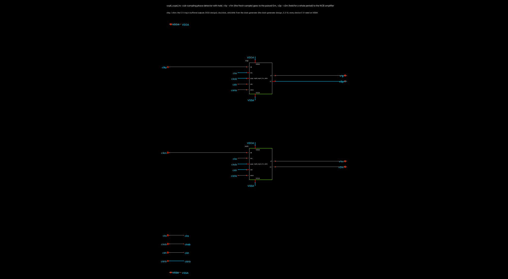
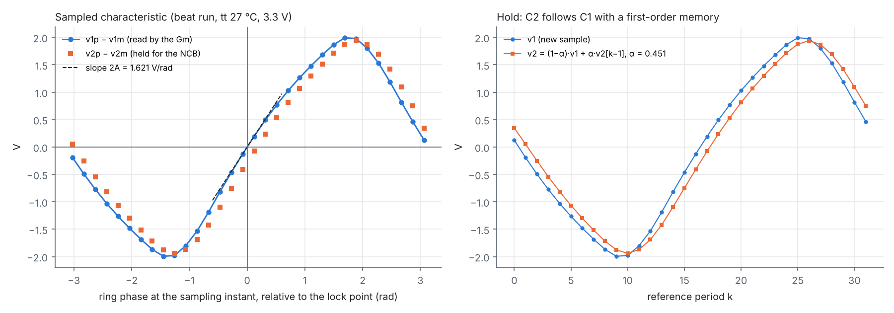
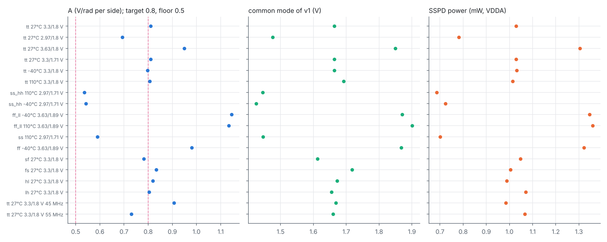
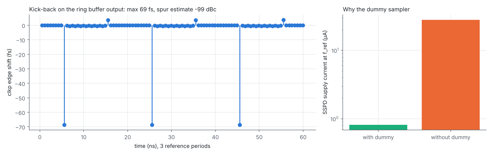
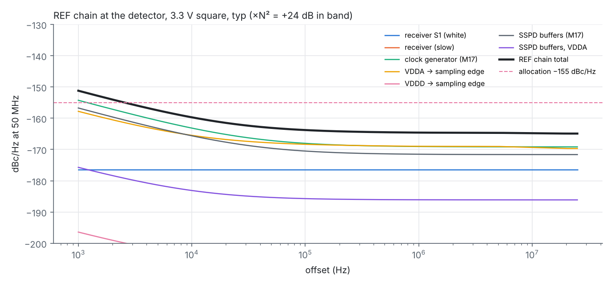
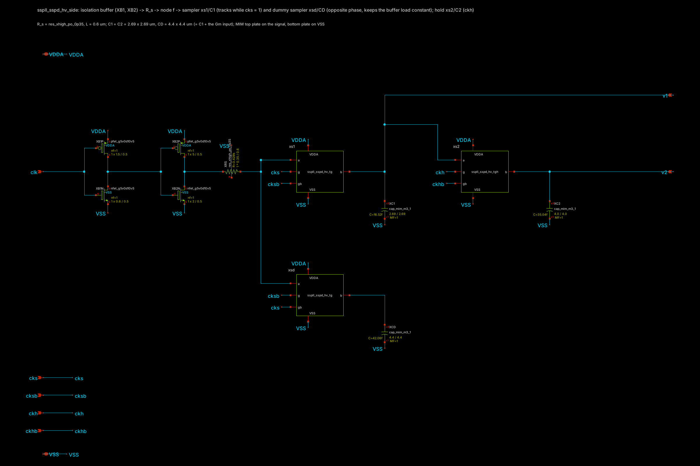

# SSPD with hold in 5 V devices at 800 MHz

*Phase 7, redone for the device-rule migration (19 Nov 2026).* Deliverable: schematic (xschem,
hierarchical, LVS-clean), sizing table, verification over PVT. Design files `design/sspd/sspd_hv.py`,
`sspd_hv_*.py`; schematics `xschem/sspd_hv/`; data `design/sspd/data/sspd_hv_*.json`; methods M17, M18, M19, M21
(explained in `docs/testbench_guide.md`). The 1.8 V version is archived.

Reproduce (in `design/sspd`):

```bash
python3 sspd_hv_size.py     # R_s length and switch width for A = 0.8 V/rad              (M18)
python3 sspd_hv_sim.py      # A characteristic x 18 conditions, B kick-back, C buffer jitter, D buffer VDDA (M18, M19, M17)
python3 sspd_hv_noise.py    # REF chain with the measured SSPD parts, system model        (M9)
python3 sspd_hv_plots.py    # docs/img/sspd_hv_*.png
python3 schematics_hv.py     # xschem/sspd_hv/*, drawing checks, LVS reference             (M5)
cd ../../xschem && ./lvs.sh sspd_hv/sspll_sspd_hv.sch netlist/ref_sspd_hv.spice sspll_sspd_hv   # M4
```

## Result in one paragraph

Each side (p from `clkp`, m from `clkm`, the ring's 3.3 V buffered outputs) has a two-inverter **isolation buffer**,
a series resistor **R_s ≈ 3.4 kΩ** that rounds the square wave into a near-sine of defined slope, a 5 V **sampling TG**
onto **C1** (16.2 fF MIM plus the Gm's 26.5 fF input = 42.7 fF), a **dummy sampler** on the opposite phase and a **hold TG**
onto **C2 = 34.6 fF**. Every device
is a g5v0d10v5 on VDDA. The detector gain is **A = 0.811 V/rad** per side at tt (target 0.8),
0.536–1.145 over 18 conditions (MOS × R/C corners, −40…110 °C, VDDA ±10 %, 45/55 MHz). The hold has
**α = 0.451** and unity DC gain (1.004). The sampler moves the ring-buffer edge by
**69 fs** once per period (spur estimate **-99 dBc**, proposal max −45 dBc); the
dummy sampler cuts the SSPD supply current at f_ref from 27.9 µA to **0.82 µA**.
The isolation buffers add **83 fs** per side (-171.6 dBc/Hz at the differential crossing)
and move with VDDA by **22.2 ps/V**. kT/C: -148.6 dBc/Hz, 40 fs in the system.
System, 3.3 V square reference: **1.97 / 1.31 ps**, L(300 kHz)
**-117.2 / -125.6 dBc/Hz** (FFNC off / on, typ); worst 3.70 /
2.50 ps. Power **1.03 mW** at tt (0.69–1.36): 0.54 mW over the
budget allocation, see G.



## What happens, how, why

### What happens
At every reference edge (cks falling) the SSPD freezes the ring's waveform on C1. Near lock the frozen differential
voltage v1p − v1m is proportional to the time between the ring's zero crossing and the reference edge. Right after the
sample, the pulsed Gm turns v1p − v1m into a charge for the loop filter during ckg. Then ckh shares the
sample onto C2, which holds it for the whole period for the noise-cancellation block (NCB).

### How it happens
- **Isolation buffer.** XB1 (0.6/1.5 µm) loads clkp lightly; XB2 (2/5 µm) drives R_s and whichever capacitor is
  connected. The sampler's charge reaches clkp only through XB1's gate–drain capacitance.
- **Shaping.** An RC-filtered square of amplitude a = VDDA/2 crosses its mid-level with slope exactly a/τ_s, so

$$A = \frac{1}{\omega_0}\left.\frac{dv}{dt}\right|_{cross} = \frac{V_{DDA}}{2\,\omega_0\,\tau_s},\qquad
\tau_s = (R_s + R_{buf} + R_{sw})\,C_{1,tot}$$

  For A = 0.8 V/rad at 800 MHz with VDDA = 3.3 V: τ_s = 3.3/(2·2π·0.8 GHz·0.8) = **0.41 ns**, more than twice the
  1.8 V design's 0.18 ns (half the carrier, almost twice the swing).
- **Sampling.** A 5 V TG (n 3 µm, p 6 µm, L 0.5 µm) opens when cks falls. There is no low-V_T 5 V device, so the nMOS at
  mid-rail (V_GS ≈ 1.65 V) is wider and the pMOS carries half the conductance.
- **Dummy sampler.** Same TG with the clocks swapped, onto CD = C1 + the Gm input. One of the two capacitors is always
  on node f, so XB2's load, delay and supply current are the same in every phase.
- **Hold.** After the Gm pulse, ckh closes a small TG (1/2 µm) between C1 and C2:

$$v_2[k] = (1-\alpha)\,v_1[k] + \alpha\,v_2[k-1],\qquad \alpha = \frac{C_{2,tot}}{C_{1,tot} + C_{2,tot}}$$

- **Noise.** Differential kT/C divided by (2A)² is a white phase floor that is *not* multiplied by N²:

$$\mathcal{L}_{kT/C} = \frac{kT}{2\,C_s\,A^2 f_{ref}} = -148.6\ \text{dBc/Hz}\quad (C_s = 45.7\ \text{fF},\ A = 0.811)$$

  Timing noise of the isolation buffers *is* reference-like: the loop cannot tell it from reference jitter.



### Why it happens this way
- **Defined slope, wide linear range.** A raw 3.3 V square would give a slope set by the inverter edge and a linear range
  of picoseconds. The RC near-sine sets A by R·C and is linear over about ±0.6 rad.
- **Gm reads C1, not C2.** No charge-sharing pole z = α inside the loop (it would cost about 16° at f_c = f_ref/20).
- **The sampled node is 45.7 fF, of which the MIM is only 16.2 fF.** The Gm design measured the Gm's input capacitance:
  26.5 fF at tt (24–29 fF over corners and codes, and up to +25 % at ±0.8 V of input), not the 8 fF first assumed. C1
  was cut from 4 × 4 to 2.69 × 2.69 µm so that the node, and with it A, α, kT/C and power, stayed where they were; the
  dummy CD (= C1 + C_Gm) did not change. The benches of this step ran with 2.73 µm and a 26.0 fF load (the first Gm):
  the same 42.7 fF. The system budget requires C_s ≥ 35 fF: 45.7 fF. Shrinking the node further would save power,
  but the Gm's non-linear gate capacitance would become a
  larger part of the sampled node. kT/C is only 40 fs in the system, so noise is not what limits C1 —
  the requirement and the sampled node's linearity are.
- **Dummy sampler.** Constant supply current at f_ref: without an LDO, any f_ref current on VDDA is a spur source for
  every block on VDDA.

## A. Architecture decisions

| Decision | Options | Chosen | Why |
|---|---|---|---|
| Devices | 1.8 V on VDDL, 5 V on VDDA | **5 V on VDDA** | device rule (analog = g5v0d10v5); VDDL no longer exists |
| SSPD input | raw ring nodes, buffered clkp/clkm | **clkp/clkm + own isolation buffer** | no extra load on the ring |
| Shaping | square, R_s + C | **R_s + C** | A set by R·C; linear range ±0.6 rad |
| R_s | xhigh_po 0.35 µm × 0.8 / 0.6 / 0.5 µm | **0.6 µm** | A = 0.812 V/rad (table below) |
| Sampling switch | nMOS, TG 3/6, TG 4/8 µm | **TG 3/6 µm** | the wider switch lowers A (more junction C) and costs 4 % more power |
| C1, C2 | 35 / 16 fF MIM | **C1 16.2 fF (+ 26.5 fF Gm), C2 34.6 fF** | node kept at 45.7 fF (the system budget: ≥ 35 fF) after the Gm input was measured |
| What the Gm reads | C2, C1 | **C1** | no z = α pole in the loop |
| Dummy | none, copy | **copy, CD = C1 + Gm input** | f_ref supply current −31 dB |

**Sizing runs (`sspd_hv_size.py`, full beat runs at tt):**

| Variant | A (V/rad) | α | Power (mW) |
|---|---|---|---|
| RS0.8 | 0.701 | 0.452 | 0.950 |
| RS0.6 | 0.812 | 0.452 | 1.028 |
| RS0.5 | 0.880 | 0.452 | 1.073 |
| RS0.6_SW4 | 0.788 | 0.444 | 1.069 |

## B. Characteristic over 18 conditions (method M18)

**Bench (`sspd_hv.bench`, `characteristic`).**
- The clock-generator clock generator makes cks/cksb, ckg/ckgb, ckh/ckhb from ideal refhv (0–VDDA) and refclk (0–VDDD,
  0.2 ns later, as the receiver makes them).
- The "ring" is two ideal 0/VDDA squares at f = (16 + 1/32)·f_ref behind a 5 V inverter like the ring's buffer output
  stage, so the sampling phase slides by 2π/32 per period (beat). 32 periods give the whole characteristic.
- v1p − v1m is read in the middle of the Gm pulse, v2p − v2m 0.5 ns after the hold; A = half the slope of a line fit
  within ±0.35 rad of the zero crossing; α and the hold DC gain from a least-squares fit of
  v2[k] = a·v1[k] + b·v2[k−1].
- Loads: 26 fF on each v1 (the Gm input as first measured in the Gm design, at lock; the final Gm has 26.5 fF and C1 is 0.5 fF larger to match), 4 fF on each v2 (the NCB input).



| Condition | A (V/rad) | α | hold DC gain | CM of v1 (V) | Power (mW) |
|---|---|---|---|---|---|
| tt 27 °C, 3.3/1.8 V | 0.811 | 0.451 | 1.004 | 1.66 | 1.03 |
| tt 27 °C, 2.97/1.8 V | 0.693 | 0.451 | 1.004 | 1.48 | 0.78 |
| tt 27 °C, 3.63/1.8 V | 0.950 | 0.452 | 1.004 | 1.85 | 1.30 |
| tt 27 °C, 3.3/1.71 V | 0.811 | 0.451 | 1.004 | 1.66 | 1.03 |
| tt -40 °C, 3.3/1.8 V | 0.798 | 0.452 | 1.004 | 1.66 | 1.03 |
| tt 110 °C, 3.3/1.8 V | 0.807 | 0.451 | 1.004 | 1.69 | 1.01 |
| ss_hh 110 °C, 2.97/1.71 V | 0.536 | 0.465 | 1.003 | 1.45 | 0.69 |
| ss_hh -40 °C, 2.97/1.71 V | 0.542 | 0.465 | 1.003 | 1.43 | 0.72 |
| ff_ll -40 °C, 3.63/1.89 V | 1.145 | 0.435 | 1.006 | 1.87 | 1.35 |
| ff_ll 110 °C, 3.63/1.89 V | 1.133 | 0.435 | 1.006 | 1.90 | 1.36 |
| ss 110 °C, 2.97/1.71 V | 0.590 | 0.449 | 1.005 | 1.45 | 0.70 |
| ff -40 °C, 3.63/1.89 V | 0.980 | 0.454 | 1.004 | 1.87 | 1.32 |
| sf 27 °C, 3.3/1.8 V | 0.782 | 0.450 | 1.004 | 1.61 | 1.05 |
| fs 27 °C, 3.3/1.8 V | 0.833 | 0.452 | 1.004 | 1.72 | 1.00 |
| hl 27 °C, 3.3/1.8 V | 0.819 | 0.427 | 1.007 | 1.67 | 0.99 |
| lh 27 °C, 3.3/1.8 V | 0.804 | 0.472 | 1.002 | 1.65 | 1.07 |
| tt 27 °C, 3.3/1.8 V, 45 MHz | 0.907 | 0.451 | 1.004 | 1.67 | 0.98 |
| tt 27 °C, 3.3/1.8 V, 55 MHz | 0.731 | 0.452 | 1.004 | 1.66 | 1.07 |

**Requirements (system budget):** A = 0.8 V/rad nominal ✔ (0.811); A ≥ 0.5 V/rad at every condition ✔
(0.536 at ss_hh / 2.97 V, the tightest item).

**Why A moves with VDDA.** The filtered square has amplitude VDDA/2, so A ∝ VDDA (2.97 V: 0.694, 3.63 V: 0.951, i.e.
−15 / +17 % for ∓10 %). There is no LDO, so this is real loop-gain variation. Only its slow part matters (VDDA set once per
chip): it is a static gain error the icp_trim covers. Its fast part is supply noise on A, which only scales the small
phase error and adds nothing in lock.

### Loop gain over PVT
A follows VDDA/(R_s·C1); τ (clock-generator design) and K_VCO (VCO design) also move. The loop needs A·G·τ·K_VCO:

| Corner | A / A_tt | τ / τ_tt (clock-generator design) | K_VCO / K_tt (VCO design) | product (before G) |
|---|---|---|---|---|
| ss 110 °C, VDDA 2.97 V | 0.73 | 1.76 | 0.636 | **0.81** |
| ss_hh 110 °C, VDDA 2.97 V | 0.66 | 1.93 | 0.636 | **0.81** |
| ss_hh -40 °C, VDDA 2.97 V | 0.67 | 1.92 | 0.636 | **0.82** |
| ff -40 °C, VDDA 3.63 V | 1.21 | 0.76 | 1.445 | **1.32** |
| ff_ll -40 °C, VDDA 3.63 V | 1.41 | 0.66 | 1.445 | **1.35** |
| ff_ll 110 °C, VDDA 3.63 V | 1.40 | 0.65 | 1.445 | **1.32** |

×0.81–1.35 is inside the icp_trim range (×0.55–2.0). The Gm design adds G and checks what is
left.

## C. Kick-back and the dummy sampler (method M19)



**Bench (`sspd_hv.kick`).** Locked (f = 16·f_ref exactly, sampling at the zero crossing). Two runs, one with the clock
generator switching and one with the reference held still (the sampler tracks, nothing switches); the difference of
the clkp edge times is the kick-back. Its Fourier component at f_ref, as phase deviation 2π·f_0·Δt, gives the spur
estimate 20·log(a1/2).

- **Largest edge shift 68.5 fs, rms 11.9 fs** — one edge per period, the one right
  after the sampling instant.
- **Spur estimate -98.9 dBc** at the ring buffer output (proposal typ −55, max −45 dBc). The ring itself is
  one more buffer away.
- 30× the 1.8 V design's 2.3 fs: the 3.3 V clock swing and the thick-oxide overlap capacitances of 0.5 µm-long devices
  couple more charge. It is still 54 dB below the proposal maximum.
- **SSPD supply current at f_ref: 0.82 µA with the dummy, 27.9 µA without.**

## D. Noise (methods M17, M21, M9)

| Source | Value | Floor at 50 MHz | Enters as |
|---|---|---|---|
| kT/C of C_s (45.7 fF), A = 0.811 | 2kT/C differential | -148.6 dBc/Hz | detector noise (not ×N²) |
| Isolation buffers XB1/XB2 (M17) | 83.4 fs per side → 59.0 fs differential | -171.6 dBc/Hz | reference-like (×N²) |
| Buffer delay vs VDDA (M21, DC) | 22.2 ps/V (delay 354 ps) | -186.1 dBc/Hz at 100 nV/√Hz | reference-like |

- **M17 bench (`buf_jitter`).** Flat copy of ring buffer stage → XB1 → XB2 → R_s → C, white `trnoise` currents of each
  inverter's trip-point noise at b1 and b2, 800 MHz input; noiseless baseline 0.13 fs.
- **Supply bench (`buf_supply`).** The buffers are plain inverters with no bias loop or coupling capacitor, so their
  delay sensitivity is flat in frequency and the DC form of M21 (+10 mV step) is enough.



**System (`sspd_hv_noise.py`, measured A and C_s; pess and worst with A_min = 0.536):**

| Case | Jitter off / on (ps) | L(300 kHz) off / on (dBc/Hz) |
|---|---|---|
| 3.3 V square, typ | 1.97 / 1.31 | -117.2 / -125.6 |
| 3.3 V square, pess | 2.97 / 2.12 | -112.6 / -118.8 |
| 1 V sine, typ | 2.00 / 1.40 | -116.8 / -123.5 |
| worst | 3.70 / 2.50 | — |

Proposal: typ 2.6 / 1.6 ps and −114 / −124 dBc/Hz; max 5.0 / 3.2 ps and −108 / −116 dBc/Hz. All met.

## E. Schematics (hierarchical, real wiring, LVS-clean)

`sspll_sspd_hv` (top: p and m sides) → `sspll_sspd_hv_side` (buffer, R_s, sampler, dummy, hold) →
`sspll_sspd_hv_tg`, `sspll_sspd_hv_tgh`. netgen against `xschem/netlist/ref_sspd_hv.spice` (= `sspd_hv.cells()`):
*Circuits match uniquely* for all four cells; drawing checker clean.



## F. Sizing table (all devices pass `tools/pdk_limits.py`)

| Device | Model | W per finger × nf | L | Role |
|---|---|---|---|---|
| XB1 (n / p) | nfet_g5v0d10v5 / pfet_g5v0d10v5 | 0.6 / 1.5 × 1 | 0.5 µm | isolation buffer input (small load on clkp) |
| XB2 (n / p) | nfet_g5v0d10v5 / pfet_g5v0d10v5 | 2.0 / 5.0 × 1 | 0.5 µm | drives R_s + C |
| XRS | res_xhigh_po_0p35 | 0.35 | 0.6 µm | R_s ≈ 3.4 kΩ (0.6 µm / 0.35 µm × 2 kΩ/□) |
| xs1, xsd: XN / XP | nfet_g5v0d10v5 / pfet_g5v0d10v5 | 3.0 / 6.0 × 1 | 0.5 µm | sampling and dummy TG |
| xs2: XN / XP | nfet_g5v0d10v5 / pfet_g5v0d10v5 | 1.0 / 2.0 × 1 | 0.5 µm | hold TG |
| XC1 | cap_mim_m3_1 | 2.69 × 2.69 µm | — | 16.2 fF, bottom plate on VSS; + 26.5 fF Gm input = the sampled node |
| XC2 | cap_mim_m3_1 | 4.0 × 4.0 µm | — | 34.6 fF |
| XCD | cap_mim_m3_1 | 4.4 × 4.4 µm | — | ≈ 41.6 fF = C1 + the Gm input |

Gate load on each of cks / cksb: two 5 V TG gates per side (n 3 µm or p 6 µm, L 0.5 µm), about 25–30 fF from the gate
area — inside the 60 fF the clock generator was verified with. On ckh / ckhb: about 3 / 6 fF (≤ 40 fF).

## G. Power

- SSPD **1.03 mW** at tt (0.69–1.36 mW), against 0.49 mW allocated in the system budget.
- Why: each side swings C_tot ≈ 46 fF by 3.3 V at 800 MHz: 2 × 46 fF × 3.3² × 0.8 GHz ≈ 0.80 mW, plus the buffers'
  own gates. The 1.8 V design swung 1.8 V at 1.6 GHz: (3.3/1.8)² × ½ = 1.68× the energy rate per farad.
- The budget allocation assumed the 1.8 V figure scaled by current, not by C·V²·f.
- Running total (typ, FFNC on): 7.55 after Ring 3.69 instead of 4.86 mW, two active buffers 0.59 instead
  of 0.99 − 0.18 (CCO) + 0.03 (receiver) + 0.31 (clock generator) + 0.54 (SSPD) = **8.25 mW**. Proposal: typ
  9.1, max 15 mW. After Gm +0.13 mW the pre-layout total is 8.38 mW; with a 15 % layout margin the
  proposal now states 9.6 mW typ, 14 mW max (`docs/design/proposal_final_spec.md`).

## H. Requirements handed on

1. **Pulsed Gm:** reads v1p − v1m during ckg; input capacitance 26.5 fF per side (measured; C1 and CD sized for it); input
   common mode 1.43–1.90 V; linear range ≥ ±0.1 V differential (±0.06 rad at A_tt; the locked phase error is about 6.5 mrad rms); β·K_VCO with A = 0.811 V/rad
   and the ×0.81–1.35 spread above.
2. **NCB (diff-to-SE):** reads v2p − v2m, ≤ 4 fF per side; first-order memory α = 0.451.
3. **Ring buffers (VCO design):** clkp/clkm drive XB1 only (≈ 3 fF each).
4. **Layout:** p/m mirror symmetry; C1/C2/CD as matched MIM tiles; equal cks routes to both sides, away from v1; v1 and
   v2 shielded; R_s next to the switch.

## Testbenches

Set-up, method and pitfalls of every bench: `docs/testbench_guide.md`, section "5 V SSPD benches (SSPD design)".

## Interview questions (SSPD design)

The answers are in the learning notebook (phase 7).

1. Why does A need a longer τ_s at 800 MHz on 3.3 V than at 1.6 GHz on 1.8 V?
2. Why is there no low-V_T sampling switch any more, and what replaces it?
3. Why does A now change with VDDA, and why is that acceptable without an LDO?
4. Why is the kick-back 30× larger than in the 1.8 V design, and does it matter?
5. Why does the SSPD use twice its power allocation?
6. Why is the MIM capacitor C1 only 16.2 fF?
7. Why is a DC supply step enough for the isolation buffers but not for the receiver?
8. How was R_s chosen?
9. Why does the dummy sampler matter more without an LDO?
10. Which SSPD noise is multiplied by N², and which is not?
