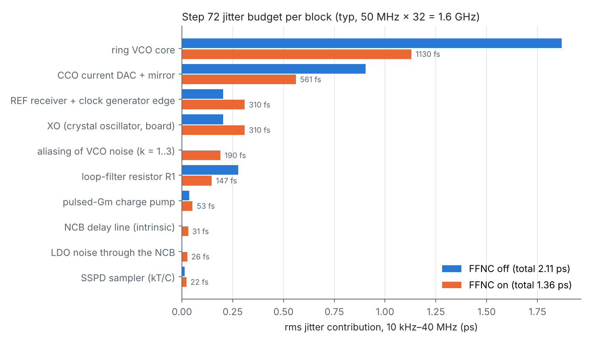
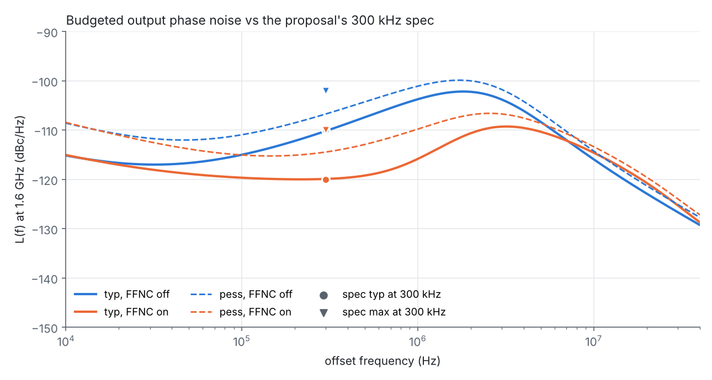

# Step 72: phase-noise, jitter, power and area budget per block

*Phase 7, roadmap step 72. Basis: the submitted proposal (13 Nov 2026): 50 MHz × 32 = 1.6 GHz, f_c ≈ 2.5 MHz, PM 50°,
5-stage pseudo-differential ring fed by a CCO from VDDA, SSPD + pulsed-Gm CP, NCB on a new 1.8 V LDO.*

Reproduce everything on this page:

```bash
python3 design/budget/step72_budget.py    # all tables below, design/budget/budget.csv
python3 design/budget/step72_plots.py     # docs/img/step72_jitter_blocks.png, step72_phase_noise.png
```

The interactive version (sliders for the loop bandwidth, ring corner and CCO noise) is
`learn/phase7_design.ipynb`.

## Result in one paragraph

The budget closes against every noise, power and area specification with FFNC on, at 1.36 ps typ / 1.73 ps
pessimistic against 1.4 / 3.2 ps. Two allocations are tighter than the earlier proposal basis:

- **Ring 1/f³ corner.** It must drop from the simulated 1.1 MHz to ≤ 0.6 MHz.
- **CCO flicker corner.** It must be ≤ 0.3 MHz.

Without these two, the FFNC-off phase noise at 300 kHz would be −108.1 dBc/Hz, 1.9 dB short of the −110 typ in the
proposal. With them it is −110.2. If the ring corner cannot be lowered, `icp_trim` can raise f_c to 2.8 MHz, which
closes the 300 kHz spec on its own.

The FFNC-on −120 dBc/Hz typ at 300 kHz is met with no margin (−119.9), and the reference sets that floor: XO and
receiver together give −121.2 dBc/Hz × N² before any on-chip noise.

Typical power is 9.08 mW against "about 9.0". Worst case is 13.5 / 11.4 mW against the 15 / 13 mW maximum.

## What happens, how, why

### What happens
Every block adds a small, independent random timing error to the output edges. The output jitter is the
root-sum-square of all of them, each one shaped by the path from its block to the output. A budget fixes, before any
transistor is sized, how much each block may contribute so that the sum meets the specification. It then gives each
block's designer a pass/fail number in that block's own units.

### How it happens
Each block is modelled as a noise source at the place where it physically enters the loop. Its transfer function to
the output is derived:

$$S_{out}(f) = \big[N^2 S_{REF} + S_{PD}\big]\,\big|H + G_c(1-H)\big|^2
            + S_{VCO}\,\big|(1-G_c)(1-H)\big|^2 + S_{NCB} + K_s^2\omega_0^2 S_{v,LDO} + |G_c|^2 S_{alias}$$

where:

- H is the type-II closed-loop transfer (f_c = 2.5 MHz, PM 50°).
- G_c = G_SSPD·G_NCB is the cancellation path: sample-and-hold sinc, half-period delay, and a pole at −60° at f_REF/7.8.
- The VCO-like sources are the ring, the CCO current and the loop-filter resistor.

Each spectrum is integrated over 10 kHz–40 MHz: σ_t = √∫S_out df / (2πf_out). Contributions add as variances because
the sources are uncorrelated.

### Why it happens this way
- **Reference.** It enters as a time error, so it is multiplied by N² = 30 dB.
- **SSPD and CP.** These see the VCO directly with no divider, so they are not multiplied by N².
- **Oscillator noise.** It is high-passed by the loop (1−H), then reduced again by (1−G_c) when FFNC is on.
- **NCB and LDO.** These come after everything, so nothing filters them.
- **Aliasing.** FFNC adds this cost: the SSPD folds VCO noise at f ± k·f_REF back into the band, and the cancellation
  path adds it to the output.

The sizes of the bars below follow from these four facts.

## A. Jitter budget per block (10 kHz–40 MHz, f_REF = 50 MHz)



| Block | Allocation (typ / pess) | typ off | typ on | pess off | pess on |
|---|---|---|---|---|---|
| XO (board crystal) | −155 dBc/Hz floor at 50 MHz, 1/f corner 30 / 100 kHz | 0.202 | 0.310 | 0.210 | 0.277 |
| REF receiver + clock generator | −155 / −151 dBc/Hz, corner 30 / 100 kHz | 0.202 | 0.310 | 0.333 | 0.439 |
| SSPD sampler (kT/C) | C_s = 100 fF/side, A = 0.5 / 0.35 V → −147.8 / −144.7 dBc/Hz | 0.014 | 0.022 | 0.020 | 0.027 |
| Pulsed-Gm charge pump | g_m 100 µS, γ 1 / 1.5, d = 1 %, 1/f corner 300 kHz | 0.037 | 0.053 | 0.065 | 0.082 |
| Loop-filter R1 (9.61 kΩ) | 4kTR = 12.6 nV/√Hz | 0.278 | 0.147 | 0.278 | 0.157 |
| Ring VCO core | −98.35 / −97.35 dBc/Hz at 1 MHz, f_c3 0.6 / 1.2 MHz | **1.869** | **1.130** | **2.300** | **1.396** |
| CCO DAC + 1:8 mirror | 7.2 / 10.1 pA/√Hz (−104.2 / −101.2 dBc/Hz at 1 MHz), f_c 0.3 / 0.6 MHz | 0.904 | 0.561 | 1.346 | 0.844 |
| NCB delay line (intrinsic) | −150 / −146 dBc/Hz, corner 1 / 3 MHz | — | 0.031 | — | 0.057 |
| LDO noise through the NCB | 40 / 80 nV/√Hz, K_s = 104 / 120 ps/V | — | 0.026 | — | 0.061 |
| Aliasing of VCO noise (k = 1…3) | from the above, 10 / 30 % FFNC gain error | — | 0.190 | — | 0.177 |
| **Total (ps rms)** | | **2.11** | **1.36** | **2.71** | **1.73** |
| **Spec** | | 2.3 typ | 1.4 typ | 4.7 max | 3.2 max |

All values in the last four columns are ps rms. Reference range, typ off / on: 45 MHz 2.23 / 1.51 ps, 55 MHz
2.01 / 1.23 ps. Pessimistic off / on: 2.86 / 1.91 and 2.58 / 1.59 ps. All are inside the maxima.

FFNC reduces typ jitter by 36% (spec: 35% typ, 20% min) and pessimistic jitter by 36%.

## B. Phase noise at 300 kHz



| f_REF | typ off | typ on | pess off | pess on |
|---|---|---|---|---|
| 45 MHz | −110.6 | −119.9 | −107.2 | −114.7 |
| 50 MHz | **−110.2** | **−119.9** | −106.7 | −114.5 |
| 55 MHz | −109.8 | −120.0 | −106.4 | −114.3 |
| Spec | −110 typ | −120 typ | −102 max | −110 max |

All values in dBc/Hz. Margins against the maxima: 4.7 dB (off) and 4.5 dB (on).

The proposal's original basis (ring corner 1.1 MHz, CCO only +1 dB) gives −108.1 / −102.6 dBc/Hz off. That is the
reason for the tighter ring and CCO allocations.

## C. Block-level specifications that come out of the budget

These are the numbers each Phase 7 block design must meet and each Phase 8 testbench must check.

| Block | Noise spec (block units) | Other budget specs | Testbench (Phase 8) |
|---|---|---|---|
| XO (board) | ≤ −155 dBc/Hz at ≥ 100 kHz, about 400 fs per edge | 45–55 MHz, 0.4–3.3 V pp | n/a (board condition) |
| REF receiver | ≤ −155 dBc/Hz equivalent, i.e. ≤ 400 fs rms per edge, ≤ 63 µV rms at the threshold for a 1 V pp sine | 0.2 mW from VDDA; duty ≥ 45 % | tb_refin (transient noise) |
| SSPD | C_s ≥ 100 fF/side (≥ 50 fF acceptable); A ≥ 0.35 V at the sample | kick-back < 1 mV (spur, step 73) | tb_sspd_char, tb_sspd_mc |
| Pulsed-Gm CP | input-referred ≤ 13 nV/√Hz (g_m ≥ 100 µS, γ ≤ 1.5); 1/f corner ≤ 300 kHz; β = 1 µA/rad | 0.05 mA on the LDO | tb_sscp_dc, tb_sscp_pulse |
| Loop filter | R1 9.61 kΩ, C1 18.2 pF, C2 2.78 pF (β = 1 µA/rad, K_VCO = 300 MHz/V assumed) | zero 0.91 MHz, pole 6.87 MHz | tb_lf_ac |
| Ring core | L(1 MHz) ≤ −98.35 dBc/Hz free-running at 1.6 GHz; f_c3 ≤ 0.6 MHz | 1.31 mA, ring node ≤ 1.8 V | tb_vco_tran, tb_vco_ktune |
| CCO | i_n ≤ 7.2 pA/√Hz at 1 MHz; 1/f corner ≤ 0.3 MHz (K_I = 1.22×10¹² Hz/A) | 1.47 mA incl. DAC, 4.86 mW | tb_cco_ac, tb_cco_dc |
| NCB | ≤ −150 dBc/Hz white, corner ≤ 1 MHz; supply sensitivity ≤ 104 ps/V | 0.44 mA on the LDO; gain 117–199 fs/mV | tb_ncb_* (new, step 80) |
| LDO | output noise ≤ 40 nV/√Hz (10 kHz–40 MHz); 1.71–1.89 V | load 1.08 mA, I_q 45 µA | tb_ldo_ac, tb_ldo_tran |
| FFNC calibration | gain error ≤ 10 % typ, ≤ 30 % worst | 4-bit `ncb_code` | tb_top_lock + tone |

## D. Power budget

| Block | Supply | I typ (mA) | P typ (mW) | P worst (mW) |
|---|---|---|---|---|
| Ring VCO through the CCO (1:8 mirror + DAC) | VDDA | 1.474 | 4.86 | 7.46 |
| Ring output buffers (to SSPD, NCB, divider) | LDO | 0.300 | 0.99 | 1.42 |
| SSPD + clock generator / pulser | LDO | 0.120 | 0.40 | 0.57 |
| Pulsed-Gm charge pump | LDO | 0.050 | 0.17 | 0.24 |
| FLL charge pump (off in lock) | LDO | 0.020 | 0.07 | 0.09 |
| Bias distribution (IBIAS mirrors) | LDO | 0.050 | 0.17 | 0.24 |
| NCB delay line | LDO | 0.440 | 1.45 | 2.08 |
| LDO load reserve | LDO | 0.100 | 0.33 | 0.47 |
| LDO quiescent (error amp, divider) | VDDA | 0.045 | 0.15 | 0.21 |
| REF receiver | VDDA | 0.061 | 0.20 | 0.29 |
| Dividers (/32 TSPC), PFD, FLL logic, decode | VDDD | 0.167 | 0.30 | 0.41 |
| **Total, FFNC on** | | | **9.08** | **13.47** |
| **Total, FFNC off** (NCB disabled) | | | **7.63** | **11.39** |
| Spec | | | 9.0 / 7.5 typ | 15 / 13 max |

How the columns are computed:

- **LDO rows.** Blocks on the LDO rail are charged at 3.3 V, because their current comes from VDDA through the pass
  device. Every mA there costs 3.3 mW, not 1.8 mW.
- **Worst case.** The ring uses the simulated 1.76 GHz, ss, 110 °C, 3.63 V point. Every other block is typ current ×
  1.3 at the maximum supply.
- **FoM.** 10·log₁₀(1.36² × 10⁻²⁴ × 9.08) = −227.8 dB (proposal −227.5).
- **Excluded.** Output taps (0.5 / 1.0 mW) and pad drivers are not counted, as in the spec.

## E. Area budget

| Block | µm² |
|---|---|
| Ring VCO | 3,000 |
| CCO DAC + 1:8 mirror (large-area, filtered gate) | 6,000 |
| SSPD, REF receiver, pulser | 3,000 |
| Pulsed-Gm CP + loop filter (C1 stacked MIM over MOS) | 5,000 |
| FLL (/32, PFD, CP) | 3,000 |
| NCB | 2,500 |
| **LDO (new; missing from the proposal basis)** | **4,000** |
| Dividers, bias, control, pad interface | 4,000 |
| Decoupling | 15,000 |
| Routing, guard rings | 12,000 |
| **Total** | **57,500 µm² = 0.058 mm²** (spec 0.08 typ / 0.12 max) |

## F. Sensitivity: which allocations are critical

The table shows total typ jitter when one block alone is 3 dB worse than its allocation.

| Block +3 dB | Total off (ps) | Total on (ps) |
|---|---|---|
| None (budget) | 2.115 | 1.359 |
| Ring VCO core | **2.819** | **1.766** |
| CCO | 2.299 | 1.470 |
| XO or REF receiver | 2.124 | 1.394 |
| Loop-filter R1 | 2.133 | 1.367 |
| SSPD, pulsed-Gm CP, NCB, LDO | ≤ 2.115 | ≤ 1.360 |

Read it this way:

- **Ring.** The ring is the only allocation with no slack. With FFNC on, a ring 3 dB worse still meets the 3.2 ps
  maximum but loses the 1.4 typ.
- **CCO and reference.** These matter second.
- **SSPD, CP, NCB, LDO.** These have more than 10 dB of slack. Their designs can be driven by spurs, linearity, power
  and robustness.

## G. Findings and decisions

1. **The proposal's FFNC-off 300 kHz typ (−110) needs a lower ring 1/f³ corner.** The allocation is f_c3 ≤ 0.6 MHz,
   against the 1.1 MHz simulated with the step-6 cell. Step 74 will reach it with longer ring nMOS (flicker ∝ 1/WL)
   and balanced rise/fall edges (smaller ISF DC term). Fallback: `icp_trim` to f_c ≈ 2.8 MHz (−110.4 typ off; phase
   loss from the hold delay grows from 9° to 10°).
2. **The CCO thermal floor is physics-bound** at about 7 pA/√Hz (1.31 mA with about 1.2 V of headroom), so only its
   flicker is reduced:
   - large-area thick-oxide output devices;
   - an RC-filtered mirror gate, so the 8× gain of the reference-side noise is removed.
3. **FFNC-on 300 kHz typ is reference-limited** (−119.9 vs −120). This is recorded rather than spent on. A −157 dBc/Hz
   receiver would cost about +0.1 mW.
4. **The LDO is added to the area table** (+4,000 µm²).
5. **Typ power is 9.08 mW**, 0.9% over "about 9.0". The LDO-load reserve (0.33 mW) is the first item to give back once
   the block currents are known.
6. **Loop filter (provisional).** R1 = 9.61 kΩ, C1 = 18.2 pF, C2 = 2.78 pF, for β = 1 µA/rad and K_VCO = 300 MHz/V. These
   are recomputed in step 76 with the real K_VCO (step 74) and β (steps 77–78).
7. **Not in this step.** Reference spurs (CP mismatch, SSPD kick-back, NCB feedthrough) are budgeted separately in the
   next step. Deterministic jitter from supply tones is covered by the VTEST measurement.

## H. Layout-convenience rules that come from the budget

These are decided now so that each schematic is drawn the way it will be laid out.

| Block | Layout-driven schematic choices |
|---|---|
| Ring VCO (dominant noise) | 5 identical cells in a row with a fold-back (U-shape), so the last-to-first wire matches the others. Every cell has the same load, including dummy loads on taps that are not used. Integer fingers (2–4) per device so each cell is one abutting row. nMOS and pMOS in matched orientation. The ring node is decoupled locally. |
| CCO (2nd) | 1:8 mirror drawn as 9 unit devices (1 reference + 8 output) in a common-centroid row, with dummies at both ends. The 5-bit DAC uses binary-weighted unit cells (1, 2, 4, 8, 16 units) in a common-centroid array. The gate RC filter uses a long xhigh_po resistor plus a MOS cap placed under the array. 3.3 V devices only, inside their own deep-nwell/guard ring. |
| REF receiver (×N² path) | Short, shielded route from the pad. Its own supply branch from VDDA, with a guard ring away from the ring. Inverter-based stages with equal-finger devices; level shifter at the 3.3 → 1.8 V edge. |
| SSPD | Fully differential, mirror-symmetric about one axis. Sampling caps as unit MIM tiles with a dummy ring. Switches with dummy half-size devices for charge-injection cancellation. Clock routes of equal length to both sides. |
| Pulsed-Gm CP | Differential pair in common-centroid (ABBA) with dummies. Non-minimum L for flicker. Tail and output mirrors use the same unit device as the bias distribution. |
| Loop filter | R1 as one wide high-res poly resistor split into equal legs (matchable, easy to trim by a strap). C1 as nfet_01v8 MOS cap (7.5 fF/µm² at 0.9 V, only 2.2 at 0 V, so V_cont must stay above about 0.6 V) with cap_mim_m3_1 stacked on top: about 9.5 fF/µm², about 1,900 µm². C2 as linear MIM (about 1,400 µm²). MIM tiles 2–30 µm a side. R1 in res_high_po (325 Ω/□): about 30 squares. |
| NCB | Two delay cells right at the output buffer. Binary cap bank for `ncb_code` as unit tiles (0.5 fF steps). Its own LDO-rail decap next to it. Symmetric differential routing. |
| LDO | Pass device as parallel unit fingers along the supply edge. Output decap distributed close to the NCB and SSPD. The error-amp input pair is common-centroid. |
| All | Unit-device discipline (few distinct W/L). Supply domains placed as bands (VDDA 3.3 V, LDO 1.8 V, VDDD). Level shifters only at band edges. Decap fills the empty space. |

## Interview questions (step 72)

42 questions. Answer each one aloud before you open it.

<details><summary><b>Q1.</b> What is a noise budget, and why do it before designing any transistor?</summary>

A table that splits the system target (here 1.4 ps typ / 3.2 ps max rms jitter, −110/−120 dBc/Hz at 300 kHz) into one allocation per block, each in that block's own units (pA/√Hz, nV/√Hz, fs per edge). It turns one system number into pass/fail tests a single block can be designed and simulated against, and it shows *early* which block dominates — so the design effort (and power and area) goes there and not to blocks that cannot matter.

</details>

<details><summary><b>Q2.</b> Why do jitter contributions add in power (rms²) and not linearly?</summary>

The sources are physically independent (different devices), so they are uncorrelated and their variances add: σ² = Σσᵢ². Consequence: a block at half the jitter of the largest one adds only 12% to the total; a block at 1/3 adds 5%. Fixing small contributors is wasted effort.

</details>

<details><summary><b>Q3.</b> Write the output phase-noise PSD of the SSPLL with FFNC in terms of the block sources.</summary>

S_out(f) = [S_REF·N² + S_PD,eq]·|H + G_c(1−H)|² + S_VCO,eq·|(1−G_c)(1−H)|² + S_NCB + S_alias·|G_c|², where H is the closed-loop transfer, G_c the cancellation path (SSPD gain × NCB gain, with sinc hold, half-period delay and pole) and the VCO-like sources (ring, CCO, loop-filter R) all enter at the VCO. Jitter = √(∫S_out df)/(2πf_out), here 10 kHz–40 MHz.

</details>

<details><summary><b>Q4.</b> Why is the reference noise multiplied by N² but the SSPD noise is not?</summary>

The reference sets the *time* of each edge; a time error Δt at f_REF becomes a phase error 2πf_out·Δt at the output, i.e. N times the reference phase error → N² in power. The SSPD compares the VCO directly (no divider), so its voltage noise divided by its gain is already a VCO-phase error: no N. That is the whole point of sub-sampling (−130 vs −110.9 dBc/Hz detector floor at the output, step 8).

</details>

<details><summary><b>Q5.</b> Why does FFNC make the reference contribution *worse* (0.20 → 0.31 ps)?</summary>

With FFNC on, the in-band transfer becomes |H + G_c(1−H)|²: above the loop bandwidth the cancellation path also passes the SSPD's view of the reference, so reference (and SSPD/CP) noise reaches the output up to ≈f_REF/8 instead of f_c. FFNC trades VCO noise for reference noise; it wins because the VCO term is 10× larger.

</details>

<details><summary><b>Q6.</b> Which block dominates the budget, and what does that tell you?</summary>

The ring VCO core (1.87 ps off / 1.13 ps on typ), then the CCO (0.90 / 0.56). Everything else together is < 0.5 ps. So power, area and design time go to the oscillator and its current source; the SSPD, CP and NCB can be designed for linearity, spurs and robustness rather than noise.

</details>

<details><summary><b>Q7.</b> The SSPD kT/C noise contributes only 22 fs. Why not shrink the sampling capacitor to save power?</summary>

Because the cap also sets the charge-sharing/kick-back spur and the hold droop; and the SSPD noise is in-band where FFNC passes it. 100 fF keeps kT/C at −147.8 dBc/Hz (17 dB below the CP allocation), so it is not the limit; going to 25 fF costs +6 dB noise but buys little power (the ring buffers that drive it set the power). The budget says: free to choose the cap for spur and matching, as long as Cs ≥ ~50 fF per side.

</details>

<details><summary><b>Q8.</b> Derive the SSPD kT/C phase-noise floor.</summary>

Each side samples kT/C; the differential sample has v² = 2kT/C. The differential slope is 2A per radian of VCO phase, so one sample carries φ² = (2kT/C)/(2A)² = kT/(2CA²). Samples are independent, so this variance is white over 0…f_REF/2: S_φ = φ²/(f_REF/2) = kT/(C·A²·f_REF), and L = S_φ/2 = kT/(2·C·A²·f_REF) = −147.8 dBc/Hz for C = 100 fF, A = 0.5 V, f_REF = 50 MHz.

</details>

<details><summary><b>Q9.</b> How is the pulsed-Gm charge-pump noise budgeted, and why does the duty cycle matter?</summary>

The transconductor's output noise current 4kTγg_m only reaches the loop filter during the pulse (duty d ≈ 1%, 200 ps of 20 ns). The useful signal current is β = 2A·g_m·d (A per rad). Referred to VCO phase: S_φ = 4kTγg_m·d/β² → L ≈ kTγ/(2A²g_m d) ≈ −140.8 dBc/Hz white, plus a 1/f corner allocated ≤ 300 kHz. Shorter pulses lower the signal more than the noise at equal g_m, so d is set by β and the spur, not by noise.

</details>

<details><summary><b>Q10.</b> Why is the loop-filter resistor a visible contributor (0.28 ps) and what are the knobs?</summary>

Its 4kTR voltage noise (12.6 nV/√Hz for 9.61 kΩ) is filtered by C1/(C1+C2+sRC1C2) and integrated by K_VCO/s, so it behaves like VCO noise (high-passed by 1−H, cancelled by FFNC). Knobs: larger β (more CP current → smaller R, larger C, more area), smaller K_VCO (needs a wider coarse range from the CCO DAC), or a dual-path filter. We accept it: 0.28 ps adds only ~1% to a 2.1 ps total.

</details>

<details><summary><b>Q11.</b> Why must the ring 1/f³ corner be halved (1.1 → 0.6 MHz) in this budget?</summary>

With the simulated 1.1 MHz corner the proposal's own model gives L(300 kHz) = −108.1 dBc/Hz FFNC-off typ, 1.9 dB short of the −110 typ in the specification. At 300 kHz the ring is in its 1/f³ region, so L ∝ (1 + f_c3/f); halving f_c3 plus a lower-flicker CCO brings it to −110.2. Halving needs ~2× gate area in the ring transistors that upconvert flicker, or better rise/fall symmetry (smaller DC term of the ISF, c₀).

</details>

<details><summary><b>Q12.</b> What determines the 1/f³ corner of a ring oscillator?</summary>

Hajimiri–Lee: f_1/f³ = f_1/f(device) · (c₀/c_rms)². c₀ is the DC value of the ISF (zero for a perfectly symmetric waveform), c_rms its rms. So the corner falls with device area (lower device flicker corner) and with symmetry of rise and fall edges (pMOS/nMOS strength balance, equal loading).

</details>

<details><summary><b>Q13.</b> Why is the CCO noise allocated in pA/√Hz, and how do you convert it?</summary>

The CCO is a current source: what it delivers to the ring is a noisy current. Frequency noise = K_I·i_n (K_I = ∂f/∂I = 1.22×10¹² Hz/A), phase noise S_φ = (K_I i_n)²/f², L = S_φ/2. L(1 MHz) = −104.2 dBc/Hz ↔ i_n = 7.2 pA/√Hz.

</details>

<details><summary><b>Q14.</b> Why can't the CCO noise be made arbitrarily small?</summary>

A MOS current source of current I with overdrive (headroom) V_ov has i_n² ≈ 4kTγ·2I/V_ov. At 1.31 mA and ~1.2 V of headroom left by VDDA_min 2.97 V minus the ~1.6–1.8 V ring node, the thermal floor is ≈6–7 pA/√Hz. Degeneration gives the same limit (4kT/R_s with R_s = V_h/I). Only more headroom or less current helps — the budget therefore allocates the thermal floor and attacks only the flicker part.

</details>

<details><summary><b>Q15.</b> Why does a filtered mirror gate help the CCO noise?</summary>

In a 1:8 mirror the reference-side noise (DAC unit cells, IBIAS mirror, diode device) is multiplied by 8 at the output. An RC low-pass on the shared gate (corner ≪ 10 kHz, e.g. a long poly resistor and a MOS cap) removes it inside the integration band, so only the output devices' own noise remains. It costs area, not power.

</details>

<details><summary><b>Q16.</b> Why is the NCB intrinsic noise budget so small (31 fs) yet still important?</summary>

It is added *after* the loop and the cancellation: nothing filters it, so it appears 1:1 at the output with FFNC on, all the way to 40 MHz. −150 dBc/Hz white with a 1 MHz flicker corner gives 31 fs. If the delay line were a long chain of starved inverters, its noise would grow with its delay and could reach hundreds of fs — so the NCB is kept short (2 cells, small delay range).

</details>

<details><summary><b>Q17.</b> How does LDO noise get into the output, and how is that budgeted?</summary>

The NCB delay depends on its supply (≈104 ps/V for 4 inverter edges at ~26 ps/V each): a supply noise density v_n becomes a timing noise K_s·v_n, i.e. phase 2πf_out·K_s·v_n. For ≤ 26 fs contribution the LDO output noise must be ≤ 40 nV/√Hz (10 kHz flicker corner). The ring itself is fed by the high-impedance CCO, not the LDO, so LDO noise does not modulate the oscillator directly.

</details>

<details><summary><b>Q18.</b> What is the aliasing term in the FFNC budget?</summary>

The SSPD samples at f_REF, so VCO noise at f ± k·f_REF folds into the 0…f_REF/2 band (Thijssen: S_s(f) = f_REF Σ S_φ(f − k f_REF)). The cancellation path then *adds* this folded noise to the output (it is not correlated with the output's own noise at f). It costs 0.19 ps typ — the main reason FFNC cannot cancel everything.

</details>

<details><summary><b>Q19.</b> Why is the jitter integrated from 10 kHz to 40 MHz?</summary>

The proposal's specification band. The lower edge excludes slow wander a downstream system tracks; the upper edge is the Nyquist range of a 100 MHz-class sampling clock divided output and where the ring's −20 dB/dec skirt has fallen well below the in-band level. A budget must use the same band as the spec.

</details>

<details><summary><b>Q20.</b> How do you check a budget against the reference range 45–55 MHz?</summary>

Re-run with f_REF = 45 and 55 MHz: f_out scales, the ring's L at 1 MHz scales ~ f_out (same power per edge), the aliasing and the cancellation bandwidth move with f_REF. Typ jitter goes 2.23/1.51 ps at 45 MHz to 2.01/1.23 ps at 55 MHz (off/on) — all inside the maxima.

</details>

<details><summary><b>Q21.</b> What does the 'pessimistic' column represent?</summary>

A coherent worst plausible set for the noise numbers: ring +1 dB and 2× 1/f³ corner, CCO +3 dB and 2× corner, reference receiver +4 dB with a 100 kHz corner, SSPD amplitude 0.35 V, γ = 1.5, NCB −146 dBc/Hz, LDO 80 nV/√Hz and a 30% FFNC gain error. It is not a SPICE corner; it is the budget's stress case that must still meet the *maximum* spec.

</details>

<details><summary><b>Q22.</b> The FFNC-on L(300 kHz) is −119.9 typ against a −120 typ spec. Is that a fail?</summary>

It is a typ number at the limit, not a guaranteed limit (the max is −110, with 4.5 dB margin pess). At 300 kHz with FFNC on the floor is set by the reference ×N²: crystal −155 and receiver −155 → −121.2 dBc/Hz together, before any on-chip noise. Only a cleaner receiver (−157 for ~+0.1 mW) or a better board crystal moves it. This is recorded as a finding.

</details>

<details><summary><b>Q23.</b> How is the power budget built and why does the LDO domain cost more?</summary>

Every block gets a current on a named supply; power = I × supply voltage at the slot. Blocks on the 1.8 V LDO rail draw their current from VDDA = 3.3 V, so each mA costs 3.3 mW, not 1.8 mW: the LDO burns the 1.5 V difference. That is why logic that can live on VDDD (1.8 V, 1.8 mW/mA) is put there.

</details>

<details><summary><b>Q24.</b> Why is the ring fed from VDDA through a CCO instead of from the LDO?</summary>

A current-fed ring has low supply sensitivity (the CCO's output impedance isolates it) and the current DAC also gives the coarse tuning. The price: the ring burns its current at 3.3 V (4.86 mW). Running it from the LDO would cost the same power from VDDA and add the LDO noise directly to the oscillator.

</details>

<details><summary><b>Q25.</b> What is the worst-case power and how is it estimated?</summary>

Ring at 1.76 GHz, ss, 110 °C, VDDA 3.63 V: 7.46 mW (from the proposal's simulated basis). Other blocks: typ current × 1.3 at the maximum supply. Total 13.5 mW FFNC on / 11.4 mW off against 15/13 mW maximum.

</details>

<details><summary><b>Q26.</b> What is the jitter figure of merit and what does this budget give?</summary>

FoM = 10·log₁₀[(σ/1 s)²·(P/1 mW)]. σ = 1.36 ps, P = 9.08 mW → −227.8 dB (proposal −227.5). Note the FoM rewards power and jitter equally in dB: halving the jitter (−6 dB) is worth 4× the power.

</details>

<details><summary><b>Q27.</b> Why does the area table now include the LDO?</summary>

Decision D4 (step 8) added an on-chip LDO for the clean 1.8 V rail; the proposal's area basis listed every block except it. ~4000 µm² (pass device for ~1.2 mA, error amp, compensation and output cap partly as MOS cap). Total 57,500 µm² — still below the 0.08 mm² typ.

</details>

<details><summary><b>Q28.</b> How would you decide between spending 1 mW on a cleaner VCO and 1 mW on a better NCB?</summary>

Use the sensitivity of the total to each block: ring +3 dB moves the typ total from 1.36 to 1.77 ps; NCB +3 dB changes nothing visible. The marginal improvement per mW is far larger at the VCO. A budget makes that comparison numeric.

</details>

<details><summary><b>Q29.</b> What is the 'sensitivity' table and how is it used during design?</summary>

For each block, the total jitter when that block alone is 3 dB worse than allocated. It shows which allocations are critical (ring, CCO, reference) and which have slack (SSPD, CP, NCB, LDO). Slack can be traded for power, area or robustness during the block designs.

</details>

<details><summary><b>Q30.</b> How will each allocation be verified in Phase 8?</summary>

Each block's testbench measures its allocation in its own units: SSPD/CP with .noise and PSS-equivalent transient noise (tb_sspd_char, tb_sscp_*), ring free-running phase noise by transient noise and ISF (tb_vco_*), CCO output current noise by .noise (tb_cco_ac), LDO output noise and PSRR (tb_ldo_ac), NCB delay noise and supply sensitivity (tb_ncb_*). The results replace the allocations in step72_budget.py, which recomputes the total.

</details>

<details><summary><b>Q31.</b> Why keep the budget in a script instead of a spreadsheet?</summary>

Because the transfer functions are frequency-dependent and complex (H, 1−H, G_c, aliasing) — a spreadsheet of single numbers cannot integrate them. A script also re-runs automatically when a simulated curve replaces an allocation, and it is version-controlled next to the schematics.

</details>

<details><summary><b>Q32.</b> What layout decisions follow directly from the noise budget?</summary>

(1) The ring and its CCO get the cleanest, symmetric placement (dominant noise); (2) the CCO output mirror is large-area, common-centroid, with a filtered gate; (3) the reference receiver path is short and shielded (it is ×N²); (4) the SSPD caps are placed symmetrically with dummies (spur, not noise); (5) the NCB is next to the output with its own LDO decap; (6) the loop-filter C1 stacks MIM over MOS to fit the area.

</details>

<details><summary><b>Q33.</b> Why is the loop-filter C1 a MOS capacitor with MIM on top, and what is the catch?</summary>

C1 = 18.2 pF would need ~9100 µm² as MIM alone (~2 fF/µm²), more than the CP+LF area allocation. A thin-oxide MOS cap (7.5 fF/µm² at 0.9 V) with a MIM cap stacked above gives ~9.5 fF/µm² → ~1,900 µm² (~11.5 fF/µm² with both MIM layers). Catch: a MOS cap is non-linear and must be kept in strong inversion/accumulation across the tuning range — acceptable for C1 (the large zero cap), not for C2.

</details>

<details><summary><b>Q34.</b> What is the effect of a loop-gain (K_VCO or β) error on the budget?</summary>

f_c moves (f_c ∝ βK_VCO): a lower f_c lets more VCO noise through and raises FFNC-off jitter; a higher f_c helps here (2.8 MHz closes the 300 kHz spec alone) but costs phase margin through the sample-and-hold delay (≈ 180°·f_c/f_REF). icp_trim[1:0] is the knob to recentre f_c after silicon or after the K_VCO of step 74 is known.

</details>

<details><summary><b>Q35.</b> Why 2× margin between pessimistic budget and the max spec?</summary>

The budget's models (ISF-based ring noise, γ, flicker coefficients) carry several-dB uncertainty, and layout parasitics add noise and power. The proposal says maximum values keep about twice the pre-layout margin; here pess 2.71/1.73 ps vs 4.7/3.2 ps max is 1.7–1.8×.

</details>

<details><summary><b>Q36.</b> Explain 'L = S_φ/2' and why the code uses 2·10^(L/10).</summary>

L(f) is defined as single-sideband noise relative to the carrier; for small phase noise L(f) = S_φ(f)/2 where S_φ is the one-sided phase PSD. Integrating jitter needs S_φ = 2·10^(L/10) rad²/Hz, then σ_t = √∫S_φ df / (2πf_0).

</details>

<details><summary><b>Q37.</b> How does a flicker (1/f) noise source in the CP or SSPD show up at the output?</summary>

Below the loop bandwidth H ≈ 1, so a 1/f input source appears as 1/f at the output — it raises L(f) at low offsets (10–100 kHz). That is why the CP/SSPD allocations include a 300 kHz flicker corner and why their devices are not minimum length.

</details>

<details><summary><b>Q38.</b> What would happen to the budget if the reference were 25 MHz with N = 64?</summary>

The reference term grows by 20·log(2) = 6 dB (N²), the SSPD term grows because A²·f_REF halves (+3 dB), the cancellation bandwidth halves (f_REF/8) and aliasing worsens — the 50 MHz reference is a deliberate budget choice.

</details>

<details><summary><b>Q39.</b> Which allocations are measured on silicon, and how?</summary>

Total jitter and L(f) on CLK_OUT (/16 + 24.1 dB), FFNC on vs off on the same chip, supply sensitivity with the VTEST tone, and power per domain from slot currents with blocks enabled in turn. Individual block noise is not directly observable — the budget lets you attribute the measured total.

</details>

<details><summary><b>Q40.</b> A colleague proposes a 3-stage ring to save power. What does the budget say?</summary>

The step-6 study: 3 × 1.0 at 0.61 mA gives −87.4 dBc/Hz vs −94.2 for 5 × 1.5 — 6.8 dB worse at the dominant block; jitter would roughly double. Saving ~2 mW does not pay; the 5-stage verdict stands.

</details>

<details><summary><b>Q41.</b> Why is the FLL charge pump nearly absent from the noise budget?</summary>

It has a dead zone: in lock the phase error sits inside it and the FLL CP is off — no noise current reaches the loop filter. Its leakage and switch charge injection matter for spurs (step 73), not for random jitter.

</details>

<details><summary><b>Q42.</b> What are the three numbers every block designer must take away from step 72?</summary>

Its noise allocation (in its own units), its supply current on a named supply, and its area. Plus its layout rules from the budget: which nodes are noise-critical, which must be symmetric and which supply domain it lives in.

</details>
