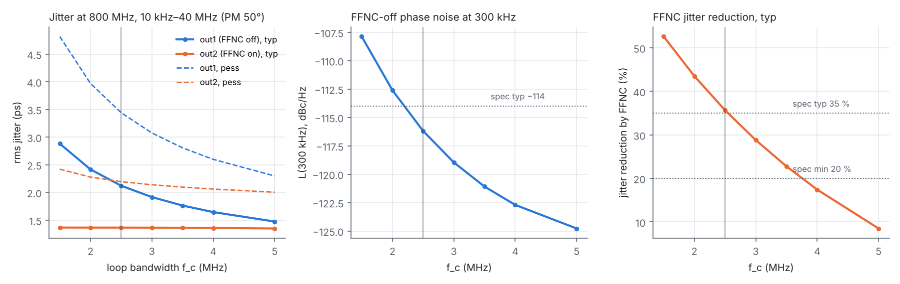
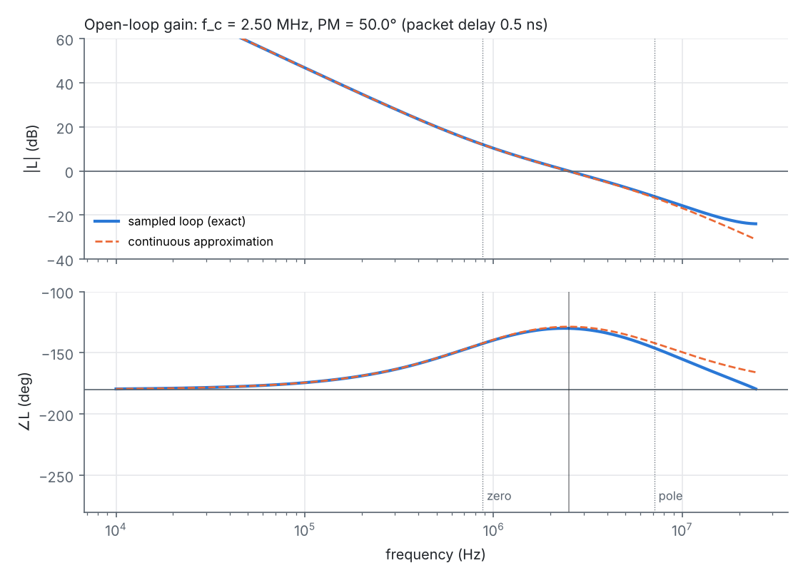
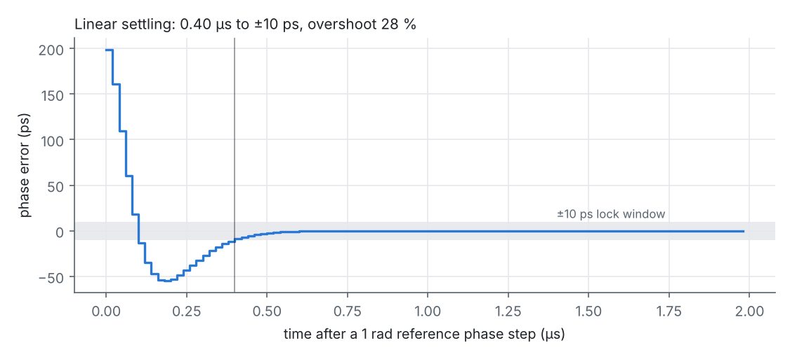
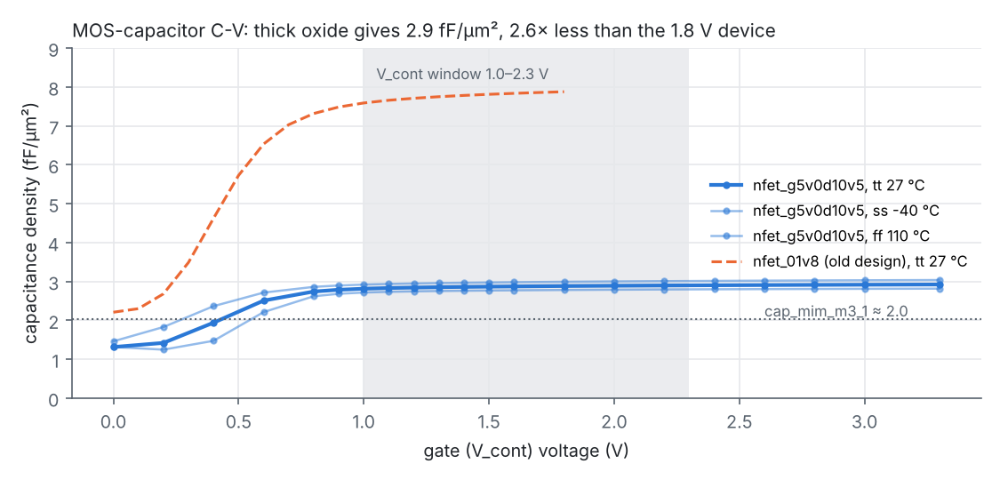
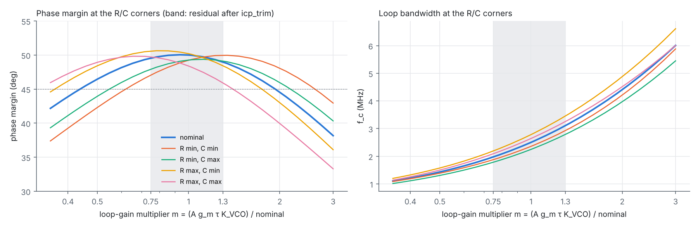

# Step 73 (redo): loop parameters for 800 MHz with 5 V analog devices

> **Superseded in part by step 80 (26 Nov 2026).** With the measured packet delay (2.62 ns, step 77) and the 175 fF that the ring, the Gm and the wiring add on vctl, R1 became 3 × 9.44 µm = 20.26 kΩ and the drawn C2 2 × MIM 30 × 7.74 µm = 0.960 pF; C1 is unchanged. See `step80_hv_lf.md`.

*Phase 7, roadmap step 73, redone for the device-rule migration (18 Nov 2026).*

**Basis**
- 50 MHz × 16 = 800 MHz.
- Every analog device is 5 V-rated (`nfet/pfet_g5v0d10v5`) on VDDA 3.3 V, so the loop-filter MOS capacitor is now thick-oxide.
- Budget from `step72_hv_budget.md`.
- The 1.6 GHz design sheet (archived) is kept unchanged for the record.

Reproduce:

```bash
PDK_ROOT=/path/to/pdk design/loop/spice/run_cv_hv.sh   # 5 V MOS cap, MIM1, MIM2: C-V over tt/ss/ff, −40/27/110 °C
python3 design/loop/step73_hv_loop.py                   # jitter grid, sampled-loop design, tiles, robustness
python3 design/loop/step73_hv_plots.py                  # docs/img/step73hv_*.png
```

The R corners and MIM corners are reused from step 73 (`design/loop/data/rc_corners.csv`); resistors and MIM are not MOS devices, so the rule change does not touch them.

## Revision, 19 Nov 2026 (from step 74 redo)

The 5 V ring's tuning switch does not conduct below about 1.3 V, so the V_cont window is now **1.3–2.3 V**, with the lock point near 1.8 V. Over that window the measured K_VCO is −173 MHz/V (tt), so the Gm unit falls from 19.0 to **16.5 µS**, keeping β·K_VCO constant. R1, C1 and C2 are unchanged.

The narrower window makes the MOS capacitor slightly flatter (×0.95–1.06 instead of ×0.93–1.06), so the robustness numbers below stay conservative. See `step74_hv_vco.md`.

## Result in one paragraph

The loop keeps the same shape: f_c = 2.5 MHz, PM = 50°, and the zero and pole at 0.88 / 7.13 MHz. The specification pins f_c again, for the same reason as before.

The capacitor is what changes. The 5 V MOS capacitor has 2.6× less capacitance per area than the 1.8 V one: 2.87 against 7.48 fF/µm². So C1 is two tiles of 4.41 pF instead of two tiles of 8.56 pF, and the loop gain β is lowered to match (0.91 µA/rad). That raises R1 to 20.6 kΩ. The extra R1 noise costs only 0.01 ps:

| | FFNC off | FFNC on |
|---|---|---|
| Typical | 2.14 ps | 1.37 ps |
| Pessimistic | 3.45 ps | 2.20 ps |

The loop filter takes about 3 800 µm².

**The proposal needs no change:**
- the loop bandwidth (2.5 MHz) is as stated;
- lock settling is 0.40 µs, inside 5 µs;
- the jitter and phase-noise targets keep their margin.

## The design sheet

| Parameter | 800 MHz, 5 V (this redo) | 1.6 GHz, 1.8 V (13 Nov) | Set by |
|---|---|---|---|
| f_REF, N | 50 MHz, 16 | 50 MHz, 32 | proposal |
| f_c | **2.50 MHz** | 2.50 MHz | both the L(300 kHz) and the FFNC-reduction specs (section A) |
| PM (exact sampled loop) | **50.0°** | 50.0° | 2.2 dB margin on L(300 kHz) typ |
| Packet delay t_p | **0.5 ns** design value (PM 50.2° at 0.2 ns, 47.0° at 5 ns) | 2.5 ns | step 77 measured 0.28 ns (0.18–0.50) + one level shifter |
| β | **0.911 µA/rad** | 0.848 µA/rad | C1 snapped to 2 tiles |
| K_VCO (fine) | 150 MHz/V, assumed | 300 MHz/V | step 74 sets it; g_m ∝ 1/K_VCO |
| SSPD gain A, Gm duty d | 0.8 V/rad, 1 % | 0.5 V/rad, 1 % | steps 77–78 (A doubles at half the carrier) |
| g_m | **56.9 µS = 3 units × 19.0 µS** | 84.8 µS = 3 × 28.3 µS | β = 2A·g_m·d |
| R1 | **20.60 kΩ**: res_xhigh_po_2p85, L = 29.2 µm | 11.01 kΩ, L = 15.5 µm | |
| C1 | **8.81 pF**: 2 tiles × (9 nfet_g5v0d10v5, W = L = 10 µm, + 1 cap_mim_m3_1 30 × 30 µm on top) | 17.11 pF, nfet_01v8 tiles | |
| C2 | **1.236 pF**: 2 × cap_mim_m3_1 30 × 10.1 µm | 2.205 pF | |
| C_tot | 10.05 pF | 19.3 pF | |
| Zero / pole | 0.877 / 7.13 MHz | 0.845 / 7.40 MHz | |
| Closed loop | 2.54 dB peaking, f_3dB 4.31 MHz | 2.5 dB, 4.3 MHz | |
| Phase step | 27.6 % overshoot, ±10 ps in **0.40 µs** | 27 %, 0.34 µs | ±10 ps is twice as many radians at 800 MHz |
| V_cont window | **1.0–2.3 V** (centre VDDA/2) | 0.6–1.2 V | the 5 V MOS cap is flat above 1.0 V |
| icp_trim | 00 → 3 units, 01 → 4, 10 → 2, 11 → 5 | same | |
| Loop-filter area | **about 3 800 µm²** | about 3 600 µm² | inside the 5 000 µm² CP + LF budget |
| Jitter (step-72 HV model, realised filter and g_m) | 2.14 / 1.37 ps typ; 3.45 / 2.20 ps pess; R1 adds 0.41 / 0.22 ps | 2.12 / 1.36; 2.71 / 1.73 | |

## What happens, how, why

### What happens

The loop does the same job as before:
- **Below f_c**, the loop makes the ring follow the clean reference.
- **Above f_c**, the FFNC cancels the ring's noise up to about f_REF/8.

The rule change moves two things:
- The carrier halves, which changes the jitter numbers the f_c choice is based on.
- The large capacitor C1 can no longer use the dense thin-oxide MOS device. The thick-oxide MOS capacitor that replaces it stores 2.6× less charge per µm², so the loop filter must either grow or be redesigned for a smaller capacitance.

### How it happens

The open-loop gain and the filter are unchanged in form:

$$L(s) \approx \beta\,K_{VCO}\,\frac{Z(s)}{s}\,e^{-s t_p},\qquad C_{tot} = \frac{b\,\beta K_{VCO}}{\omega_c^2},\quad R_1 = \frac{b}{\omega_c C_1}.$$

Only the product β·K_VCO and the ratio β/C set f_c and PM. So a smaller C1 is matched exactly by a smaller β, with R1 rising as 1/C1: same zero, same pole, same loop.

What this costs is the noise of R1. Its voltage noise $4kTR_1$ reaches the VCO through the filter divider, and a larger R1 adds more phase noise near f_c:

$$S_{\varphi,R_1}(f) = 4kT R_1 \left|\frac{C_1}{C_1 + C_2 + j2\pi f R_1 C_1 C_2}\right|^2 \frac{K_{VCO}^2}{f^2}\,\big|(1-G_c)(1-H)\big|^2$$

### Why it happens this way

The capacitance of a MOS capacitor in inversion is set by its gate oxide: C_ox = ε_ox/t_ox. The 5 V devices have a gate oxide roughly 2.5–3× thicker than the 1.8 V devices, which matches the 2.6× measured.

The thick oxide also moves the threshold. That is why the window moves up:
- The 1.8 V cap is flat from 0.6 V.
- The 5 V cap is flat (within 3 %) from 1.0 V.
- The new window is 1.0–2.3 V, centred on VDDA/2. That suits a Gm and a VCO control input that run from 3.3 V anyway.

## A. Choosing f_c and PM from the jitter model (800 MHz)



| f_c (PM 50°) | out1 typ | out2 typ | out1 pess | out2 pess | L(300 kHz) out1 typ | FFNC reduction typ |
|---|---|---|---|---|---|---|
| 1.5 MHz | 2.88 ps | 1.37 ps | 4.82 ps | 2.42 ps | −107.9 dBc/Hz | 53 % |
| 2.0 MHz | 2.42 | 1.37 | 3.97 | 2.28 | −112.6 | 44 % |
| **2.5 MHz** | **2.12** | **1.37** | **3.44** | **2.20** | **−116.2** | **36 %** |
| 3.0 MHz | 1.92 | 1.36 | 3.08 | 2.14 | −119.0 | 29 % |
| 3.5 MHz | 1.76 | 1.36 | 2.81 | 2.10 | −121.1 | 23 % |
| 4.0 MHz | 1.65 | 1.36 | 2.60 | 2.06 | −122.7 | 17 % |
| 5.0 MHz | 1.47 | 1.35 | 2.30 | 2.00 | −124.8 | 9 % |
| Proposal | 2.6 typ / 5.0 max | 1.6 / 3.2 | | | −114 typ | 35 typ / 20 min |

How to read this table:
- **L(300 kHz) ≤ −114 dBc/Hz needs f_c ≥ about 2.25 MHz.**
- **The 35 % FFNC reduction needs f_c ≤ about 2.55 MHz.**
- **So f_c = 2.5 MHz is pinned by the specification, as at 1.6 GHz.** The FFNC-on jitter (out2) is again flat within 0.02 ps, so it does not choose f_c.

**Phase margin at f_c = 2.5 MHz**

| PM | out1 typ | out2 typ | L(300 kHz) | pess off / on |
|---|---|---|---|---|
| 40° | 2.30 | 1.44 | −118.0 | 3.73 / 2.33 |
| 45° | 2.20 | 1.40 | −117.2 | 3.57 / 2.26 |
| **50°** | **2.12** | **1.37** | **−116.2** | **3.44 / 2.20** |
| 55° | 2.05 | 1.33 | −115.1 | 3.33 / 2.14 |
| 60° | 2.00 | 1.31 | −113.9 | 3.25 / 2.09 |

A higher PM lowers the jitter slightly but pushes the zero down, which costs low-frequency ring suppression. 55° would still meet −114 dBc/Hz, but with only 1.1 dB to spare. PM stays at 50°, with 2.2 dB to spare and the same overshoot as before.

## B. The exact sampled loop and the packet delay



| t_p | 0.2 ns | **0.5 ns** | 1 ns | 2 ns | 2.5 ns | 5 ns |
|---|---|---|---|---|---|---|
| PM with the final filter | 50.2° | **50.0°** | 49.7° | 49.1° | 48.7° | 47.0° |

The step-77 clock generator fires the Gm pulse 0.28 ns (0.18–0.50 ns) after the hold transfer. A level shifter to 3.3 V adds about 0.1–0.2 ns, so the design value is 0.5 ns. Even 2 ns would cost only 0.9°, so the level shifter is not timing-critical here. It is critical only on the sampling edge (step 72 budget).



The phase-step settling (0.40 µs to ±10 ps) is slower than at 1.6 GHz (0.34 µs) only because ±10 ps is half as many radians at 800 MHz. The loop dynamics are identical.

## C. Realisation with PDK devices (layout first)



| Item | Measured (ngspice, frozen PDK) | Spread used |
|---|---|---|
| nfet_g5v0d10v5 MOS cap, W = L = 10 µm | 2.87 fF/µm² at 1.65 V; 2.81 at 1.0 V; 2.90 at 2.3 V; 2.5 at 0.6 V; 1.3 at 0 V (tt, 27 °C) | ×0.93–1.06 over V_cont 1.0–2.3 V, tt/ss/ff, −40/27/110 °C |
| cap_mim_m3_1 30 × 30 µm | 1.820 pF | −12.4 / +12.9 % (R/C corners) |
| cap_mim_m3_2 30 × 30 µm (met4/capm2) | 1.820 pF, same density | not used; see the option below |
| res_xhigh_po_2p85 | 701 Ω/µm + 139 Ω heads | −12.4 / +13.4 % (corners and temperature) |

**How the trade was decided.** The loop is the same for any number of C1 tiles; only R1 and the area change.

| C1 tiles | β (µA/rad) | R1 (kΩ) | C1 (pF) | C2 (pF) | Area (µm²) | R1 jitter off / on (ps) | Total off / on (ps) |
|---|---|---|---|---|---|---|---|
| 1 | 0.455 | 41.2 | 4.41 | 0.62 | 2 400 | 0.585 / 0.313 | 2.179 / 1.391 |
| **2** | **0.911** | **20.6** | **8.81** | **1.24** | **3 800** | **0.414 / 0.221** | **2.139 / 1.373** |
| 3 | 1.366 | 13.7 | 13.22 | 1.85 | 5 300 | 0.338 / 0.180 | 2.126 / 1.367 |
| 4 | 1.822 | 10.3 | 17.62 | 2.47 | 6 900 | 0.293 / 0.156 | 2.119 / 1.364 |

Two tiles cost 0.013 ps (FFNC off) against three, and save 1 500 µm². That keeps the charge pump and loop filter inside their 5 000 µm² budget.

**Layout-first realisation of each part**
1. **C1 tile, about 35 × 35 µm.**
   - 3 × 3 nfet_g5v0d10v5 units, W = L = 10 µm: gate = filter node; source, drain and body = VSS.
   - Under a 30 × 30 µm cap_mim_m3_1: capm/met4 = filter node, met3 = VSS, which shields the gates from routing above.
   - 4.41 pF per tile. C1 = 2 identical tiles, side by side.
   - The thick-oxide devices need the HV implant and wider well spacing. 35 µm leaves room for them and the guard ring.
2. **β follows C1.** The sampled design asked for 9.67 pF at β = 1 µA/rad. C1 was snapped to 2 tiles (8.81 pF, ×0.911), and β, R1 and C2 were rescaled by the same factor.
3. **C2 = 2 × cap_mim_m3_1, 30 × 10.1 µm,** next to C1. Both are linear, so the pole stays put.
4. **R1 = res_xhigh_po_2p85, L = 29.2 µm.** Fold it in 3 × 9.7 µm with a dummy strip on each side. It has the smallest corner spread of the poly resistors, and 2.85 µm is a legal width.
5. **Gm = 3 identical unit cells of 19.0 µS (5 V devices),** plus switchable units for `icp_trim`. If step 74 measures K_VCO ≠ 150 MHz/V, the unit size scales as 150/K_VCO; the filter stays.

**Option: stacking MIM2.** cap_mim_m3_2 (met4/capm2, top plate on met5) has the same 2.0 fF/µm² and can be stacked on MIM1 in the same footprint. That gives 6.6 pF per tile instead of 4.4. It is not used because the slot's met5 use is not confirmed by the organisers. If they allow met5, the same 2 tiles give 12.45 pF, so β ≈ 1.29 µA/rad and R1 ≈ 14.6 kΩ (about −0.01 ps).

### PDK limit check (no value below a PDK minimum or above a maximum)

| Device | Size | Legal range | OK |
|---|---|---|---|
| res_xhigh_po_2p85 (R1) | W 2.85 µm, L 29.2 µm | W ∈ {0.35, 0.69, 1.41, 2.85, 5.73} µm, L ≥ 0.5 µm | ✓ |
| nfet_g5v0d10v5 MOS cap (C1) | W 10 µm, L 10 µm per unit | L 0.5–100 µm, W 0.42–100 µm | ✓ |
| cap_mim_m3_1 (C1 top plate) | 30 × 30 µm | each side 2–30 µm | ✓ (at the maximum) |
| cap_mim_m3_1 (C2) | 30 × 10.1 µm | each side 2–30 µm | ✓ |

The checks are in `step73_hv_loop.py`, which stops if any device is out of range. Check the same sizes against the Cadence kit pcells when the cells are drawn.

## D. Robustness: loop-gain spread × R/C corners



m = (A·g_m·τ·K_VCO)/nominal.

| Case | PM ≥ 45° for m in | PM ≥ 40° for m in | At m = 1 |
|---|---|---|---|
| Nominal R, C | 0.46–1.92 | 0.35–2.51 | 2.50 MHz, 50.0° |
| R min, C min | 0.66–2.51 | 0.46–3.00 | 2.36 MHz, 49.2° |
| R min, C max | 0.60–2.10 | 0.38–3.00 | 2.25 MHz, 49.3° |
| R max, C min | 0.38–1.60 | 0.35–2.29 | 2.78 MHz, 50.2° |
| R max, C max | 0.35–1.34 | 0.35–1.92 | 2.64 MHz, 48.4° |

Over the residual band m = 0.75–1.3 left after `icp_trim`:

| | PM | f_c |
|---|---|---|
| At every R/C corner | 46.5–50.6° | 1.84–3.29 MHz |
| Wider band m = 0.6–1.6 | still ≥ 44.4° | |

The thick-oxide MOS capacitor is flatter over its window (×0.93–1.06) than the 1.8 V one was (×0.81–1.08). The C-min corner therefore costs less phase margin than before.

## E. Requirements handed to other steps

| To | Requirement |
|---|---|
| Step 74 ring VCO | Fine-tune gain near 150 MHz/V over V_cont = 1.0–2.3 V (or rescale g_m ∝ 1/K_VCO). The fine range (about 195 MHz at 150 MHz/V) must cover the drift after the coarse code is set. |
| Step 75 CCO | Coarse DAC step smaller than the fine range, with margin for temperature drift. |
| Step 77 clock generator + level shifters | Gm pulse t_p ≤ 2 ns after the hold transfer (0.5 ns design value). τ = 200 ps ±25 %. |
| Step 78 SSPD | A = 0.8 V/rad nominal at 800 MHz, ≥ 0.5 V/rad worst case. |
| Step 79 pulsed-Gm CP (5 V devices) | 3 + 2 unit cells of 19.0 µS (offset-binary decode). Output compliance over 1.0–2.3 V. |
| Step 80 loop filter | The device sizes above. Repeat the C-V and R corners with the Cadence kit. |
| Step 81 FLL | Same filter: C_tot = 10.05 pF. A 10 µA FLL current slews V_cont at 1.0 V/µs. |
| Steps 100 / 103 / 104 testbenches | Zero 0.877 MHz, pole 7.13 MHz; PM 50° at m = 1; settling 0.40 µs to ±10 ps (800 MHz), 27.6 % overshoot after a 1 rad step. |

## Does the proposal need an update?

No.

| Item | Proposal | This step |
|---|---|---|
| Loop bandwidth | about 2.5 MHz | 2.50 MHz |
| Lock time, typ / max | 5 / 20 µs | the phase loop settles in 0.40 µs; the FLL dominates (step 81) |
| Jitter, FFNC off / on, typ | 2.6 / 1.6 ps | 2.14 / 1.37 ps |
| Jitter, FFNC off / on, max | 5.0 / 3.2 ps | 3.45 / 2.20 ps (pess) |
| L(300 kHz) typ, FFNC off | −114 dBc/Hz | −116.2 dBc/Hz |
| FFNC reduction, typ | 35 % | 36 % |
| Area | 0.10 mm² typ | the loop filter fits its budget |

The proposal does not mention the loop-filter devices or the V_cont window.

## Interview questions (step 73 redo)

The answers are in the learning notebook (phase 7), step 73.

1. Why does the 5 V MOS capacitor give 2.6× less capacitance per area, and why is its flat region higher?
2. If C1 has to shrink, why does lowering β keep the loop identical, and what does it cost?
3. Why does f_c come out at 2.5 MHz again at 800 MHz?
4. Why does the phase-step settling to ±10 ps take longer at 800 MHz, although the loop dynamics are the same?
5. Why is the Gm level shifter not timing-critical for the loop, while the sampling-edge level shifter is?
6. Why centre the V_cont window at VDDA/2?
7. When would you stack MIM2 on MIM1, and what must you check first?
8. Why does the flatter thick-oxide C-V improve the phase-margin spread at the C-min corner?
