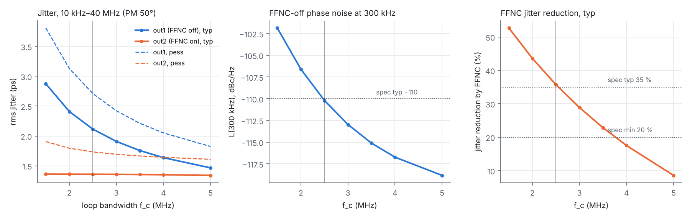
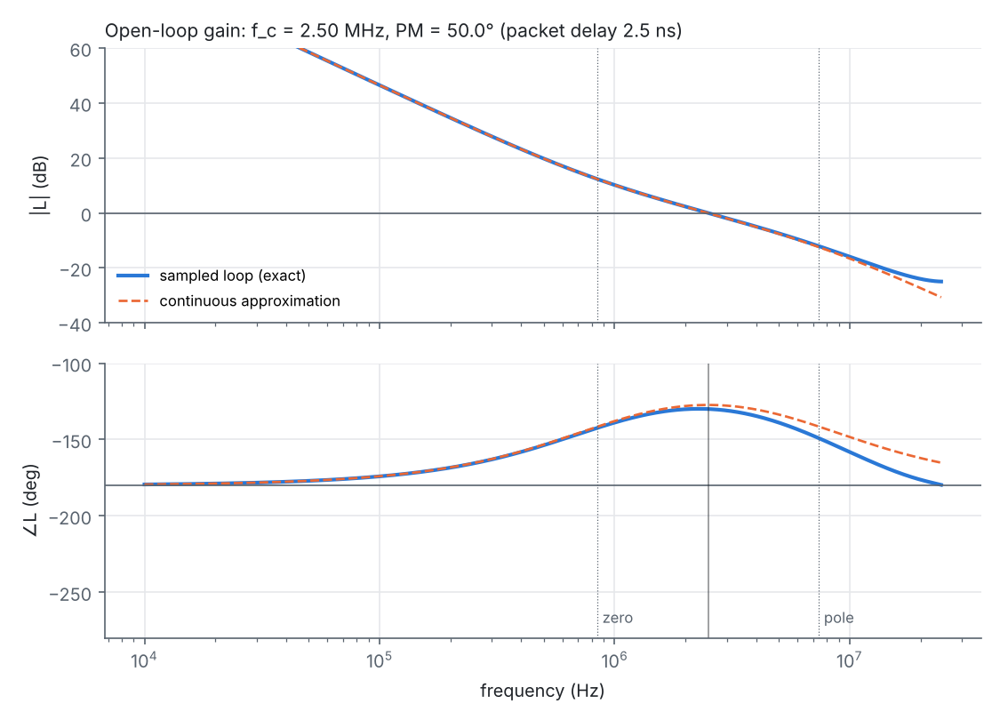
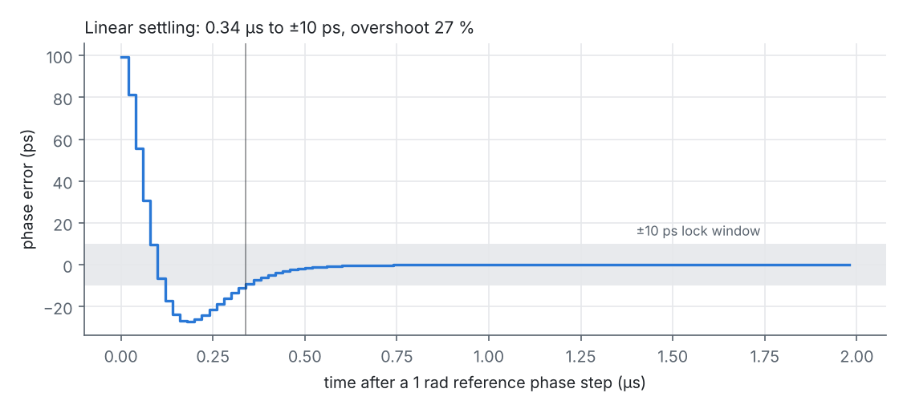
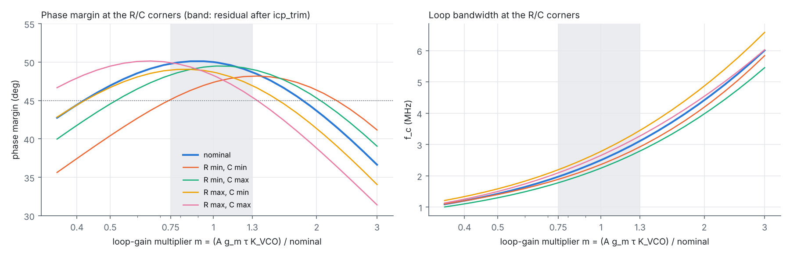

# Step 73: loop parameters (f_c, PM, β, R1, C1, C2) — design sheet

*Phase 7, roadmap step 73. Basis: the submitted proposal (50 MHz × 32 = 1.6 GHz, f_c ≈ 2.5 MHz) and the
step-72 budget.*

Reproduce:

```bash
PDK_ROOT=/path/to/pdk design/loop/spice/run_cv.sh   # MOS-cap and MIM C-V over tt/ss/ff, −40/27/110 °C
PDK_ROOT=/path/to/pdk design/loop/spice/run_rc.sh   # R and MIM over tt/ll/hh/hl/lh, −40/27/110 °C
python3 design/loop/step73_loop.py                  # jitter grid, sampled-loop design, realisation, robustness
python3 design/loop/step73_plots.py                 # docs/img/step73_*.png
```

The exact sampled-data loop model is `design/loop/sampled_loop.py`. The interactive version is in
`learn/phase7_design.ipynb`, step 73.


> **Update 15 Nov 2026.** The corrected step-74 ring (re-run with the PDK `.spiceinit`) has K_VCO = −326 MHz/V averaged
> over 0.6–1.2 V instead of the −300 assumed here. Only β·K_VCO sets f_c and PM, so the loop filter (R1, C1, C2) stays
> as designed. The Gm unit becomes **26.0 µS** (3 units = 78.1 µS, β = 0.781 µA/rad); that is the requirement on
> step 79. The corner spread of K_VCO (×0.68 at ss/110 °C, ×1.48 at ff/−40 °C) stays inside the icp_trim range (2–5
> units).

## The design sheet

| Parameter | Value | Set by |
|---|---|---|
| f_REF, N | 50 MHz, 32 (no feedback divider in the main loop) | proposal |
| Loop bandwidth f_c | **2.50 MHz** (f_REF/20) | the only point meeting the out1 300 kHz typ and the FFNC-reduction typ specs (section A) |
| Phase margin | **50.0°**, in the exact sampled loop, including the packet delay | highest PM that keeps L(300 kHz) ≤ −110 dBc/Hz |
| Charge-packet delay t_p | 2.5 ns nominal, **≤ 5 ns** | requirement on the clock generator (step 77) |
| β (A per rad of VCO phase) | **0.848 µA/rad** = 2A·g_m·d | C1 snapped to whole layout tiles |
| β·K_VCO | 0.848 µA/rad × 2π·300 MHz/V (frozen) | if K_VCO changes in step 74, scale g_m ∝ 1/K_VCO |
| SSPD amplitude A, Gm duty d | 0.5 V, 1 % (τ = 200 ps of 20 ns) | steps 77–79 |
| g_m | **84.8 µS = 3 unit cells × 28.3 µS** (at K_VCO = 300 MHz/V) | pulsed-Gm CP (step 79) |
| R1 | **11.01 kΩ**: res_xhigh_po_2p85, L = 15.5 µm | |
| C1 | **17.11 pF at V_cont = 0.9 V**: 2 tiles × (9 nfet_01v8 W = L = 10 µm + 1 cap_mim_m3_1 30 × 30 µm on top) | |
| C2 | **2.205 pF**: 2 × cap_mim_m3_1 30 × 18.1 µm | |
| Zero / pole | 0.845 MHz / 7.40 MHz | |
| Closed loop | 2.5 dB peaking, f_3dB = 4.3 MHz | |
| Phase-step settling | 27 % overshoot, inside ±10 ps in 0.34 µs | |
| V_cont window | **0.6–1.2 V** (MOS cap ≥ 6.1 fF/µm²) | requirement on the VCO fine-tune range (steps 74/75) |
| icp_trim[1:0] | 00 → 3 units (×1), 01 → 4 (×1.33), 10 → 2 (×0.67), 11 → 5 (×1.67) | recentres the process part of the loop gain |
| Loop-filter area | about 3,600 µm²: C1 ≈ 2 × 34 × 34 µm, C2 ≈ 2 × 31 × 19 µm, R1 ≈ 3 × 18 µm | inside the 5,000 µm² CP + LF budget |
| Jitter with these values | out1 2.12 / out2 1.36 ps typ; 2.71 / 1.73 ps pess. R1 adds 0.31 / 0.17 ps | step-72 model |

## What happens, how, why

### What happens
The loop filter and the charge-pump gain set how the PLL divides the work between the loop and FFNC:

- **Below f_c**, the loop forces the VCO to follow the clean reference.
- **Above f_c**, the VCO runs free, and FFNC removes its noise up to about f_REF/8.

Step 73 chooses f_c and the phase margin from the jitter model. It then computes R1, C1 and C2 for the real,
sampled loop, and turns them into PDK devices of whole layout tiles.

### How it happens
The open-loop gain from VCO phase error to VCO phase is

$$L(s) \approx \beta\,K_{VCO}\,\frac{Z(s)}{s}\,e^{-s t_p},\qquad
Z(s) = \frac{1 + sR_1C_1}{s(C_1+C_2)\,(1 + sR_1\frac{C_1C_2}{C_1+C_2})},\qquad \beta = 2A\,g_m\,\frac{\tau}{T}.$$

The closed-form starting point puts the zero and pole symmetrically around ω_c, with spread
b = tan(45° + φ_lead/2):

$$C_{tot} = \frac{b\,\beta K_{VCO}}{\omega_c^2},\quad C_2 = \frac{C_{tot}}{b^2},\quad C_1 = C_{tot} - C_2,\quad
R_1 = \frac{b}{\omega_c C_1}.$$

The lead φ_lead is set to PM plus the delay lag 360°·f_c·t_p. Then the exact sampled model corrects both f_c and PM:

$$x[k+1] = e^{AT}x[k] + e^{A(T-t_p)}B\,q[k],\qquad q[k] = \beta T\,\theta_e[k],\qquad L(z) = \beta T\,C(zI - e^{AT})^{-1}e^{A(T-t_p)}B.$$

### Why it happens this way
- **The SSPD acts once per period.** It samples once per reference period, and the Gm delivers one charge packet a
  delay t_p later. A continuous model therefore overestimates the phase margin: 48.7° instead of 50° at t_p = 0.5 ns,
  and 40.6° at t_p = 11 ns.
- **The loop sees only the product β·K_VCO.** The area-heavy passives can be frozen now, and the still-unknown K_VCO is
  absorbed later by the small g_m unit cells.
- **A MOS capacitor is nonlinear.** C1 can be a dense MOS cap only if V_cont stays where the cap is flat (above about
  0.6 V).

## A. Choosing f_c and PM from the jitter model



| f_c (PM 50°) | out1 typ | out2 typ | out1 pess | out2 pess | L(300 kHz) out1 typ | FFNC reduction typ |
|---|---|---|---|---|---|---|
| 1.5 MHz | 2.88 ps | 1.36 ps | 3.81 ps | 1.91 ps | −101.9 dBc/Hz | 53 % |
| 2.0 MHz | 2.41 | 1.36 | 3.13 | 1.79 | −106.6 | 44 % |
| **2.5 MHz** | **2.11** | **1.36** | **2.71** | **1.73** | **−110.2** | **36 %** |
| 3.0 MHz | 1.91 | 1.36 | 2.42 | 1.69 | −113.0 | 29 % |
| 4.0 MHz | 1.64 | 1.35 | 2.05 | 1.64 | −116.7 | 18 % |
| 5.0 MHz | 1.47 | 1.34 | 1.82 | 1.61 | −118.8 | 9 % |
| Spec | 2.3 typ / 4.7 max | 1.4 / 3.2 | | | −110 typ | 35 typ / 20 min |

How to read this table:

- **out2 alone does not choose f_c.** It is flat within 0.02 ps.
- **out1 at 300 kHz needs f_c ≥ 2.5 MHz.**
- **The FFNC reduction needs f_c ≤ 2.5 MHz.**

So f_c = 2.5 MHz is not a free choice; the specification pins it.

For PM the grid is in `design/loop/data/step73_jitter_grid.csv`:

- **Higher PM** (55–65°) lowers jitter by up to 0.1 ps. But it pushes the zero down and costs 1–3 dB at 300 kHz.
- **PM 50°** is the highest value that keeps −110 dBc/Hz.

## B. The exact sampled loop



| Packet delay t_p | 0.5 ns | 1 ns | **2.5 ns** | 5 ns | 8 ns | 11 ns |
|---|---|---|---|---|---|---|
| PM with the final filter | 51.3° | 51.0° | **50.0°** | 48.3° | 46.0° | 43.4° |
| Lead needed in the filter for PM = 50° | 51.4° | 51.7° | 52.7° | 54.4° | — | 59.2° |

The clock generator must fire the Gm pulse right after the hold transfer, not half a period later. This costs nothing
and saves up to 7° of phase margin.



## C. Realisation with PDK devices (layout first)

All component values come from ngspice runs on the frozen PDK (`design/loop/data/`).

| Item | Measured value | Spread used |
|---|---|---|
| nfet_01v8 MOS cap, W = L = 10 µm | 7.48 fF/µm² at 0.9 V; 6.53 at 0.6 V; 7.71 at 1.2 V; 2.2 at 0 V (tt, 27 °C) | 0.81–1.08 × nominal over V_cont 0.6–1.2 V, ss/ff, −40/110 °C |
| cap_mim_m3_1 30 × 30 µm | 1.820 pF (2.00 fF/µm² + 0.164 fF/µm perimeter) | ll, hl −11.7 to −12.4 %; hh, lh +12.1 to +12.9 %; no temperature dependence in the model |
| res_xhigh_po (1.41 µm, L 6.5 µm) | 9.45 kΩ at tt 27 °C | ll/hh ±2.5 %, temperature +11 % (−40 °C) / −10 % (110 °C) |
| res_high_po (1.41 µm, L 40 µm) | 9.46 kΩ | ll −15 %, hh +15 %, temperature −3 % / +5 %, so −17 % / +20 % in total |

**Layout-first realisation of each part:**

1. **C1 tile, about 34 × 34 µm.**
   - 3 × 3 MOS units (W = L = 10 µm): gate = filter node, source, drain and body = VSS.
   - A 30 × 30 µm cap_mim_m3_1 on top: capm/met4 = filter node, met3 = VSS. The met3 plate shields the MOS gates from
     routing above.
   - 8.56 pF per tile. C1 = 2 identical tiles, placed side by side.
2. **β follows C1.** The design called for 20.17 pF. C1 was snapped to 2 tiles (17.11 pF, ×0.848), and β, R1 and C2
   were rescaled by the same factor. The loop is unchanged.
3. **C2 = 2 × cap_mim_m3_1, 30 × 18.1 µm each.** Two equal rectangles next to C1. Because they are linear, the pole
   stays put.
4. **R1 = res_xhigh_po_2p85, L = 15.5 µm.**
   - Chosen because it has the smallest simulated corner spread (−12 / +13 %) and is compact.
   - Width 2.85 µm (a legal width) keeps mismatch and flicker low.
   - One body, with a dummy strip on each side.
5. **Gm as 3 identical unit cells** plus switchable units for `icp_trim`. Each unit is a small differential pair with
   its own tail, laid out as a row with dummies at both ends. Trimming by unit count keeps g_m noise proportional to β
   and the layout regular.

The Cadence kit (sky130_release_0.0.4) uses its own resistor and capacitor models. Step 7 showed these differ from
the open PDK, so the C-V and R corner runs must be repeated with the kit before the values are frozen in Virtuoso.

### PDK limit check (project rule: no value below a PDK minimum or above a maximum)

`tools/pdk_limits.py` holds the legal ranges, taken from the frozen PDK's model bins and the DRC and pcell rules.
`step73_loop.py` checks every device against it and stops if one is out of range.

| Device | Size used | Legal range | OK |
|---|---|---|---|
| res_xhigh_po_2p85 (R1) | W 2.85 µm, L 15.5 µm | W ∈ {0.35, 0.69, 1.41, 2.85, 5.73} µm, L ≥ 0.5 µm (fold above about 100 µm) | ✓ |
| nfet_01v8 MOS cap (C1) | W 10 µm, L 10 µm per unit | L 0.15–100 µm, W per finger 0.36–100 µm | ✓ |
| cap_mim_m3_1 (C1 top plate) | 30 × 30 µm | each side 2–30 µm | ✓ (at the maximum) |
| cap_mim_m3_1 (C2) | 30 × 18.1 µm | each side 2–30 µm | ✓ |

Check the same sizes against the Cadence kit (sky130_release_0.0.4) pcells when the cells are drawn in Virtuoso.

## D. Robustness: loop-gain spread × R/C corners



m = (A·g_m·τ·K_VCO)/nominal. Before trimming it can span about 0.3 to 2.4 over PVT.

| Case | PM ≥ 45° for m in | PM ≥ 40° for m in | At m = 1 |
|---|---|---|---|
| Nominal R, C | 0.46–1.75 | 0.35–2.29 | 2.50 MHz, 50.0° |
| R min, C min | 0.78–2.10 | 0.50–3.00 | 2.36 MHz, 47.4° |
| R min, C max | 0.55–1.92 | 0.38–2.74 | 2.24 MHz, 49.5° |
| R max, C min | 0.46–1.47 | 0.35–2.10 | 2.78 MHz, 48.7° |
| R max, C max | 0.35–1.34 | 0.35–1.75 | 2.65 MHz, 48.3° |

How icp_trim and the residual spread work out:

- **What the trim does.** `icp_trim` multiplies β by 0.67 / 1 / 1.33 / 1.67. This recentres the process part of m
  (about ×0.55 to ×2.0) to within about ±17 %.
- **Requirement on steps 74–79.** The residual spread m after trim (voltage, temperature, mismatch) must stay within
  **×0.75 to ×1.3**.
- **Result inside that band.** At every R/C corner PM is 45.5–50.1° and f_c is 1.84–3.29 MHz.
- **Floor and fallback.** PM ≥ 40° is the absolute floor; out2 pess at PM 40° is 1.84 ps, inside the 3.2 ps maximum.
  If later blocks show a wider spread, raise PM to 55° (costs 0.8 dB at 300 kHz).

## E. Requirements handed to other steps

| To | Requirement |
|---|---|
| Step 74 VCO | Fine-tune gain K_VCO near 300 MHz/V, or rescale g_m ∝ 1/K_VCO. The fine range must keep V_cont in 0.6–1.2 V after the CCO coarse code is set. |
| Step 75 CCO | Coarse DAC step smaller than the fine range across 0.6–1.2 V, with margin for temperature drift after calibration. |
| Step 77 clock generator | t_p ≤ 5 ns (2.5 ns nominal). τ = 200 ps ±25 % over PVT. |
| Step 78 SSPD | A = 0.5 V nominal, ≥ 0.35 V worst case. |
| Step 79 pulsed-Gm CP | 3 + 2 unit cells of 28.3 µS (offset-binary decode). Output compliance over 0.6–1.2 V. |
| Step 80 loop filter | Device sizes above. Re-run C-V and R corners with the Cadence kit. |
| Step 81 FLL | The FLL charge pump drives the same filter (C_tot ≈ 19.3 pF). Size its current for the slew and dead zone. |
| Steps 100 / 103 / 104 testbenches | Zero 0.845 MHz, pole 7.40 MHz. PM 50° at m = 1. Settling 0.34 µs with 27 % overshoot after a 1 rad phase step. |

## Interview questions (step 73)

36 questions. Answer each one aloud before you open it.

<details><summary><b>Q1.</b> Why is the loop bandwidth chosen from the out2 (FFNC-on) jitter model and not from out1?</summary>

out2 is the output the specification is written for (1.4 ps typ). But out2 is almost flat in f_c (1.34–1.36 ps from 1.5 to 5 MHz) because FFNC cancels the VCO noise the loop would otherwise have to suppress. So out2 says 'anything in 1.5–5 MHz works', and the *other* specs pick the point inside that range.

</details>

<details><summary><b>Q2.</b> Then what actually pins f_c = 2.5 MHz?</summary>

Two specs pull in opposite directions. The FFNC-off phase noise at 300 kHz (−110 typ) needs f_c ≥ 2.5 MHz, because a wider loop suppresses more ring noise. The FFNC jitter reduction (35 % typ, 20 % min) needs f_c ≤ 2.5 MHz, because a wider loop leaves less VCO noise for FFNC to remove. 2.5 MHz is the only point that meets both typ values.

</details>

<details><summary><b>Q3.</b> Why does a wider loop reduce the benefit of FFNC?</summary>

FFNC removes VCO noise between f_c and about f_REF/8. If the loop already suppresses the VCO up to a higher f_c, the band where FFNC helps shrinks: at 4 MHz the reduction is 18 % (below the 20 % minimum), at 5 MHz only 9 %.

</details>

<details><summary><b>Q4.</b> Why 50° of phase margin and not 60°?</summary>

In the jitter model a higher PM lowers peaking and jitter slightly (1.36 → 1.30 ps at 60°), but the zero moves lower (the zero–pole spread b grows), which weakens low-frequency VCO suppression: L(300 kHz) FFNC-off goes from −110.2 to −108. 50° is the highest PM that still meets −110, and it keeps the overshoot (27 %) and peaking (2.5 dB) moderate.

</details>

<details><summary><b>Q5.</b> What is the 'sampled-data' loop and why is it needed here?</summary>

The SSPD looks at the phase only once per reference period and the pulsed Gm delivers one charge packet per period, a delay t_p after the sampling edge. A continuous-time model ignores both. The exact model propagates the filter + VCO state over one period with the matrix exponential, x[k+1] = e^{AT}x[k] + e^{A(T−t_p)}B·q[k], and evaluates L(e^{jωT}). It shows the continuous design would land at 48.7° (t_p = 0.5 ns) or 40.6° (t_p = 11 ns) instead of 50°.

</details>

<details><summary><b>Q6.</b> How large is the phase lag of the packet delay, and how do you compensate it?</summary>

A delay t_p adds 360°·f_c·t_p of lag at crossover: 2.3° at 2.5 ns, 9.9° at 11 ns. It is compensated by designing the filter for a larger lead (52.7° instead of 50° at t_p = 2.5 ns), i.e. a wider zero–pole spread, then iterating on the exact sampled model until f_c and PM land exactly.

</details>

<details><summary><b>Q7.</b> Why does t_p become a requirement on the clock generator?</summary>

With the filter fixed, PM falls from 51.3° (t_p = 0.5 ns) to 48.3° (5 ns) and 43.4° (11 ns). Firing the Gm pulse right after the hold transfer instead of half a period later is free in power and area, so step 77 must deliver t_p ≤ 5 ns (2.5 ns nominal).

</details>

<details><summary><b>Q8.</b> Write β for the pulsed-Gm charge pump and explain each term.</summary>

β = 2A·g_m·d (A per rad of VCO phase). 2A is the differential SSPD slope (V/rad) for a sampled amplitude A, g_m converts the held voltage into current, and d = τ/T is the fraction of the period the Gm conducts. The average current into the filter is β·θ_e. Here A = 0.5 V, d = 0.01 (200 ps / 20 ns), g_m = 84.8 µS → β = 0.848 µA/rad.

</details>

<details><summary><b>Q9.</b> Why can K_VCO still be unknown when the filter is frozen?</summary>

The loop depends only on the product β·K_VCO (C_tot = b·β·K_VCO/ω_c², R = b/(ω_c C1)). If step 74 lands a different K_VCO, g_m is rescaled (g_m ∝ 1/K_VCO) and the filter is unchanged. The large-area parts (C1, C2) are frozen now; the small-area part (Gm unit size) absorbs the uncertainty. That is a layout-driven decision.

</details>

<details><summary><b>Q10.</b> How were C1 and β picked together?</summary>

C1 was snapped to whole layout tiles first (2 tiles of 8.56 pF), then β was scaled by the same factor (×0.848) so β·K_VCO/C stays the same, and R (×1/0.848) and C2 (×0.848) followed. The loop is identical; the layout gets an integer number of identical tiles.

</details>

<details><summary><b>Q11.</b> What is in one C1 tile and why?</summary>

9 nfet_01v8 MOS-capacitor units (W = L = 10 µm, 3×3) with one 30×30 µm cap_mim_m3_1 above them: 6.73 pF + 1.82 pF = 8.56 pF at V_cont = 0.9 V in about 34×34 µm. The MOS cap gives density (7.5 fF/µm²), the MIM on top is free extra capacitance in the same footprint and shields the gate from routing above.

</details>

<details><summary><b>Q12.</b> What is the catch with a MOS capacitor in the loop filter?</summary>

Its capacitance depends on the gate voltage: 7.48 fF/µm² at 0.9 V, 6.5 at 0.6 V, only 2.2 at 0 V (measured C-V, tt). If V_cont drops below ~0.6 V, C1 collapses, the zero moves up and the PM drops. So the VCO fine-tune range must be centred so V_cont stays in 0.6–1.2 V — a requirement handed to steps 74/75.

</details>

<details><summary><b>Q13.</b> Why is C1 allowed to be a MOS cap but C2 is a MIM cap?</summary>

C1 is the large zero capacitor; a ±19 % variation of it moves the zero and changes PM by only a few degrees. C2 sets the pole and directly takes the charge packet each cycle; its linearity and its absolute value matter more, and it is small (2.2 pF), so a linear MIM costs little area.

</details>

<details><summary><b>Q14.</b> How is R1 realised and why that resistor type?</summary>

res_xhigh_po_2p85 (2.85 µm wide, 701 Ω/µm, 139 Ω heads), L = 15.5 µm → 11.0 kΩ. In the ngspice R/C corners it moves −12 % / +13 % (mostly temperature: tc ≈ −2.5e-3/°C), against −17 % / +20 % for res_high_po. It is compact, and wide enough for low mismatch and flicker. 2.85 µm is one of the five legal widths.

</details>

<details><summary><b>Q15.</b> How much does R1 add to the jitter, and what is the trade-off with β?</summary>

0.31 ps FFNC-off / 0.165 ps FFNC-on (total 2.12 / 1.36 ps). Doubling β halves R (−30 % R noise) but doubles C1 and C2 area; halving β halves area but R-jitter rises to 0.40 ps. Between β = 0.5 and 2 µA/rad the total changes by only 0.03 ps, so β is chosen for area and for a Gm small enough to keep its own noise and offset low.

</details>

<details><summary><b>Q16.</b> Why are the zero and pole at 0.84 MHz and 7.4 MHz?</summary>

They are placed about geometrically around f_c with spread b = tan(45° + lead/2) ≈ 2.9: f_z = f_c/b, f_p = f_c·b (here slightly asymmetric because the sampled-loop correction adds lead). The zero gives the phase lead at f_c; the pole filters the per-cycle charge-packet ripple and the reference spur.

</details>

<details><summary><b>Q17.</b> What is the closed-loop peaking and the 3 dB bandwidth?</summary>

2.5 dB peaking, f_3dB = 4.3 MHz. Peaking amplifies in-band (reference, SSPD, CP) noise near f_c; 2.5 dB is acceptable because those sources are ≥ 10 dB below the VCO contribution in the budget.

</details>

<details><summary><b>Q18.</b> How do you check the loop's lock behaviour at this stage?</summary>

With the same sampled model, cycle by cycle: after a 1 rad reference phase step the error overshoots 27 % and settles inside ±10 ps in 0.34 µs. The 5 µs lock-time spec is therefore set by FLL acquisition (step 81), not by the phase loop.

</details>

<details><summary><b>Q19.</b> Which parameters make up the loop-gain spread m?</summary>

m = (A·g_m·τ·K_VCO)/nominal. A (SSPD amplitude, buffer swing), g_m (bias, mobility), τ (pulser RC) and K_VCO (ring) all vary over PVT; their product can span about ×0.3 to ×2.4 before any trim.

</details>

<details><summary><b>Q20.</b> How robust is the loop to m and to the R/C corners?</summary>

At nominal R/C, PM ≥ 45° for m = 0.46–1.75. At the worst R/C combinations (R −12/+13 %, MIM −12/+13 %, MOS cap −19/+8 % over V_cont 0.6–1.2 V, ss/ff, −40/110 °C) the range narrows to m = 0.78–1.23. With a residual m of 0.75–1.3, PM stays 45.5–50° and f_c 1.8–3.3 MHz at every corner.

</details>

<details><summary><b>Q21.</b> What does icp_trim do and how is it built?</summary>

It changes the number of identical Gm unit cells: 00 → 3 units (nominal), 01 → 4, 10 → 2, 11 → 5, i.e. β ×1, ×1.33, ×0.67, ×1.67. It recentres the process part of m (≈ ×0.55 to ×2.0) to within about ±17 %, leaving room for voltage and temperature drift. Unit cells (rather than a trimmed resistor or pulse width) keep the layout regular and the Gm noise proportional to β.

</details>

<details><summary><b>Q22.</b> Why should code 00 be the nominal setting?</summary>

All controls power up at 0. With 00 = nominal the PLL locks with a sensible bandwidth before any calibration, which makes bring-up and the first measurements safe. The offset-binary decode costs three gates on VDDD.

</details>

<details><summary><b>Q23.</b> What happens if PM drops to 40°?</summary>

The loop is still stable, but peaking rises to about 4 dB, the overshoot grows, and in-band noise is amplified near f_c. The jitter model at PM 40° gives out2 pess 1.84 ps — still inside the 3.2 ps max — so 40° is the floor, 45° the target.

</details>

<details><summary><b>Q24.</b> Why is the continuous approximation good below f_c but wrong near f_REF/2?</summary>

Below f_c the loop sees many samples per cycle of any disturbance, so sampling is invisible. Near f_REF/2 the sampled gain folds and its phase falls faster (delay e^{−jωt_p} plus the hold): the sampled |L| flattens at −25 dB while the continuous one keeps falling. Gardner's rule (f_c < f_REF/10) keeps the difference small; here f_c/f_REF = 1/20.

</details>

<details><summary><b>Q25.</b> What is Gardner's stability limit and how far are we from it?</summary>

For a CP-PLL the sampled loop becomes unstable when the loop gain is so high that the per-cycle correction overshoots; roughly ω_c²·T² limits apply when f_c approaches f_REF/π. At f_c = f_REF/20 we are far below; m = 3 (f_c ≈ 6 MHz) still keeps PM above 30°.

</details>

<details><summary><b>Q26.</b> How does the FLL interact with this loop filter?</summary>

The FLL charge pump injects into the same filter while out of lock. With C_tot ≈ 19 pF a 10 µA FLL current slews V_cont at 0.5 V/µs; once the phase error is inside the dead zone the FLL CP is off and only the pulsed Gm acts. Step 81 sizes the FLL current against this C_tot.

</details>

<details><summary><b>Q27.</b> Why does the filter not use a third pole (4th-order loop)?</summary>

The reference spur from a pulsed-Gm SSPLL is small (no PFD/CP mismatch pulses; in lock the packets are near zero), and C2 with the 7.4 MHz pole already filters the packet ripple at 50 MHz by about 17 dB. An extra RC pole would cost phase margin and area for a spur that is not the limiting spec.

</details>

<details><summary><b>Q28.</b> What leakage matters in this filter?</summary>

Gate leakage of the thin-oxide MOS cap and junction leakage at V_cont. A leakage I_L is supplied by the loop as a static phase offset θ = I_L/β and a small per-cycle ripple I_L·T/C2. For nA-level leakage the offset is mrad and the ripple µV, but it is checked in the loop-filter testbench (step 100) at 110 °C.

</details>

<details><summary><b>Q29.</b> How does temperature move f_c?</summary>

R (xhigh_po) falls about 19 % from −40 to 110 °C (+11 % / −10 % around 27 °C); K_VCO and g_m change too. Since f_c ≈ β·K_VCO·R/2π above the zero, f_c moves with the product; the robustness plot covers this with the R and m axes.

</details>

<details><summary><b>Q30.</b> Why freeze the loop filter now, before the VCO and CP exist?</summary>

C1 and C2 are the largest analog blocks after the CCO and the decap; their area and shape set the floorplan of the CP + LF region. Freezing them (and absorbing K_VCO uncertainty in g_m) lets the floorplan and layout start early.

</details>

<details><summary><b>Q31.</b> What is in the design sheet that the block designers need?</summary>

β·K_VCO product, g_m per unit, τ and t_p limits, R1/C1/C2 with device names and sizes, V_cont window 0.6–1.2 V, icp_trim mapping, and the spread budget for m (process ×0.55–2.0, residual ×0.75–1.3).

</details>

<details><summary><b>Q32.</b> How would you verify the loop parameters in simulation?</summary>

Step 100: AC of the filter impedance at R/C corners (zero, pole). Step 103: open-loop gain from extracted block gains. Step 104: transient lock with a phase/frequency step, compared with the cycle model's 0.34 µs and 27 % overshoot.

</details>

<details><summary><b>Q33.</b> Why does the jitter barely depend on β at fixed f_c and PM?</summary>

Because the only β-dependent noise is R1's, and R1's contribution is small (0.2–0.4 ps against 2.1 ps total). The detector and CP noise referred to VCO phase do not depend on how β is split between g_m and τ, only on A, g_m and d through the budget formulas of step 72.

</details>

<details><summary><b>Q34.</b> Explain the open-loop gain shape in the Bode plot.</summary>

Below the zero: two integrators (VCO and C_tot) → −40 dB/dec and −180°. Between zero and pole: −20 dB/dec, phase rises to a maximum near f_c (the lead). Above the pole: −40 dB/dec again. The sampled version adds extra phase lag from the delay and sampling and flattens near f_REF/2.

</details>

<details><summary><b>Q35.</b> What would change if the reference were 45 or 55 MHz?</summary>

T changes, so the per-cycle charge changes but the average gain β = 2A·g_m·τ/T changes with 1/T: β rises 11 % at 55 MHz and falls 10 % at 45 MHz (m = 1.11 / 0.90) — inside the residual band. f_c/f_REF stays near 1/20.

</details>

<details><summary><b>Q36.</b> Why is the loop parameterised by β and not by an equivalent charge-pump current I_p?</summary>

In a PFD/CP loop the CP current per radian of reference phase is I_p/2π and the divider adds 1/N. In the SSPLL there is no divider and the detector gain is per radian of VCO phase, so β (A/rad of VCO phase) is the natural unit; I_p/(2πN) of a CP-PLL corresponds to β.

</details>

