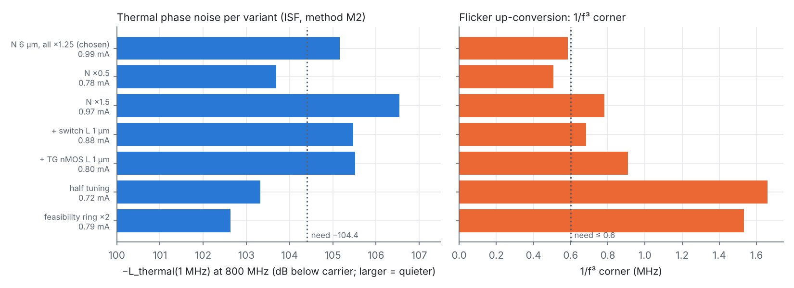
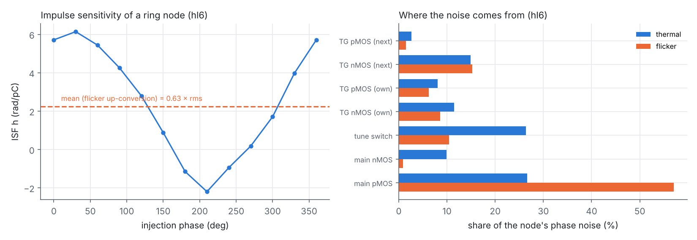
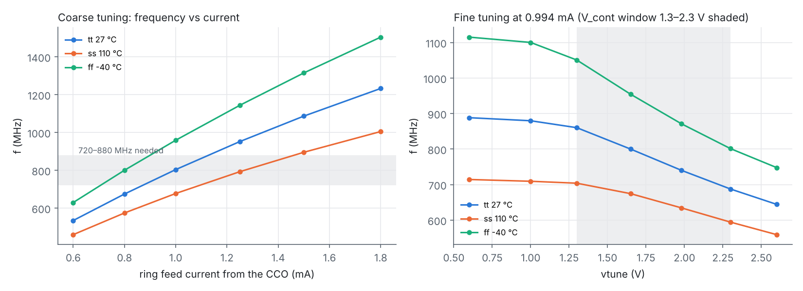
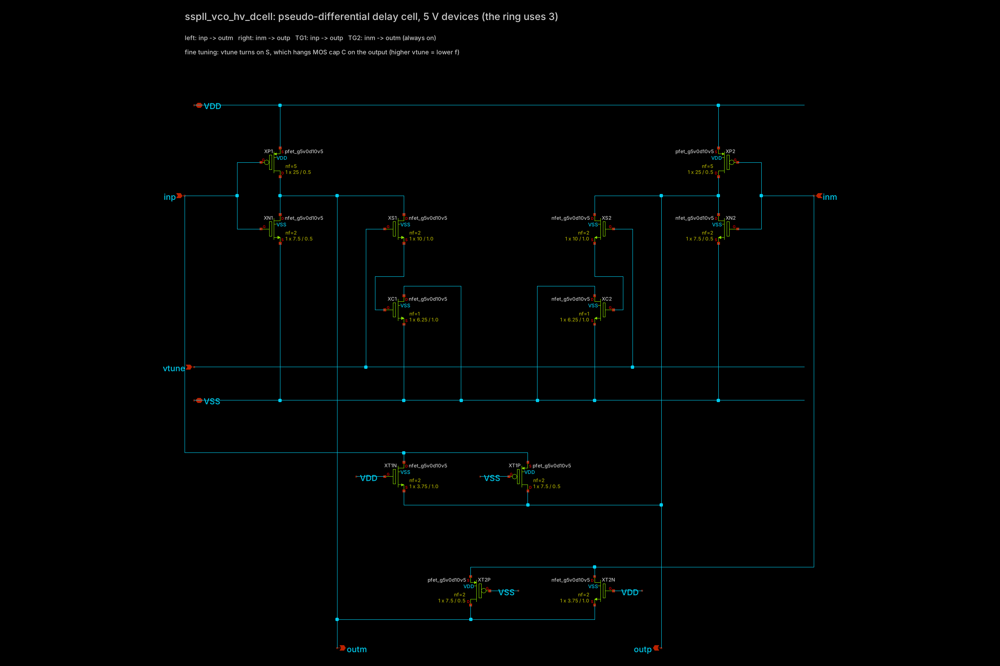
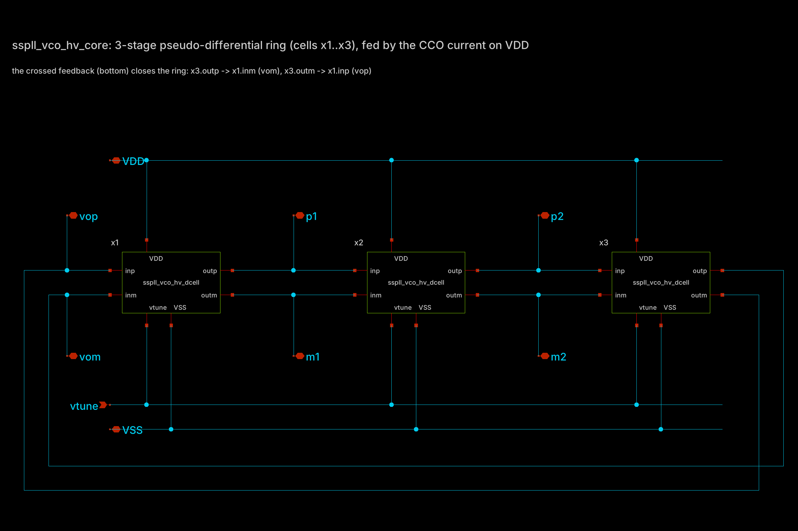
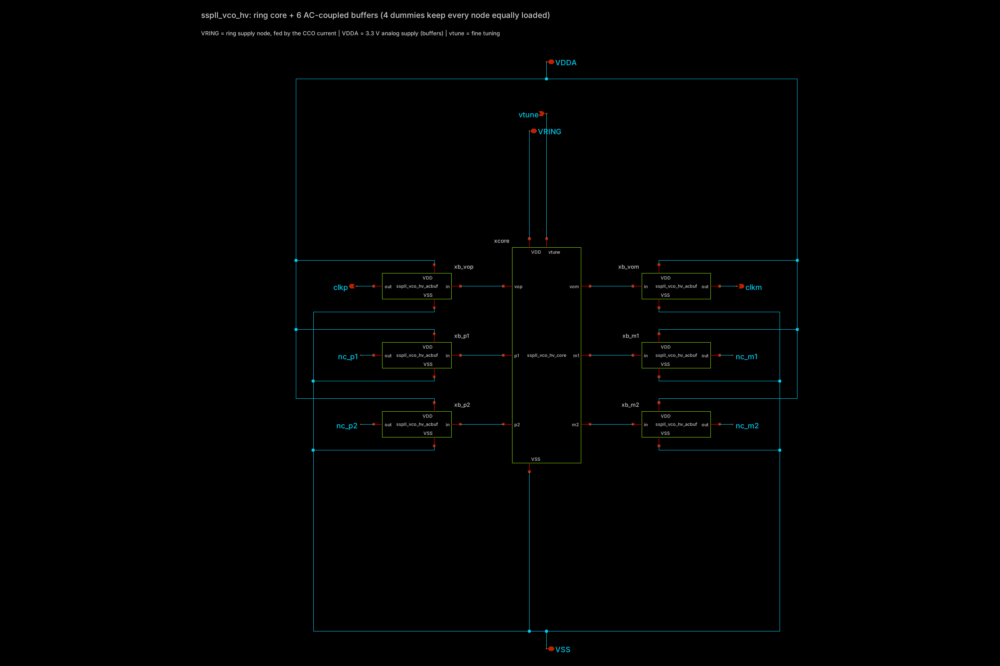
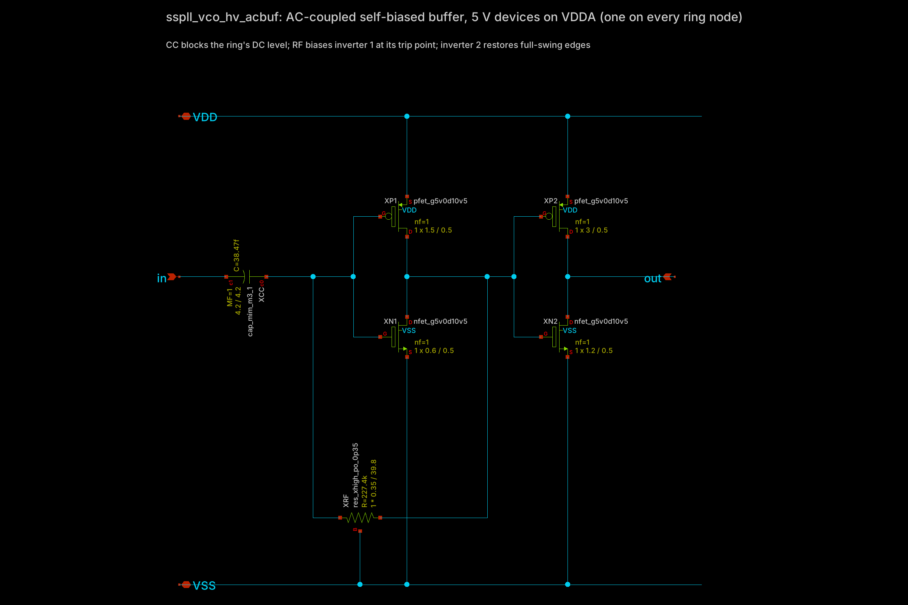

# Step 74 (redo): ring VCO for 800 MHz in 5 V devices

*Phase 7, roadmap step 74, redone for the device-rule migration (18–19 Nov 2026).*

**Basis**
- The step-72 HV budget: ring L(1 MHz) ≤ −104.4 dBc/Hz at 800 MHz, 1/f³ corner ≤ 0.6 MHz, at most 1.31 mA from the CCO.
- The step-73 HV loop: K_VCO ≈ 150 MHz/V assumed, V_cont 1.0–2.3 V.
- The feasibility study (`docs/design/hv_vco_feasibility.md`), which chose a 3-stage pseudo-differential ring (ring B).
- The 1.6 GHz design (`step74_vco.md`, `design/vco/vco.py`) is kept unchanged for the record.

Reproduce (in `design/vco`):

```bash
python3 step74hv_point.py hl6 1.0e-3   # current for 800 MHz + ISF phase noise (method M2); ~6 min, first run also builds
                                       # the 5 V noise tables (~13 min each, cached in data/noisegrid_*_g5v0d10v5_*.npz)
python3 step74hv_char.py hl6           # f vs current at corners, f vs vtune, 720/880 MHz range, sf/fs, buffer (method M1)
python3 step74hv_startup.py hl6        # power-up start-up, symmetric and with 2 % mismatch (method M1, corrected read-out)
python3 step74hv_system.py             # K_VCO -> Gm unit, jitter budget with the measured ring, power, FoM
python3 step74hv_plots.py              # docs/img/step74hv_*.png
python3 schematics_hv.py               # xschem/vco_hv/*.sch + *.sym, drawing checks (method M5)
python3 -c "import vco_hv as v, step74hv_point as s; open('../../xschem/netlist/ref_vco_hv.spice','w').write(v.lvs_reference(s.VARIANTS['hl6']))"
cd ../../xschem && ./lvs.sh vco_hv/sspll_vco_hv.sch netlist/ref_vco_hv.spice sspll_vco_hv   # method M4
```

The other design points of the study are `step74hv_point.py s2 | halftune | hl | hl2 | hl3 | hl4 | hl5`.

## Result in one paragraph

The ring is a 3-stage pseudo-differential ring of 5 V devices, current-fed by the CCO. At **0.994 mA** (tt) it runs at 800 MHz with the ring node at 1.89 V.

**Noise (ISF):**
- thermal **−105.2 dBc/Hz** at 1 MHz (needed ≤ −104.4);
- 1/f³ corner **0.59 MHz** (needed ≤ 0.6).

**Power.** The ring takes **3.69 mW** from VDDA instead of the 4.86 mW budgeted. Thick-oxide devices make less thermal noise per milliwatt, and the ring swings over a larger voltage.

**Range and tuning:**
- The whole 720–880 MHz range is reached at every corner with the ring node ≤ 2.37 V.
- The ring starts in under 18 ns at every corner, also with 2 % mismatch.
- The fine tuning gives **−173 MHz/V** at tt (−110 at ss, −250 at ff) over V_cont = **1.3–2.3 V**. The window moves up by 0.3 V from step 73 because the tuning switch does not conduct below about 1.3 V.

**System effect** (step-72 HV model with this ring and the step-73 filter):

| | FFNC off | FFNC on |
|---|---|---|
| Jitter, typ | 1.99 ps | 1.29 ps |
| L(300 kHz), typ | −116.8 dBc/Hz | −126.0 dBc/Hz |
| Power | 6.10 mW | 7.55 mW |

FoM **−229.0 dB**. All proposal targets are met with margin.

## The design sheet

| Parameter | 800 MHz, 5 V (this redo) | 1.6 GHz, 1.8 V (15 Nov) | Requirement |
|---|---|---|---|
| Ring | 3-stage pseudo-differential, nfet/pfet_g5v0d10v5 | 5-stage, nfet/pfet_01v8 | 5 V devices for analog |
| Current for f₀ (tt, 27 °C, 10 fF/node) | **0.994 mA** | 1.352 mA | ≤ 1.31 mA (step 72 HV) |
| Ring node at f₀ (tt) | **1.89 V** | 1.38 V | |
| L(1 MHz) thermal / flicker / total | **−105.16 / −107.49 / −103.16 dBc/Hz** | −98.66 / −100.87 / −96.62 (at 1.6 GHz) | thermal ≤ −104.4 |
| 1/f³ corner | **0.59 MHz** | 0.60 MHz | ≤ 0.6 MHz (pess 1.2) |
| h_dc / h_rms | 0.626 | 0.67 | |
| Ring power from VDDA (I × 9/8 × 3.3 V) | **3.69 mW** | 4.64 mW | ≤ 4.86 mW |
| K_VCO, V_cont 1.3–2.3 V (tt / ss 110 / ff −40) | **−173 / −110 / −250 MHz/V** | −326 / −223 / −484 (0.6–1.2 V) | ≈ 150 (step 73 HV) |
| 880 MHz at ss 110 °C, 15 fF, VDDA 2.97 V | **1.462 mA, ring node 2.37 V** | 1.93 mA, 1.65 V (1.76 GHz) | node ≤ VDDA − CCO headroom |
| 720 MHz at ff −40 °C, 5 fF | **0.704 mA**, 1.60 V | 0.89 mA (1.44 GHz) | |
| sf / fs at 0.994 mA | 728 / 898 MHz | | |
| Start-up (\|vd\| > 1 V), tt / ss / ff | **7.4 / 9.9 / 7.3 ns** symmetric; ≤ 17.6 ns with ±2 % mismatch | < 9 ns | starts at every corner |
| Output buffers | 6 AC-coupled 5 V buffers on VDDA, 2 active: **89 µA each** (tt), swing 3.40 V (tt), 2.86 V (ss 110) | 1.8 V buffers on VDDBUF | 0.99 mW for buffers |

## What happens, how, why

### What happens

The same job as at 1.6 GHz, done with different transistors:
- The CCO pushes a current into the ring's supply node.
- The ring settles at the supply voltage where its average current equals that current, so more current gives faster edges and a higher frequency (coarse tuning).
- vtune hangs a little extra capacitance on every output (fine tuning).
- Every transistor's noise moves the edges a little: white noise gives phase noise falling at 20 dB/decade, and up-converted flicker noise gives phase noise falling at 30 dB/decade close in.

### How it happens

For a current-fed ring with N stages and node capacitance C, settled at ring voltage V_ring:

$$f \approx \frac{I}{N\,C\,V_{ring}}\quad (N = 3),\qquad P_{ring} = I\,V_{ring} \approx N\,C\,V_{ring}^2 f .$$

Phase noise follows the impulse sensitivity function h(τ) (Hajimiri–Lee), exactly as in the 1.6 GHz study:

$$\mathcal{L}_{th}(\Delta f) = \frac{2N\,\langle h^2 S_{th}\rangle}{2(2\pi\Delta f)^2},\qquad
\mathcal{L}_{fl}(\Delta f) = \frac{2N\,\langle h\sqrt{B}\rangle^2}{\Delta f\cdot 2(2\pi\Delta f)^2}.$$

The device noise (S_th, B) comes from new 5 V tables. They cover V_GS and V_DS up to 3.3 V, at L = 0.5 µm and 1 µm.

### Why it happens this way

1. **Thermal noise per milliwatt.**
   - At fixed f, the thermal noise falls as 1/(C·V_ring²), which is 1/P.
   - It rises with the devices' noise factor γ.
   - The 5 V devices have γ ≈ 1.1 (nMOS) and 0.5 (pMOS) instead of 1.9 and 1.2.
   - The ring swings over 1.9 V instead of 1.4 V.
   - So 3.7 mW is enough where the 1.6 GHz ring needed 4.6 mW for the same FoM.
2. **Flicker.** Flicker only matters through the average of h, and it comes from the smallest devices sitting on a node. Here those were the transmission-gate nMOS and the tuning switch, as at 1.6 GHz. Drawing them at L = 1 µm cuts their flicker per µm about 7×. After that the main pMOS dominates, and making the edges more symmetric (a narrower nMOS) lowers h_dc.
3. **Tuning window.** The switch is an nMOS whose gate is vtune. It conducts only while the node is below vtune − V_T, and the thick-oxide V_T with body effect is about 1.1–1.2 V. Below vtune ≈ 1.3 V the tuning capacitor is never connected, and the frequency hardly changes.

## A. Architecture choices

| Question | Decision | Evidence |
|---|---|---|
| Stages | **3** | 5 V devices are about 5× slower; a 3-stage ring reaches 1.0 GHz at ss/110 °C at 1.8 mA, a 5-stage one would not reach 880 MHz. Each half (vop → m1 → p2 → vop) is a 3-inverter odd loop: it cannot latch. |
| Maneatis (replica-biased) ring | no | Feasibility study: unreliable at 3 stages, 0.87 GHz at 6.8 mW at 4 stages. |
| Tuning | **switch S + MOS cap (as before)** | An nMOS varactor (gate = node, S/D = vtune) gave 4 MHz/V: it never inverts in the 1.0–2.3 V window. A pMOS varactor in its own well tuned only above 1.65 V. The switched cap gives −173 MHz/V over 1.3–2.3 V. |
| Coupling | **TG nMOS + pMOS (as before)**, nMOS at L = 1 µm | pMOS-only coupling (`tponly`) let the halves lock in phase (no differential output). The TG nMOS at L = 1 µm still holds the differential mode at every corner. |
| Buffers | **AC-coupled, self-biased, 5 V on VDDA**, one per node, 2 active | Keeps the six nodes equally loaded. The ring's DC level (≈ 0.8 V mean) is decoupled from the 3.3 V buffer. |

## B. The noise study (ISF, method M2)



All points at 800 MHz, tt, 27 °C, 10 fF per node, vtune 1.65 V:

| Variant | Change | I (mA) | Thermal | Flicker | Total | 1/f³ corner | h_dc/h_rms |
|---|---|---|---|---|---|---|---|
| s2 | feasibility ring B ×2 + switched-cap tuning | 0.786 | −102.63 | −100.78 | −98.59 | 1.53 MHz | 0.55 |
| halftune | half the switch and cap | 0.715 | −103.32 | −101.12 | −99.07 | 1.66 MHz | 0.54 |
| hl | + TG nMOS at L = 1 µm | 0.801 | −105.52 | −105.94 | −102.72 | 0.91 MHz | 0.62 |
| hl2 | hl with TG nMOS W ×2 | 0.856 | −104.86 | −106.00 | −102.38 | 0.77 MHz | 0.59 |
| hl3 | hl + switch at L = 1 µm, same W/L | 0.877 | −105.47 | −107.12 | −103.21 | 0.68 MHz | 0.64 |
| hl4 | hl3, main nMOS ×1.5 | 0.966 | −106.55 | −107.62 | −104.04 | 0.78 MHz | 0.64 |
| hl5 | hl3, main nMOS ×0.5 | 0.783 | −103.69 | −106.63 | −101.91 | 0.51 MHz | 0.58 |
| **hl6 (chosen)** | hl3 with main nMOS 6 µm, every device ×1.25 | **0.994** | **−105.16** | **−107.49** | **−103.16** | **0.59 MHz** | 0.63 |
| Requirement | | ≤ 1.31 | ≤ −104.4 | | | ≤ 0.6 MHz | |

Noise values are in dBc/Hz at 1 MHz from 800 MHz.



Where the noise of hl6 comes from (thermal / flicker): main pMOS 27 / 57 %, tuning switch 26 / 11 %, TG nMOS (own + next) 26 / 24 %, TG pMOS 11 / 8 %, main nMOS 10 / 1 %.

**How it was decided.**
- **s2:** the ISF showed the TG nMOS making 72 % of the flicker and the switch a third of the thermal noise.
- **hl:** lengthening the TG nMOS fixed most of the flicker.
- **hl3:** a long switch with the same W/L fixed its flicker, and also restored K_VCO to about −150 MHz/V. The longer switch adds capacitance behind it, so more of the tuning capacitor is seen.
- **hl4 / hl5:** these two bracket the main-nMOS width. A narrower nMOS gives more symmetric edges (lower h_dc, lower corner) but more thermal noise per mA.
- **hl6:** takes the middle width and scales everything by 1.25, to put the thermal noise below the requirement with 0.8 dB to spare.

## C. Frequency range, tuning and start-up (method M1)



**Frequency vs current (vtune 1.65 V)**

| Corner (wiring) | 0.6 mA | 0.8 mA | 1.0 mA | 1.25 mA | 1.5 mA | 1.8 mA |
|---|---|---|---|---|---|---|
| tt 27 °C (10 fF) | 535 MHz / 1.65 V | 675 / 1.77 | 804 / 1.89 | 952 / 2.02 | 1087 / 2.15 | 1233 / 2.28 |
| ss 110 °C (15 fF, VDDA 2.97) | 460 / 1.78 | 574 / 1.94 | 678 / 2.08 | 793 / 2.24 | 895 / 2.39 | 1005 / 2.56 |
| ff −40 °C (5 fF, VDDA 3.63) | 630 / 1.54 | 800 / 1.64 | 959 / 1.74 | 1144 / 1.85 | 1315 / 1.95 | 1504 / 2.07 |

Coarse gain K_I near each corner's operating point: 0.62 GHz/mA at tt (around 1 mA), 0.41 at ss (around 1.46 mA), 0.85 at ff (around 0.7 mA).

**Range end points.**
- 880 MHz at ss/110 °C needs 1.462 mA, with the ring node at 2.37 V. That leaves 0.60 V for the CCO at VDDA = 2.97 V.
- 720 MHz at ff/−40 °C needs 0.704 mA.
- At tt, 720 and 880 MHz need 0.869 and 1.125 mA.

**Fine tuning at 0.994 mA**

| vtune | 0.6 | 1.0 | 1.3 | 1.65 | 1.98 | 2.3 | 2.6 V |
|---|---|---|---|---|---|---|---|
| tt (MHz) | 888 | 880 | 860 | 800 | 740 | 687 | 644 |
| ss 110 °C | 714 | 709 | 704 | 674 | 634 | 594 | 559 |
| ff −40 °C | 1115 | 1100 | 1051 | 954 | 871 | 801 | 748 |

K_VCO over 1.3–2.3 V is −173 / −110 / −250 MHz/V. Over the step-73 window 1.0–2.3 V it would be −148 / −89 / −230 MHz/V, with a nearly flat part below 1.3 V (−65 MHz/V at tt, −18 at ss).

**Decision: V_cont window = 1.3–2.3 V.** The coarse calibration (cco_code) sets the lock point near 1.8 V. The step-73 loop filter is unchanged; the narrower window makes the MOS capacitor C1 even flatter. The fine range at tt is 173 MHz (22 % of 800 MHz).

**Start-up** (`step74hv_startup.py`). All nodes and the ring supply start at 0 V, and the current ramps in 2 ns.

| Corner | \|vd\| > 1 V after (symmetric / +2 % / −2 %) | Settled f | Differential swing |
|---|---|---|---|
| tt 27 °C | 7.4 / 14.2 / 14.1 ns | 800 MHz | 3.07 V |
| ss 110 °C | 9.9 / 17.6 / 17.1 ns | 674 MHz | 3.25 V |
| ff −40 °C | 7.3 / 10.7 / 10.6 ns | 954 MHz | 2.92 V |

The mismatch case is P +2 %, N −2 %, TG nMOS +2 % in stage 1 (and the opposite). In every case the ring settles in the differential mode, at the same frequency as the steady-state runs.

## D. Output buffers

Each of the six nodes drives an AC-coupled buffer on VDDA:
- **Coupling:** a 4.2 × 4.2 µm MIM (38 fF) couples the node to inverter 1.
- **Inverter 1:** pfet 1.5/0.5 µm, nfet 0.6/0.5 µm, self-biased at its trip point by a 228 kΩ xhigh-poly feedback resistor.
- **Inverter 2:** pfet 3/0.5 µm, nfet 1.2/0.5 µm, squares the edge.

| Corner (800 MHz; 880 MHz at ss) | Supply current, running | Output swing | Current with no input |
|---|---|---|---|
| tt 27 °C | 89 µA | 3.40 V | 128 µA |
| ss 110 °C, VDDA 2.97 V | 76 µA | 2.86 V | 63 µA |
| ff −40 °C, VDDA 3.63 V | 112 µA | 3.70 V | 233 µA |

The first inverter was first drawn at L = 1 µm (0.84 / 0.42 µm). It swung only 1.13 V at ss/110 °C, so it went back to L = 0.5 µm.

Only clkp and clkm are used. The four dummy buffers keep the load equal and have no supply (layout: same MIM and gate, VDDA not connected). Two active buffers take 0.59 mW, inside the 0.99 mW budget.

## E. Schematics (hierarchical, real wiring, LVS-clean)

| Level | Cell | Contents |
|---|---|---|
| 1 | `xschem/vco_hv/sspll_vco_hv_dcell.sch` | pseudo-differential delay cell, 12 transistors (5 V) |
| 1 | `xschem/vco_hv/sspll_vco_hv_acbuf.sch` | AC-coupled self-biased buffer (MIM, poly R, two 5 V inverters) |
| 2 | `xschem/vco_hv/sspll_vco_hv_core.sch` | 3 × dcell in a ring, crossed feedback drawn visibly, 6 tap pins |
| 3 | `xschem/vco_hv/sspll_vco_hv.sch` | core + 6 buffers (clkp/clkm used, 4 dummies); pins VRING, vtune, VDDA, VSS, clkp, clkm |






**Checks:**
- **Drawing.** `tools/xsch.py` finds no overlapping wires, no wire through a pin, no floating pin and no text collision.
- **LVS.** netgen compares each level with `xschem/netlist/ref_vco_hv.spice`, which `vco_hv.lvs_reference()` writes from the netlist every simulation used. All four levels give *Circuits match uniquely*.

## F. Sizing table (all devices inside the PDK limits; `tools/pdk_limits.py`)

| Cell | Device | Model | W per finger × nf | L | Role |
|---|---|---|---|---|---|
| dcell | XP1, XP2 | pfet_g5v0d10v5 | 5.0 µm × 5 | 0.5 µm | main inverter pMOS |
| dcell | XN1, XN2 | nfet_g5v0d10v5 | 3.75 µm × 2 | 0.5 µm | main inverter nMOS |
| dcell | XS1, XS2 | nfet_g5v0d10v5 | 5.0 µm × 2 | 1.0 µm | fine-tune switch (gate = vtune) |
| dcell | XC1, XC2 | nfet_g5v0d10v5 | 6.25 µm × 1 | 1.0 µm | tuning MOS cap (gate = switch side) |
| dcell | XT1N, XT2N | nfet_g5v0d10v5 | 1.875 µm × 2 | 1.0 µm | coupling TG nMOS (gate = VRING) |
| dcell | XT1P, XT2P | pfet_g5v0d10v5 | 3.75 µm × 2 | 0.5 µm | coupling TG pMOS (gate = VSS) |
| acbuf | XCC | cap_mim_m3_1 | 4.2 × 4.2 µm | | coupling capacitor (38 fF) |
| acbuf | XRF | res_xhigh_po_0p35 | 0.35 µm | 39.8 µm | feedback / bias resistor (228 kΩ) |
| acbuf | XP1 / XN1 | pfet / nfet_g5v0d10v5 | 1.5 / 0.6 µm | 0.5 µm | self-biased inverter |
| acbuf | XP2 / XN2 | pfet / nfet_g5v0d10v5 | 3.0 / 1.2 µm | 0.5 µm | output inverter |

## G. Effect on the system

`step74hv_system.py` uses the step-72 HV model, the step-73 filter, and this ring's thermal noise and corner. The pessimistic case adds 3 dB to the thermal noise and doubles the corner, as a margin for extraction.

| | Typical, FFNC off | Typical, FFNC on | Pessimistic, off | Pessimistic, on | Proposal typ / max |
|---|---|---|---|---|---|
| Jitter 10 kHz–40 MHz | 1.99 ps | 1.29 ps | 3.23 ps | 2.08 ps | off 2.6 / 5.0, on 1.6 / 3.2 ps |
| of which the ring | 1.70 | 1.03 | 2.63 | 1.60 | |
| L(300 kHz) | −116.8 | −126.0 | −111.7 | −119.7 dBc/Hz | off −114 / −108, on −124 / −116 |
| Power | 6.10 mW | 7.55 mW | | | 9.1 / 15 mW |

- **FoM:** −229.0 dB (1.29 ps at 7.55 mW). The step-72 estimate was −227.7.
- **Loop:** β·K_VCO must stay as step 73 set it. With −173 MHz/V the Gm unit falls from 19.0 to **16.5 µS** (3 units = 49.4 µS). R1, C1 and C2 are unchanged.
- **R1 noise:** the step-72 model takes K_VCO = 150 MHz/V for the R1 term. At 173 MHz/V that term rises by 1.2 dB, about +0.01 ps.

## H. Requirements handed on

| To | Requirement |
|---|---|
| Step 73 loop | V_cont window **1.3–2.3 V** (was 1.0–2.3 V); lock point near 1.8 V after coarse calibration; Gm unit 16.5 µS. |
| Step 75 CCO | Ring current 0.70 mA (ff/−40 °C, 720 MHz) to 1.46 mA (ss/110 °C, 880 MHz), plus IBIAS ±20 % and margin. Output compliance up to a 2.37 V ring node at VDDA = 2.97 V (0.60 V headroom). K_vdd ≤ 5 MHz/V (step 72 HV). L ≥ 1 µm current sources. |
| Step 77 clock generator / dividers | clkp/clkm are 3.3 V CMOS edges (swing 2.86–3.70 V). The 1.8 V ÷16 divider needs a 3.3 → 1.8 V level shifter at 880 MHz. |
| Step 78 SSPD (5 V redo) | It samples clkp/clkm directly; its shaping buffers see 3.3 V edges. A ≈ 0.8 V/rad to be re-checked. |
| Step 80 NCB | Driven by clkp/clkm (3.3 V); delay range sized for a 1.25 ns period. |
| Step 100 testbenches | Start-up: read out with \|vd\| > 1 V and a settled window, never by counting early zero crossings. |

## I. Problems met and how they were solved

| Problem | Cause | Solution |
|---|---|---|
| 1/f³ corner 1.5 MHz in the first 5 V ring | The TG nMOS (72 % of the flicker) and the tuning switch, both at L = 0.5 µm | Both drawn at L = 1 µm (switch with the same W/L); the main-nMOS width set for edge symmetry → 0.59 MHz |
| ISF injection runs returned nothing | The `save` list of the injection runs lacked `vdda#branch`, which the new buffer-current measure needs, so every `meas` failed | Added it to the saved vectors |
| 5 V nMOS noise table had 8 `nan` points | The model returns nan for the 1 GHz noise deep in triode (high V_GS, V_DS ≤ 0.25 V) | Those points take the largest finite value of their V_GS row (the saturation value, conservative) |
| "No oscillation" below 0.8 mA and at power-up | The measurement window ended before the 28th cycle (low f), and at power-up the read-out counted numerical chatter of vd around 0 V | 60 ns window; start-up read out by \|vd\| > 1 V and a settled frequency after 40 ns |
| A varactor tuning would avoid the switch noise | The nMOS varactor never inverts in the V_cont window; a pMOS varactor tunes only above 1.65 V | Kept the switched MOS cap; moved the window to 1.3–2.3 V |
| Buffer too slow at ss/110 °C | First inverter at L = 1 µm | L = 0.5 µm, 1.5 / 0.6 µm: 2.86 V swing at ss, 89 µA at tt |

## Does the proposal need an update?

Not for correctness. Every target is met with margin:

| | Proposal (typ / max) | This step (typ / pess) |
|---|---|---|
| Jitter, FFNC on | 1.6 / 3.2 ps | 1.29 / 2.08 ps |
| Power, FFNC on | 9.1 / 15 mW | 7.55 mW |

**Optional:** the power could be lowered to about 8 mW typ, which gives FoM −226.9 dB at 1.6 ps. The CCO, SSPD and NCB in 5 V devices are still estimates, so keeping 9.1 mW is the safer choice until step 80.

## Interview questions (step 74 redo)

The answers are in `learn/phase7_design.ipynb`, step 74.

1. Why three stages now, when the 1.8 V design had to use five?
2. The first 5 V ring had a 1/f³ corner of 1.5 MHz. What did the ISF say, and what fixed it?
3. Why does narrowing the main nMOS lower the flicker up-conversion?
4. The thick-oxide ring meets the FoM at less power than budgeted. Why?
5. Why was the V_cont window moved from 1.0–2.3 V to 1.3–2.3 V?
6. The first start-up run said the ring did not oscillate. What was wrong?
7. Why did the buffer's first inverter go from L = 1 µm back to L = 0.5 µm?
8. Why are there buffers on all six nodes when only clkp and clkm are used?
