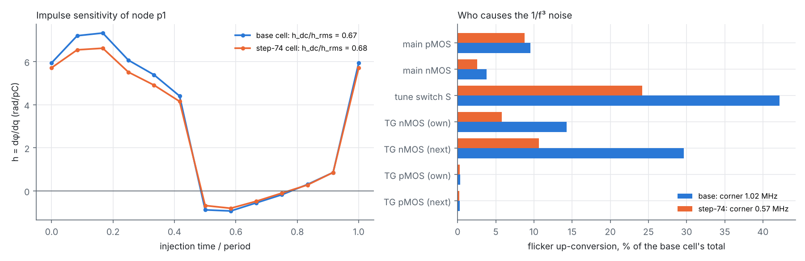
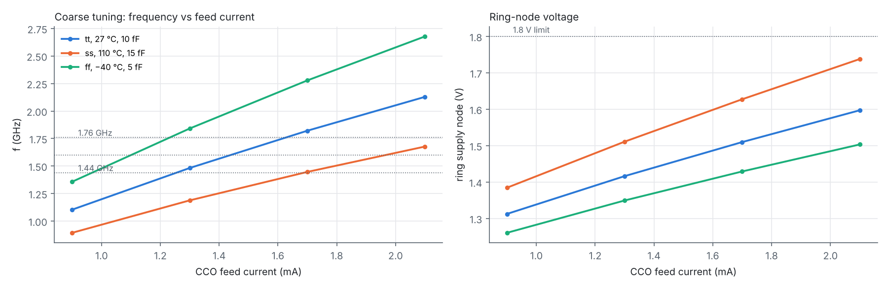
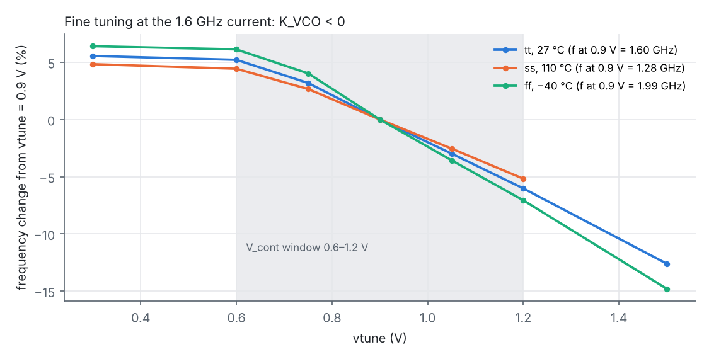
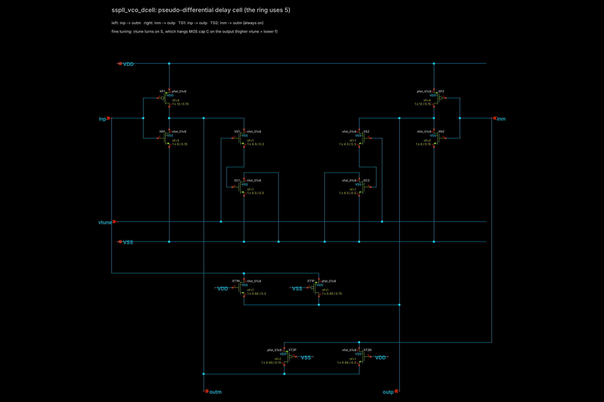
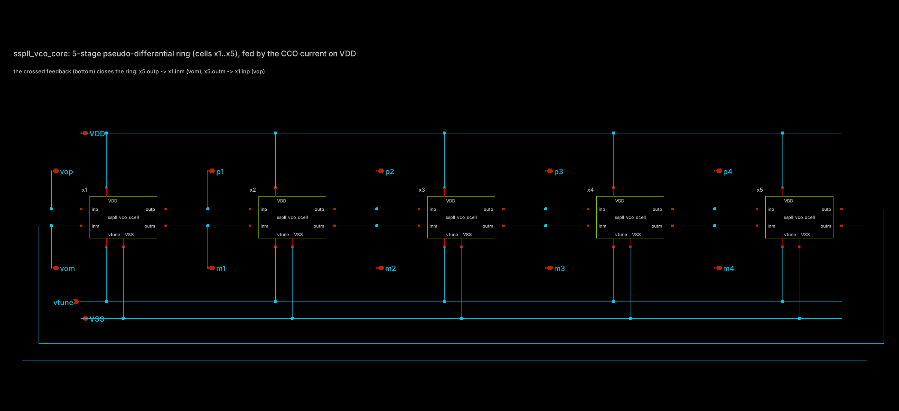
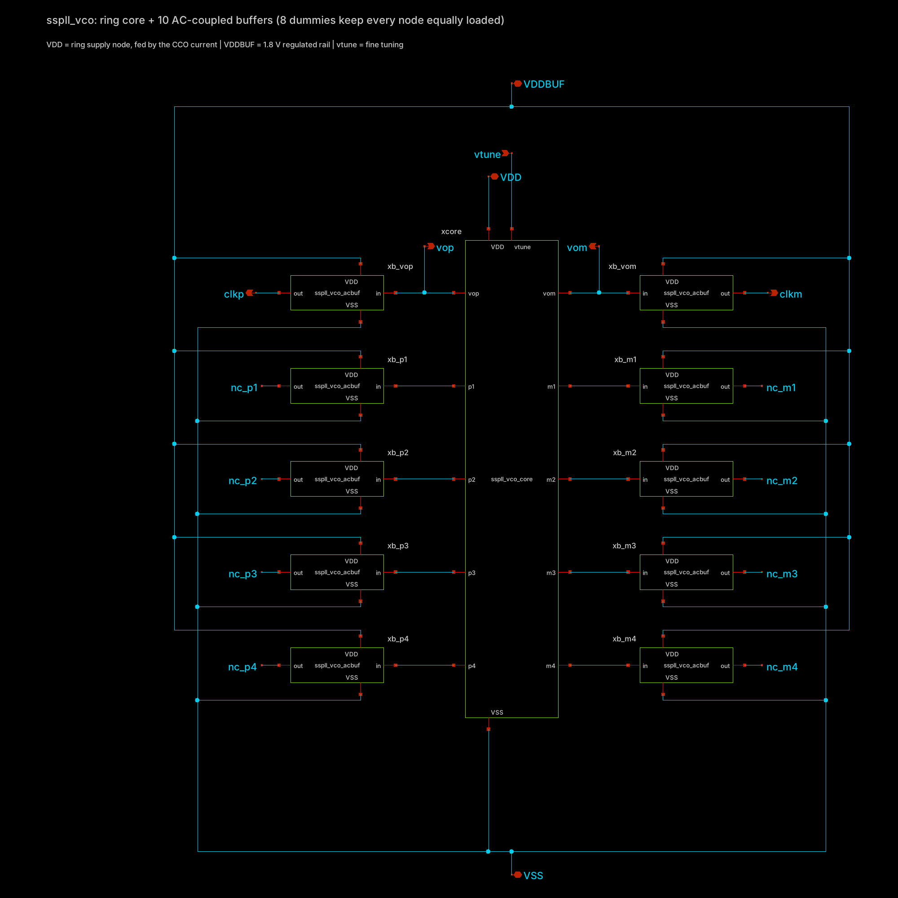
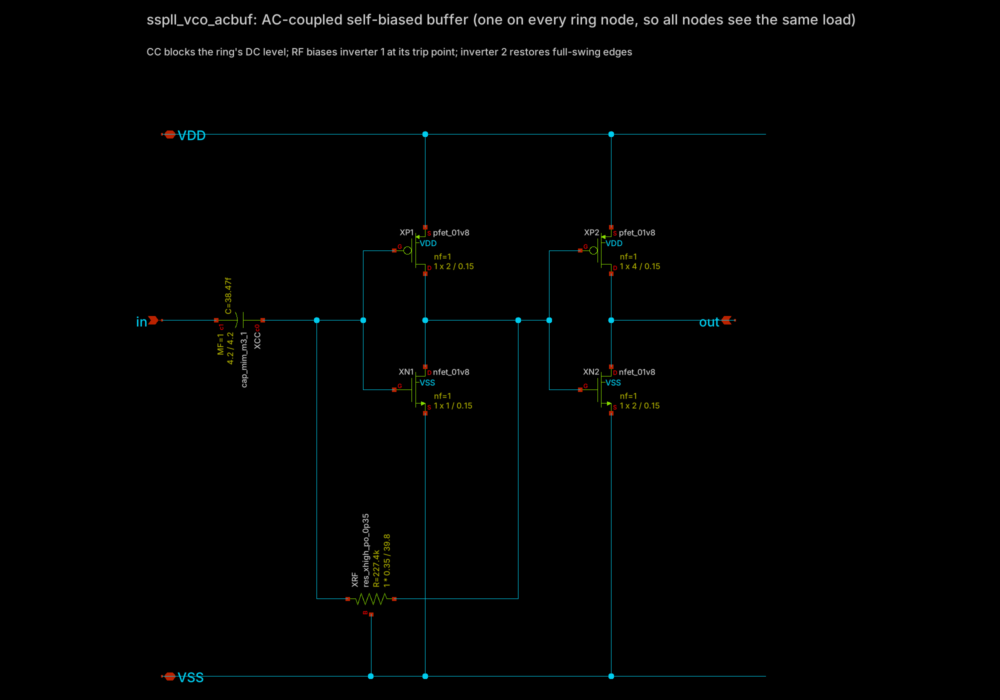

# Step 74: VCO redesign — schematic and sizing table

*Phase 7, roadmap step 74. Basis: the submitted proposal (5-stage pseudo-differential ring, current-fed by a CCO,
1.6 GHz) and the requirements from steps 72 and 73.*

Reproduce:

```bash
cd design/vco
python3 step74_point.py base 1.31e-3      # current for 1.6 GHz + ISF phase noise (method M2), ~35 min
python3 step74_point.py q3 1.4e-3         # the step-74 cell
python3 step74_char.py q3                 # frequency vs current / vtune over corners, start-up (method M1)
python3 step74_extra.py                   # start-up with 1 % mismatch, top of the range at ss/110 °C
python3 step74_plots.py                   # docs/img/step74_*.png
python3 schematics.py                     # xschem/vco/*.sch + *.sym with drawing checks (method M5)
cd ../../xschem && ./lvs.sh vco/sspll_vco.sch netlist/ref_vco.spice sspll_vco   # method M4
```

Methods M1–M5 (what, why, how, how to run) are in [`docs/methods.md`](../methods.md). Every number below is also in
[`design/SSPLL_design_log.xlsx`](../../design/SSPLL_design_log.xlsx).

## Result in one paragraph

The VCO keeps the proposal's 5-stage pseudo-differential ring with the ×1.5 cell. One change was made: the
fine-tune switch and the coupling-TG nMOS are now drawn at L = 0.3 µm.

- **Why.** The ISF showed that these two minimum-length devices caused 86 % of the flicker up-conversion. The
  1/f³ corner was 1.02 MHz.
- **Noise.** The corner falls to **0.57 MHz** (requirement ≤ 0.6). Thermal phase noise is **−98.7 dBc/Hz at
  1 MHz** (requirement ≤ −98.35).
- **Current.** The ring needs **1.437 mA** for 1.6 GHz (tt), 9 % more than before.
- **Tuning.** The fine-tune gain is **−300 MHz/V** averaged over 0.6–1.2 V, the value step 73 assumed. So the
  frozen loop filter and the 3-unit Gm stay as they are.
- **Range and start-up.** All corners reach 1.44–1.76 GHz with the ring node at or below 1.71 V (10 fF per node).
  The ring starts in under 9 ns at every corner.
- **System effect.** With these numbers the step-72 budget gives:
  - jitter **2.04 / 1.32 ps** typ (FFNC off / on);
  - L(300 kHz) **−110.6 / −120.0 dBc/Hz**;
  - power **9.55 mW** typ, against "about 9";
  - FoM **−227.8 dB**, unchanged.

## What happens, how, why

### What happens
The ring's frequency is set by how fast each stage charges its load: more CCO current means faster edges. vtune
adds a little capacitance on every output, for fine tuning. Every transistor's noise moves the edges a little.

- **White (thermal) noise** gives phase noise falling at 20 dB/dec.
- **Slow flicker (1/f) noise** is up-converted into close-in phase noise falling at 30 dB/dec. Below the 1/f³
  corner it dominates.

Step 74 sizes the ring for frequency, tuning gain and noise, and draws it as a hierarchical, LVS-clean schematic.

### How it happens
A current-fed ring settles at the supply voltage V_ring where its average current equals the CCO current I. Then

$$f \approx \frac{I}{N\,C_{node}\,V_{ring}}\ \ (N = 5),\qquad K_I = \frac{\partial f}{\partial I}\ \text{(Hz/A)},\qquad
K_{VCO} = \frac{\partial f}{\partial v_{tune}}.$$

Phase noise follows the impulse sensitivity function h(τ) (Hajimiri–Lee). A charge q injected at time τ shifts the
phase by Δφ = h(τ)·q. For a device noise current with thermal density S_th and flicker coefficient B:

$$\mathcal{L}_{th}(\Delta f) = \frac{2N\,\langle h^2 S_{th}\rangle}{2(2\pi\Delta f)^2},\qquad
\mathcal{L}_{fl}(\Delta f) = \frac{2N\,\langle h\sqrt{B}\rangle^2}{\Delta f\cdot 2(2\pi\Delta f)^2},\qquad
f_{1/f^3} = \Delta f\ \text{where}\ \mathcal{L}_{fl} = \mathcal{L}_{th}.$$

### Why it happens this way
Flicker noise only becomes phase noise through the average (dc) part of h, which here is 0.67 of its rms. A
device's flicker density scales like 1/(W·L).

So the smallest devices sitting on an output node dominate:

- the fine-tune switch, whose resistance sets how much of the tuning capacitor the node sees;
- the coupling-TG nMOS.

The main inverters, usually blamed for this, contribute only 13 %. Enlarging only those two devices fixes the noise
at a small power cost. Scaling the whole ring would cost power one-for-one.

## A. Architecture choices (4 vs 5 stages, LVT, tuning)

| Question | Decision | Evidence |
|---|---|---|
| 4 or 5 stages? | **5** | A 4-stage pseudo-differential ring latched at tt, ss and ff, because each half is a non-inverting 4-inverter loop (`proposal/sim/startup_results.md`). A cross-coupled latch to break it stayed stuck at ss/fs. With 5 stages each half is odd and cannot latch. |
| 3 stages (2.4 GHz)? | no | `vco_study/RESULTS.md`: same VCO FoM within 1 dB, more jitter at equal power, pushes the SSPD, NCB and divider to 2.4–2.6 GHz, and would change the proposal. |
| LVT devices? | **no (fallback only)** | pfet_01v8_lvt needs L ≥ 0.35 µm, too slow for this ring. nfet_01v8_lvt would lower V_ring, but the standard-Vt ring already reaches 1.76 GHz at ss/110 °C at 1.71 V. Kept as the fallback if extracted wiring exceeds 10 fF per node. |
| Coarse tuning | CCO current into the ring node | Low supply sensitivity. K_I = 0.85 GHz/mA at tt (0.58 at ss/110 °C, 1.21 at ff/−40 °C). |
| Fine tuning | vtune → switch S → MOS cap on each output | K_VCO < 0, so the loop polarity is set accordingly. |

## B. The flicker fix (ISF, method M2)



| Cell | Change | I for 1.6 GHz (tt) | Ring node | L(1 MHz) thermal | flicker | total | 1/f³ corner |
|---|---|---|---|---|---|---|---|
| base (proposal ×1.5) | — | 1.314 mA | 1.420 V | −98.40 | −98.32 | −95.35 | **1.02 MHz** |
| quiet | S and TG nMOS at L = 0.5 µm | f −21 % at equal current | — | — | — | — | rejected (too slow) |
| q2 | S and TG nMOS at L = 0.3 µm, same W/L | 1.494 mA | 1.459 V | (not run) | | | rejected (power) |
| **q3 (step-74 cell)** | S 4.5/0.3 µm, TG nMOS 0.84/0.3 µm | **1.437 mA** | **1.449 V** | **−98.71** | **−101.12** | **−96.74** | **0.57 MHz** |
| Requirement (step 72) | | ≤ ~1.45 mA | ≤ 1.8 V | ≤ −98.35 | | | ≤ 0.6 MHz |

All noise values are in dBc/Hz.

Device shares in q3 (thermal / flicker):

| Device | Thermal | Flicker |
|---|---|---|
| main pMOS | 65 % | 17 % |
| tune switch | 13 % | 46 % |
| TG nMOS (own + next) | 10 % | 31 % |
| main nMOS | 6 % | 5 % |

The switch still leads the flicker, but at a level 4× lower than in the base cell.

## C. Frequency range, tuning and start-up (method M1)



| Corner (wiring per node) | I for 1.44 GHz | I for 1.6 GHz | I for 1.76 GHz | Ring node at 1.76 GHz |
|---|---|---|---|---|
| tt, 27 °C (10 fF) | 1.26 mA | 1.437 mA | 1.63 mA | 1.49 V |
| ss, 110 °C (10 fF)* | 1.52 mA | 1.76 mA | 2.02 mA | **1.71 V** |
| ss, 110 °C (15 fF) | 1.7 mA | 1.95 mA | 2.26 mA | 1.78 V |
| ff, −40 °C (5 fF) | 0.97 mA | 1.10 mA | 1.23 mA | 1.33 V |
| sf / fs, 27 °C (10 fF), at 1.437 mA | 1.42 / 1.70 GHz | | | 1.57 / 1.41 V |

These are interpolated from the 0.9/1.3/1.7/2.1 mA runs and the ss runs at 2.1 and 2.4 mA (`data/step74_*.json`).

\* The ss/110 °C row at 10 fF is the 15 fF curve shifted by the measured +8 % frequency (10 fF vs 15 fF at 2.1 mA).

**Requirements on the CCO (step 75):**

- **Current range.** About 0.95 mA to 2.5 mA, a ratio of about 2.6.
- **Ring-node limit.** Keep the ring node ≤ 1.8 V. The layout target is ≤ 10 fF wiring per node, which gives
  1.71 V worst case.
- **DAC step.** A 5-bit DAC step of about 50 µA is 42 MHz at tt. That is less than a quarter of the fine-tune
  range (about 150 MHz over 0.75–1.2 V).



| K_VCO (MHz/V) | tt, 27 °C | ss, 110 °C | ff, −40 °C |
|---|---|---|---|
| average over 0.6–1.2 V | **−300** | −205 | −439 |
| average over 0.75–1.2 V | −328 | −223 | −492 |
| 0.6–0.75 V segment | −216 | −151 | −279 |

Below about 0.7 V the switch turns off and the tuning flattens. The lock window is therefore narrowed to
**V_cont 0.7–1.2 V** (centre 0.95 V). This updates step 73's 0.6–1.2 V; the MOS loop capacitor is ≥ 6.9 fF/µm²
there.

Across corners K_VCO spans ×0.68–×1.50 of tt. `icp_trim` (×0.67–×1.67) recentres it.

**Start-up.** All nodes start at 0 V, the current ramps in 2 ns, and there is a 1 % capacitive mismatch. The ring
oscillates at full swing by the 10th cycle at 7.1 ns (tt), 8.5 ns (ss/110 °C) and 5.9 ns (ff/−40 °C).

A perfectly symmetric netlist with no mismatch can sit at its metastable point in simulation. Real silicon always
has mismatch and noise, so the test uses 1 % mismatch on purpose.

## D. Schematics (hierarchical, real wiring, LVS-clean)

| Level | Cell | Contents |
|---|---|---|
| 1 | `xschem/vco/sspll_vco_dcell.sch` | pseudo-differential delay cell, 12 transistors |
| 1 | `xschem/vco/sspll_vco_acbuf.sch` | AC-coupled self-biased buffer (MIM Cc, poly Rf, 2 inverters) |
| 2 | `xschem/vco/sspll_vco_core.sch` | 5 × dcell in a ring, crossed feedback drawn visibly, 10 tap pins |
| 3 | `xschem/vco/sspll_vco.sch` | core + 10 buffers (2 used: clkp/clkm; 8 dummies for equal loading), raw taps vop/vom |






**Checks:**

- **Drawing.** `tools/xsch.py` finds no overlapping wires, no wire through a pin, no floating pin and no text
  collision.
- **LVS.** netgen compares each schematic with the netlist used in every simulation above. All four levels give
  *Circuits match uniquely*.

## E. Sizing table (all devices inside the PDK limits; `tools/pdk_limits.py`)

| Cell | Device | Model | W per finger × nf | L | Role |
|---|---|---|---|---|---|
| dcell | XP1, XP2 | pfet_01v8 | 3.0 µm × 4 | 0.15 µm | main inverter pMOS |
| dcell | XN1, XN2 | nfet_01v8 | 3.0 µm × 2 | 0.15 µm | main inverter nMOS |
| dcell | XS1, XS2 | nfet_01v8 | 4.5 µm × 1 | **0.30 µm** | fine-tune switch (was 2.25/0.15) |
| dcell | XC1, XC2 | nfet_01v8 | 4.5 µm × 1 | 0.50 µm | fine-tune MOS cap |
| dcell | XT1N, XT2N | nfet_01v8 | 0.84 µm × 1 | **0.30 µm** | coupling TG nMOS (was 0.63/0.15) |
| dcell | XT1P, XT2P | pfet_01v8 | 0.63 µm × 1 | 0.15 µm | coupling TG pMOS |
| acbuf | XCC | cap_mim_m3_1 | 4.2 × 4.2 µm | — | 38.5 fF coupling (bottom plate on the ring node) |
| acbuf | XRF | res_xhigh_po_0p35 | 0.35 µm | 39.8 µm | 228 kΩ self-bias |
| acbuf | XP1 / XN1 | pfet / nfet_01v8 | 2 / 1 µm | 0.15 µm | inverter 1 |
| acbuf | XP2 / XN2 | pfet / nfet_01v8 | 4 / 2 µm | 0.15 µm | inverter 2 |

**Layout notes (decided in the schematic):**

- **One cell, one row.** Integer fingers (pMOS 4 × 3 µm, nMOS 2 × 3 µm) so each half-cell is a single
  abutting row.
- **Mirror symmetry.** The two halves are mirror images.
- **Five identical cells.** Placed in a U-shape so the crossed feedback has the same wire length as the other
  stage connections.
- **Ten identical buffers.** Every ring node sees the same load.
- **MIM orientation.** Bottom plate on the driven node, top plate on the buffer gate.
- **Wiring budget.** ≤ 10 fF per ring node (this sets the ss/110 °C ring-node margin).

## F. Effect on the system

| | Step-72 allocation | Step-74 cell |
|---|---|---|
| Ring L(1 MHz) / 1/f³ corner | −98.35 dBc/Hz / 0.6 MHz | −98.71 dBc/Hz / 0.57 MHz |
| Jitter typ FFNC off / on | 2.115 / 1.359 ps | **2.040 / 1.318 ps** |
| L(300 kHz) typ off / on | −110.2 / −119.9 dBc/Hz | **−110.6 / −120.0 dBc/Hz** |
| Ring power (1.437 mA × 9/8 × 3.3 V) | 4.86 mW | 5.33 mW |
| Total power typ | 9.08 mW | **9.55 mW** (spec "about 9.0", max 15) |
| FoM | −227.8 dB | −227.8 dB |

If the 0.5 mW must come back, take it from these, not from the ring:

- the LDO load reserve (0.33 mW);
- smaller dummy buffers with the same input capacitance;
- the NCB bias.

The ring's current buys its noise margin.

## G. Requirements handed on

| To | Requirement |
|---|---|
| Step 73 / 79 (loop) | K_VCO = −300 MHz/V average (the loop polarity must give negative feedback). V_cont lock window 0.7–1.2 V. K_VCO spread ×0.68–×1.50 over corners is within the icp_trim range. |
| Step 75 (CCO) | Feed current 0.95–2.5 mA. Ring node ≤ 1.8 V (clamp). K_I = 0.58–1.21 GHz/mA. Output noise ≤ 7.2 pA/√Hz × (1.22 / 0.85) = **10.3 pA/√Hz** at tt, because the measured K_I is lower than the 1.22 GHz/mA assumed in step 72. Flicker corner ≤ 0.3 MHz. |
| Steps 77 / 78 (SSPD) | Raw taps vop/vom: 3.0 V pp differential at tt. Sampled amplitude A ≈ 0.5 V after the sampling network. |
| Step 109 (layout) | Wiring ≤ 10 fF per ring node. U-shaped placement. Identical buffers. Local decap on the ring node. |
| Step 95 (testbench) | Spectre PSS + PNOISE cross-check of the ISF numbers in the Cadence VM. |

## Interview questions (step 74)

31 questions. Answer each one aloud before you open it.

<details><summary><b>Q1.</b> Why a ring oscillator and not an LC oscillator for this PLL?</summary>

Area and tuning range. An LC tank at 1.6 GHz needs a nH inductor (hundreds of µm on a side in SKY130's thick metal) and gives a narrow range; a ring is a few hundred µm², tunes over more than ±30 % and is easy to lay out. Its phase noise is ~20 dB worse, which is exactly why this design uses a sub-sampling detector and FFNC: they suppress and cancel ring noise.

</details>

<details><summary><b>Q2.</b> Why 5 stages and not 4?</summary>

A pseudo-differential ring of N stages is two single-ended rings of N inverters coupled by the cross connection. With N = 4 each half is a 4-inverter ring - a non-inverting loop that can latch (two stable states). The proposal's start-up simulations latched at tt, ss and ff. With N = 5 each half is an odd ring and cannot latch; the crossing at the end keeps the differential loop inverting.

</details>

<details><summary><b>Q3.</b> Why not 3 stages?</summary>

The step-6 study: 3 stages run at 2.4 GHz for N = 48 with similar efficiency (VCO FoM within 1 dB) but more absolute jitter at equal power, push the SSPD, NCB and first divider to 2.4–2.6 GHz, and would have changed the submitted proposal. 5 stages at 1.6 GHz were kept.

</details>

<details><summary><b>Q4.</b> What does the always-on transmission gate between the two halves do?</summary>

It ties inp to outp (and inm to outm) so the two single-ended rings run in anti-phase: a weak in-phase coupling that enforces the differential mode. Without it the halves could drift into the common mode. It also adds load and, as the ISF showed, noise - which is why its nMOS was redesigned.

</details>

<details><summary><b>Q5.</b> How is the frequency tuned?</summary>

Coarse: the CCO current into the ring's supply node (5-bit DAC, step 75) - more current, faster edges. Fine: vtune turns on switch S, which hangs a MOS capacitor on each output; more vtune means more capacitance and a lower frequency, so K_VCO is negative (−300 MHz/V average over 0.6–1.2 V). The loop's charge-pump polarity is chosen to match.

</details>

<details><summary><b>Q6.</b> Why is K_VCO negative and does it matter?</summary>

Raising vtune connects more capacitance, slowing the ring. A negative gain is fine as long as the sign of the detector or the charge pump is flipped so the loop has negative feedback. It must be documented, because a wrong sign makes the loop run away to a rail instead of locking.

</details>

<details><summary><b>Q7.</b> What did the ISF reveal about the original cell?</summary>

Thermal noise was dominated by the main pMOS (68 %), but 86 % of the flicker up-conversion came from two small devices: the fine-tune switch (42 %) and the coupling TG nMOS (44 %) - both minimum length (0.15 µm). The main inverter nMOS, normally blamed for flicker, contributed only 4 %.

</details>

<details><summary><b>Q8.</b> Why does a tiny switch dominate the flicker?</summary>

Flicker noise density scales roughly with 1/(W·L): a 0.15 µm device has a tiny gate area, so its 1/f current is large. The switch's on-resistance sets how much of the tuning capacitor the output sees; slow fluctuations of that resistance change the load - that is directly a frequency modulation, i.e. up-converted flicker (the dc part of the ISF).

</details>

<details><summary><b>Q9.</b> How was the 1/f³ corner reduced and what did it cost?</summary>

The switch and the TG nMOS were drawn at L = 0.3 µm (switch W 2.25 → 4.5 µm to keep W/L; TG nMOS 0.63 → 0.84 µm). Corner 1.02 → 0.57 MHz (spec ≤ 0.6). The bigger devices add capacitance: 9 % more current for 1.6 GHz (1.314 → 1.437 mA, ring power 4.86 → 5.33 mW). L = 0.5 µm was tried first and cost 21 % of speed - rejected.

</details>

<details><summary><b>Q10.</b> Why not simply make the main inverters bigger to lower the noise?</summary>

Scaling the whole ring by k lowers all noise by 10·log k but costs k× power - the FoM does not change. The ISF showed the flicker came from two small devices; fixing those costs 9 % power for 2.6 dB lower close-in noise, far better than scaling.

</details>

<details><summary><b>Q11.</b> What is the 1/f³ corner and why does it matter here?</summary>

The offset where up-converted flicker equals thermal phase noise; below it L(f) falls at −30 dB/dec. With the loop at 2.5 MHz, a corner near 1 MHz puts flicker noise right where the loop and FFNC have the least suppression, raising L(300 kHz) FFNC-off above the −110 dBc/Hz spec.

</details>

<details><summary><b>Q12.</b> What does h_dc/h_rms (0.67) tell you?</summary>

How asymmetric the ISF is: the dc part converts slow (flicker) noise into phase drift. A perfectly symmetric waveform would have h_dc = 0 and no flicker up-conversion. 0.67 is high - the rising and falling edges and the load of the tuning branch are not symmetric - so the remaining handle is device area of the noisy devices.

</details>

<details><summary><b>Q13.</b> Why use LVT devices or not?</summary>

pfet_01v8_lvt has a minimum length of 0.35 µm - far too slow for a 1.6 GHz ring. nfet_01v8_lvt would lower the ring-node voltage for a given frequency (more headroom for the CCO), but the standard-Vt ring already runs at 1.45 V at tt and within the limit at ss/110 °C; LVT would add leakage and spread. Kept as a fallback, not used.

</details>

<details><summary><b>Q14.</b> Why is the ring fed by a current and not by a voltage?</summary>

A current-fed ring (CCO) has low supply sensitivity - the high output impedance of the current source isolates it from VDDA noise - and the current directly sets the frequency (K_I ≈ 1.2 GHz/mA). The ring-node voltage settles wherever the ring needs it to draw that current.

</details>

<details><summary><b>Q15.</b> Why must the ring-node voltage stay below 1.8 V?</summary>

The ring uses 1.8 V core devices (absolute maximum 1.95 V) and the CCO output transistor needs headroom from VDDA (2.97 V minimum): every 100 mV more on the ring node costs CCO headroom and raises its noise (step 72).

</details>

<details><summary><b>Q16.</b> Why does every ring node get a buffer, even unused ones?</summary>

Equal loading: each node then has the same capacitance, so all stages have the same delay and the ISF is the same at every node (the 2N-node assumption of the noise calculation holds). It also makes the layout regular - 10 identical buffer cells - and any tap can be used later.

</details>

<details><summary><b>Q17.</b> Why AC-coupled buffers?</summary>

The ring's DC level moves with the CCO current (1.1–1.7 V); a buffer biased by the ring's DC would change its trip point and duty cycle with frequency. The coupling cap removes the DC and the feedback resistor biases the first inverter at its own trip point, so the buffer output is centred at any ring voltage.

</details>

<details><summary><b>Q18.</b> How is the frequency measured in simulation and why that way?</summary>

Transient with an ideal current feed, a differential kick at t = 0, and .meas of 16–20 zero crossings of vop − vom after start-up has settled. A ring has no DC operating point that oscillates, so a small-signal analysis cannot give the frequency; the transient is the simulation equivalent of a frequency counter.

</details>

<details><summary><b>Q19.</b> How was phase noise computed without Spectre PNOISE?</summary>

With the ISF: the charge-injection response h(t) of one node at 12 phases, the bias of every device over a cycle and the PDK's own thermal and flicker noise tables for each device type and length. L = 2N·⟨h²S_th⟩/(2Δω²) for thermal; the flicker part uses ⟨h·√B⟩². It tells not only the total but which device causes it.

</details>

<details><summary><b>Q20.</b> How accurate is the ISF estimate?</summary>

The level is about 6 dB pessimistic against ngspice transient noise (step 7), because the ISF with cyclostationary white noise treats every injection as uncorrelated and the tables use the device's small-signal noise at each instant. The ranking of devices and the 1/f³ corner are reliable. Spectre PNOISE in the Cadence VM is the cross-check (step 95).

</details>

<details><summary><b>Q21.</b> Why use ideal R and C in the buffer for the long characterisation runs?</summary>

The PDK poly resistor is a behavioural (voltage-dependent) model and makes the transient about 5× slower. The ideal replacement uses the PDK values including the resistor's 3 fF end parasitics, and reproduces the PDK-buffer frequency to 0.001 %; the ISF runs and the LVS use the real PDK devices.

</details>

<details><summary><b>Q22.</b> What is K_I and how is it used?</summary>

df/dI of the current-fed ring (Hz/A). It converts the CCO's output current noise into frequency noise (step 72: i_n ≤ 7.2 pA/√Hz) and sets the DAC step size in Hz (step 75).

</details>

<details><summary><b>Q23.</b> How do you check the schematic is the simulated circuit?</summary>

xschem netlists the schematic (LVS format) and netgen compares it with the netlist generated for simulation: all four levels (cell, buffer, core, VCO) match uniquely. The same flow is used for layout-versus-schematic later.

</details>

<details><summary><b>Q24.</b> What layout decisions are already in the schematic?</summary>

Integer finger counts (pMOS 4 × 3 µm, nMOS 2 × 3 µm) so each cell is one abutting row; the two halves are mirror images; the 5 cells are identical; the TGs, switches and caps are drawn per half; 10 identical buffers; MIM bottom plate on the driven ring node, top plate on the high-impedance buffer gate.

</details>

<details><summary><b>Q25.</b> Why is the MIM bottom plate on the ring node?</summary>

The bottom plate (met3) has parasitic capacitance to the substrate. On the strongly driven ring node it only adds a little load; on the high-impedance buffer gate it would form a divider with the coupling cap and attenuate the signal.

</details>

<details><summary><b>Q26.</b> Why is the ring supply node decoupled with only 0.5 pF in simulation?</summary>

The ring is current-fed: a large decap on its supply node would just be charged by the CCO current (it sets the start-up time) and filters the ring's own current ripple. Its value is a layout choice (step 109); 0.5 pF keeps start-up fast.

</details>

<details><summary><b>Q27.</b> How does the frequency change from tt to ss/110 °C, and how is it handled?</summary>

Slower devices and higher temperature lower the frequency at a given current; the CCO DAC supplies more current. The check is that 1.76 GHz is reachable at ss/110 °C with the ring node below the limit, and 1.44 GHz at ff/−40 °C with the DAC's minimum current.

</details>

<details><summary><b>Q28.</b> What sets the start-up time?</summary>

The CCO charging the supply node and decap, then the growth of the differential mode from noise or mismatch. With 5 stages the differential mode is the only unstable mode, so it starts in a few ns at all corners.

</details>

<details><summary><b>Q29.</b> Why 10 fF extra capacitance per node in the simulations?</summary>

A pre-layout allowance for wiring; corners use 5 fF (ff/−40 °C, fast case) and 15 fF (ss/110 °C, slow case). Step 118 replaces it with the extracted values.

</details>

<details><summary><b>Q30.</b> What is the VCO's contribution to the total jitter after this step?</summary>

With the step-74 ring numbers in the step-72 model: 2.04 ps FFNC off, 1.32 ps FFNC on (typ), L(300 kHz) −110.6 / −120.0 dBc/Hz - all inside the typ specs. Power rises to 9.55 mW typ (spec 'about 9'), FoM −227.8 dB unchanged.

</details>

<details><summary><b>Q31.</b> If power had to come back to 9.0 mW, where would you take it?</summary>

The LDO load reserve (0.33 mW), the dummy-buffer size (8 of 10 buffers only provide equal loading - they can be smaller inverters with the same input capacitance), and the NCB bias. Not from the ring: its current buys the noise margin.

</details>

