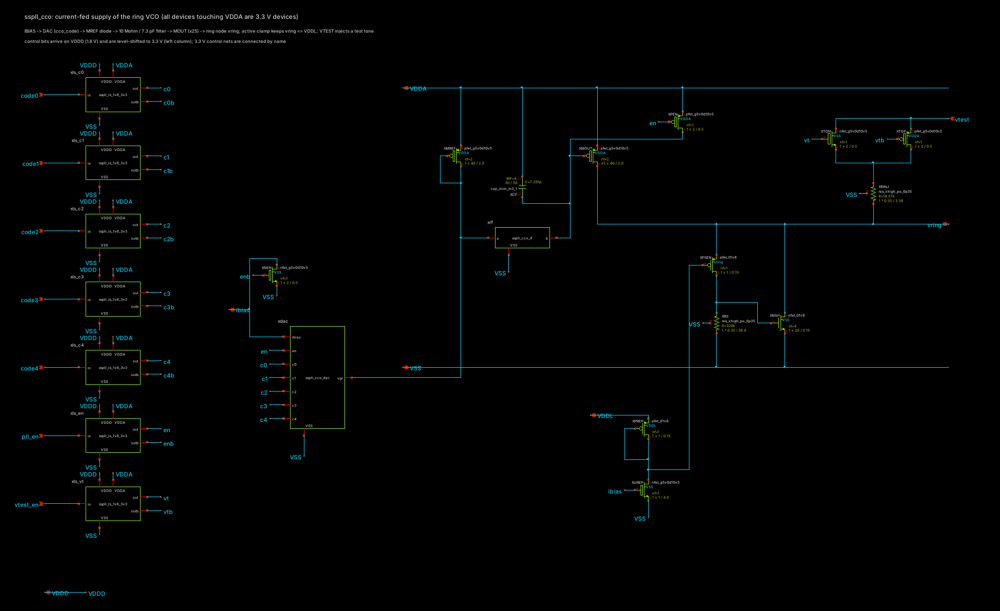
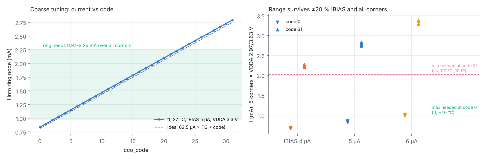
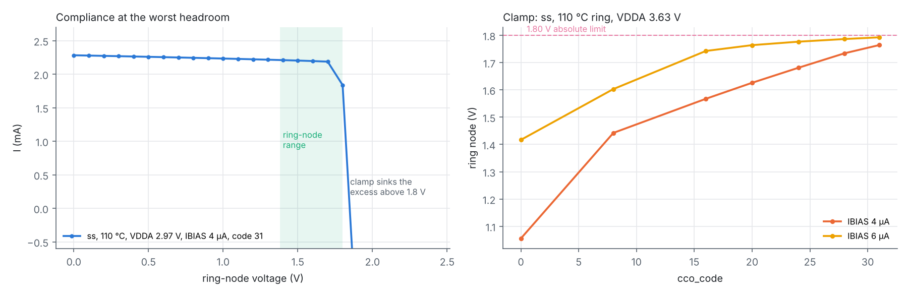
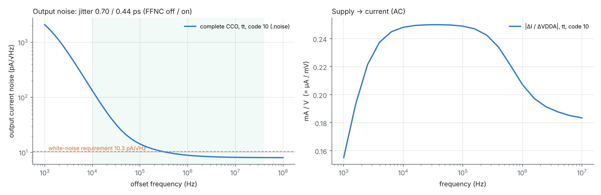
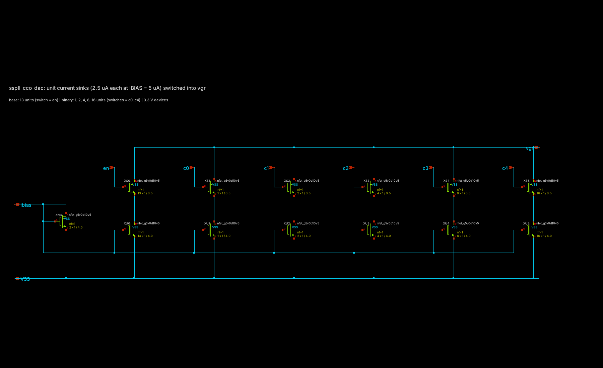
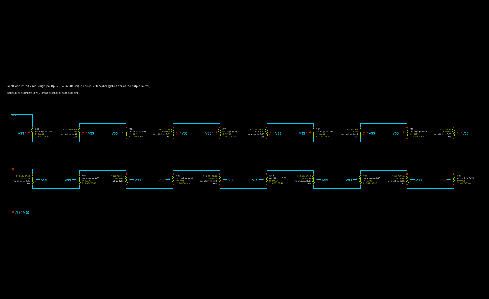
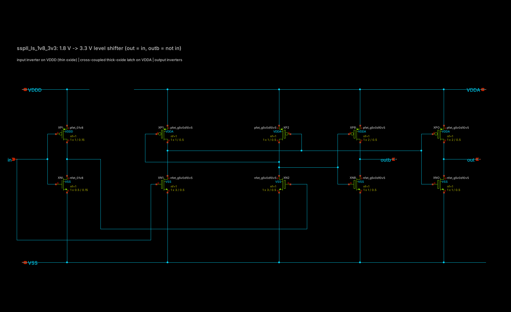

# Step 75: CCO — current-fed supply of the ring VCO (schematic)

**Roadmap step 75** · Phase 7 · deliverable: schematic (xschem, hierarchical, LVS-clean), sizing table, verification.
Design files: `design/cco/` · schematics: `xschem/cco/` · data: `design/cco/data/` · methods: M10–M13 in `docs/methods.md`.

## Result in one paragraph
The ring VCO of step 74 is fed by a programmable current source. IBIAS (5 µA from the harness) is mirrored into a 5-bit
DAC of 2.5 µA unit sinks (13 always on + binary 1…16), the DAC current flows out of a one-unit pMOS diode, and a 1:25
pMOS mirror delivers $I_{CCO} = 62.5\ \mu\text{A} \times (13 + \text{code})$ to the ring node: **0.84–2.79 mA at tt**.
Between the two mirror gates a **10 MΩ / 7.3 pF** filter removes the reference-side noise. Over 5 corners × VDDA
2.97/3.63 V × IBIAS 4/5/6 µA, code 31 always gives ≥ 2.20 mA (2.02 mA needed for 1.76 GHz at ss/110 °C) and code 0
≤ 1.02 mA (0.97 mA needed for 1.44 GHz at ff/−40 °C; the 50 µA excess is 60 MHz, inside the ±75 MHz fine-tune range).
An **active clamp** referenced to the 1.8 V rail keeps the ring node at ≤ 1.793 V even in the abuse case. Output noise is
**8.9 pA/√Hz at 1 MHz** (allowed 10.3): CCO jitter 0.70 / 0.44 ps, system **1.96 / 1.27 ps**, L(300 kHz) **−110.9 /
−120.0 dBc/Hz** (FFNC off / on). The 1:25 ratio lowers the power to **9.15 mW typ, 13.64 mW worst** (was 9.55 / 14.26):
the worst-case power is no longer at risk. Seven 1.8 → 3.3 V level shifters bring the control bits into the VDDA domain.

## What happens, how, why

### What happens
The ring has no supply of its own. A pMOS current source from VDDA pushes $I_{CCO}$ into the ring's supply node, and the
ring settles at the voltage where its average current equals $I_{CCO}$ (1.45 V at tt for 1.6 GHz). The current sets the
frequency: $f \approx I/(N C V)$, $K_I \approx 0.85$ GHz/mA. The code is the coarse knob; vtune (step 74) the fine knob.

### How it happens
$$I_{CCO} = M\,I_u\,(N_{base} + \text{code}),\quad M = 25,\ I_u = \tfrac{I_{BIAS}}{2},\ N_{base} = 13$$
The DAC units are 1 µm/4 µm thick-oxide nMOS with a 1 µm/0.5 µm switch in series; the switch gates come from level
shifters. The output pair MREF (1 unit) and MOUT (25 units) are 40 µm/2 µm pMOS (2 fingers of 20 µm). Noise at the output
above the filter corner $f_F = 1/(2\pi R_F C_F) \approx 2.2$ kHz:
$$S_{i,out}(f) \approx \underbrace{4kT\gamma\,g_{m,out}}_{\text{MOUT}} +
\underbrace{\frac{4kT\,g_{m,out}^2}{R_F\,(2\pi f C_F)^2}}_{R_F\ \text{above } f_F} +
\underbrace{25^2\,S_{i,ref}\,\left|\frac{1}{1+j2\pi fR_FC_F}\right|^2}_{\text{reference side, filtered}}$$
Frequency noise $S_f = K_I^2 S_i$, phase noise $S_\phi = S_f/f^2$, shaped in the PLL like VCO noise by $|(1-G_c)(1-H)|^2$.

### Why it happens this way
* **Current feed:** a current source has a high output impedance, so VDDA ripple hardly reaches the ring; current is also
  what the ring frequency is proportional to.
* **Code range 3.4 : 1:** IBIAS may be ±20 % and the corners need 0.97–2.02 mA, so code 0 must work at IBIAS +20 % and
  code 31 at IBIAS −20 %.
* **1:25 ratio:** the reference branch also draws from VDDA. 1:25 costs 4 % extra current instead of 12.5 % (1:8).
* **Large $R_F$:** above $f_F$ the resistor's noise at the gate falls as $1/(\sqrt{R_F}\,C_F)$ — larger R, less noise.
* **Clamp:** the ring's core devices are 1.8 V devices; at ss/110 °C with IBIAS +20 % and a high code the CCO could
  push the node to ~2 V without it.

## A. Architecture and sizing decisions
| Decision | Options considered | Chosen | Reason |
|---|---|---|---|
| Mirror ratio | 1:8 (step 72), 1:16, 1:20, 1:25 | **1:25** | power (−0.62 mW worst) and enough code range |
| Base units | 19 (with 1:20), 13 | **13** | 3.4:1 range covers IBIAS ±20 % and corners |
| Filter | none, 300 kΩ/7 pF, 10 MΩ/7.3 pF | **10 MΩ/7.3 pF** | 300 kΩ gave 21 pA/√Hz; 10 MΩ gives 8.9 |
| $C_F$ to | VSS, VDDA | **VDDA** | gate follows VDDA → constant $V_{sg}$ → supply rejection |
| Clamp | none, 1 pMOS, active 2-stage | **active** | 1 pMOS stole 0.5–0.85 mA at 1.7 V |
| Devices on VDDA | thin, thick oxide | **g5v0d10v5** | up to 3.63 V across terminals |
| L of mirror / DAC | 0.5–4 µm | **2 / 4 µm** | flicker, matching, output impedance; Vov fits 1.17 V headroom |

## B. Coarse tuning over corners and IBIAS (method M10)

| IBIAS | code 0 (min–max over 5 corners × 2 VDDA) | code 10 | code 31 |
|---|---|---|---|
| 4 µA | 0.66–0.69 mA | 1.16–1.20 mA | **2.20**–2.28 mA |
| 5 µA | 0.82–0.85 mA | 1.45–1.50 mA | 2.74–2.84 mA |
| 6 µA | 0.98–**1.02** mA | 1.73–1.79 mA | 3.28–3.39 mA |

The current is almost corner-independent (±2 %): it is a ratio of matched long-channel devices. VDDA moves it 2.5 %.
One LSB = 62.5 µA ≈ 53 MHz (tt), the fine tune spans ≈ 150 MHz, so every frequency is reachable with ≥ 1 LSB overlap.

## C. Compliance and the clamp (methods M10, M12)

At the least headroom (VDDA 2.97 V, ss/110 °C, code 31) the current falls by only 3 % from 0 V to 1.7 V: MOUT stays
saturated over the whole ring range. Above 1.8 V the clamp sinks the excess (right side of the left plot, the source is
then absorbing current). With the ring's real I–V (step-74 transients at ss/110 °C, 10 fF/node) the ring node reaches
at most **1.793 V** (code 31, IBIAS 6 µA, VDDA 3.63 V); in normal operation (1.76 GHz) it is 1.71 V.

**How the clamp works:** a replica pMOS diode from VDDL biased by one DAC unit sets the sense gate one $|V_{GS}|$ below
VDDL. The sense pMOS (source on the ring node) therefore turns on — exponentially, in weak inversion — when the ring node
approaches VDDL, at every corner (the replica tracks the threshold). Its current into $R_S$ = 320 kΩ drives an nMOS shunt
(20 µm/0.15 µm), adding gain: < 10 µA at 1.725 V, 0.2–1.5 mA at 1.8 V.

## D. Noise and supply rejection (method M11)

| Offset | 10 kHz | 100 kHz | 300 kHz | 1 MHz | 10 MHz |
|---|---|---|---|---|---|
| $\sqrt{S_i}$ (pA/√Hz) | 132 | 14.3 | 10.3 | 8.9 | 8.2 |

Below ~100 kHz the filtered reference flicker rises, but there the loop (and FFNC) suppress VCO-type noise strongly. Put
through the step-72 model (method M9): CCO 0.70 / 0.44 ps, total 1.96 / 1.27 ps, L(300 kHz) −110.9 / −120.0 dBc/Hz.
Supply rejection: $|\Delta I/\Delta V_{DDA}| \le 0.25$ µA/mV from 1 kHz to 10 MHz (1 mV of ripple → 0.25 µA → ≈ 0.2 MHz).

## E. Level shifter (method M13)
At VDDD 1.71 V / VDDA 3.63 V, 20 fF load: full 0–3.63 V output, rise 1.55 ns (ss/110 °C) / 1.36 ns (ff/−40 °C). Pull-downs
W 3 µm vs latch pMOS W 1 µm (both thick oxide, L 0.5 µm) guarantee the flip.

## F. Schematics (hierarchical, real wiring, LVS-clean)
`sspll_cco` (top) → `sspll_cco_dac`, `sspll_cco_rf` (20-segment serpentine), 7 × `sspll_ls_1v8_3v3`. Each was netlisted
by xschem and compared with the simulated netlist by netgen (`xschem/lvs.sh`): **"Circuits match uniquely"** for all.
The drawing checker (`tools/xsch.py`) now also flags 4-way junctions and wires that touch two pins of one device — both
caused shorts here before they were caught by LVS.

## G. Sizing table (all devices pass `tools/pdk_limits.py`)
| Device | Model | W per finger × nf × m | L | Role |
|---|---|---|---|---|
| XNB | nfet_g5v0d10v5 | 1 × 1 × 2 | 4 µm | IBIAS input diode |
| XU0…XU5 | nfet_g5v0d10v5 | 1 × 1 × (13, 1, 2, 4, 8, 16) | 4 µm | DAC unit sinks (2.5 µA) |
| XS0…XS5 | nfet_g5v0d10v5 | 1 × 1 × same | 0.5 µm | DAC switches |
| XMREF | pfet_g5v0d10v5 | 20 × 2 × 1 | 2 µm | reference diode |
| XMOUT | pfet_g5v0d10v5 | 20 × 2 × 25 | 2 µm | output mirror |
| xrf1…20 | res_xhigh_po_0p35 | 0.35 | 87.48 µm | $R_F$ = 10 MΩ |
| XCF | cap_mim_m3_1 | 30 × 30 µm × 4 | — | $C_F$ = 7.3 pF (placed over MOUT) |
| XPEN / XNEN | p/nfet_g5v0d10v5 | 2 × 1 | 0.5 µm | enable (gate to VDDA / IBIAS to ground) |
| XPREP | pfet_01v8 | 1 × 1 | 0.15 µm | clamp replica from VDDL |
| XUREP | nfet_g5v0d10v5 | 1 × 1 | 4 µm | replica bias (1 unit) |
| XPSEN | pfet_01v8 | 1 × 1 | 0.15 µm | clamp sense |
| XRS | res_xhigh_po_0p35 | 0.35 | 56 µm | 320 kΩ |
| XNSH | nfet_01v8 | 5 × 4 | 0.15 µm | clamp shunt |
| XTGN / XTGP | n/pfet_g5v0d10v5 | 2 × 1 | 0.5 µm | VTEST gate |
| XRINJ | res_xhigh_po_0p35 | 0.35 | 3.39 µm | 20 kΩ injection |
| LS: XPI/XNI | pfet/nfet_01v8 | 1 / 0.5 | 0.15 µm | input inverter (VDDD) |
| LS: XP1/XP2, XN1/XN2 | p/nfet_g5v0d10v5 | 1 / 3 | 0.5 µm | latch |
| LS: XPO/XNO, XPB/XNB | p/nfet_g5v0d10v5 | 2 / 1 | 0.5 µm | output inverters |

## H. Effect on the system (margin tracker, `design/SSPLL_design_log.xlsx`)
* Power: 9.15 mW typ (target 9.0), **13.64 mW worst** (limit 15, post-layout estimate 14.6 → TIGHT, was AT RISK).
* Jitter 1.96 / 1.27 ps typ, L(300 kHz) −110.9 / −120.0 dBc/Hz — typ targets are met pre-layout with < 1 dB margin.
* Ring node: 1.71 V operating, 1.793 V abuse case — both TIGHT, both protected by the clamp.

## I. Requirements handed on
1. **Layout:** MREF in the centre of the 25 MOUT units (common centroid), dummies at both ends; MIM tiles over the array;
   the `vgo` node (10 MΩ, high impedance) short and shielded; ring-node capacitance ≤ 10 fF per node (step 74).
2. **FLL (step 81):** set `cco_code` before `pll_en`; wait ≥ 0.3 ms (RC = 70 µs) before measuring frequency.
3. **Test plan:** VTEST injects $(V_{test} - V_{ring})/20\,\text{k}\Omega$: 1 mV → 50 nA → ≈ 42 kHz deviation.
4. **Post-layout (step 118):** re-run M10 (code 0 at ff/−40 °C/6 µA, code 31 at ss/110 °C/4 µA) and M12 with the
   extracted ring.

## Interview questions (step 75)

**Q1. What is the CCO in this design and why is the ring fed by a current?**  
A programmable current source from VDDA (3.3 V) into the ring's supply node. A current-fed ring settles at the voltage where it draws exactly that current, so the current sets the frequency (K_I ≈ 0.85 GHz/mA). The current source's high output impedance isolates the ring from VDDA noise, and the DAC gives the coarse tuning.

**Q2. Draw the CCO from IBIAS to the ring node.**  
IBIAS (5 µA) → 2-unit nMOS diode → unit sinks of 2.5 µA (13 base + binary 1, 2, 4, 8, 16, switched by cco_code) → pMOS diode MREF (1 unit) → 10 MΩ / 7.3 pF RC filter → MOUT (25 units) → ring node. I_out = 25 × 2.5 µA × (13 + code) = 62.5 µA × (13 + code): 0.81–2.75 mA.

**Q3. Why a 1:25 output mirror and not 1:8?**  
The reference branch also draws its current from VDDA: with 1:8 that is +12.5 % of the ring current, with 1:25 only +4 %. At the worst corner (2.0–2.3 mA at 3.63 V) that saves 0.6–0.7 mW, which brings the worst-case power back under 15 mW. The price: reference-side noise is multiplied by 25 — which the RC filter removes.

**Q4. Why is the DAC range 0.81–2.75 mA when the ring only needs 0.97–2.26 mA?**  
IBIAS from the harness may be 4.0–6.0 µA (±20 %), and the DAC current scales with it. At IBIAS = 6 µA, code 0 must still be low enough for 1.44 GHz at ff/−40 °C (0.97 mA); at 4 µA, code 31 must still reach 1.76 GHz at ss/110 °C (2.02 mA at 10 fF/node). The ±20 % costs a 3.4:1 code range.

**Q5. How fine is the coarse tuning and why is it fine enough?**  
One LSB is 62.5 µA, i.e. about 53 MHz at tt (K_I 0.85 GHz/mA). The fine-tune range over the 0.75–1.2 V lock window is about 150 MHz, roughly 3 LSBs, so after the coarse code is chosen the loop can always reach lock with margin for temperature drift.

**Q6. Why the RC filter between the two mirror gates?**  
Without it, the noise of the reference side (MREF, the DAC units, the IBIAS input) appears at the output multiplied by the mirror ratio (×25 in current, ×625 in power). The RC low-pass with a ~2 kHz corner removes it everywhere in the 10 kHz–40 MHz band, so only MOUT's own noise and the filter resistor's noise remain.

**Q7. Why is the filter resistor 10 MΩ and not 300 kΩ?**  
Above the RC corner the resistor's own noise at the gate falls as √(4kT/R)/(2πCf): a larger R with the same C gives LESS noise in band. With 300 kΩ the output noise was 21 pA/√Hz at 1 MHz and L(300 kHz) FFNC-off −104.4 dBc/Hz; with 10 MΩ it is 8.9 pA/√Hz and −110.9 dBc/Hz.

**Q8. How is a 10 MΩ resistor made legal and layout-friendly?**  
20 series segments of res_xhigh_po_0p35 (the highest sheet resistance, 0.35 µm is a legal width), each 87.48 µm long (≈ 500 kΩ including heads), drawn as a serpentine. Every segment is inside the PDK limits and the array folds into a compact block.

**Q9. Where does the 7.3 pF filter capacitor go?**  
Four 30 × 30 µm MIM tiles, placed over the output-transistor array (the MIM layers are above the active devices), so they cost no extra area. Top plate on the high-impedance gate node, bottom plate on VDDA. MOUT's own gate capacitance (several pF) adds to it.

**Q10. Why is the filter capacitor tied to VDDA and not to ground?**  
The output pMOS current depends on its source-gate voltage. With the capacitor to VDDA, a VDDA step moves the gate with the source, so Vsg — and the current — stays constant: supply rejection. A capacitor to ground would hold the gate still and turn every VDDA ripple into a current ripple.

**Q11. What sets the CCO output noise floor?**  
MOUT's channel noise, i_n² = 4kTγ·g_m. With 25 units of 40/2 µm and ~1.45 mA, g_m is a few mS; the result is 8.9 pA/√Hz at 1 MHz (requirement ≤ 10.3). Lower g_m (larger overdrive) would help but costs headroom: VDDA_min − V_ring_max = 2.97 − 1.8 = 1.17 V.

**Q12. Why thick-oxide (g5v0d10v5) devices in the CCO?**  
Every device connected to VDDA can see up to 3.63 V (3.96 V absolute) between terminals; thin-oxide devices are rated for 1.8 V. The project rule: 3.3 V devices wherever a node touches VDDA or a pad.

**Q13. Why L = 2 µm for the mirror and 4 µm for the DAC units?**  
Long channels lower flicker noise (area), raise output impedance (better DAC accuracy and supply rejection) and improve matching. The output still saturates: Vov ≈ 0.5–0.7 V against 1.17 V of headroom.

**Q14. What does the clamp do and why is it needed?**  
At ss/110 °C with IBIAS +20 % and a high code, the CCO could push the ring node to ~2.0 V — above the 1.8 V rating of the ring's core devices and above the proposal's absolute limit. The clamp sinks the excess current once the node reaches the 1.8 V rail (VDDL).

**Q15. Why did a simple one-transistor clamp not work?**  
A pMOS from the ring node to ground, biased by a replica, conducts by Vsg: to sink ~1 mA at 1.8 V it already steals 0.4–0.85 mA at 1.7 V, which is exactly where the ring must run at the top of its range. Its I-V is not sharp enough.

**Q16. How does the two-stage active clamp get a sharp knee?**  
A small sense pMOS (gate at the replica voltage) conducts exponentially (weak inversion) as the ring node approaches VDDL; its current into 320 kΩ drives the gate of an nMOS shunt. The shunt only turns on when that voltage reaches its threshold, adding gain: < 10 µA at 1.725 V, 0.2–1.5 mA at 1.8 V. With the ring's I-V at ss/110 °C, code 31 and IBIAS 6 µA the node stays at 1.793 V.

**Q17. Why is the clamp referenced to VDDL and a replica pMOS?**  
The replica diode from the 1.8 V rail sets the sense gate one |Vgs| below VDDL, so the sense device turns on when the ring node reaches VDDL regardless of the pMOS threshold at that corner (it tracks process and temperature). VDDL is the regulated rail whose voltage is, by definition, safe for 1.8 V devices.

**Q18. How is the CCO disabled (pll_en = 0)?**  
A thick-oxide pMOS pulls the output gate to VDDA (MOUT off) and a thick-oxide nMOS shorts the IBIAS input to ground (all DAC units and the clamp replica off). The base units' switch is also driven by pll_en. All controls default to 0, so the block powers up off.

**Q19. What is VTEST for and how is it injected?**  
The test plan uses a tone on ANA0 (VTEST) to calibrate the cancellation gain (50 kHz) and to measure supply sensitivity (1 mV pp at 100 kHz). A thick-oxide transmission gate (vtest_en) and a 20 kΩ poly resistor inject (V_test − V_ring)/20 kΩ into the ring node: 1 mV → 50 nA → ~42 kHz frequency deviation, a clearly measurable spur.

**Q20. Why level shifters, and how does yours work?**  
cco_code, pll_en and vtest_en come from the 1.8 V digital domain but drive 3.3 V switches. A thin-oxide inverter on VDDD makes in/inb; thick-oxide nMOS pull-downs flip a cross-coupled thick-oxide pMOS latch on VDDA; output inverters give full 3.3 V out/outb. Pull-downs (W 3 µm) are sized to win against the pMOS loads (W 1 µm) even at VDDD 1.71 V.

**Q21. How was the CCO verified?**  
DC operating points (current vs code over 5 corners × VDDA × IBIAS), a compliance sweep, the clamp with the ring's measured I-V, an AC supply-rejection analysis, .noise of the complete circuit with PDK resistors and capacitors (converted to jitter through the loop model), and a level-shifter transient at the hardest supplies. Methods M10–M13.

**Q22. How do you convert CCO current noise to phase noise?**  
Frequency noise S_f = K_I²·S_i (Hz²/Hz); phase noise S_φ = S_f/f²; L = S_φ/2. In the PLL it is shaped like VCO noise: |(1 − G_c)(1 − H)|², so low-frequency CCO noise is suppressed by the loop and FFNC.

**Q23. Why did the CCO beat its step-72 allocation?**  
The allocation assumed 7.2 pA/√Hz with a 0.3 MHz flicker corner; the measured K_I (0.85 instead of 1.22 GHz/mA) relaxes the current-noise requirement by 1.44×, and the long-channel devices plus the filter keep the spectrum low. Result: 0.70 ps (FFNC off) / 0.44 ps (on) instead of 0.90 / 0.56 ps.

**Q24. What would you check in layout for this block?**  
Common-centroid placement of MREF among the 25 MOUT units, dummies at the array ends, the MIM tiles over the array, the serpentine resistor away from the ring and shielded, the gate node (vgo) kept short and guarded (it is a 10 MΩ high-impedance node: leakage and coupling matter), thick-oxide devices in their own well/guard ring.

**Q25. What leakage could upset a 10 MΩ / 7 pF filter node?**  
The gate node draws no DC current, but junction leakage of the enable pMOS drain and the resistor body leakage flow through 10 MΩ: 1 nA gives 10 mV of offset between vgr and vgo, i.e. a few % current error — a static offset the loop absorbs, but it is verified at 110 °C (leakage doubles every ~10 °C).

**Q26. How does VDDA noise reach the ring?**  
Through the finite output impedance of MOUT and through the gate coupling. The AC analysis gives ΔI/ΔVDDA of about 0.25 mA/V up to 1 MHz, i.e. 1 mV of VDDA ripple → 0.25 µA → ~0.2 MHz deviation — further reduced by the loop and FFNC below 2.5–6 MHz.

**Q27. What is the start-up behaviour?**  
pll_en rises, the level shifter releases the enable devices, IBIAS flows into the DAC and the reference diode, the filter charges the output gate with τ = RC ≈ 70 µs — the current ramps up over ~0.2 ms. The FLL waits for it (step 81).

**Q28. Could the 70 µs RC time constant be a problem for lock time?**  
Only at power-up: once the CCO current has settled, the coarse code is static. The 5 µs lock-time spec is measured 'from pll_en with coarse code set' — but the code must be set before the CCO is enabled, and the slow filter is precisely why the test plan sets cco_code first.
