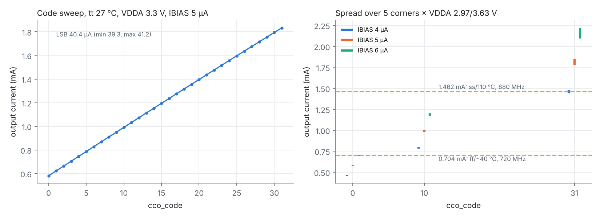
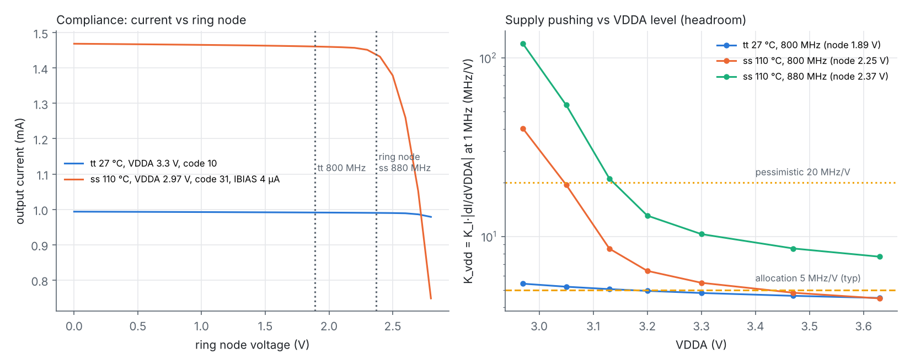
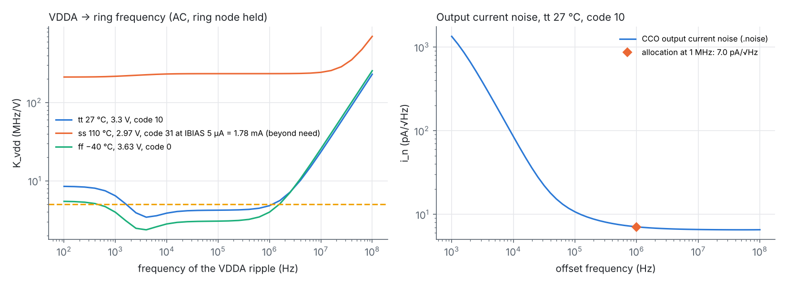
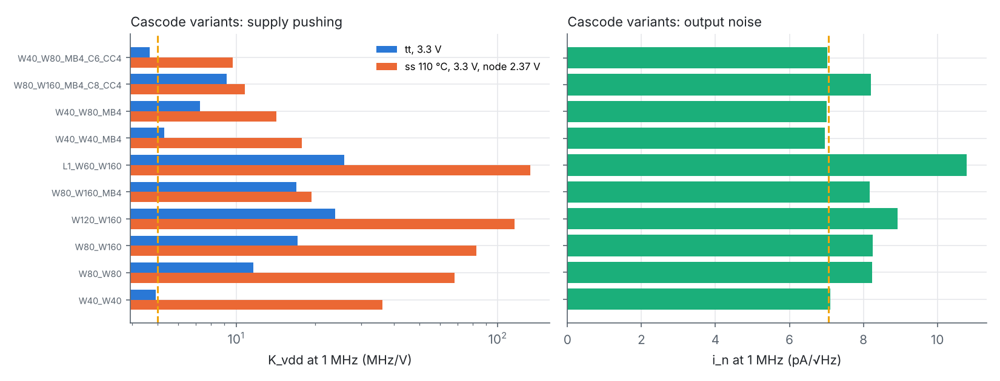
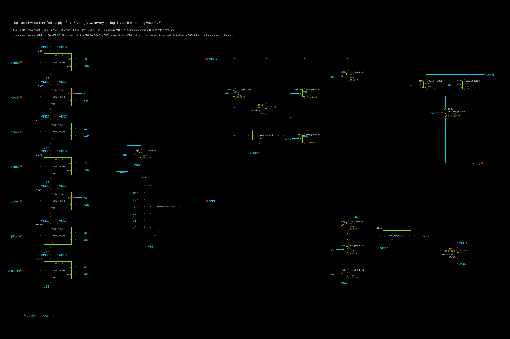
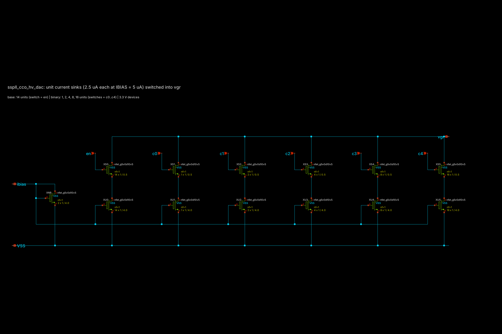
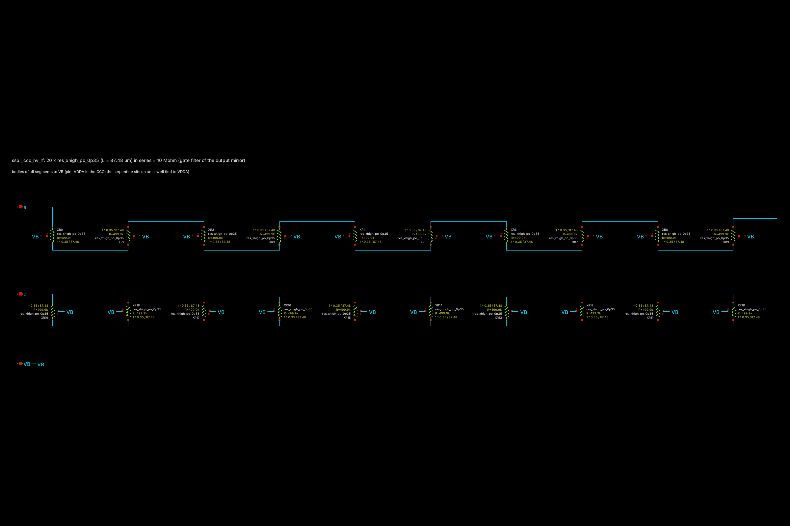
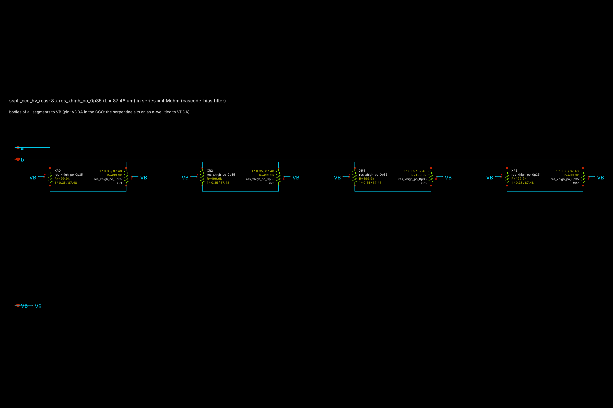

# Step 75 (redo): CCO — current-fed supply of the 5 V ring, without the LDO

*Phase 7, roadmap step 75, redone for the device-rule migration (19 Nov 2026).*

**Basis**
- Step 74 HV ring: 0.994 mA for 800 MHz (tt, ring node 1.89 V), K_I ≈ 0.62 GHz/mA (tt), 0.41 (ss/110 °C), 0.85 (ff/−40 °C).
- Range needed: **0.704 mA** (ff/−40 °C, 720 MHz) to **1.462 mA** (ss/110 °C, 880 MHz, ring node **2.37 V**), plus IBIAS ±20 %.
- Step 72 HV budget, now without the LDO:
  - CCO noise allocation: L = −110.2 dBc/Hz at 1 MHz, which is **7.05 pA/√Hz** of output current;
  - supply pushing K_vdd = K_I·|dI/dVDDA| ≤ **5 MHz/V** typ, 20 pess, with VDDA noise ≤ 100 nV/√Hz.
- Device rule: every analog device is nfet/pfet_g5v0d10v5 on VDDA = 3.3 V; only the control logic is 1.8 V.
- The 1.6 GHz CCO (archived note, `design/cco/cco.py`) stays unchanged for the record.

Reproduce (in `design/cco`):

```bash
python3 step75hv_explore.py     # plain mirror: sizes, current range, K_vdd               (M10, M11)  ~6 min
python3 step75hv_casc.py        # cascode variants: K_vdd, noise                          (M11)       ~8 min
python3 step75hv_headroom.py    # cascode sizes at the low-headroom corner                (M10, M11)  ~10 min
python3 step75hv_sim.py         # verification A-F: DC, compliance, PSR, disable, LS      (M10, M11, M13) ~25 min
python3 step75hv_vdda.py        # K_vdd vs VDDA level at ss/110 C and tt                  (M11)       ~3 min
python3 step75hv_noise.py       # .noise of the drawn circuit -> jitter in the system     (M11, M9)   ~15 s
python3 step75hv_plots.py       # docs/img/step75hv_*.png
python3 schematics_hv.py        # xschem/cco_hv/*.sch + *.sym, drawing checks, LVS reference (M5)
cd ../../xschem && ./lvs.sh cco_hv/sspll_cco_hv.sch netlist/ref_cco_hv.spice sspll_cco_hv          # M4
```

## Result in one paragraph

IBIAS (5 µA) is mirrored into a 5-bit DAC of 2.5 µA thick-oxide units (14 always on, plus 1…16 by code). The DAC current leaves a one-unit pMOS diode MREF, passes a **10 MΩ / 10.9 pF** filter, and a 1:17 pMOS mirror MOUT drives the ring through a **cascode MC whose gate follows VDDA**:

$$I_{out} = 17\cdot\frac{I_{BIAS}}{2}\,(14 + \text{code}) \approx 42.5\ \mu\text{A}\times(14+\text{code})$$

- **Range:** 0.58–1.83 mA at tt (LSB 40.4 µA). Over 5 corners × VDDA ±10 % × IBIAS ±20 %, code 31 gives ≥ 1.440 mA and code 0 ≤ 0.706 mA. Both edges miss the need by less than 22 µA (≈ 9 MHz), well inside the ±55 MHz fine-tune range.
- **Noise:** **7.10 pA/√Hz** at 1 MHz (allocation 7.05): on budget.
- **Supply pushing:** **4.8 MHz/V** at tt (allocation 5). At ss/110 °C it stays ≤ 8.5 MHz/V for VDDA ≥ 3.13 V and rises to 40 MHz/V at 2.97 V, where MOUT and MC run out of headroom.
- **System** (step-72 HV model, measured ring, CCO and K_vdd(f)):

| Case | FFNC off | FFNC on | Proposal typ / max |
|---|---|---|---|
| typ (tt, 3.3 V) | 1.98 ps | **1.34 ps** | off 2.6 / 5.0, on 1.6 / 3.2 ps |
| pess (ss/110 °C, VDDA 3.13 V, 300 nV/√Hz) | 2.99 ps | 2.16 ps | |
| worst (ss/110 °C, VDDA 2.97 V, 300 nV/√Hz) | 3.71 ps | **2.53 ps** | |

Every case meets the proposal's max. No clamp and no 1.8 V rail are needed: the ring is 5 V-rated now.

## The design sheet

| Parameter | This redo (5 V, 800 MHz, no LDO) | 1.6 GHz CCO (15 Nov) | Requirement |
|---|---|---|---|
| Output stage | MOUT 17 units + cascode MC (gate tracks VDDA) | MOUT 25 units, no cascode | K_vdd ≤ 5 MHz/V |
| I_out | 42.5 µA × (14 + code) | 62.5 µA × (11 + code) | 0.704–1.462 mA + IBIAS ±20 % |
| tt code 0 / 10 / 31 | **0.580 / 0.991 / 1.829 mA** | 0.710 / 1.344 / 2.666 | |
| Code 0, IBIAS 6 µA, all corners | **≤ 0.706 mA** | ≤ 0.865 | ≤ 0.704 (+ fine tune) |
| Code 31, IBIAS 4 µA, all corners | **≥ 1.440 mA** | ≥ 2.104 | ≥ 1.462 (− fine tune) |
| LSB (tt) | 40.4 µA (39.3–41.2) ≈ 25 MHz | 62.5 µA | < half the fine range |
| Compliance: drop at 2.37 V, ss/110 °C, 2.97 V | **1.7 %** | — (clamped node) | ≤ 3 % |
| Output noise at 10 k / 100 k / 1 M / 10 MHz | 85.5 / 10.7 / **7.10** / 6.59 pA/√Hz | 122 / – / 8.7 / – | 7.05 at 1 MHz |
| K_vdd at 1 MHz: tt / ff / ss 800 MHz at 3.3 V | **4.8 / 4.0 / 5.5 MHz/V** | (behind the LDO) | 5 typ |
| K_vdd, ss 800 MHz, VDDA 3.13 / 2.97 V | 8.5 / 40 MHz/V | | 20 pess |
| Gate filter R_F·C_F; cascode-bias filter R_CAS·C_CAS | **1.46 kHz; 5.5 kHz** | 2.2 kHz; – | below the 2.5 MHz loop |
| Power overhead (DAC + MB branch, tt) | 70 µA = **0.23 mW** | 0.12 mW | ring + CCO ≤ 3.69 mW |
| Off current (pll_en = 0) | 34 pA | | ≈ 0 |
| Level shifter 1.8 → 3.3 V delay (worst) | **0.45 ns rise, 0.74 ns fall** | | static bits |

## What happens, how, why

### What happens

The ring has no supply of its own. The CCO pushes a current I_out into the ring's supply node, and the ring settles at the voltage where its own average current equals I_out. The current sets the frequency (f ≈ I/(N·C·V)), so the 5-bit code is the coarse frequency knob and vtune (step 74) the fine knob.

Without an LDO, VDDA reaches the CCO directly. Whatever part of a VDDA ripple turns into output current becomes a frequency ripple of K_I per ampere. Making the CCO a good current source *against VDDA* is therefore the main job of this step.

### How it happens

**1. The DAC and the mirror.**

$$I_{ref} = I_u\,(N_{base}+\text{code}),\qquad I_u = \frac{I_{BIAS}}{2},\qquad I_{out} = M\,I_{ref},\quad M = 17,\ N_{base} = 14 .$$

- DAC units: nMOS 1 µm / 4 µm, with a 1 µm / 0.5 µm switch in series. A long L keeps the flicker low and the unit currents matched.
- MREF (1 unit) and MOUT (17 units): pMOS 2 × 20 µm / 2 µm.

**2. The gate filter.** R_F (20 × 500 kΩ of xhigh-poly, body on VDDA) and C_F (6 MIM tiles, 10.9 pF, from vgo to VDDA) form a low-pass between MREF's gate and MOUT's gate:

$$f_F = \frac{1}{2\pi R_F C_F} = \frac{1}{2\pi\cdot 10\,\text{M}\Omega\cdot 10.9\,\text{pF}} \approx 1.46\ \text{kHz}.$$

Above f_F, the noise of MREF, the DAC and IBIAS no longer reaches the output. Because C_F goes to VDDA, MOUT's gate follows VDDA, so its V_SG does not change with VDDA.

**3. Where VDDA ripple turns into current.** With the gate tracking VDDA, a plain mirror still sees its drain-source voltage change, because the ring node is set by the ring and does not follow VDDA:

$$\delta I_{out} = g_{ds,out}\,\delta V_{DDA}\quad\Rightarrow\quad K_{vdd} = K_I\,g_{ds,out}.$$

**4. The cascode.** MC sits between MOUT's drain (vc) and the ring node. Its gate vcas = VDDA − V_SG(MB) comes from a diode MB carrying 4 DAC units, filtered by R_CAS (8 × 500 kΩ) and held to VDDA by C_CAS (4 MIM tiles, 7.3 pF). So vcas follows VDDA, vc = vcas + V_SG(MC) follows VDDA too, and MOUT sees no change at all on gate, source or drain. What is left is the ripple across MC alone, divided by its intrinsic gain:

$$\delta I_{out} \approx \frac{g_{ds,c}\,g_{ds,out}}{g_{m,c}}\,\delta V_{DDA} \quad(\text{about } 1/(g_m r_o) \text{ of the plain mirror}).$$

**5. Noise and phase noise.**

$$S_{\phi,CCO}(f) = \frac{K_I^2\,\overline{i_n^2}(f)}{f^2},\qquad S_{\phi,VDDA}(f) = \frac{K_{vdd}(f)^2\,\overline{v_n^2}(f)}{f^2},\qquad \mathcal{L} = S_\phi/2 .$$

Both terms are shaped in the PLL like VCO noise: by |(1−H)(1−G_c)|².

**6. Headroom.** Both pMOS must stay in saturation:

$$V_{DDA} - V_{ring} \ \ge\ V_{SD,sat}(\text{MOUT}) + V_{SD,sat}(\text{MC}).$$

### Why it happens this way

1. **Why a cascode was unavoidable.** The plain mirror of `step75hv_explore.py` gave K_vdd = **66–110 MHz/V** (13–22× the allocation): g_ds of a 40 µm / 2 µm thick-oxide pMOS at 1 mA is still about 100 µA/V. A longer L lowers g_ds only slowly, and it costs headroom. A cascode gains its g_m·r_o (≈ 30–50) at once.
2. **Why the cascode gate must follow VDDA.** If vcas were referred to VSS, vc would stay fixed while MOUT's gate and source move with VDDA: MOUT's V_SD would change by the full ripple, which is the plain mirror again. MB and C_CAS make vcas a copy of "VDDA minus a constant".
3. **Why R_F's body is on VDDA.** The xhigh-poly sits on field oxide over the substrate or a well, and the poly-to-body capacitance is about 60 fF. With the body on VSS, that capacitance pulls vgo towards VSS at high frequency, MOUT's gate stops tracking VDDA, and 34 µA/V of ripple came back. Drawn over an n-well tied to VDDA, every parasitic of the gate network goes to VDDA.
4. **Why the cascode bias needs its own filter.** MB is a plain mirror of IBIAS, not behind R_F. Without R_CAS, the noise of the IBIAS input diode reached vcas and, through MOUT's g_ds, the output: 12 pA/√Hz at 1 MHz. R_CAS with C_CAS (corner 5.5 kHz) removes it: 7.1 pA/√Hz.
5. **Why the slow corner at low VDDA is the weak point.** At ss/110 °C the ring needs a high node (2.25 V for 800 MHz, 2.37 V for 880 MHz) because thick-oxide devices are slow there. At VDDA = 2.97 V only 0.72 V (or 0.60 V) is left for two pMOS with |V_T| ≈ 1 V at 110 °C and low mobility. Both slide into triode, g_m·r_o collapses and K_vdd rises (40 MHz/V at 800 MHz). This is physics, not sizing: wider devices lower V_SD,sat a little but raise g_ds and C_gd, so tt became worse (variant study, section C).
6. **Why the K_vdd rises again above 2 MHz.** MC's drain–n-well junction and C_gd connect VDDA (or vcas, which follows it) to the ring node. At high frequency this capacitive current, jωC·v_dda with C ≈ 0.6 pF, is larger than the resistive part. The jitter model uses the measured K_vdd(f), not a flat value.

## A. Architecture choices

| Question | Decision | Evidence |
|---|---|---|
| Keep current feed (no LDO, no voltage-fed ring) | **yes** | A current source rejects VDDA by its output impedance; the ring's frequency is set by current. |
| Mirror ratio | **1:17** (was 1:25) | The 5 V ring needs 0.70–1.46 mA instead of 0.89–1.93; 17 keeps the DAC unit at 2.5 µA (IBIAS / 2). |
| Base units | **14** | Centres the range: code 0 at IBIAS +20 % ≈ 0.704 mA, code 31 at IBIAS −20 % ≈ 1.46 mA. 13 left code 31 short by 60 µA at ss. |
| Clamp on the ring node | **removed** | The ring is 5 V-rated; the node may reach VDDA without stress. |
| VDDL (1.8 V reference for the clamp) | **removed** | No clamp. |
| Cascode | **yes, 80 µm / 0.5 µm per unit**, gate = VDDA − V_SG(MB) | Section C. |
| Cascode-bias filter | **R_CAS 4 MΩ, C_CAS 7.3 pF** | IBIAS-diode noise; section D. |
| R_F body | **VDDA (n-well)** | Section "Why", point 3. |
| VTEST injection (factory/lab K_I calibration) | kept: TG + 24 kΩ xhigh-poly | +10 mV on vtest → +0.41 µA, as calculated. |

## B. Coarse tuning over corners and IBIAS (method M10)

**Bench (A in `step75hv_sim.py`).** The drawn circuit with ideal supplies, the ring node held by an ideal source `vr` at the voltage the ring has at that corner (ss 2.37 V, ff 1.60 V, others 1.89 V), so `i(vr)` is the output current. Operating point at 5 corners × VDDA 2.97 / 3.63 V × IBIAS 4 / 5 / 6 µA × code 0 / 10 / 31 (90 runs), and a code sweep 0…31 at tt.

**Why this bench:** the ring needs a current, not a voltage; holding its node at the worst-case voltage tests the current source under exactly the drain voltage it will see.



| IBIAS | code 0 | code 10 | code 31 |
|---|---|---|---|
| 4 µA | 0.457–0.469 mA | 0.782–0.799 | **1.440–1.479** |
| 5 µA | 0.574–0.587 | 0.980–1.000 | 1.776–1.850 |
| 6 µA | **0.690–0.706** | 1.171–1.201 | 2.093–2.221 |

- **Upper edge.** Code 31 at IBIAS −20 % gives ≥ 1.440 mA; 880 MHz at ss/110 °C needs 1.462 mA. The 22 µA gap is 9 MHz at K_I = 0.41 GHz/mA. The fine tune covers ±55 MHz at ss, so 880 MHz is reached.
- **Lower edge.** Code 0 at IBIAS +20 % gives ≤ 0.706 mA; 720 MHz at ff/−40 °C needs ≤ 0.704 mA. The 2 µA excess is 1.7 MHz; the fine range at ff is 245 MHz.
- **LSB** 40.4 µA ≈ 25 MHz at tt. The FLL (step 81) needs one LSB inside the fine range (±87 MHz at tt): it is.

## C. Compliance, supply rejection and headroom (methods M10, M11)

**Benches.**
- **B (compliance).** DC sweep of `vr` 0–2.8 V at the least-headroom case (ss/110 °C, VDDA 2.97 V, code 31, IBIAS 4 µA) and at tt (3.3 V, code 10).
- **C (PSR).** AC of 1 V on VDDA, ring node held, read |i(vr)| from 100 Hz to 100 MHz; K_vdd = K_I·|dI/dVDDA|.
- **`step75hv_vdda.py`.** The same AC at 1 MHz for VDDA 2.97…3.63 V at three operating points: tt 800 MHz (node 1.89 V), ss/110 °C 800 MHz (node 2.25 V, code 17) and ss/110 °C 880 MHz (node 2.37 V, code 31 at IBIAS 4 µA).

**Why these benches:** holding the ring node with an ideal source is the worst case for supply rejection. A real ring node has finite impedance and would absorb part of the current ripple, so the measured K_vdd is an upper bound.




| VDDA | tt 800 MHz | ss 110 °C, 800 MHz | ss 110 °C, 880 MHz |
|---|---|---|---|
| 2.97 V | 5.4 MHz/V | 40.2 | 119.9 |
| 3.05 V | 5.2 | 19.5 | 54.4 |
| 3.13 V | 5.1 | **8.5** | 21.1 |
| 3.30 V | 4.8 | 5.5 | 10.3 |
| 3.63 V | 4.5 | 4.5 | 7.7 |

- At tt and ff the cascode meets the 5 MHz/V allocation over the whole VDDA range.
- At the operating point (800 MHz) of the slow corner it meets the 20 MHz/V pessimistic allocation for VDDA ≥ 3.05 V.
- 880 MHz at ss/110 °C is the edge of the range (a 55 MHz reference). The PLL does not run there in the standard test (50 MHz); there the high K_vdd only costs jitter, it does not break lock.
- The PSR run "ss, 2.97 V, code 31" in the plot uses IBIAS 5 µA, i.e. 1.78 mA, more than any corner needs (234 MHz/V). It shows what happens beyond the design range, and it is not used in the budget.
- Compliance: at 2.37 V the worst-case current falls 1.7 % (1.438 vs 1.463 mA); at tt the current is flat to 2.6 V.

**Design study (`step75hv_explore.py`, `step75hv_casc.py`, `step75hv_headroom.py`).**



| Variant | Result | Lesson |
|---|---|---|
| Plain mirror, 40 µm / 2 µm | 66–110 MHz/V | g_ds of MOUT dominates |
| Cascode, R_F body on VSS | 34 µA/V → 21 MHz/V | the gate network must be referred to VDDA |
| Cascode, no R_CAS | 12 pA/√Hz at 1 MHz | cascode bias carries IBIAS noise |
| W80/W160, wider MOUT and MC | tt 11–24 MHz/V | wider = more g_ds and C_gd, worse at tt |
| L 1 µm MOUT | 26 / 133 MHz/V | longer = less headroom at ss |
| **W40 MOUT, W80 MC, MB 4/4, C_F 6, C_CAS 4 tiles** | **tt 4.7, ss (3.3 V, 2.37 V) 9.7 MHz/V, 7.0 pA/√Hz** | chosen |

## D. Noise (method M11) and system effect (method M9)

**Bench (`cco_hv.noise()`).** ngspice `.noise` of the drawn circuit with all PDK devices (xhigh-poly R_F and R_CAS, MIM caps). The ring node is held by `vr` through an ammeter `vm`, and a CCVS `h1` (1 V/A) turns the output current into a voltage so that `onoise` reads A/√Hz. tt, 27 °C, code 10.

**Why this bench:** `.noise` adds every device's noise (thermal and flicker) at its operating point. The CCVS trick is needed because ngspice reports output noise only as a node voltage.

| Offset | 10 kHz | 100 kHz | 300 kHz | 1 MHz | 10 MHz |
|---|---|---|---|---|---|
| i_n (pA/√Hz) | 85.5 | 10.7 | 8.06 | **7.10** | 6.59 |

- Above 1 MHz the floor is MOUT's and MC's channel noise. Below 100 kHz MOUT's flicker rises with 1/f, but there the loop (f_c 2.5 MHz) suppresses VCO-type noise.
- **System** (`step75hv_noise.py`): the measured noise and K_vdd(f) are put into the step-72 HV model with the step-74 HV ring and the step-73 HV loop filter.

| | typ off | typ on | pess off | pess on | worst off | worst on |
|---|---|---|---|---|---|---|
| CCO term | 0.82 ps | 0.52 | 0.82 | 0.53 | 0.82 | 0.53 |
| VDDA-into-ring term | 0.32 | 0.33 | 0.99 | 0.98 | 2.41 | 1.64 |
| **Total jitter** | **1.98** | **1.34** | 2.99 | 2.16 | 3.71 | **2.53** |
| L(300 kHz) dBc/Hz | −117.0 | −124.5 | −112.4 | −118.1 | −111.5 | −117.8 |

- typ: tt, VDDA noise 100 nV/√Hz, K_vdd 4.8 MHz/V flat up to 1 MHz, the measured rise above.
- pess: ring +3 dB and corner ×2 (step 74), VDDA noise 300 nV/√Hz, K_vdd 8.5 MHz/V (ss/110 °C, 800 MHz, VDDA 3.13 V).
- worst: as pess with VDDA at 2.97 V: K_vdd 40 MHz/V.
- **Why FFNC on hardly helps the VDDA term:** above ~2 MHz K_vdd rises (capacitive path), and with FFNC on that wide-band ring noise aliases back through the 50 MHz sampling of the NCB control. This is also why L(300 kHz) FFNC on is 1.5 dB worse than in step 74 (−124.5 vs −126.0).

## E. Disable, VTEST and level shifters (methods M10, M13)

- **pll_en = 0:** PEN pulls vgo to VDDA (MOUT off) and NEN pulls IBIAS to VSS (DAC off): output **34 pA**.
- **VTEST:** with vtest_en high, vtest drives the ring node through the TG and 24 kΩ: +10 mV → **+0.41 µA**, as R predicts. A lab can push a known current step and read the frequency step: K_I measured on the chip.
- **Level shifter** `sspll_ls_1v8_3v3` (thin-oxide input inverter on VDDD, thick-oxide cross-coupled latch on VDDA), 20 fF load, step at 1 ns:

| Corner | VDDA / VDDD | t_pd rise | t_pd fall | high / low |
|---|---|---|---|---|
| ss 110 °C | 3.63 / 1.71 V | 0.45 ns | 0.73 ns | full rail |
| ss 110 °C | 2.97 / 1.71 V | 0.42 ns | 0.74 ns | full rail |
| ff −40 °C | 3.63 / 1.71 V | 0.26 ns | 0.38 ns | full rail |
| ff −40 °C | 2.97 / 1.89 V | 0.22 ns | 0.35 ns | full rail |

The code bits are static, so only correct levels matter here; the timing-critical clock level shifters are step 77.

## F. Schematics (hierarchical, real wiring, LVS-clean)

| Level | Cell | Contents |
|---|---|---|
| 1 | `xschem/cco_hv/sspll_ls_1v8_3v3.sch` | 1.8 → 3.3 V level shifter (2 thin-oxide, 8 thick-oxide devices) |
| 1 | `xschem/cco_hv/sspll_cco_hv_dac.sch` | IBIAS diode (2 units), 6 DAC branches (14, 1, 2, 4, 8, 16 units) with switches |
| 1 | `xschem/cco_hv/sspll_cco_hv_rf.sch` | R_F: 20 xhigh-poly segments in series, body VDDA |
| 1 | `xschem/cco_hv/sspll_cco_hv_rcas.sch` | R_CAS: 8 xhigh-poly segments, body VDDA |
| 2 | `xschem/cco_hv/sspll_cco_hv.sch` | 7 level shifters, DAC, MREF, R_F, C_F, MOUT, MC, MB + KB sink, R_CAS, C_CAS, enable, VTEST TG + R_INJ |






**Checks:**
- **Drawing** (`tools/xsch.py`): no overlapping wires, no wire through a pin, no floating pin, no 4-way junction, no text collision.
- **LVS** (netgen against `xschem/netlist/ref_cco_hv.spice`, written by `schematics_hv.py` from `cco_hv.full()`, the netlist every simulation used): `sspll_ls_1v8_3v3`, `sspll_cco_hv_dac` and `sspll_cco_hv` give *Circuits match uniquely*.

**Layout notes:**
- MOUT, MREF and MC as one common-centroid pMOS array in a single n-well on VDDA, MREF in the centre, dummies at the ends.
- C_F (6 tiles) and C_CAS (4 tiles) are MIM (M3/M4) placed *over* the arrays; together ≈ 9 000 µm² that costs no extra area.
- R_F and R_CAS serpentines over an n-well tied to VDDA (body terminal), with a guard ring.
- vgo and vcas are high-impedance nodes: route them short and shield them with VDDA, not with VSS.

## G. Sizing table (all devices pass `tools/pdk_limits.py`)

| Cell | Device | Model | W per finger × nf | L | m | Role |
|---|---|---|---|---|---|---|
| top | MREF | pfet_g5v0d10v5 | 20 µm × 2 | 2.0 µm | 1 | mirror reference diode |
| top | MOUT | pfet_g5v0d10v5 | 20 µm × 2 | 2.0 µm | 17 | mirror output |
| top | MC | pfet_g5v0d10v5 | 20 µm × 4 | 0.5 µm | 17 | cascode |
| top | MB | pfet_g5v0d10v5 | 4 µm × 1 | 4.0 µm | 1 | cascode-bias diode |
| top | UB / SB | nfet_g5v0d10v5 | 1 µm × 1 | 4.0 / 0.5 µm | 4 | cascode-bias sink and its enable switch |
| dac | NB | nfet_g5v0d10v5 | 1 µm × 1 | 4.0 µm | 2 | IBIAS input diode |
| dac | U0…U5 | nfet_g5v0d10v5 | 1 µm × 1 | 4.0 µm | 14, 1, 2, 4, 8, 16 | unit sinks (2.5 µA) |
| dac | S0…S5 | nfet_g5v0d10v5 | 1 µm × 1 | 0.5 µm | same | code switches |
| rf | XRF0…19 | res_xhigh_po_0p35 | 0.35 µm | 87.48 µm | 20 | R_F 10 MΩ (500 kΩ each) |
| top | XCF | cap_mim_m3_1 | 30 × 30 µm | | 6 | C_F 10.9 pF |
| rcas | XRC0…7 | res_xhigh_po_0p35 | 0.35 µm | 87.48 µm | 8 | R_CAS 4 MΩ |
| top | XCCAS | cap_mim_m3_1 | 30 × 30 µm | | 4 | C_CAS 7.3 pF |
| top | PEN / NEN | pfet / nfet_g5v0d10v5 | 2 µm × 1 | 0.5 µm | 1 | disable |
| top | TGN / TGP | nfet / pfet_g5v0d10v5 | 2 µm × 1 | 0.5 µm | 1 | VTEST gate |
| top | XRINJ | res_xhigh_po_0p35 | 0.35 µm | 3.39 µm | 1 | VTEST resistor (24 kΩ) |
| ls | XPI / XNI | pfet / nfet_01v8 | 1 / 0.5 µm | 0.15 µm | 1 | input inverter on VDDD |
| ls | XP1, XP2 | pfet_g5v0d10v5 | 1 µm | 0.5 µm | 1 | cross-coupled load |
| ls | XN1, XN2 | nfet_g5v0d10v5 | 3 µm | 0.5 µm | 1 | pull-downs |
| ls | XPO/XNO, XPB/XNB | pfet / nfet_g5v0d10v5 | 2 / 1 µm | 0.5 µm | 1 | output inverters |

**Area estimate:** pMOS array ≈ 4 400 µm², DAC ≈ 900 µm², R_F + R_CAS ≈ 3 900 µm², level shifters ≈ 400 µm²: about **10 000 µm²**, with the MIM on top. The step-72 HV area table gave 6 000 µm²; the total becomes 64 000 µm², still far inside the 0.10 mm² of the proposal.

## H. Requirements handed on

| To | Requirement |
|---|---|
| Step 76 REF receiver, step 78 SSPD, step 79 Gm | Every analog block now sees VDDA unregulated: each must state its own VDDA sensitivity, with the same method (AC on VDDA, 100 nV/√Hz typ, 300 pess). |
| Step 81 FLL | 5-bit code, LSB ≈ 25 MHz at tt; code ≈ 10 for 800 MHz at tt, ≈ 17 at ss/110 °C, ≈ 5 at ff/−40 °C. |
| Bias distribution | IBIAS 5 µA ±20 % into a 2-unit 5 V nMOS diode (V_GS ≈ 1.0 V); the input node is noisy: no other circuit should share it unfiltered. |
| Step 95 layout | R_F and R_CAS over VDDA n-well; MIM over the arrays; vgo/vcas shielded with VDDA. |
| Step 100 testbenches | CCO benches hold the ring node with an ideal source; the system test must still be run with the real ring (transient, VDDA noise source). |
| Datasheet | Full jitter spec meets the proposal's max over VDDA ±10 % at every corner; best performance for VDDA ≥ 3.13 V. |

## I. Problems met and how they were solved

| Problem | Cause | Solution |
|---|---|---|
| Plain mirror: K_vdd 66–110 MHz/V without the LDO | MOUT's g_ds with the ring node held by the ring | Cascode MC with its gate following VDDA |
| Cascode still gave 34 µA/V | R_F's poly-to-body capacitance to VSS pulled MOUT's gate away from VDDA at high frequency | R_F body on VDDA (n-well) |
| Output noise 12 pA/√Hz at 1 MHz with the cascode | The cascode bias, a plain mirror of IBIAS, carried the IBIAS diode's noise to vcas | R_CAS 4 MΩ + C_CAS 7.3 pF (5.5 kHz) |
| Wider MOUT / MC made tt worse | More g_ds and C_gd | Kept W40 / W80; more filter capacitance (C_F 6, C_CAS 4 tiles) |
| K_vdd 40–120 MHz/V at ss/110 °C, VDDA 2.97 V | Only 0.60–0.72 V for two thick-oxide pMOS: both in triode | Inherent; quantified: worst-case jitter 2.53 ps FFNC on, inside the 3.2 ps max |
| 4-way junction in the drawn MB node | Gate, drain and the R_CAS feed met at one point | Two T-taps at y = 610 and 640 |

## Does the proposal need an update?

No. The proposal verifies over VDDA ±10 %, and the worst case (ss/110 °C, VDDA 2.97 V, 300 nV/√Hz) gives 2.53 ps with FFNC on and 3.71 ps off, inside the 3.2 / 5.0 ps max. The typical values (1.34 / 1.98 ps) stay inside 1.6 / 2.6 ps. Power falls slightly (CCO overhead 0.23 mW instead of 0.41 budgeted), and the area grows by 4 000 µm² inside the 0.10 mm².

## Interview questions (step 75 redo)

The answers are in the learning notebook (phase 7), step 75.

1. Without an LDO, what number tells you how much VDDA noise reaches the ring's frequency, and how do you measure it?
2. Why can a plain pMOS mirror not meet 5 MHz/V, even with its gate filtered to VDDA?
3. Why must the cascode gate follow VDDA and not VSS?
4. What did the substrate terminal of the R_F resistor have to do with supply rejection?
5. The cascode raised the output noise from 7 to 12 pA/√Hz. Why, and what fixed it?
6. Why does the K_vdd become large at ss/110 °C with VDDA at 2.97 V, and why is it not fixed by sizing?
7. Why does K_vdd rise again above 2 MHz, and how did that change the jitter number?
8. Why is the ring node held by an ideal voltage source in the CCO benches, and why is that the worst case?
9. How were 17 output units and 14 base units chosen?
10. What is the VTEST injection for?
