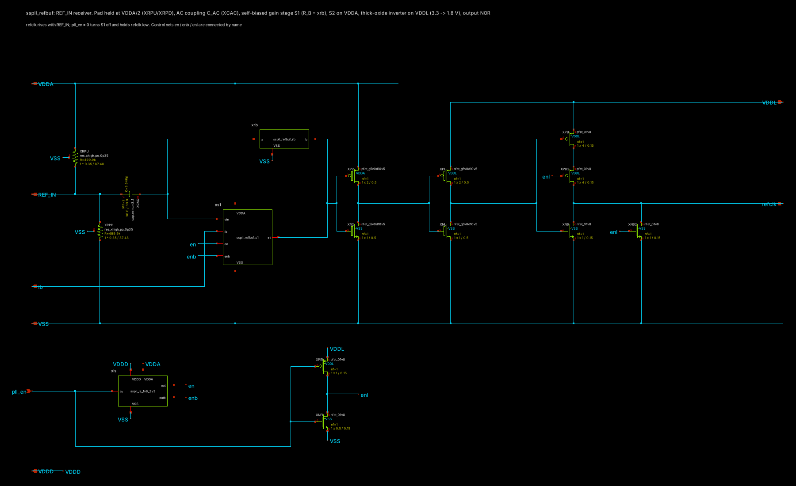
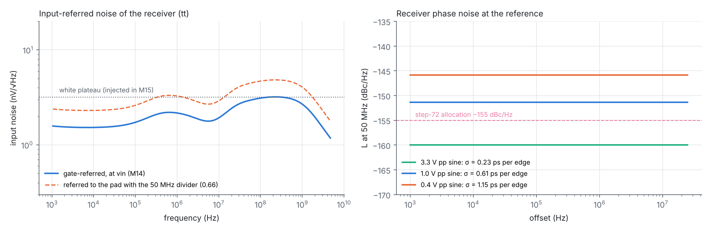
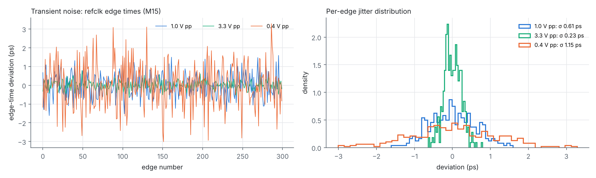
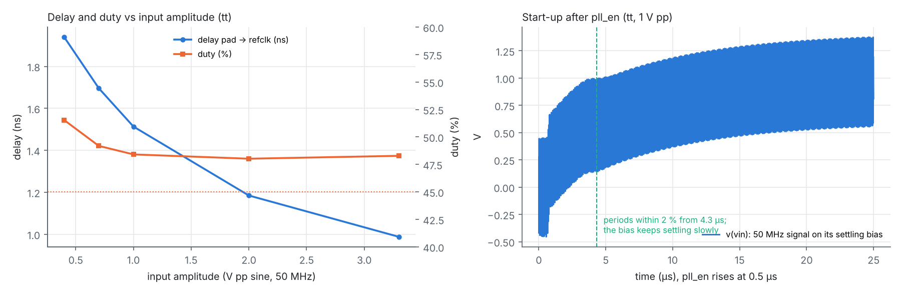
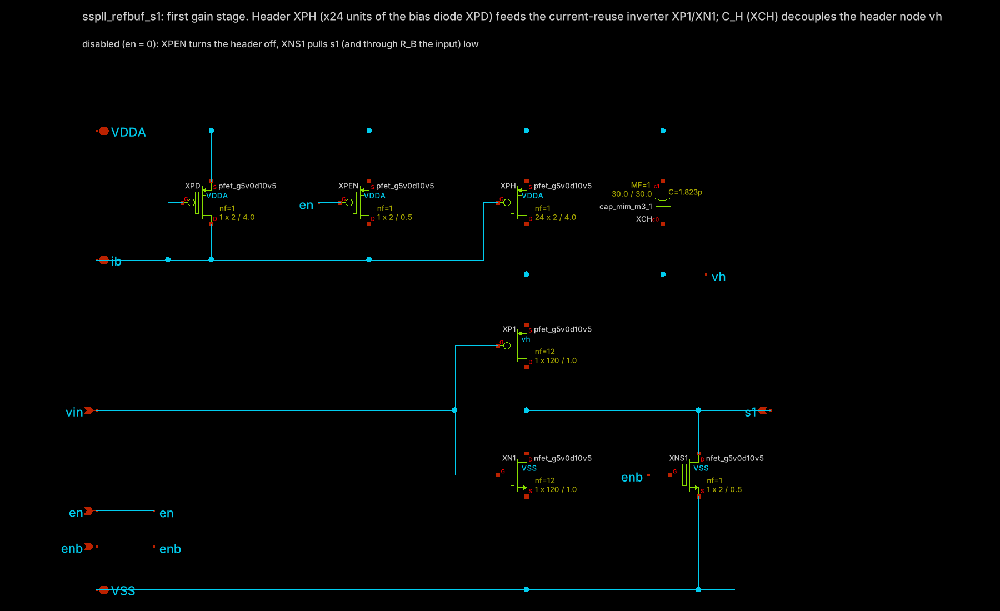
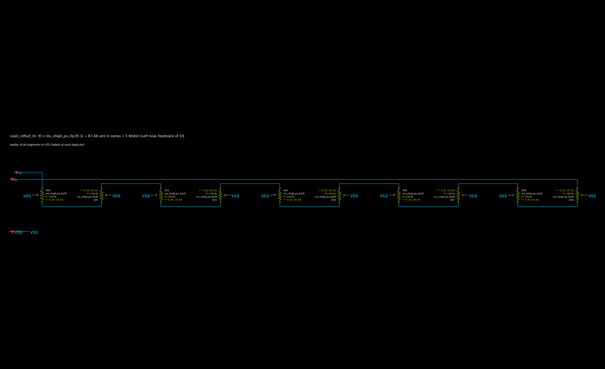

# Step 76: REF buffer — the REF_IN receiver (schematic)

**Roadmap step 76** · Phase 7 · deliverable: schematic (xschem, hierarchical, LVS-clean), sizing table, verification.
Design files: `design/refbuf/` · schematics: `xschem/refbuf/` · data: `design/refbuf/data/` · methods: M14–M16 in `docs/methods.md`.

## Result in one paragraph
The 45–55 MHz reference enters on REF_IN, is AC-coupled (3.6 pF MIM) into a self-biased first stage (5 MΩ feedback
resistor) and leaves as a 1.8 V CMOS edge, `refclk`. The first stage is a current-reuse inverter (XN1/XP1, 120 µm/1 µm
thick-oxide) fed by a 60 µA header current source whose node is decoupled by a 1.8 pF MIM, so both devices contribute
g_m in moderate inversion. **Per-edge jitter: 0.23 ps with a 3.3 V pp input (−159.9 dBc/Hz), 0.61 ps at 1 V pp
(−151.4), 1.15 ps at 0.4 V pp (−145.8).** With the ring (step 74), the CCO (step 75) and the loop, a full-swing reference
gives **1.95 / 1.26 ps and L(300 kHz) −111.0 / −120.7 dBc/Hz** (FFNC off / on): every typical target is met. With a
1 V pp sine the FFNC-on L(300 kHz) is −118.2 (1.8 dB over its typical target); every *guaranteed* limit is met down to
0.4 V pp. Power 0.25 mW typ, 0.39 mW worst. Delay 1.0–2.3 ns, duty 47–65 %, start-up ≈ 4 µs, refclk held low when
`pll_en` = 0.

## What happens, how, why

### What happens
The crystal oscillator's waveform (a 0.4 V pp sine up to a 0–3.3 V square) is turned into a sharp 1.8 V edge. The
moment of that edge is what the SSPD samples the VCO with, so any timing noise added here is reference noise: inside
the loop bandwidth it reaches the output multiplied by N = 32 (+30 dB).

### How it happens
A noise voltage at the crossing moves the edge in time by its value over the slope:
$$\sigma_t = \frac{\sigma_v}{s},\quad s_{gate} = \pi f_{ref} V_{pp}\,\left|\frac{v_{in}}{v_{pad}}\right|_{f_{ref}},\qquad
\mathcal{L}_{floor} = \frac{(2\pi f_{ref}\sigma_t)^2}{f_{ref}},\qquad \sigma_v^2 \approx S_w B_{eff}$$
$S_w$ is the stage's white gate-referred noise (3.2 nV/√Hz) and $B_{eff}$ ≈ 650 MHz its effective noise bandwidth (close
to S1's gain-bandwidth). Slow noise (flicker, $R_B$) shifts the threshold quasi-statically:
$\mathcal{L}(f) = (2\pi f_{ref})^2 S_{gate}(f)/(2 s_{gate}^2)$; here it stays below the white floor.

### Why it happens this way
Jitter is noise **per unit of input slope**. The steepest input is the cheapest fix (3.3 V pp is 10 dB better than 1 V pp).
On chip, lower noise needs more $g_m$, i.e. current; moderate inversion behind a current source and current reuse
(both devices adding $g_m$) give the most $g_m$ per µA. The AC coupling and self-bias put the crossing at the middle of
any input waveform, whatever its DC level.

> **Update 15 Nov 2026 (step-74 re-run, CCO NBASE 11):** with the corrected ring and CCO, a full-swing reference gives
> **1.97 / 1.26 ps and L(300 kHz) −110.8 / −120.7 dBc/Hz**; at 1 V pp 1.98 / 1.33 ps and −110.5 / −118.2. Power falls
> to 8.91 mW typ and 13.40 mW worst. The receiver itself is unchanged.

## A. Architecture decisions
| Decision | Options | Chosen | Why |
|---|---|---|---|
| Input coupling | DC (Schmitt trigger), AC + self-bias | **AC + self-bias** | any XO DC level; crossing at the waveform centre; proposal says so |
| First stage | plain self-biased inverter, header-limited inverter | **header-limited, 60 µA** | current fixed over PVT; moderate inversion → high g_m/I |
| Header node | open, decoupled by C_H | **C_H = 1.8 pF** | XP1 adds its g_m; header noise shunted: white noise −30 % |
| R_B | 20 MΩ (40 seg.), 10 MΩ, 5 MΩ | **5 MΩ (10 seg.)** | inside the bias loop the in-band R_B noise ∝ R_B: less noise, ¼ area, 4× faster start |
| 3.3 → 1.8 V | latch shifter, thick-oxide inverter on VDDL | **inverter** | a 3.3 V input switches a 1.8 V inverter fully; no latch needed |
| Disabled state | — | **header off, s1 low, NOR output low** | no static current, quiet refclk |
| Current | 40 / 60 / 120 µA | **60 µA** | 120 µA gains only √2 in jitter at 1 V pp and uses most of the worst-case power margin |

## B. Noise (methods M14, M15) and system impact (M9)

| Input (50 MHz sine) | σ per edge (M15) | L floor at 50 MHz | System FFNC off: jitter / L(300 kHz) | FFNC on: jitter / L(300 kHz) |
|---|---|---|---|---|
| 3.3 V pp | 0.23 ps | −159.9 dBc/Hz | 1.95 ps / −111.0 | **1.26 ps / −120.7** |
| 1.0 V pp | 0.61 ps | −151.4 dBc/Hz | 1.97 ps / −110.6 | 1.33 ps / −118.2 |
| 0.4 V pp | 1.15 ps | −145.8 dBc/Hz | 2.03 ps / −109.7 | 1.53 ps / −114.6 |
| spec (typ / max) | | | 2.3 / 4.7 ps; −110 / −102 | 1.4 / 3.2 ps; −120 / −110 |

The clock generator (step 77) is still a −160 dBc/Hz placeholder in these totals. Period jitter / √2 equals the
per-edge jitter in every run, so the jitter is white (no hidden correlation).

**Two pitfalls found on the way** (both in the design log): (1) dividing the integrated small-signal output noise by the
output slope gave 1.2 ps instead of 0.6 ps — the comparator's DC gain (≈ 190) is not the gain during a crossing (≈ 30);
(2) referring slow noise to the *pad* through the AC-coupling high-pass blows it up below the corner — slow noise must
be referred at the *gate* and divided by the gate slope at 50 MHz.

## C. Large-signal behaviour (method M16)

| Condition | Delay | Duty | Rise 10–90 % | Power |
|---|---|---|---|---|
| tt, 3.3 V, 1 V pp | 1.51 ns | 48.4 % | 295 ps | 0.254 mW |
| tt, 3.3 V, 3.3 V pp sine / square | 0.99 / 0.16 ns | 48.3 / 54.6 % | 295 ps | 0.240 / 0.233 mW |
| corners, 0.4–1 V pp, VDDA 2.97–3.63 V | 1.2–1.9 ns | 47.3–64.8 % | 228–414 ps | 0.21–0.39 mW |
| 45 / 55 MHz (tt, 1 V pp) | 1.63 / 1.42 ns | 48.2 / 48.6 % | 296 ps | 0.25 mW |

* Bias point over 5 corners × VDDA: input at 0.81–0.92 V, supply current 66–77 µA (static, no signal).
* Supply sensitivity of the edge time: VDDA −0.25 ps/mV (1 V pp) / −0.12 ps/mV (3.3 V pp), VDDL −0.15 ps/mV.
* Start-up: periods within 2 % 3.8 µs after `pll_en`; the bias keeps settling for ~30 µs. Disabled: 5.9 µA (pad divider
  + bias input), refclk = 0.
* Duty reaches 65 % only at VDDA 3.63 V with a 0.4 V pp input (S2's threshold follows VDDA while s1's edges are slow).
  ≥ 45 % is met everywhere, and the SSPD uses only the rising edge.

## D. Schematics (hierarchical, real wiring, LVS-clean)
`sspll_refbuf` (top) → `sspll_refbuf_s1` (first stage with its header and enable), `sspll_refbuf_rb` (5 MΩ, 10-segment
serpentine), and the step-75 level shifter `sspll_ls_1v8_3v3` for `pll_en`. All three match the simulated netlist
("Circuits match uniquely"). The drawing checker now also rejects a wire that passes through any pin — it had missed a
wire crossing a resistor's body pin that already had its own stub (caught by LVS first).

## E. Sizing table (all devices pass `tools/pdk_limits.py`)
| Device | Model | W per finger × nf × m | L | Role |
|---|---|---|---|---|
| XRPU / XRPD | res_xhigh_po_0p35 | 0.35 | 87.48 µm | pad divider, 500 kΩ each |
| XCAC | cap_mim_m3_1 | 30 × 30 µm × 2 | — | C_AC = 3.6 pF, bottom plate (c1) on the pad |
| xrb0…9 | res_xhigh_po_0p35 | 0.35 | 87.48 µm | R_B = 5 MΩ |
| XPD | pfet_g5v0d10v5 | 2 × 1 × 1 | 4 µm | bias diode (2.5 µA from the bias generator) |
| XPH | pfet_g5v0d10v5 | 2 × 1 × 24 | 4 µm | header, 60 µA |
| XCH | cap_mim_m3_1 | 30 × 30 µm | — | C_H = 1.8 pF |
| XP1 | pfet_g5v0d10v5 | 10 × 12 | 1 µm | S1 pMOS, own n-well, body = source |
| XN1 | nfet_g5v0d10v5 | 10 × 12 | 1 µm | S1 nMOS |
| XPEN / XNS1 | p/nfet_g5v0d10v5 | 2 × 1 | 0.5 µm | header off / s1 low when disabled |
| XP2 / XN2 | p/nfet_g5v0d10v5 | 2 / 1 | 0.5 µm | S2 on VDDA |
| XPL / XNL | p/nfet_g5v0d10v5 | 2 / 1 | 0.5 µm | 3.3 → 1.8 V inverter on VDDL |
| XPB, XPB2 / XNB, XNB2 | p/nfet_01v8 | 4 / 1 | 0.15 µm | output NOR(s3, not pll_en) |
| XPEI / XNEI | p/nfet_01v8 | 1 / 0.5 | 0.15 µm | local pll_en inverter (VDDL) |

## F. Effect on the system (margin tracker, `design/SSPLL_design_log.xlsx`)
* Typ jitter FFNC on 1.256 ps (post-layout estimate 1.39 vs 1.4 → TIGHT); L(300 kHz) FFNC on −120.7 (post-layout
  −119.7 → typ target likely missed by ~0.3 dB); FFNC off −111.0 (TIGHT).
* Power 9.20 mW typ, **13.74 mW worst** (post-layout 14.7 vs 15 → TIGHT, not at risk).
* Area: ≈ 0.004 mm² (3 MIM tiles placed over R_B and the S1 devices).

## G. Requirements handed on
1. **Proposal / test plan:** state the typical noise specs for a full-swing reference (3.3 V CMOS XO or ≥ 2 V pp sine);
   the guaranteed limits hold from 0.4 V pp.
2. **Bias generator (step 86):** one 2.5 µA current sink into `ib` (pulls 2.5 µA out of the XPD diode), off when disabled.
3. **Clock generator (step 77):** refclk rising edge is the active edge; 1.0–2.3 ns delay, 230–410 ps rise time; its own
   edge noise ≤ −160 dBc/Hz to keep the placeholder.
4. **Layout:** REF_IN short and shielded; vin (5 MΩ node) guarded, no digital lines nearby; XP1 in its own n-well;
   XN1/XP1 with dummies; C_H right at the header; C_AC bottom plate to the pad.
5. **Post-layout (step 118):** rerun M15 at 1 and 3.3 V pp with extracted parasitics on vin and s1.

## Interview questions (step 76)

**Q1. What does the reference buffer do in this PLL?**  
It turns whatever the crystal oscillator delivers on the REF_IN pad (a 0.4 V pp sine up to a 0–3.3 V square wave) into a clean 1.8 V CMOS edge, refclk, for the clock generator that fires the sub-sampling phase detector. Its own noise is added to the reference, so it is multiplied by N² = 1024 (+30 dB) inside the loop bandwidth.

**Q2. Why is reference-buffer noise so important in a sub-sampling PLL?**  
The SSPD removes the divider and makes PD/CP noise small, so inside the loop bandwidth the output phase noise is set by the reference path: XO + buffer, times N². In this design FFNC-on L(300 kHz) is reference-limited: a perfect buffer gives −121.3 dBc/Hz, a −155 dBc/Hz buffer −119.7 (with a −160 dBc/Hz clock-generator placeholder).

**Q3. How do you convert voltage noise at a threshold crossing into jitter?**  
σ_t = σ_v / slope at the crossing. For a sine of V_pp at f the slope at the zero crossing is π f V_pp: 1 V pp at 50 MHz gives 0.157 V/ns, so 63 µV rms of noise is 0.4 ps rms. A square wave with 0.5 ns edges has a 20× steeper slope, so the same noise gives 20× less jitter.

**Q4. How do you convert per-edge white jitter into a phase-noise floor?**  
Independent jitter σ on every edge at f_ref is sampled white noise: S_φ (single-sided) = 2(2π f_ref σ)²/f_ref, so L = (2π f_ref σ)²/f_ref. 0.4 ps at 50 MHz is −155 dBc/Hz; 0.61 ps is −151.4 dBc/Hz.

**Q5. Why AC coupling at the input?**  
The external oscillator may have any DC level (0–1.8 V CMOS, 0–3.3 V CMOS, a clipped sine around ground or an AC-coupled sine). The coupling capacitor removes the DC, and the receiver biases its own input at its switching point, so the crossing is always at the middle of the input waveform and the duty cycle stays near 50 %.

**Q6. How is the receiver input biased?**  
Through R_B = 5 MΩ from the output of the first stage to its input. At DC this is a short, so the inverter sits at its trip point: v_in = v_s1 ≈ 0.86 V. At 50 MHz R_B is an open circuit, so the full signal reaches the gate.

**Q7. What is the pad divider for?**  
Two 500 kΩ poly resistors hold the pad at VDDA/2 when the oscillator is AC-coupled externally or not connected, so the pad never floats. They load the oscillator with 250 kΩ, negligible next to C_AC's 0.9 kΩ at 50 MHz, and cost 3.3 µA.

**Q8. Why is the first stage a current-limited inverter and not a plain self-biased inverter?**  
A plain inverter at VDDA/2 runs both devices in strong inversion with a current that changes 4–6× over VDDA and process. The header current source fixes the current (60 µA) and lets the wide input devices run in moderate inversion, where g_m/I is high (~13 V⁻¹): more g_m — less noise — per µA.

**Q9. What is C_H for?**  
The header is a current source, so the pMOS input device's source sees a high impedance and is degenerated: it would add almost no g_m. C_H (1.8 pF MIM) ties that node to VDDA at high frequency, so XP1 adds its g_m (current reuse) and the header's own noise current is shunted into the capacitor instead of the output. It lowered the white input noise by about 30 %.

**Q10. Why is XP1's body tied to its source?**  
Its source sits about 0.9 V below VDDA. With the body at VDDA its threshold rose to 1.24 V (body effect), costing headroom at VDDA = 2.97 V. In its own n-well with body = source, V_th is about 1.0 V.

**Q11. Why thick-oxide devices in S1 and S2?**  
They connect to VDDA (3.3 V) and S1's gate connects to the pad through C_AC: with a 3.3 V pp input the gate swings from about −0.8 V to 2.5 V. Thin-oxide devices are rated for 1.8 V. The project rule: 3.3 V devices wherever a node touches VDDA or a pad.

**Q12. How is the signal brought from 3.3 V down to 1.8 V?**  
A thick-oxide inverter powered from VDDL (1.8 V): its gate tolerates the 0–3.3 V swing of S2, its output swings 0–1.8 V. A down-shift needs no latch (unlike the up-shift of step 75) because a 3.3 V input fully turns the 1.8 V inverter on and off.

**Q13. Why is the output a NOR gate?**  
NOR(s3, not pll_en): when enabled it is an inverter, when disabled it forces refclk low, so the clock generator and SSPD see a defined, quiet state. All controls default to 0.

**Q14. What happens when pll_en = 0?**  
XPEN pulls the header gate to VDDA (S1 current off), XNS1 pulls s1 low (and through R_B the input), so no device carries static current; the output NOR holds refclk at 0. Only the pad divider (3.3 µA) remains.

**Q15. Why is there a start-up time after pll_en?**  
When enabled, the input sits at 0 V and must charge to the trip point through R_B into C_AC + C_in before the crossing is centred; simulated, the periods are within 2 % about 4 µs after pll_en and the bias keeps settling for some 30 µs. The CCO filter needs about 0.3 ms, so the FLL (step 81) waits for that anyway.

**Q16. How did you choose R_B?**  
Its noise current flows into the input node. Inside the bias loop the low-frequency level at the gate is 4kT·R_B/(1 + A)², flat up to the corner (1 + A)/(2π R_B C), which lies above 300 kHz because A ≈ 190. So a smaller R_B gives LESS noise in the 10 kHz–1 MHz band: 20 MΩ gave 3.3 nV/√Hz at the gate, 5 MΩ 1.7 nV/√Hz. 5 MΩ is also four times smaller (10 segments) and starts up faster. The lower limit: the input high-pass corner, about 1.5 MHz, must stay far below 45 MHz.

**Q17. How was the noise verified?**  
Two methods. M14: .noise at the self-bias point (which is the crossing point of S1) gives the input-referred spectrum, including flicker and R_B; its low-frequency part converts to phase noise through the input slope. M15: a transient with the white part of that spectrum injected at the pad (trnoise) gives the per-edge jitter directly from 300 edge times, including the stage's non-linear switching.

**Q18. Why not just divide the integrated .noise output by the output slope?**  
S1 is a high-gain comparator: its small-signal low-frequency gain (≈ 190) is much larger than the gain that applies to the fast-moving input during a crossing (≈ 30), so output-referred noise over output slope overestimated the jitter 2×. The transient-noise run measures what really happens; the small-signal analysis is used only for the slow (quasi-static) noise, where it is exact.

**Q19. What is the effective noise bandwidth of the receiver and why does it matter?**  
σ_v = σ_t × slope; with the white input noise S_w this defines B_eff = σ_v²/S_w ≈ 650 MHz, close to S1's gain-bandwidth. The per-edge jitter is √(S_w·B_eff)/slope: lower noise density (more g_m) or less bandwidth reduce it, at the price of power or delay.

**Q20. What does the receiver achieve?**  
Per-edge jitter 0.23 ps with a 3.3 V pp input (−159.9 dBc/Hz), 0.61 ps at 1 V pp (−151.4), 1.15 ps at 0.4 V pp (−145.8). With the ring, CCO and loop: 1.95 / 1.26 ps and L(300 kHz) −111.0 / −120.7 dBc/Hz at 3.3 V pp; at 1 V pp 1.97 / 1.33 ps and −110.6 / −118.2.

**Q21. Does the design meet the specification?**  
All guaranteed (max) limits are met over the whole 0.4–3.3 V pp input range. The typical targets need a full-swing input (≥ about 2 V pp, e.g. a 3.3 V CMOS crystal oscillator): with a 1 V pp sine the FFNC-on L(300 kHz) is 1.8 dB above its typical target. So the typical specification is stated for a full-swing reference.

**Q22. Why not simply burn more current to fix the 1 V pp case?**  
Doubling S1's current (+0.2 mW) lowers the white jitter only by √2: L(300 kHz) FFNC-on would still be about −119.5 dBc/Hz at 1 V pp, while the worst-case power margin (0.4 mW) would be almost used up. A full-swing XO costs nothing on chip.

**Q23. How sensitive is the edge time to supply noise?**  
Measured by stepping VDDA and VDDL by 10 mV and comparing the delays (finite difference). Supply ripple at the reference rate moves every edge the same way and appears as a spur; random supply noise inside the loop bandwidth is multiplied by N² like any reference noise.

**Q24. What sets the duty cycle and does it matter?**  
The input is centred by the self-bias, and later stages switch near mid-supply, so the duty stays 47–53 % at typical supplies; at VDDA = 3.63 V with the smallest (0.4 V pp) input it rises to about 65 % because S2's threshold moves with VDDA while s1's edges are slow. The SSPD only uses the rising edge (the clock generator makes its own pulses from it), but the proposal guarantees ≥ 45 %.

**Q25. Which layout precautions does this block need?**  
REF_IN routed short and shielded from the pad, the high-impedance vin node (5 MΩ) guarded and away from digital lines, C_AC with its bottom plate on the pad side (bottom-plate parasitic driven by the low-impedance source), XN1 and XP1 with dummies, XP1 in its own n-well, C_H next to the header, R_B as a serpentine over a quiet area.

**Q26. Why the bottom plate of C_AC on the pad side?**  
The MIM bottom plate has a larger parasitic capacitance to the substrate. On the pad side it is driven by the 50 Ω source and does not matter; on vin it would attenuate the signal and couple substrate noise into a 20 MΩ node.

**Q27. What ESD considerations apply?**  
The pad cell provides primary ESD protection. Behind it the only connections are poly resistors and the MIM capacitor's bottom plate — no gate is connected directly to the pad. The MIM dielectric must withstand the pad's ESD voltage; this is checked with the pad cell in the top-level ESD review.
