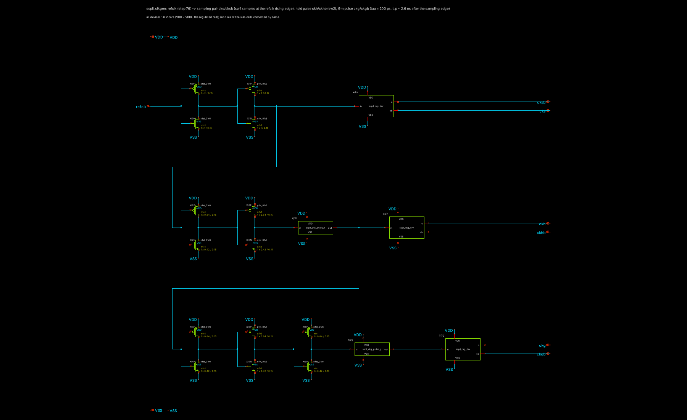
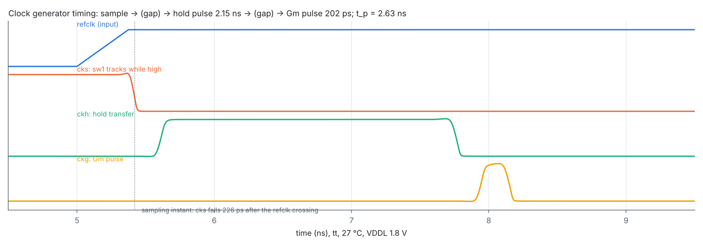
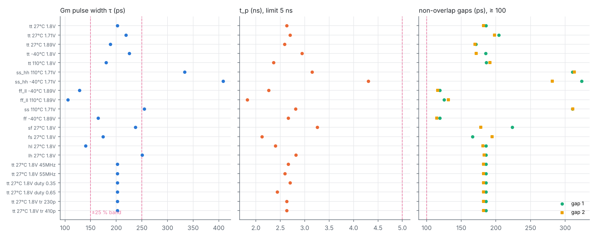
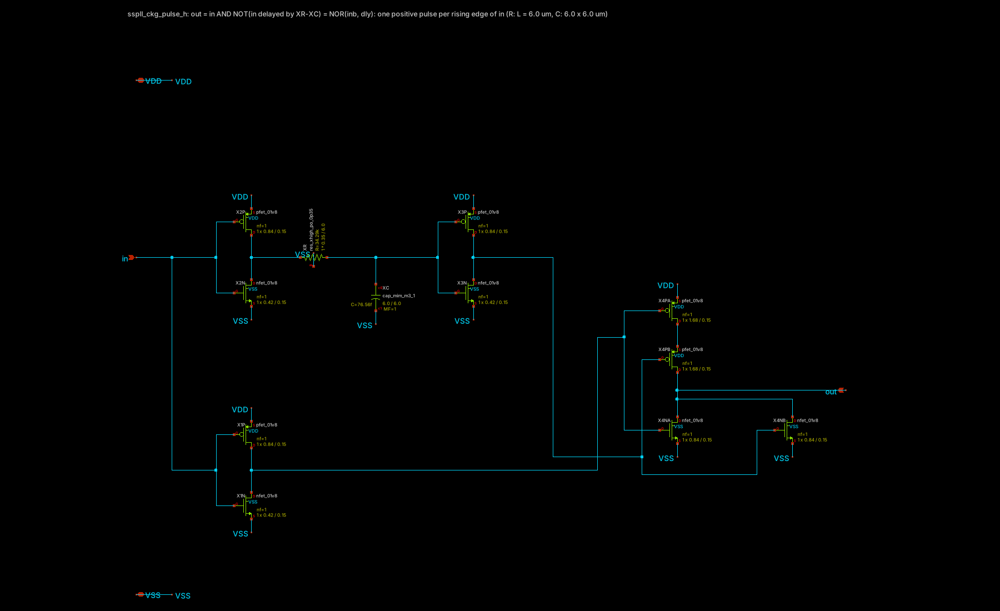
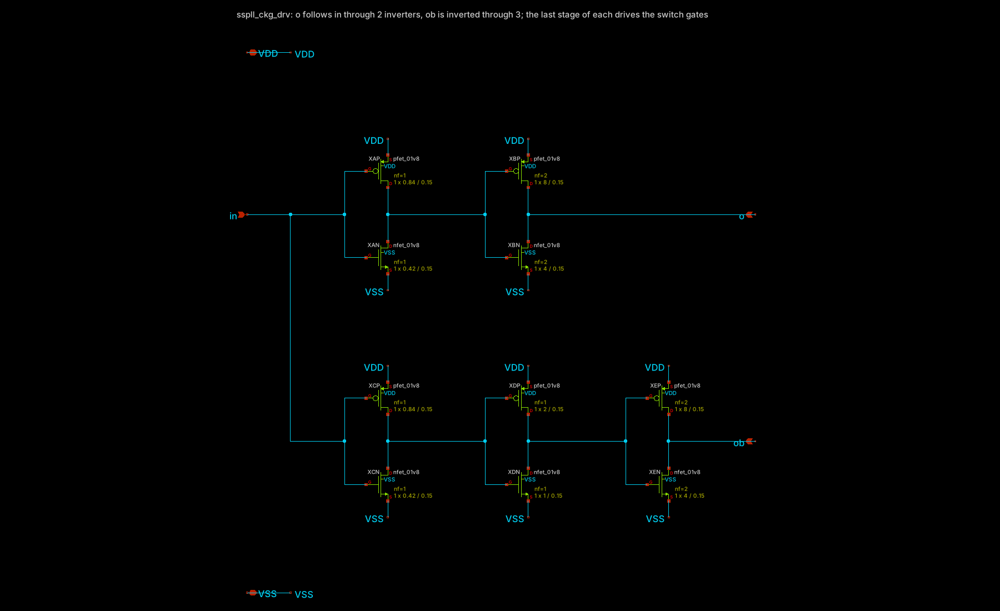

# Step 77: clock generator — sampling clocks, hold pulse, Gm pulse (schematic)

**Roadmap step 77** · Phase 7 · deliverable: schematic (xschem, hierarchical, LVS-clean), sizing table, verification.
Design files: `design/clkgen/` · schematics: `xschem/clkgen/` · decks: `tb/clkgen/` · data: `design/clkgen/data/` ·
methods: M16, M17 in `docs/methods.md`.

## Result in one paragraph
From the reference edge `refclk` (step 76) the clock generator makes three complementary pairs on VDDL = 1.8 V:
**cks/cksb** for the sampling switch (it tracks the VCO and opens 226 ps after the refclk rising edge), **ckh/ckhb** for
the hold-transfer switch (a 2.15 ns pulse) and **ckg/ckgb** for the pulsed-Gm charge pump (a **202 ps** pulse). The
non-overlap gaps are 186 / 182 ps (≥ 115 ps at every corner). The loop delay from the sampling instant to the middle of
the Gm pulse is **t_p = 2.63 ns** (1.82–4.30 ns over 21 conditions; requirement ≤ 5 ns). The sampling edge adds
**0.15 ps** of jitter (−163.4 dBc/Hz at 50 MHz, allocation −160). Power **78 µW** typ (69–108 µW). The Gm pulse width
alone spreads 106–408 ps over PVT, but it tracks the VCO gain: **τ·K_VCO stays within ×0.86–1.21** of nominal. The
final β·K_VCO check moves to step 79 (g_m, A). With this block the system gives **1.963 / 1.254 ps and L(300 kHz)
−110.9 / −121.0 dBc/Hz** (FFNC off / on, 3.3 V pp reference).

## What happens, how, why

### What happens
Every reference period the SSPD does three things in a fixed order: **sample** the VCO on C1 (sw1 opens), **transfer**
the sample to C2 (sw2 closes for W_H), then **convert** it into a charge with a short Gm current pulse of width τ.
The clock generator turns one edge into these three phases and guarantees they never overlap.

### How it happens
- **Sampling pair.** refclk → two inverters (buffer) → a complementary driver: cks falls (sw1 opens) one buffer +
  three stages after refclk rises; cksb is its complement, made by a two-stage path (skew ≈ 12 ps).
- **Hold pulse.** The buffered edge goes through two more inverters (gap 1) into the **RC pulser** `sspll_ckg_pulse_h`:
  $$\text{out} = \overline{\overline{\text{in}} + \overline{\text{in}_{RC}}} = \text{in}\cdot\text{in}_{RC},\qquad
  \tau \approx \ln 2\,R\,C + t_{gates}$$
  The input switches at once; its R-C delayed copy reaches the trip point (≈ V_DD/2) after ln2·RC. The NOR is high only
  between the two, so each rising edge makes one pulse. R_H = 34.9 kΩ (xhigh_po, 0.35 × 6 µm), C_H = 76 fF (MIM 6 × 6 µm):
  ln2·RC = 1.84 ns + 0.31 ns of gates = 2.15 ns.
- **Gm pulse.** The end of the hold pulse (three inverters = gap 2, inverting so the falling edge of ph triggers) fires
  `sspll_ckg_pulse_g`: R_G = 3.48 kΩ (minimum length 0.5 µm), C_G = 27 fF (3.5 × 3.5 µm): ln2·RC = 65 ps + ≈ 137 ps
  of gates = 202 ps.
- **Loop delay.**
  $$t_p = t_{gap1} + W_H + t_{gap2} + \frac{\tau}{2},\qquad \beta = 2A\,g_m\frac{\tau}{T}$$
  (measured from the cks edge). 186 + 2151 + 182 + 101 ps ≈ 2.62 ns, the deck gives 2.63 ns.
- **Jitter.** Only the sampling edge matters (the later edges act on a sample that is already taken):
  $$\mathcal{L}_{floor} = \frac{(2\pi f_{ref}\,\sigma_t)^2}{f_{ref}},\qquad NA = \sqrt{\frac{S_i}{2\,NT}}$$
  The second formula is the size of the trnoise current source that reproduces a white noise density S_i in a
  transient with time step NT (method M17).

### Why it happens this way
- The sample must be taken **at the reference edge**, so the sampling path is the shortest one (5 stages) and has the
  biggest drivers: it is the only path whose noise and slope reach the output phase.
- **Non-overlap gaps** are made by plain inverter delays, which scale with the same corners as the rest; a gap of
  2–3 gate delays can never close.
- **τ is gate-dominated on purpose.** An RC with a poly resistor drifts with its own TC (xhigh_po −19 % over
  −40…110 °C) and R/C corners. Gate delay grows when transistors are slow, exactly when the ring VCO's gain drops, so
  the loop gain β·K_VCO is naturally compensated.
- **Disabled state comes free:** with pll_en = 0 refclk is held at 0, so cks = 1 (track) and no hold or Gm pulses
  are produced.

## A. Architecture decisions
| Decision | Options | Chosen | Why |
|---|---|---|---|
| Pulse generator | RC pulser, inverter-chain pulser, DLL-locked delay | **RC pulser + NOR** | small, few devices, W_H needs ns (an inverter chain would be 20+ stages) |
| R type | xhigh_po, high_po (TC +7.6 %), MOS-R | **xhigh_po 0.35 µm** | smallest area for 35 kΩ; TC tolerated (W_H has margin) |
| τ set by | RC, gates | **gates (R at minimum length)** | τ tracks K_VCO; RC TC would have added ±10 % |
| Trigger of Gm pulse | refclk delayed, end of hold pulse | **end of hold pulse** | gap 2 can never collapse, whatever W_H does |
| Drivers | single inverter, 2/3-stage complementary | **2/3-stage driver, 4/8 µm output** | sharp 70–80 ps edges into 20–30 fF |
| Enable | own pin, via refclk | **via refclk** | refclk = 0 when disabled → track, no pulses |

## B. Timing over 21 conditions (method M16)

| Condition | t_s (ps) | gap1 | W_H (ns) | gap2 | τ (ps) | t_p (ns) | P (µW) |
|---|---|---|---|---|---|---|---|
| tt 27 °C 1.8 V | 226 | 186 | 2.15 | 182 | 202 | 2.63 | 78 |
| tt 27 °C 1.71 / 1.89 V | 250 / 208 | 204 / 171 | 2.17 / 2.14 | 198 / 170 | 219 / 189 | 2.70 / 2.59 | 69 / 88 |
| tt −40 / 110 °C | 222 / 235 | 185 / 186 | 2.46 / 1.88 | 172 / 191 | 226 / 180 | 2.94 / 2.36 | 75 / 85 |
| ss_hh 110 °C 1.71 V | 344 | 310 | 2.33 | 313 | 333 | 3.15 | 75 |
| **ss_hh −40 °C 1.71 V** | 377 | 324 | 3.50 | 281 | **408** | **4.30** | 69 |
| ff_ll −40 °C 1.89 V | 142 | 119 | 1.95 | 116 | 128 | 2.26 | 85 |
| **ff_ll 110 °C 1.89 V** | 171 | 125 | **1.51** | 131 | **106** | 1.82 | **108** |
| ss 110 °C 1.71 V | 344 | 310 | 2.03 | 311 | 255 | 2.81 | 72 |
| ff −40 °C 1.89 V | 142 | 119 | 2.34 | **115** | 164 | 2.66 | 89 |
| sf / fs 27 °C | 231 / 243 | 224 / 166 | 2.74 / 1.65 | 178 / 194 | 238 / 174 | 3.26 / 2.12 | 79 / 80 |
| hl / lh 27 °C | 226 / 226 | 186 / 186 | 1.95 / 2.32 | 181 / 183 | 140 / 251 | 2.40 / 2.82 | 75 / 82 |
| f_ref 45 / 55 MHz | 226 | 186 | 2.18 / 2.11 | 182 | 202 | 2.66 / 2.60 | 71 / 86 |
| duty 35 / 65 % | 226 | 186 | 2.22 / 1.95 | 182 | 202 | 2.70 / 2.44 | 78 |
| refclk rise 230 / 410 ps | 220 / 235 | 186 | 2.15 | 182 | 202 | 2.63 | 78 |

**Requirements:** t_p ≤ 5 ns ✔ (max 4.30), gaps ≥ 100 ps ✔ (min 115), W_H ≥ 1.5 ns ✔ (min 1.51, the tightest item),
power inside the 0.12 mA SSPD + clock-generator allocation ✔.

### τ and the loop gain
τ alone spreads 106–408 ps (−48 % / +102 %), far outside ±25 %. The loop only sees β·K_VCO, and K_VCO (step 74)
moves the other way:

| Condition | τ / τ_nom | K_VCO / K_nom | product |
|---|---|---|---|
| ss 110 °C | 255/202 = 1.26 | 0.684 | **0.86** |
| ss_hh 110 °C | 333/202 = 1.65 | 0.684 | 1.13 |
| ff −40 °C | 164/202 = 0.81 | 1.485 | **1.21** |
| ff_ll −40 °C | 128/202 = 0.63 | 1.485 | 0.94 |

So the product stays within ×0.86–1.21. Step 79 completes the check with g_m (which also tracks the corners) and the
sample amplitude A.

### Duty-cycle dependence of W_H
The hold pulser's RC node is reset during the low half of refclk. At 65 % duty (3 ns less reset time) it starts
partly charged and the pulse is 1.95 ns instead of 2.15 ns; at 35 % it is 2.22 ns. Still above 1.5 ns. A reset nMOS
on the RC node would remove the effect if a later step needs more margin.

## C. Jitter of the sampling edge (method M17)
- `.noise` at the trip point gives the white output noise current of each inverter size:
  INVS 2.43, INVM 3.57, INVL 7.20 pA/√Hz.
- Transient with these currents at all 7 nodes of the sampling path (NT = 1 ps), 123 edges of a 500 MHz noiseless
  input, 4th-order detrend: **σ = 0.152 ps** (raw 1.15 ps is numerical drift: the same run with noise × 10⁻⁶ gives
  1.2 ps raw and 0.0002 ps after detrend). The stand-alone deck gives 0.18 ps with 122 edges (same within ±7 %).
- Floor: (2π · 50 MHz · 0.152 ps)² / 50 MHz = **−163.4 dBc/Hz** (allocation −160 → 3.4 dB margin).
- In the system budget (`design/refbuf/ref_budget.py`, CLKGEN = −163.4 dBc/Hz) the PLL gives **1.963 / 1.254 ps,
  L(300 kHz) −110.9 / −121.0 dBc/Hz** (FFNC off / on) with a 3.3 V pp reference; 1.983 / 1.327 ps and −110.5 / −118.4
  at 1 V pp; 2.042 / 1.525 ps and −109.6 / −114.7 at 0.4 V pp.

## D. Schematics (hierarchical, real wiring, LVS-clean)
`sspll_clkgen` (top: input buffer, gap inverters, three drivers, two pulsers) → `sspll_ckg_pulse_h`,
`sspll_ckg_pulse_g` (same drawing, different R and C) and `sspll_ckg_drv`. All four cells match the simulated netlist
(`netgen`: "Circuits match uniquely"); the drawing checker reports no crossings, overlaps or wires through pins.

## E. Sizing table (all devices pass `tools/pdk_limits.py`)
| Device | Model | W per finger × nf | L | Role |
|---|---|---|---|---|
| INVS (n / p) | nfet_01v8 / pfet_01v8 | 0.42 / 0.84 × 1 | 0.15 µm | gap and pulser inverters, driver input |
| INVM (n / p) | nfet_01v8 / pfet_01v8 | 1 / 2 × 1 | 0.15 µm | refclk buffer, driver middle stage |
| INVL (n / p) | nfet_01v8 / pfet_01v8 | 2 / 4 × 2 | 0.15 µm | driver outputs (4 / 8 µm) |
| NOR2 (n / p) | nfet_01v8 / pfet_01v8 | 0.84 / 1.68 × 1 | 0.15 µm | pulser gate (series pMOS 2× wider) |
| R_H | res_xhigh_po_0p35 | 0.35 | 6.0 µm | 34.9 kΩ, hold pulse |
| C_H | cap_mim_m3_1 | 6 × 6 µm | — | 76 fF, hold pulse |
| R_G | res_xhigh_po_0p35 | 0.35 | 0.5 µm (min) | 3.48 kΩ, Gm pulse |
| C_G | cap_mim_m3_1 | 3.5 × 3.5 µm | — | 27 fF, Gm pulse |

61 transistors, 2 resistors, 2 MIM capacitors. Estimated area ≈ 30 × 25 µm (MIMs placed over the logic).

## F. Effect on the system (margin tracker, `design/SSPLL_design_log.xlsx`)
* Clock-generator floor −163.4 instead of the −160 placeholder: FFNC-on jitter 1.254 ps (was 1.26), L(300 kHz)
  −121.0 (was −120.7). FFNC off 1.963 ps, −110.9 dBc/Hz.
* Power 78 µW typ, 108 µW worst: inside the allocation already counted (system 8.91 mW typ, 13.40 mW worst unchanged).

## G. Requirements handed on
1. **Sampling switch (step 78):** gate load ≤ 30 fF on cks / cksb; it opens on the cks falling edge.
2. **Hold switch and Gm cell (step 79):** ≤ 20 fF on ckh/ckhb/ckg/ckgb; the Gm switch must pass pulses down to
   106 ps; check β·K_VCO over corners with g_m and A (target product within ±25 %).
3. **Layout:** the sampling path (xi0, xi1, xds) short, symmetric and shielded from the VCO; MIMs over the logic;
   R_G placed right at the pulser so its wiring adds little C.
4. **Post-layout (step 118):** rerun the timing deck over the combined corners and M17 with extracted parasitics.

## Testbenches
`tb/clkgen/tb_clkgen_tran.spice` (timing, power) and `tb/clkgen/tb_clkgen_jitter.spice` (M17) — set-up and how they
work: `docs/testbench_guide.md`, section "Step 77".

## Interview questions (step 77)

**Q1. What does the clock generator do in this sub-sampling PLL?**  
From one reference edge (refclk) it makes three complementary control pairs, in a fixed order: cks/cksb for the sampling switch (it tracks the VCO and opens at the reference edge), ckh/ckhb for the hold switch that copies the sample from C1 to C2, and ckg/ckgb for the short current pulse of the pulsed-Gm charge pump. It is the timing skeleton of the SSPD + charge pump.

**Q2. Why does the sampling happen on the falling edge of cks and not on a rising edge?**  
While cks = 1 the switch conducts and the sampling capacitor follows the VCO (track). The sample is the voltage at the moment the switch opens, i.e. when cks falls. The reference's rising edge is the timing reference, so cks must fall in response to refclk rising: the driver gives cks from the inverted path.

**Q3. Why are there gaps between the three phases?**  
Two switches must never conduct at the same time. If sw2 (hold) closed while sw1 still tracked the VCO, C2 would see the VCO directly and the sample would be corrupted; if the Gm current flowed while sw2 was still transferring, the current would depend on an unsettled voltage. Gap 1 (cks fall → ckh rise) and gap 2 (ckh fall → ckg rise) are non-overlap times; here 186 / 182 ps typical, at least 115 ps over all corners (requirement ≥ 100 ps).

**Q4. How does an RC pulser make a pulse from an edge?**  
The input and a delayed, inverted copy of it go into a gate (here a NOR of the inverted input and the inverted delayed input, which is input AND NOT delayed). After a rising edge both conditions are true until the delayed copy has also switched, so the output is high for one delay: the pulse width is the delay of the R-C stage plus the gates. A falling edge produces no pulse.

**Q5. What sets the width of the RC pulse?**  
The RC node charges exponentially and the next inverter switches when it crosses its trip point (about half the supply), so the RC part is ≈ ln2 · R·C. To it add the delays of the inverters and the NOR. For the hold pulse RC dominates (R_H ≈ 34 kΩ, C_H ≈ 75 fF → ≈ 1.8 ns of the 2.15 ns); for the 200 ps Gm pulse the gates dominate (minimum-length resistor).

**Q6. Why does the Gm pulse width τ matter so much?**  
The charge pump delivers a charge g_m · v_sample · τ per reference period, so the phase-detector gain is β = 2A·g_m·τ/T. The loop bandwidth and phase margin depend on β·K_VCO. A τ that varies ±50 % over PVT moves the bandwidth by ±50 % unless something else compensates.

**Q7. τ varies from 106 to 408 ps over corners. Why is that acceptable?**  
Because the loop needs β·K_VCO, not τ alone. τ is long when transistors are slow (ss, cold, high R) and the VCO gain is then small; τ is short in ff where K_VCO is large. The product τ·K_VCO stays within ×0.86–1.21 of nominal in the worst conditions found. The final check of β·K_VCO with g_m and A is done in step 79.

**Q8. Why not use a high-precision resistor for τ?**  
A poly resistor's temperature coefficient (xhigh_po −19 % over −40…110 °C) and its process corner (±20 % or more) add to the gate-delay variation. Making R small and letting the gates set most of τ lets the τ variation track the ring VCO's transistors, which is the compensation we want. Absolute accuracy would need a trimmed or locked delay (a DLL), which costs power and area for no system benefit here.

**Q9. What are the SKY130 'combined' corners and why did you use them here?**  
The PDK has MOS corners (tt, ss, ff, sf, fs) and resistor/capacitor corners. The combined library sections such as ss_hh (slow MOS, high R, high C) and ff_ll move both together, and hl / lh move R and C the opposite way. A circuit whose timing is R·C plus gate delay has its extremes there, not at plain ss/ff: τ's worst cases came from ss_hh (408 ps) and ff_ll (106 ps).

**Q10. What is t_p and why must it be ≤ 5 ns?**  
t_p is the delay from the sampling instant to the centre of the Gm current pulse: the loop's transport delay. In the loop gain it appears as e^{−s·t_p}, i.e. a phase lag ω_c·t_p at the crossover. Step 73 allowed up to 5 ns for ≤ 1° of phase-margin loss at the chosen bandwidth. Here t_p = 2.63 ns typical and 4.30 ns worst.

**Q11. Why must W_H be at least 1.5 ns?**  
During the hold pulse the charge on C1 is shared with C2 through sw2. The transfer must settle (several R_on·C time constants) before the Gm pulse uses the voltage on C2, and some time is reserved for the switch's own charge injection to die away. 1.5 ns is the step-73 requirement; the minimum over corners is 1.51 ns (ff_ll, 110 °C).

**Q12. Why does the hold pulse width depend on the reference duty cycle?**  
The RC node of the hold pulser is reset during the low part of the input. With a short low time (duty 65 %) the node is not fully discharged at the next edge, so it reaches the trip point earlier and the pulse shrinks (1.95 ns at 65 % vs 2.22 ns at 35 %). It stays above 1.5 ns; a faster reset path (a reset nMOS) would remove the dependence if needed.

**Q13. How is the clock generator disabled when the PLL is off?**  
It has no enable pin. When pll_en = 0 the reference buffer holds refclk at 0: cks stays 1 (the sampling switch tracks), and no hold or Gm pulses are produced, so the charge pump injects no charge and the circuit draws only leakage.

**Q14. How much power does it use and why so little?**  
78 µW typical (69–108 µW over corners). It is CMOS logic switching once per reference period: P ≈ C_total·V²·f with tens of fF per node at 50 MHz. It fits inside the 0.12 mA allocation for the SSPD and clock generator.

**Q15. Why does the jitter of the clock generator matter?**  
The sampling edge is the PLL's time reference. Any random delay added between refclk and the moment the switch opens is reference jitter and is multiplied by N = 32 (+30 dB) inside the loop bandwidth, exactly like the crystal's own noise. The Gm and hold edges do not matter for noise: they act after the sample has been taken.

**Q16. How did you estimate the jitter of an inverter chain in ngspice?**  
Method M17: .noise on each inverter size biased at its trip point gives the noise current it makes while switching (2.4–7.2 pA/√Hz). In a transient, every node of the sampling path gets a white trnoise current of that size, with NA = √(S/(2NT)). 123 edges of a noiseless 500 MHz input give the spread of the output edge times: 0.15 ps rms.

**Q17. Why inject at the trip-point noise level?**  
A CMOS inverter is quiet when it rests at a rail (one device off, the other in deep triode with no gain). It contributes to timing only while it passes through the threshold, where both devices conduct with maximum g_m and the node is high-impedance. Using the trip-point density during the whole run is pessimistic, which is fine for a budget check.

**Q18. Your first jitter result was 1.17 ps. What was wrong?**  
Two things. Some output edges were paired with the wrong input edge, and the simulator's time grid made the edge times drift slowly by about 1.2 ps over the run. A run with all noise scaled by 10⁻⁶ showed the same 1.2 ps, so it was numerical. Pairing each output edge within 0.6 ns of its input edge and removing a 4th-order trend gave 0.15 ps, with a noiseless baseline of 0.0002 ps.

**Q19. How do you turn 0.15 ps of per-edge jitter into phase noise?**  
Independent jitter on each 50 MHz edge is a white phase-noise floor L = (2π·f_ref·σ)²/f_ref = (2π·5×10⁷·1.5×10⁻¹³)² / 5×10⁷ = 4.4×10⁻¹⁷ → −163.4 dBc/Hz. The step-72 allocation was −160 dBc/Hz, so there is 3.4 dB of margin.

**Q20. Why are the output drivers bigger than the rest of the logic?**  
They drive the switch gates (30 / 20 fF) with sharp edges. A slow edge on the sampling switch makes the sampling instant depend on the signal level (the switch turns off when V_GS crosses V_T, which depends on the sampled voltage) and makes the edge more sensitive to noise. 4 / 8 µm output stages give 76 ps rise times.

**Q21. Why are cks and cksb generated by paths of 2 and 3 inverters, and is the skew a problem?**  
One output needs the inverted signal, so its path has one more stage. The extra stage gives about 12 ps skew. For a complementary transmission gate, a small skew only changes which device turns off last; the sampling instant is set by the last one to turn off, and it is the same every period, so it adds no jitter and only a fixed delay.

**Q22. Which requirements does step 77 hand on to later steps?**  
Loads ≤ 30 fF on cks/cksb and ≤ 20 fF on the others (switch sizes in steps 78/79); the Gm switch must handle pulses as short as 106 ps; β·K_VCO must be checked over corners with the real g_m and A (step 79); the layout must keep the sampling path short and symmetric (parasitic delay adds to t_p and to jitter).

**Q23. How would you check this block in Cadence?**  
Same testbench: an ideal 50 MHz pulse on refclk, capacitive loads, tran with the Calculator's cross() and delay() for the edges, Corners setup with the combined MOS+R/C sections. Jitter by Spectre transient noise (noisefmax ≈ 500 GHz) or, better, pss + pnoise with sampled (jitter) output at the cks crossing.

**Q24. What would you change if τ had to be accurate to ±10 %?**  
Replace the RC pulser by a delay that is locked to the reference: e.g. a current-starved delay biased from a replica delay line in a DLL, or trim the R with a few switched segments after measurement. Both cost area and power; with this loop the natural τ·K_VCO compensation makes them unnecessary.

**Q25. Why are all the devices thin-oxide 1.8 V transistors at minimum length?**  
The block runs from VDDL = 1.8 V and has to be fast: minimum L gives the smallest gate capacitance and delay, and the power is dominated by switching, not leakage. Matching is not important here because the absolute delays are re-referenced every period and only their noise matters.
