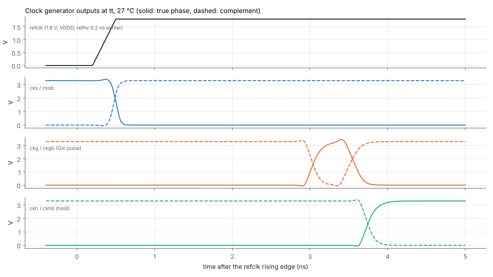
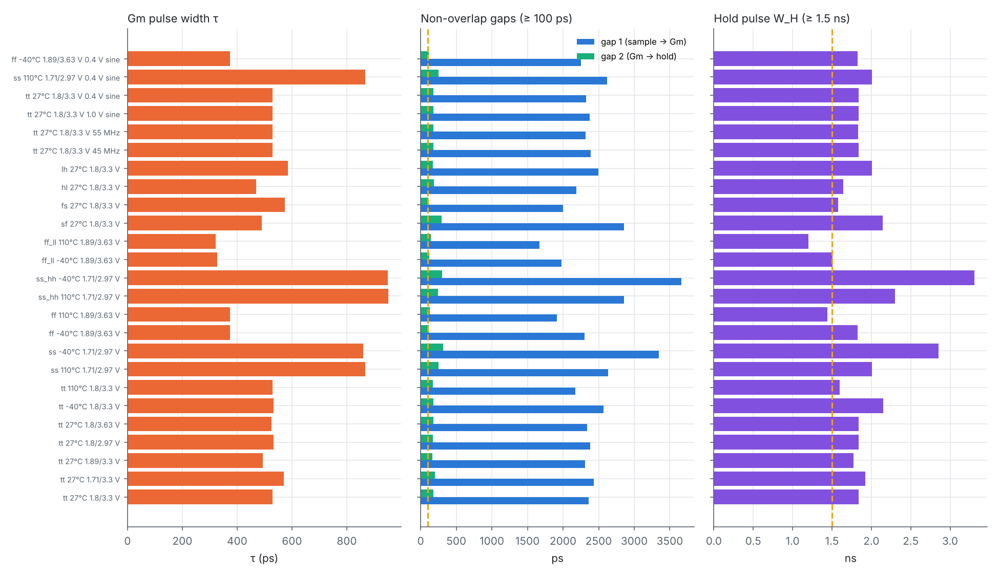
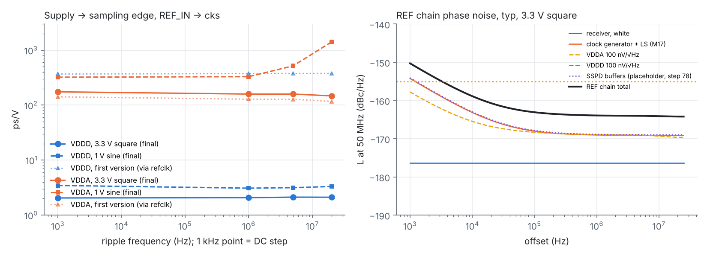
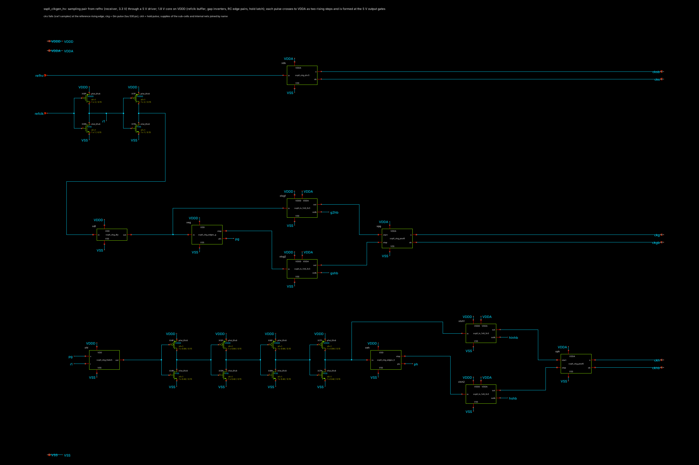
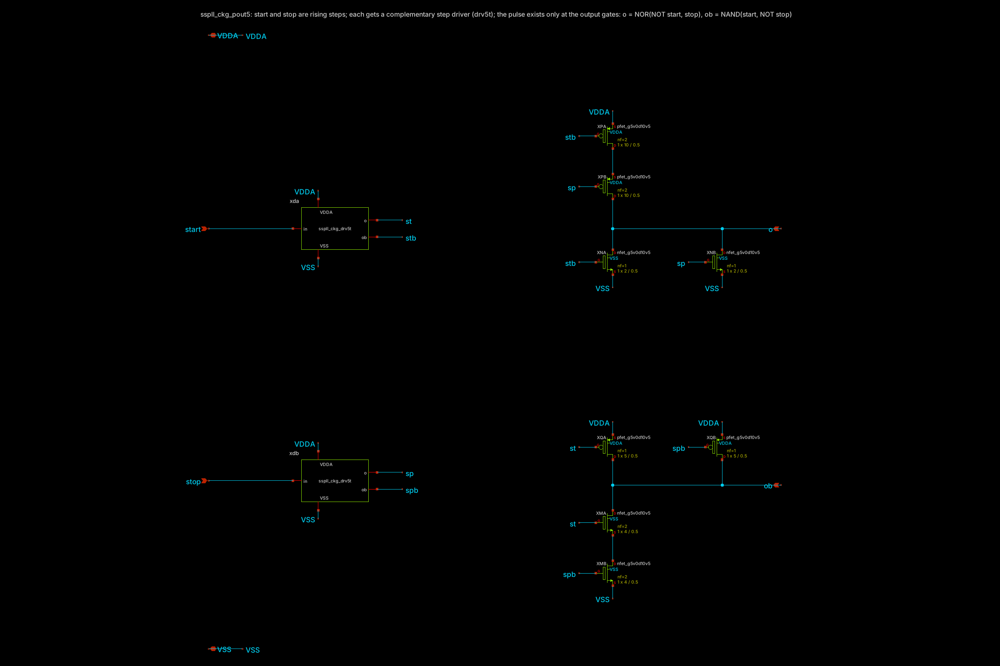
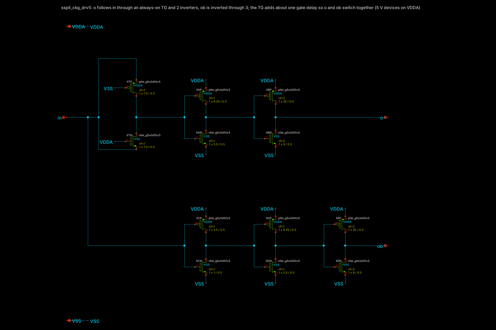

# Step 77 (redo): clock generator with 3.3 V outputs for the 5 V SSPD and Gm

*Phase 7, roadmap step 77, redone for the device-rule migration (19 Nov 2026).*

**Basis**
- The 13/17 Nov clock generator (archived note, `design/clkgen/clkgen.py`): 1.8 V logic on VDDL, three complementary pairs: cks/cksb (sample), ckg/ckgb (Gm pulse, τ = 200 ps), ckh/ckhb (hold), in the order sample → Gm → hold.
- Now VDDL is gone, and the SSPD (step 78 HV) and the Gm (step 79) use 5 V switches on VDDA, whose gates need 0 / 3.3 V.
- The step list keeps the clock generator in 1.8 V logic (on VDDD) and adds level shifters to 3.3 V.
- Step 76 HV: the receiver gives refclk (1.8 V, VDDD) and, since this step, refhv (3.3 V, VDDA).

Reproduce (in `design/clkgen`):

```bash
python3 step77hv_size.py     # 5 V gate ratio, TG widths, pulser C, power split              (M16)
python3 step77hv_sim.py      # A timing over 25 conditions with the receiver, B tau x K_VCO, C sampling-edge jitter (M16, M17)
python3 step77hv_supply.py   # supply -> sampling edge, REF_IN -> cks, VDDA and VDDD, 3.3 V square    (M21)
python3 step77hv_supply.py --sine1   # the same with a 1 V pp sine reference                       (M21)
python3 step77hv_noise.py    # REF chain in the system                                            (M9)
python3 step77hv_plots.py    # docs/img/step77hv_*.png
python3 schematics_hv.py     # xschem/clkgen_hv/*, drawing checks, LVS reference                   (M5)
cd ../../xschem && ./lvs.sh clkgen_hv/sspll_clkgen_hv.sch netlist/ref_clkgen_hv.spice sspll_clkgen_hv   # M4
```

## Result in one paragraph

The clock generator keeps its 1.8 V timing core on VDDD and drives the 5 V switches of the SSPD and the Gm with 0 / 3.3 V clocks. Pulses cross the supply domains as **edge pairs** (two rising steps through identical level shifters, the pulse formed at the 3.3 V output gate), and the **sampling edge comes straight from the receiver's 3.3 V node refhv**, so it never passes a VDDD gate. At tt: sampling instant 425 ps after REF_IN, cks/cksb skew -11 ps, Gm pulse **τ = 528 ps** (322–951 ps over 25 conditions; τ·K_VCO 0.89–1.14 of nominal), gap 2 ≥ 109 ps, hold 1.20–3.31 ns, loop delay **t_p = 2.62 ns** (≤ 4.15 ns; the Gm pulse waits about 2.4 ns after the sample so the Gm can recover from the SSPD's tracking swing, section B2). The sampling edge adds **78 fs** (-169.2 dBc/Hz) and moves **2.1 ps/V with VDDD** (was 377 ps/V through refclk) and 148–175 ps/V with VDDA. REF chain floor -164.2 dBc/Hz (allocation −155). System with a 3.3 V square reference: **1.97 / 1.31 ps**, L(300 kHz) -117.2 / -125.6 dBc/Hz (FFNC off / on, typ); worst 3.70 / 2.50 ps. Power **0.72 mW** (0.54–0.95 mW), 0.31 mW over its allocation. Eight cells, all LVS-clean.

## The design sheet

| Quantity | Formula | Value (tt) | Why this value |
|---|---|---|---|
| 5 V gate ratio | W_p/W_n for equal rise/fall | 2.5 | thick-oxide hole mobility ≈ 1/2.5 of electrons (61 / 62 ps at fan-out 1) |
| Driver taper | C_in(k+1)/C_in(k) | ≈ 3 | INV5S 1/2.5 → INV5M 2.5/6.25 → INV5L 8/20 µm into 60 fF |
| Edge-pair delay | t_stop − t_start ≈ ln2·R·C_G + 2 gates | ≈ 0.45 ns | sets τ together with the output-gate difference |
| Gm pulse | τ = (t_stop − t_start) + (d_o − d_ob) | 528 ps | full 0–3.3 V swing at the fastest corner (≥ 322 ps) |
| Gap-1 delay | ln2·R_DL·C_DL + 4 gates | ≈ 1.75 ns (gap1 2.36 ns) | the Gm recovers from the 800 MHz tracking swing (step 79) |
| Loop delay | t_p = gap1 + τ/2 | 2.62 ns | ≤ 5 ns; costs ΔPM ≈ 1.4° (step 73 HV table: 50.0° at 0.5 ns, 47.0° at 5 ns) |
| Gap 2 | 4 inverter delays + output-gate difference | 177 ps | ≥ 100 ps: Gm off before C1 → C2 sharing |
| Hold pulse | W_H ≈ ln2·R·C_H + gates | 1.84 ns | ≥ 1.0 ns (5 time constants of the C1–C2 transfer = 0.25 ns) and the hold must end before tracking resumes |
| Dynamic power | Σ C·VDDA²·f_ref per output + internal | 0.72 mW | 6 outputs × (40–60 fF load + ≈ 50 fF self) × 3.3² × 50 MHz ≈ 0.3 mW, the rest is internal 5 V gates and short-circuit current |

## What happens, how, why

### What happens

Each reference period the SSPD needs three events in a fixed order:
1. the sampling switch opens (cks falls) at the reference edge;
2. a Gm current pulse of width τ reads the fresh sample (ckg);
3. a hold pulse shares the sample onto C2 for the NCB (ckh).

All three switch pairs are now 5 V devices on VDDA, so their gates must swing 0 / 3.3 V. The 1.8 V clock generator still makes the timing, and the new part is how the edges reach 3.3 V without losing their timing.

### How it happens

- **Sampling edge.** refhv, the receiver's 3.3 V node, drives a 5 V complementary driver:
  - cks goes through three inverters, cksb through an always-on transmission gate and two inverters;
  - the TG's RC delay replaces the missing inverter, so the two switch together (−11 ps at tt).
- **Gm and hold pulses: edge pairs.** In the 1.8 V core an RC edge generator makes two rising steps for each pulse: start, and stop (ln2·RC + two gates later). Each step crosses to VDDA through its own level shifter and its own 5 V step driver. The pulse is formed only at the output gates:

$$\tau = (t_{stop} - t_{start}) + (d_o - d_{ob}),\qquad ck = \overline{\overline{start} + stop},\quad \overline{ck} = \overline{start\cdot\overline{stop}}$$

- **Loop delay.** From the sample to the middle of the Gm pulse:

$$t_p = t_{gap1} + \frac{\tau}{2},\qquad \Delta PM = 360°\cdot f_c\cdot \Delta t_p$$

### Why it happens this way

1. **A level shifter is asymmetric.**
   - Its output rises when the input nMOS pulls the latch (fast).
   - It falls only after the latch flips back through a weak pMOS (slow).
   - A pulse sent through one shifter loses the difference: a few hundred ps at the slow corner.
   - Sending only rising edges, through identical shifters, makes the difference cancel.
2. **A narrow pulse dies in a 5 V buffer chain.** Thick-oxide gates have 100–250 ps edges with these loads, so a pulse shorter than about rise + fall never reaches full swing at the next stage. The first pulse output drove the pulse through a driver and lost it. In the final design the pulse exists only at the last gate.
3. **τ is longer than before (≈ 530 ps instead of 200 ps).**
   - At 400 ps, the ff_ll / 110 °C corner made a 210 ps pulse that reached only 84 % of VDDA.
   - The loop sees only β = 2A·g_m·τ/T, so step 79 lowers g_m by the same factor.
   - The pulsed-Gm noise ∝ 1/(g_m·τ) does not change.
   - τ is mostly gate delay. It grows at the slow corners, where the ring's K_VCO falls, so τ·K_VCO stays within ×0.89–1.14.
4. **The sampling edge must not pass through VDDD.** The first version took it from refclk through two VDDD inverters and a level shifter. Measured with M21, the edge then moved **376 ps per volt of VDDD** (receiver 157 + clock generator ≈ 220). The harness VDDD is shared with the other projects' logic, so no noise limit on it could be promised. Taking the edge from refhv removes VDDD from the sampling path (section D).

## A. Architecture decisions

| Question | Decision | Evidence |
|---|---|---|
| Where to make the timing | **1.8 V logic on VDDD** (kept) | Fast and small; refclk is already a VDDD signal |
| How to cross to 3.3 V | **cross-coupled level shifter (step 75 HV), rising edges only** | Rising output is the fast edge |
| How to make 3.3 V pulses | **edge pairs, pulse formed at the output NOR / NAND** | A pulse through a shifter or a 5 V driver chain shrinks or vanishes (step77hv_size.py: 'output never switched') |
| Sampling edge source | **refhv (receiver's 3.3 V node)** | 376 ps/V of VDDD through refclk (`data/step77hv_supply_via_vddd.json`) |
| 5 V gate P/N ratio | **2.5** | equal rise / fall at fan-out 1: 61.4 / 62.4 ps |
| Complementary outputs | **TG + 2 inverters vs 3 inverters**, TG width sets the skew | TG 1.5 µm: cks/cksb −11 ps; TG 0.75 µm in the step drivers: ckg/ckgb −7 ps |
| τ | **≈ 530 ps** (C_G 4 × 4 µm) | full swing at every corner (≥ 322 ps at ff_ll 110 °C) |
| Gap 2 | **four 1.8 V inverters** | two gave 79 ps at fs (< 100 ps) |
| Hold pulse | **edge pair, C_H 4.5 × 4.5 µm** (6 × 6 before the gap-1 delay) | W_H 1.20–3.31 ns; the hold ends ≤ 8.2 ns after the sample |
| Gap 1 | **RC delay cell `sspll_ckg_dly` (R 0.35 × 6 µm, C 5.3 × 5.3 µm) + edge pair** | added after step 79: Gm charge offset 4.4 → 0.7 fC per period, gain 73 → 102 % of G·τ |

## B. Timing over 25 conditions (method M16)

**Bench (`clkgen_hv.tran`, `step77hv_sim.py` part A).**
- The real 5 V receiver (step 76 HV) is in front: REF_IN → refhv and refclk → clock generator.
- Output loads are 60 fF on cks/cksb and 40 fF on the others. These are estimates of the 5 V switch gates, checked in steps 78 and 79.
- Conditions: tt, ss, ff, sf, fs, ss_hh, ff_ll, hl, lh; −40 / 27 / 110 °C; VDDD 1.71–1.89 V, VDDA 2.97–3.63 V; 45 / 55 MHz; 3.3 V square, 1 V and 0.4 V sine.
- Outputs are read at VDDA/2.

**Why with the receiver:** refhv and refclk come from different points of the receiver, so their relative timing only exists with the real receiver in front.




| Condition | t_s ps | skew_s ps | gap1 ps | τ ps | skew_g ps | gap2 ps | W_H ns | t_p ps | cks fall ps | P mW |
|---|---|---|---|---|---|---|---|---|---|---|
| tt 27 °C, 1.8/3.3 V | 425 | -11 | 2357 | 528 | -7 | 177 | 1.84 | 2621 | 117 | 0.72 |
| tt 27 °C, 1.71/3.3 V | 425 | -11 | 2431 | 570 | -8 | 198 | 1.92 | 2716 | 117 | 0.72 |
| tt 27 °C, 1.89/3.3 V | 425 | -11 | 2308 | 494 | -6 | 161 | 1.77 | 2555 | 117 | 0.73 |
| tt 27 °C, 1.8/2.97 V | 497 | -0 | 2382 | 533 | 1 | 173 | 1.84 | 2648 | 127 | 0.57 |
| tt 27 °C, 1.8/3.63 V | 368 | -17 | 2341 | 525 | -12 | 180 | 1.84 | 2603 | 110 | 0.90 |
| tt -40 °C, 1.8/3.3 V | 343 | -12 | 2567 | 534 | -13 | 182 | 2.15 | 2834 | 98 | 0.70 |
| tt 110 °C, 1.8/3.3 V | 516 | -11 | 2170 | 529 | 6 | 169 | 1.60 | 2435 | 144 | 0.76 |
| ss 110 °C, 1.71/2.97 V | 788 | 9 | 2634 | 868 | 56 | 250 | 2.01 | 3077 | 185 | 0.61 |
| ss -40 °C, 1.71/2.97 V | 537 | 15 | 3346 | 859 | 26 | 312 | 2.85 | 3791 | 124 | 0.58 |
| ff -40 °C, 1.89/3.63 V | 219 | -21 | 2300 | 374 | -22 | 115 | 1.83 | 2487 | 81 | 0.85 |
| ff 110 °C, 1.89/3.63 V | 334 | -20 | 1917 | 374 | -13 | 127 | 1.44 | 2104 | 117 | 0.96 |
| ss_hh 110 °C, 1.71/2.97 V | 788 | 9 | 2856 | 951 | 56 | 241 | 2.30 | 3341 | 185 | 0.62 |
| ss_hh -40 °C, 1.71/2.97 V | 539 | 15 | 3661 | 949 | 26 | 305 | 3.31 | 4151 | 124 | 0.59 |
| ff_ll -40 °C, 1.89/3.63 V | 218 | -21 | 1980 | 326 | -22 | 123 | 1.51 | 2143 | 81 | 0.85 |
| ff_ll 110 °C, 1.89/3.63 V | 331 | -20 | 1672 | 322 | -13 | 142 | 1.20 | 1833 | 117 | 0.95 |
| sf 27 °C, 1.8/3.3 V | 471 | -23 | 2859 | 490 | -80 | 297 | 2.14 | 3104 | 120 | 0.74 |
| fs 27 °C, 1.8/3.3 V | 395 | -14 | 2003 | 575 | 39 | 109 | 1.58 | 2290 | 119 | 0.72 |
| hl 27 °C, 1.8/3.3 V | 423 | -11 | 2187 | 468 | -7 | 184 | 1.65 | 2422 | 117 | 0.72 |
| lh 27 °C, 1.8/3.3 V | 427 | -11 | 2498 | 585 | -7 | 171 | 2.01 | 2791 | 117 | 0.73 |
| tt 27 °C, 1.8/3.3 V, 45 MHz | 426 | -11 | 2387 | 528 | -7 | 177 | 1.84 | 2651 | 117 | 0.65 |
| tt 27 °C, 1.8/3.3 V, 55 MHz | 423 | -11 | 2317 | 528 | -7 | 177 | 1.83 | 2581 | 117 | 0.80 |
| tt 27 °C, 1.8/3.3 V, 1.0 V sine | 1882 | -15 | 2374 | 528 | -7 | 177 | 1.84 | 2638 | 117 | 0.73 |
| tt 27 °C, 1.8/3.3 V, 0.4 V sine | 2433 | -15 | 2322 | 528 | -7 | 177 | 1.84 | 2586 | 118 | 0.73 |
| ss 110 °C, 1.71/2.97 V, 0.4 V sine | 3053 | 5 | 2617 | 868 | 56 | 250 | 2.01 | 3055 | 186 | 0.62 |
| ff -40 °C, 1.89/3.63 V, 0.4 V sine | 1987 | -25 | 2251 | 374 | -22 | 115 | 1.83 | 2438 | 82 | 0.87 |

**Spread over all 25 conditions (none failed):** τ 322–951 ps, gap1 ≥ 1672 ps, gap2 ≥ 109 ps, W_H ≥ 1.20 ns, t_p 1833–4151 ps, power 0.57–0.96 mW.

**τ·K_VCO (part B):** ss 110 °C 1.04, ss -40 °C 1.03, ff -40 °C 1.02, ff 110 °C 1.02, ss hh 110 °C 1.14, ff ll -40 °C 0.89. The product stays within 0.89–1.14 because τ (gate delay) grows exactly where the ring's K_VCO falls.

**Reading the table.**
- t_s grows with a smaller reference amplitude (1.88 ns at 1 V sine, 2.43 ns at 0.4 V): that is the receiver's slope, not the clock generator. Only its *stability* matters, because the loop locks the VCO to whatever instant cks falls.
- gap1 is the time between cks/cksb settling and the Gm turning on. Since step 79 it holds an RC delay of about 2 ns (section B2): ≥ 1.67 ns, so the Gm has recovered from the SSPD's tracking swing before it is read.
- t_p (sample → middle of the Gm pulse) is the loop's delay; the slowest corner gives 4.15 ns (≤ 5 ns, PM ≥ 47.5°).
- The hold pulse ends at most 8.2 ns after the sample (ss_hh −40 °C), before tracking resumes (≥ 9.6 ns: the shortest refhv high time, 48 % duty).

**Requirements:**
- t_p ≤ 5 ns ✔
- gaps ≥ 100 ps ✔ (gap 2 ≥ 108 ps at fs)
- W_H ≥ 1.0 ns ✔ (≥ 1.20); hold ends before tracking ✔ (≤ 8.2 ns of ≥ 9.6 ns)
- τ·K_VCO within ±15 % ✔
- cks/cksb skew ≤ 25 ps ✔

The ckg/ckgb skew reaches −79 ps at sf and +56 ps at ss. Step 79 is designed so that this does not matter (section G).

## B2. The gap-1 delay (added after step 79)

**What happened.** Step 79's whole-detector bench (SSPD + Gm + this clock generator, beat run) found that with the
original 0.6 ns gap the Gm delivered 4.4 fC per period at lock and only 73 % of G·τ per volt. During tracking the
SSPD's v1 swings ±2 V at 800 MHz; the Gm's source nodes (degeneration R_S ≈ 97 kΩ × ≈ 12 fF) need about 1.5 ns to
come back after the sample, and the Gm was read before they had.

**Measurement (ideal ckg at a variable delay after the sample, tt, locked):**

| Pulse start after the sample | 0.7 ns | 2.0 ns | 3.0 ns | 4.5 ns |
|---|---|---|---|---|
| charge per period at lock | 4.42 fC | 1.05 fC | 0.68 fC | 0.61 fC |
| gain, fraction of G·τ | 73 % | 113 % | 102 % | 104 % |

**Fix.** An RC delay cell (`sspll_ckg_dly`: inverter, xhigh-poly 0.35 × 6 µm, MIM 5.3 × 5.3 µm, three inverters to
sharpen the edge again) replaces the two gap inverters in front of the Gm edge pair: gap1 = 2.36 ns at tt
(1.67–3.66 ns). The hold pulse follows the Gm pulse, so C_H shrank from 6 × 6 to 4.5 × 4.5 µm to end the hold
before tracking resumes at the slowest corner (8.2 ns after the sample, against ≥ 9.6 ns). The sampling path
(refhv → cks) is untouched, so its jitter (C) and supply sensitivity (D) still hold; part A and B were re-run.

**Cost.** t_p rises from 0.88 to 2.62 ns: PM 50.0° → 48.6° at tt, ≥ 47.5° at the slowest corner (step 73 HV);
the step-73 HV PM table puts that at +0.01 ps of FFNC-on jitter.

## C. Jitter of the sampling edge (method M17)

**Bench (`step77hv_sim.py` part C).**
- The receiver's top cell is drawn flat, with the sampling driver's inverted path flat behind refhv.
- trnoise currents with each stage's trip-point noise sit at refhv (S2, 1.99 pA/√Hz) and at the driver's three nodes (2.08 / 3.30 / 5.95 pA/√Hz).
- Input: a noiseless 3.3 V square on REF_IN; 80 edges, 4th-order detrend.
- A baseline run with the sources × 10⁻⁶ gives the numerical floor.

**Why:** these are the stages between the receiver's S1 (whose jitter step 76 measured) and the sampling switch. Only this edge is timing-critical; the Gm and hold edges act on a sample that is already held.

| Stage (node) | Trip-point noise current |
|---|---|
| S2 | 1.99 pA/√Hz |
| INV5S | 2.08 pA/√Hz |
| INV5M | 3.30 pA/√Hz |
| INV5L | 5.95 pA/√Hz |

- Raw rms of 75 edges: 78.4 fs; noiseless baseline 3.4 fs (numerical floor).
- Added jitter √(raw² − baseline²) = **78.3 fs** per edge.
- As a phase-noise floor at the reference: L = (2π·50 MHz·σ)²/50 MHz = **-169.2 dBc/Hz**, 14 dB under the −155 dBc/Hz REF-chain allocation.
- With 80 edges σ is known to about ±8 %; even +8 % changes the floor by only 0.7 dB.
- Why so small: every stage here swings 3.3 V, so the edge slope is about twice the 1.8 V chain's, and noise voltage divided by slope gives less time error.

## D. Supply → sampling edge (method M21)

**Bench (`step77hv_supply.py`).** The whole path REF_IN → receiver → clock generator → cks, measured with the differential sinusoidal modulation of M21 (10 mV on one rail, modulated minus unmodulated run). The edge is read where cks crosses VDDA/2 at that instant.

**Why the combined path:** the receiver and the clock generator share both rails. Their sensitivities add with their signs, so only the combined run gives the real number.



**Sensitivity of the sampling instant (ps/V), REF_IN → receiver → clock generator → cks:**

| Rail | DC | 1 MHz | 5 MHz | 20 MHz |
|---|---|---|---|---|
| *3.3 V square reference* | | | | |
| VDDA | 175.0 | 159.3 | 159.2 | 147.9 |
| VDDD | 2.1 | 2.1 | 2.1 | 2.1 |
| *1 V pp sine reference* | | | | |
| VDDA | 323.1 | 330.1 | 518.6 | 1410.3 |
| VDDD | 3.5 | 3.1 | 3.2 | 3.3 |
| *first version (edge via refclk), 3.3 V square* | | | | |
| VDDA | 142.0 | 128.5 | 128.2 | 116.9 |
| VDDD | 369.1 | 376.0 | 375.9 | 377.3 |

**What changed and why.**
- VDDD: 369–377 → **2.1–2.1 ps/V**. Nothing in the sampling path runs from VDDD any more; the small remainder couples in from the VDDD half of the shared receiver (not traced further at this size). VDDD can carry any realistic noise: 12 µV/√Hz would still be below −165 dBc/Hz.
- VDDA: 117–142 → 148–175 ps/V. The edge now passes five VDDA gates (S1, S2, three driver inverters) instead of S1 plus the 5 V driver, so it sees a little more of VDDA. At 100 nV/√Hz this is a -169.7 dBc/Hz term, 15 dB under the −155 dBc/Hz allocation (at 300 nV/√Hz: -160.1).
- With the 1 V sine the receiver's S1 sees a slope 3.3× smaller, so its threshold moving with VDDA turns into 323–1410 ps/V; VDDD 3.1–3.5 ps/V.
  - The rise with ripple frequency (330 at 1 MHz, 519 at 5 MHz, 1410 at 20 MHz) was already visible in step 76 (268 → 529 ps/V from 1 to 5 MHz). A likely cause (not traced further): S1 is self-biased through R_B, so at low frequency the bias moves the input with the threshold and part of the ripple cancels; above that bias loop's corner the threshold moves alone.
  - Above the 2.5 MHz loop bandwidth the loop filters reference noise, so these high-frequency points cost little: the 1 V sine system result moves from 1.40 to 1.40 ps (typ) and 2.24 to 2.25 ps (pess) compared with the earlier estimate.
  - Before this run, the 1 V sine terms were estimated from step 76's refclk runs plus the clock generator's own part. The combined run replaced that estimate (problem log, 77-HV).
- The delay is read where cks crosses VDDA/2 *at that instant*, because the SSPD switches are VDDA gates.

## E. Effect on the system (method M9)

`step77hv_noise.py` builds the REF chain at 50 MHz from:
- the receiver (step 76 HV: white and quasi-static parts);
- this step's sampling-edge jitter, with an assumed 30 kHz 1/f corner (logic flicker is not in M17);
- the VDDA and VDDD terms with the combined sensitivity of section D;
- the SSPD buffers (step 78 placeholder, −169 dBc/Hz).

The chain is then put into `hv_system.py`, which contains the measured blocks of steps 73–76.

| Case | receiver S1 | clock gen | VDDA | VDDD | REF chain | jitter off / on (ps) | L(300 kHz) off / on |
|---|---|---|---|---|---|---|---|
| 3.3 V square, typ | -176.4 | -169.2 | -169.7 | -206.6 | **-164.2** | 1.97 / 1.31 | -117.2 / -125.6 |
| 3.3 V square, pess | -176.4 | -169.2 | -160.1 | -197.0 | **-159.1** | 2.97 / 2.12 | -112.6 / -118.8 |
| 1 V sine, typ | -152.1 | -169.2 | -150.1 | -202.6 | **-147.9** | 2.00 / 1.40 | -116.8 / -123.5 |
| 1 V sine, pess | -152.1 | -169.2 | -140.5 | -193.1 | **-140.2** | 3.00 / 2.25 | -112.4 / -118.0 |

Floors in dBc/Hz at 50 MHz (white region). Worst case (3.3 V square, pess chain, worst corners): 3.70 / 2.50 ps.

**Against the proposal** (typ 2.6 / 1.6 ps, −114 / −124 dBc/Hz; max 5.0 / 3.2 ps, −108 / −116 dBc/Hz): the typical reference (3.3 V square) meets every typical value; the 1 V sine meets every maximum and the typical jitter (1.40 ps FFNC on), with L(300 kHz) -123.5 dBc/Hz against −124 typical — as agreed on 19 Nov, the typical column assumes the CMOS square.

**Reading it.** The clock generator (-169.2) and VDDA (-169.7) are now the largest REF-chain terms with a square input, still 9 dB under the allocation; with a 1 V sine the receiver's S1 dominates.

## F. Schematics (hierarchical, real wiring, LVS-clean)

| Level | Cell | Contents |
|---|---|---|
| 1 | `sspll_ckg_dly` | gap-1 RC delay (added after step 79): inverter, R, C, three inverters |
| 1 | `sspll_ckg_edges_g` / `_h` | 1.8 V RC edge pair: stop = delayed edge, pls = 1.8 V pulse |
| 1 | `sspll_ckg_hlatch` | hold trigger latch (set by the 1.8 V Gm pulse, reset while refclk is low) |
| 1 | `sspll_ckg_drv5` / `drv5t` | 5 V complementary driver (always-on TG + 2 inverters / 3 inverters); large / small output stage |
| 2 | `sspll_ckg_pout5` | two step drivers + output NOR (o) and NAND (ob) |
| 1 | `../cco_hv/sspll_ls_1v8_3v3` | level shifter (step 75 HV) |
| 3 | `sspll_clkgen_hv` | refhv → drv5 → cks/cksb; refclk → buffers, gap inverters, edge pairs, latch, 4 level shifters, 2 pulse outputs |





**Checks:**
- **Drawing:** clean (no overlap, no wire through a pin, no floating pin, no 4-way junction, no text collision).
- **LVS:** netgen against `xschem/netlist/ref_clkgen_hv.spice` (= `clkgen_hv.cells()`): all eight cells give *Circuits match uniquely*.

## G. Sizing table (all devices pass `tools/pdk_limits.py`)

| Device | Size | L | Type |
|---|---|---|---|
| INV5S | n 1.0 µm ×1, p 2.5 µm ×1 | L 0.5 µm | 5 V (g5v0d10v5) |
| INV5M | n 2.5 µm ×1, p 6.25 µm ×1 | L 0.5 µm | 5 V (g5v0d10v5) |
| INV5L | n 4.0 µm ×2, p 10.0 µm ×2 | L 0.5 µm | 5 V (g5v0d10v5) |
| INV5A | n 2.5 µm ×1, p 6.25 µm ×1 | L 0.5 µm | 5 V (g5v0d10v5) |
| INV5T | n 2.0 µm ×1, p 5.0 µm ×1 | L 0.5 µm | 5 V (g5v0d10v5) |
| TG5 | n 1.5 µm ×1, p 1.5 µm ×1 | L 0.5 µm | 5 V (g5v0d10v5) |
| TG5T | n 0.75 µm ×1, p 0.75 µm ×1 | L 0.5 µm | 5 V (g5v0d10v5) |
| NOR5L | n 2.0 µm ×1, p 5.0 µm ×2 | L 0.5 µm | 5 V (g5v0d10v5) |
| NAND5L | n 2.0 µm ×2, p 5.0 µm ×1 | L 0.5 µm | 5 V (g5v0d10v5) |
| CG | cap_mim_m3_1 | 4.0 × 4.0 µm | — |
| CH | cap_mim_m3_1 | 4.5 × 4.5 µm | — |
| CDL (gap-1 delay) | cap_mim_m3_1 | 5.3 × 5.3 µm | — |
| RDL (gap-1 delay) | res_xhigh_po_0p35 | 0.35 × 6 µm | — |

The 1.8 V core (RC edge generators, gap inverters, hold latch) keeps the 13 Nov sizes of `clkgen.py`; the four level shifters are the step-75 HV cell `sspll_ls_1v8_3v3`. All widths ≥ 0.42 µm, all 5 V lengths = 0.5 µm (PDK minimum for g5v0d10v5), MIM sides between 2 and 30 µm: inside the PDK limits (`tools/pdk_limits.py`).

## H. Requirements handed on

| To | Requirement |
|---|---|
| Step 78 SSPD | cks/cksb are 0 / 3.3 V, 117 ps fall (tt), 81–186 ps over corners; sampling instant 425 ps after REF_IN (square, tt). Gate load ≤ 60 fF per output. |
| Step 79 Gm | ckg/ckgb: τ = 528 ps tt (322–951 ps); β = 2A·g_m·τ/T → g_m for β·K_VCO = step 73 HV. ckg/ckgb skew up to ±80 ps: the pulse width must be set by ckg alone (TG steering whose both halves see the same pulse is fine). Load ≤ 40 fF. |
| Step 73 HV loop | t_p = 2.62 ns tt (1.83–4.15 ns) instead of 0.5 ns: PM 48.6° at tt, ≥ 47.5° at the slowest corner (step 73 HV table); jitter +0.01 ps (step 73 HV PM table). |
| Step 76 receiver | new output refhv (done; LVS redone). |
| Proposal | none for timing; the architecture text now says the sampling edge stays in the 3.3 V domain (19 Nov). |
| Power budget | clock generator 0.72 mW typ (0.54–0.95) against 0.41 mW (0.08 core + 0.33 level shifters): +0.31 mW. Running total 7.55 (after step 74 HV) − 0.18 (CCO) + 0.03 (receiver) + 0.31 = 7.71 mW typ (proposal 9.1, max 15); settled after step 79, when the SSPD and the Gm are measured. |

## I. Problems met and how they were solved

| Problem | Cause | Solution |
|---|---|---|
| ckg never reached 90 % of VDDA (first run) | The 200–300 ps pulse went through a 5 V driver whose first stage drove a fan-out-8 load: the pulse was filtered away | 5 V gates resized (P/N = 2.5, taper ≈ 3) |
| Skew between cks and cksb 117 ps | The in-phase path had one inverter fewer than the inverted path | Always-on TG in the in-phase path (1.5 µm): −11 ps |
| A narrow TG made pulses vanish | The pulse still passed through the driver | Pulse formed only at the output gates (`pout5`) from two step drivers |
| `Pool.map` silently returned fewer results | A `StopIteration` from a failed edge search ended `map`'s internal iteration early | Every job catches it and reports "failed" |
| ff_ll / 110 °C: pulse reached 84 % of VDDA | τ only 210 ps at the fastest corner | τ ≈ 530 ps typ (C_G 4 µm), ≥ 322 ps everywhere |
| Gap 2 = 79 ps at fs | Two gap inverters | Four gap inverters: ≥ 108 ps |
| VDDD moved the sampling edge 376 ps/V | Edge through refclk, two VDDD inverters and a level shifter whose nMOS is driven with VDDD's level | Sampling edge from the receiver's 3.3 V node (refhv); receiver output added |
| `schematics.py` imported from the wrong folder | `design/cco` (on the path) has a `schematics.py` too | 13 Nov helpers loaded by file path |
| A cloud restart stopped the jitter and supply runs twice | Long jobs | Restarted with `setsid`; timing results checkpointed to JSON after part A/B |

## Does the proposal need an update?

- **Timing, jitter, phase noise:** no change. Every typical and maximum value still holds (table in E).
- **Architecture text:** already updated on 19 Nov (the sampling edge stays in the 3.3 V domain; VDDD carries no noise requirement).
- **Power:** the typical rises from 7.40 to 7.71 mW with this step (proposal 9.1 mW). Steps 78 and 79 add the SSPD and the Gm; the power line is decided once, after step 79, with all three numbers measured, instead of being edited three times.

## Interview questions (step 77 redo)

The answers are in the learning notebook (phase 7), step 77.

1. Why does the clock generator stay in 1.8 V logic when its outputs must swing 0–3.3 V?
2. Why can't a short pulse simply be passed through one level shifter?
3. What is edge-pair level shifting?
4. Why does a narrow pulse not survive a 5 V buffer chain, and how was that found?
5. Why was the Gm pulse lengthened from 200 ps to about 530 ps, and what does it cost?
6. Why is τ allowed to vary 3× over the corners?
7. How are cks and cksb made to switch together?
8. Why does the sampling edge no longer pass through refclk and a level shifter?
9. Why does the clock generator now cost about 0.7 mW instead of 0.08 mW?
10. Why must gap 2 be at least 100 ps, and what fixed it?
