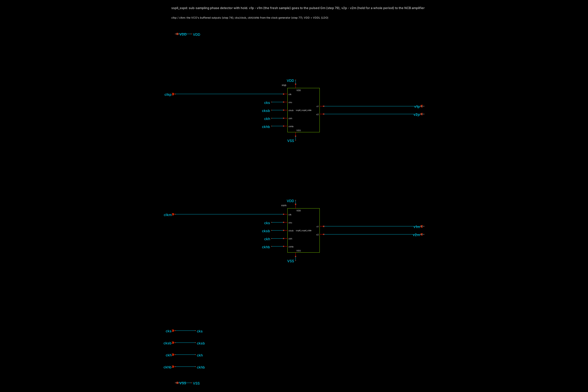
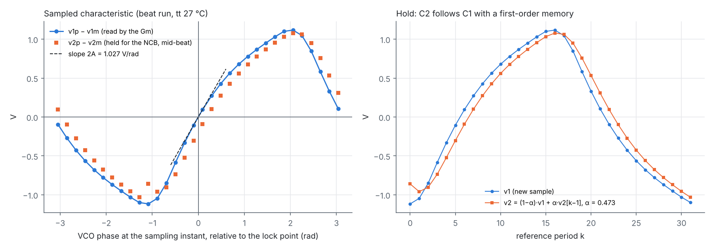
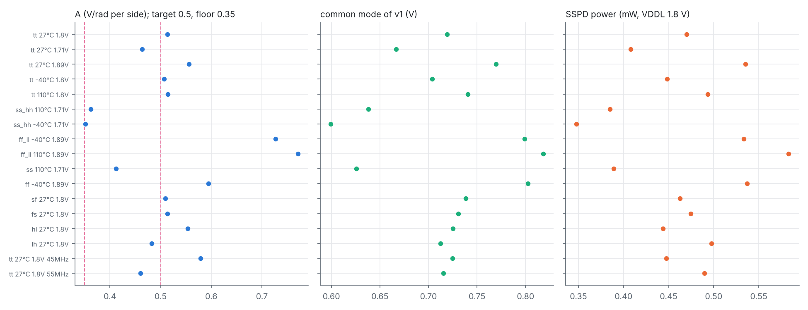
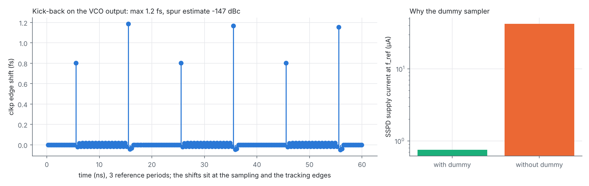
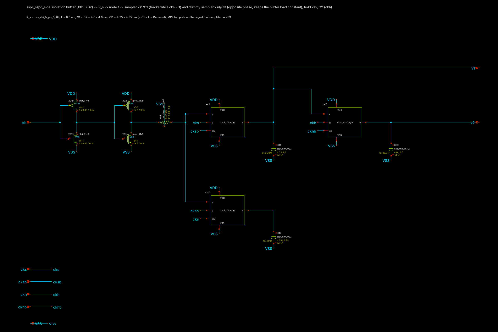
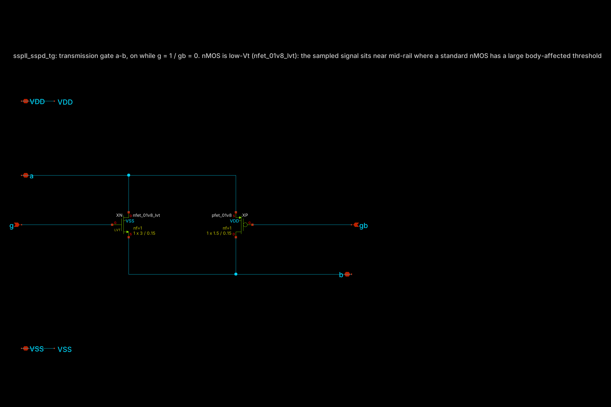

# Step 78: SSPD with hold — sampler, dummy sampler, isolation buffers (schematic)

**Roadmap step 78** · Phase 7 · deliverable: schematic (xschem, hierarchical, LVS-clean), sizing table, verification.
Design files: `design/sspd/` · schematics: `xschem/sspd/` · decks: `tb/sspd/` · data: `design/sspd/data/` ·
methods: M17, M18, M19 in `docs/methods.md`.

## Result in one paragraph
Each side (p from `clkp`, m from `clkm`) has a two-inverter **isolation buffer**, a series resistor **R_s = 2.16 kΩ**
that rounds the square wave into a near-sine of defined slope, a low-Vt **sampling switch** onto **C1 = 35 fF**, a
**dummy sampler** on the opposite phase and a **hold switch** onto **C2 = 35 fF**. The phase-detector gain is
**A = 0.514 V/rad** per side at tt (target 0.5), 0.35–0.77 V over the combined MOS + R/C corners and only ±1.5 % over
−40…110 °C. The hold has the expected memory **α = C2/(C1 + C2) = 0.473** and unity DC gain. The sampler's
switching moves the VCO output edges by **≤ 2.3 fs** (reference spur estimate ≤ −134 dBc). The dummy sampler cuts the
SSPD supply current at f_ref from 42 µA to **0.76 µA**. The isolation buffers add **0.080 ps** of reference-like jitter
(−169.0 dBc/Hz), and kT/C gives −144.7 dBc/Hz (not ×N²). System: **1.964 / 1.256 ps, L(300 kHz) −110.9 / −120.9 dBc/Hz**
(FFNC off / on, 3.3 V pp reference). Power **0.47 mW** at tt on VDDL (0.35–0.58 mW): more than the step-72 allocation,
see F.

**Important change to step 77.** The Gm now reads **C1 before the hold transfer** (clock order sample → Gm → hold).
Reading C2 would put the charge-sharing pole z = α ≈ 0.5 inside the PLL loop: 16° of phase lag at f_c = f_ref/20,
which step 73 did not include. The clock generator was revised (hold-trigger latch, t_p 2.63 → 0.28 ns), see
`docs/design/step77_clkgen.md`.

## What happens, how, why

### What happens
At every reference edge the SSPD freezes the VCO waveform on C1. Near lock the frozen voltage is proportional to the
time between the VCO zero crossing and the reference edge; its slope with phase is the detector gain. Right after the
sample the pulsed Gm (step 79) turns v1p − v1m into a charge for the loop filter. Then the sample is shared onto C2,
which holds it for a whole period for the NCB (feed-forward noise cancellation).

### How it happens
- **Isolation buffer.** XB1 (0.42/0.84 µm, ~2 fF on clkp) and XB2 (2/4 µm). The sampler's charge reaches the shared
  VCO output only through XB1's gate–drain capacitance.
- **Shaping.** XB2 drives R_s and C1 (main sampler tracking) or CD (dummy tracking). An RC-filtered square of amplitude
  a = VDD/2 crosses zero with slope exactly a/τ_s (proof: Q5), so
  $$A = \frac{1}{\omega_0}\left.\frac{dv}{dt}\right|_{cross} = \frac{V_{DD}}{2\,\omega_0\,\tau_s},\qquad
  \tau_s = (R_s + R_{buf} + R_{sw})\,C_{1,tot}$$
  With A = 0.5 V at 1.6 GHz: τ_s = 179 ps. R_s = 2.16 kΩ is about 60 % of the total resistance; C_1,tot ≈ 46 fF
  (34.7 fF MIM + 6 fF Gm input + switch junctions).
- **Sampling.** The TG (nfet_01v8_lvt 3 µm + pfet_01v8 1.5 µm) opens when cks falls. At mid-rail a standard nMOS would
  have 5.4 kΩ (body effect), the lvt one 1.8 kΩ at 2 µm.
- **Dummy sampler.** Same TG, gates swapped, onto CD = 40.7 fF (= C1 + the Gm input). One of the two capacitors is
  always connected to node f, so XB2's load, delay and supply current are the same in every phase.
- **Hold.** After the Gm pulse, ckh closes the small TG (1 µm devices) between C1 and C2:
  $$v_2[k] = (1-\alpha)\,v_1[k] + \alpha\,v_2[k-1],\qquad \alpha = \frac{C_{2,tot}}{C_{1,tot} + C_{2,tot}}$$
- **Noise.** Differential kT/C, divided by the gain (2A)², is a white phase floor that is *not* multiplied by N²:
  $$\mathcal{L}_{kT/C} = \frac{kT}{2\,C\,A^2 f_{ref}}$$
  Timing noise of the isolation buffers *is* reference-like (the loop cannot tell it from reference jitter).

### Why it happens this way
- **Defined slope, wide linear range.** A raw square would give a huge, inverter-dependent slope and a linear range of
  picoseconds. The RC near-sine gives A set by R·C, linear over about ±0.7 rad. kT/C does not depend on R.
- **Gm reads C1.** No charge-sharing pole in the loop; the NCB path keeps the pole the FFNC model already contains.
- **35 fF, not 100 fF.** Power scales with C (0.70 → 0.47 mW); kT/C is still 15 dB under the reference at the output
  (L(300 kHz) changes by 0.01 dB in the system model).
- **Dummy sampler.** Constant supply current: the SSPD does not ripple the LDO rail at f_ref.

## A. Architecture decisions
| Decision | Options | Chosen | Why |
|---|---|---|---|
| SSPD input | raw ring taps vop/vom, buffered clkp/clkm | **clkp/clkm + own isolation buffer** | no extra load on the ring; the acbuf noise is common with the output (VCO-like) |
| Waveform shaping | none (square), R_s + C | **R_s + C (Gao)** | A set by R·C, ±0.7 rad linear range, kT/C unchanged |
| Sampling switch | nMOS, nMOS lvt, TG | **TG with lvt nMOS** | mid-rail signal; lvt 3× lower R_on than standard; pMOS partly cancels injection |
| C1, C2 | 100 / 50 / 35 fF | **35 fF (4 × 4 µm MIM)** | power; kT/C negligible in the system |
| What the Gm reads | C2 after sharing, C1 before | **C1 before sharing** | no z = 0.5 pole in the loop (16° at f_c) |
| Dummy sampler | none, opposite-phase copy | **opposite-phase copy, CD = C1 + C_Gm** | constant buffer load and supply current (−35 dB at f_ref) |
| R_s type | high_po (+7.6 % TC), xhigh_po (−19 %) | **xhigh_po 0.69 µm** | small; its TC slightly raises A when hot (helps the ss/hot loop gain) |

## B. Characteristic over 17 conditions (method M18)

| Condition | A (V/rad) | α | CM of v1 (V) | Power (mW) |
|---|---|---|---|---|
| tt 27 °C 1.8 V | **0.514** | 0.473 | 0.72 | 0.47 |
| tt 1.71 / 1.89 V | 0.463 / 0.556 | 0.473 | 0.67 / 0.77 | 0.41 / 0.54 |
| tt −40 / 110 °C | 0.507 / 0.514 | 0.473 | 0.70 / 0.74 | 0.45 / 0.49 |
| ss_hh 110 / −40 °C, 1.71 V | 0.362 / **0.352** | 0.474 | 0.64 / 0.60 | 0.39 / 0.35 |
| ff_ll −40 / 110 °C, 1.89 V | 0.727 / **0.771** | 0.470 | 0.80 / 0.82 | 0.53 / **0.58** |
| ss 110 °C 1.71 V / ff −40 °C 1.89 V | 0.412 / 0.595 | 0.471 / 0.474 | 0.63 / 0.80 | 0.39 / 0.54 |
| sf / fs 27 °C | 0.509 / 0.514 | 0.474 / 0.472 | 0.74 / 0.73 | 0.46 / 0.48 |
| hl / lh 27 °C | 0.553 / 0.482 | 0.467 / 0.477 | 0.73 / 0.71 | 0.44 / 0.50 |
| f_ref 45 / 55 MHz (VCO 1.44 / 1.76 GHz) | 0.579 / 0.460 | 0.473 | 0.73 / 0.72 | 0.45 / 0.49 |

**Requirements (step 73):** A = 0.5 V nominal ✔ (0.514), ≥ 0.35 V worst ✔ (0.352, the tightest item).

### Loop gain over PVT
A follows 1/(R_s C1): the R/C corner moves it, temperature hardly does. The loop needs A·g_m·τ·K_VCO:

| Corner | A / A_tt | τ / τ_tt (step 77) | K_VCO / K_tt (step 74) | product (before g_m) |
|---|---|---|---|---|
| ss 110 °C | 0.80 | 1.26 | 0.684 | **0.69** |
| ss_hh 110 °C | 0.70 | 1.65 | 0.684 | 0.79 |
| ff −40 °C | 1.16 | 0.82 | 1.485 | **1.41** |
| ff_ll −40 °C | 1.41 | 0.63 | 1.485 | 1.33 |

×0.69–1.41 is inside the `icp_trim` range (process ×0.55–2.0, step 73). Step 79 adds g_m and checks the residual
(temperature/voltage) spread against ×0.75–1.3.

## C. Kick-back and the dummy sampler (method M19)

- Locked (f = 32·f_ref, sampling near the zero crossing). Run with the clock generator vs refclk held low (nothing
  switches); difference of the clkp edge times.
- **clkp edge shift ≤ 1.2 fs** (design script) / 2.3 fs (deck); phase deviation at f_ref → **spur ≤ −134 dBc**.
  Largest voltage difference on clkp 0.28 mV. The ring is one more buffer (acbuf) away.
- **SSPD supply current at f_ref: 0.76 µA with the dummy, 42 µA without** (−35 dB).

## D. Noise (methods M17, M9)
| Source | Value | Phase-noise floor | Enters as |
|---|---|---|---|
| kT/C of C1 (46 fF), A = 0.514 | 2kT/C differential | −144.7 dBc/Hz | PD noise (not ×N²) |
| Isolation buffers XB1/XB2 (M17) | 0.113 ps per side → 0.080 ps differential | −169.0 dBc/Hz at 50 MHz | reference-like (×N²) |
| clkp / acbuf noise | — | — | VCO-like (common with the output) |

M17 run: trip-point noise currents XB1 2.43 pA/√Hz, XB2 5.11 pA/√Hz at b1 and b2, 312 edges, noiseless baseline
0.0001 ps. System (ref_budget, 3.3 V pp): 1.964 / 1.256 ps, −110.9 / −120.9 dBc/Hz; at 1 V pp 1.984 / 1.329 ps,
−110.5 / −118.4; at 0.4 V pp 2.042 / 1.526 ps, −109.6 / −114.7.

## E. Schematics (hierarchical, real wiring, LVS-clean)
`sspll_sspd` (top: p and m sides) → `sspll_sspd_side` (buffer, R_s, sampler, dummy, hold) → `sspll_sspd_tg`,
`sspll_sspd_tgh`. All match the simulated netlist ("Circuits match uniquely"); the drawing checker is clean. Clock
nets are joined by name inside the side cell.

## F. Sizing table (all devices pass `tools/pdk_limits.py`)
| Device | Model | W per finger × nf | L | Role |
|---|---|---|---|---|
| XB1 (n / p) | nfet_01v8 / pfet_01v8 | 0.42 / 0.84 × 1 | 0.15 µm | isolation buffer input (~2 fF on clkp) |
| XB2 (n / p) | nfet_01v8 / pfet_01v8 | 2 / 4 × 1 | 0.15 µm | drives R_s + C |
| XRS | res_xhigh_po_0p69 | 0.69 | 0.6 µm | R_s = 2.16 kΩ |
| xs1, xsd: XN / XP | nfet_01v8_lvt / pfet_01v8 | 3 / 1.5 × 1 | 0.15 µm | sampling and dummy TG |
| xs2: XN / XP | nfet_01v8_lvt / pfet_01v8 | 1 / 1 × 1 | 0.15 µm | hold TG |
| XC1, XC2 | cap_mim_m3_1 | 4 × 4 µm | — | 34.7 fF each, bottom plate on VSS |
| XCD | cap_mim_m3_1 | 4.35 × 4.35 µm | — | 40.7 fF = C1 + Gm input |

Gate load on cks / cksb ≈ 12 fF (≤ 30 fF allowed by step 77); on ckh / ckhb ≈ 4 fF. 18 transistors, 2 resistors and
6 MIM per SSPD. Area ≈ 25 × 20 µm (MIMs over the switches).

## G. Effect on the system and the power question
- **Noise:** FFNC-on jitter 1.256 ps (was 1.254), L(300 kHz) −120.9 (was −121.0): the SSPD costs 0.1 dB.
- **Power:** SSPD 0.47 mW on VDDL (0.26 mA) + clock generator 0.08 mW (0.05 mA) = 0.31 mA, against 0.12 mA allocated
  to "SSPD + clock generator" in step 72. Counted as extra from the 3.3 V LDO input: **9.53 mW typ** (was 8.91),
  **14.2 mW worst** (was 13.4, limit 15). Part of it may belong to the 0.30 mA "ring output buffers (to SSPD, NCB,
  divider)" allocation, whose acbuf currents were never measured (step 74 reported the ring only).
- **Options, if the typical 9.0 mW must be met:** C1 = C2 = 20 fF with R_s = 3.5 kΩ (−0.15 mW at 1.8 V, Gm input then
  20 % of C1); measure the ten acbufs and re-balance the buffer allocation (they may hold the margin); run the NCB
  delay line (0.44 mA allocated) at lower current. Decided in the power review after step 82.

## H. Requirements handed on
1. **Step 79 (pulsed Gm):** reads v1p − v1m during ckg; input capacitance ≈ 6 fF per side (CD sized for it); input
   common mode 0.60–0.82 V; differential range ±1.1 V (±0.7 rad linear); loop polarity picks the stable zero
   crossing; β·K_VCO check with A = 0.514 V (×0.69–1.41 with τ and K_VCO).
2. **NCB amplifier (diff-to-SE):** reads v2p − v2m, input ≤ 4 fF per side; the hold is a first-order memory α = 0.47.
3. **Clock generator (step 77, done):** order sample → Gm → hold; cks load ≈ 12 fF.
4. **Layout:** p/m mirror symmetry; C1/C2/CD matched MIM tiles; equal cks routes to both sides; v1/v2 shielded;
   R_s next to the switch; clkp/clkm into the SSPD from symmetric buffer outputs.
5. **Power review:** see G.

## Testbenches
`tb/sspd/tb_sspd_char.spice` + `tb/sspd_char.py` (M18) and `tb/sspd/tb_sspd_kick.spice` + `tb/sspd_kick.py` (M19):
set-up and how they work in `docs/testbench_guide.md`, section "Step 78".

## Interview questions (step 78)

**Q1. What does the SSPD do, in one sentence?**  
At every reference edge it takes a sample of the VCO waveform; near lock the sampled voltage is proportional to the time (phase) error between the VCO zero crossing and the reference edge, with gain dv/dt of the waveform, and no divider is needed because sampling a 1.6 GHz wave with 50 MHz folds it down by itself.

**Q2. Why is the SSPD gain not divided by N like a PFD's?**  
A PFD compares the reference with the VCO divided by N, so a VCO phase error φ appears as φ/N at its input. The SSPD looks at the VCO itself: an error of φ radians of VCO phase moves the sampled voltage by A·φ. The gain is set by the VCO waveform slope, not by N, so the PD and charge-pump noise are not multiplied by N² at the output.

**Q3. What is A and how did you get it?**  
A is the slope of the sampled waveform at the lock point per side, in volts per radian of VCO phase: dv/dφ = (dv/dt)/ω0. The differential sample v1p − v1m changes by 2A per radian. It is measured with a beat run: the VCO runs at (32 + 1/32)·f_ref, so each reference period samples 1/32 of a VCO cycle further along; a line fit within ±0.35 rad of the zero crossing gives 2A. Result 0.514 V at tt (target 0.5 V).

**Q4. Why put a series resistor in front of the sampling capacitor?**  
The isolation buffer makes a sharp square wave, whose slope at the crossing would be very large, badly defined (it depends on the inverter edge) and linear over only a few picoseconds. R_s and C1 round it into a near-sine. For an RC-filtered square of amplitude VDD/2 the slope at the crossing is exactly (VDD/2)/τ_s, so A = VDD/(2ω0 R C): set by a resistor and a capacitor, with a linear range of about ±1 rad. kT/C noise does not change: it depends only on C.

**Q5. Derive the slope of an RC-filtered square wave at its zero crossing.**  
After an edge, v(t) = a(1 − 2e^{−t/τ}/(1 + e^{−T/2τ})) for a square of ±a. It crosses zero where e^{−t_c/τ} = (1 + e^{−T/2τ})/2. The slope is dv/dt = (2a/τ)e^{−t/τ}/(1 + e^{−T/2τ}), which at t_c is exactly a/τ, independent of the period. With a = 0.9 V and A = 0.5 V at 1.6 GHz: τ = a/(Aω0) = 179 ps.

**Q6. Why a transmission gate with a low-Vt nMOS as the sampling switch?**  
The sample is taken near mid-rail (the common mode of the filtered wave, ≈ 0.72 V). A standard nfet_01v8 with its source at 0.9 V has a body-affected threshold near 1 V and gives 5.4 kΩ at W = 2 µm; the pfet_01v8 is worse (35 kΩ). nfet_01v8_lvt gives 1.8 kΩ at the same size. The pMOS in parallel helps when the waveform is high and cancels part of the nMOS channel charge at turn-off.

**Q7. What is the dummy sampler and why is it there?**  
A second switch and capacitor (CD = C1 + the Gm input) on the same node f, driven by the opposite clock. When the sampler opens, the dummy closes, so the isolation buffer always drives one capacitor. Its delay and its supply current then do not change at f_ref. Without the dummy the SSPD current has a 42 µA component at f_ref; with it, 0.76 µA (−35 dB). That current would ripple the LDO rail that also feeds the VCO buffers and the NCB: a reference spur.

**Q8. What are the isolation buffers for?**  
Two inverters between the VCO output (clkp/clkm, shared with the NCB and the divider) and the sampler. The first is small (0.42/0.84 µm), so clkp sees ~2 fF; the second drives R_s and C1. The sampler's switching charge then reaches clkp only through the gate-drain capacitance of the small inverter: the clkp edges move by at most 1.2 fs, a spur estimate of −147 dBc.

**Q9. Why does the Gm read C1 and not C2?**  
Sharing C1 with C2 makes C2 a memory: v2[k] = (1 − α)v1[k] + αv2[k−1], α = C2/(C1 + C2) ≈ 0.47. A pole at z = α inside the PLL loop would cost about 16° of phase margin at f_c = f_ref/20. So the Gm reads C1 during the 200 ps pulse right after the sample, and only then is C1 shared onto C2. Step 77's clock order was changed for this (t_p also fell from 2.63 to 0.28 ns).

**Q10. What is C2 for, then?**  
The NCB needs the measured phase error for a whole reference period, while C1 is busy tracking the VCO again. C2 holds it. The charge-sharing pole on that path is the one the FFNC model already contains (−60° at f_ref/7.8 together with the hold and the half-period delay).

**Q11. How did you measure α?**  
From the same beat run: every period gives a pair (v1[k], v2[k]). A least-squares fit of v2[k] = a·v1[k] + b·v2[k−1] gives b = α = 0.473 and a + b = 1.000 (the hold has unity DC gain). The capacitor ratio predicts (34.7 + 4)/(34.7 + 6 + 3 + 34.7 + 4) ≈ 0.47.

**Q12. Why C1 = C2 = 35 fF and not the 100 fF of the roadmap?**  
Power. The buffer must swing C at 1.6 GHz: about C·ΔV·f per side. 100 fF cost 0.70 mW, 35 fF 0.47 mW. The kT/C noise goes up by 4.6 dB but it is far below the reference: the system model gives L(300 kHz) −121.00 vs −121.01 dBc/Hz and the same jitter. The step-72 budget already allowed ≥ 50 fF; going lower was checked with the full model.

**Q13. How large is the kT/C noise of the sampler in phase terms?**  
Each side gets kT/C; the differential sample has 2kT/C. Divided by (2A)² it is a phase variance kT/(2CA²) per sample, a white floor L = kT/(2 C A² f_ref) = −144.7 dBc/Hz with C ≈ 46 fF and A = 0.514 V. It is not multiplied by N² — about 15 dB under the reference contribution at the output.

**Q14. Which noise of the SSPD does count like reference noise?**  
Timing noise of the isolation buffers. The loop sees the VCO through them, so a random delay there is indistinguishable from reference jitter: it is multiplied by N² inside the bandwidth. The clkp node itself is common with the output path, so its noise is VCO-like. Method M17 on XB1/XB2 gives the jitter of the filtered crossing.

**Q15. How does A vary over PVT and why is that acceptable?**  
0.35 V (ss_hh) to 0.77 V (ff_ll); over temperature only ±3 % at a fixed corner, over VDDL ±10 % per ±5 %. A follows 1/(R_s C1), so the R/C process corner moves it most. The loop needs β·K_VCO; A·τ·K_VCO at the extreme corners is ×0.69–1.41, inside the icp_trim range (process ×0.55–2.0). What the trim cannot remove is drift, and the drift is small.

**Q16. Why does A depend on VDDL?**  
The filtered square has amplitude VDD/2 and the slope at the crossing is (VDD/2)/τ_s, so A ∝ VDDL. The LDO keeps VDDL fixed; its tolerance is part of the residual spread handed to step 79.

**Q17. What is the common mode of the sample and why is it not 0.9 V?**  
0.72 V at tt (0.60–0.82 V over corners). The TG conducts better at low voltage (lvt nMOS) than at high voltage (a standard pMOS), so the falling half of the wave is driven harder: the average and the crossing level sink below VDD/2. Only the differential sample matters for the loop; the Gm input stage (step 79) must accept 0.6–0.85 V.

**Q18. What sets the linear range of the SSPD?**  
The shape of the sampled waveform. The near-sine has a linear region of about ±0.7 rad around the crossing and peaks at ±1.1 V differential near ±π/2. Outside, the gain falls and reverses: the SSPD has no frequency information, so the FLL must bring the VCO within the capture range first.

**Q19. Is the SSPD characteristic symmetric?**  
Per side, no: the TG makes rise and fall slightly different. Differentially, yes: the m side is the p side shifted by π, so v1p − v1m is odd-symmetric and both zero crossings have the same slope (0.514 V/rad at tt, checked). The loop polarity (step 79) picks the stable one.

**Q20. What is the kick-back problem and how big is it here?**  
When the sampling switch opens or closes, its channel charge and the capacitor's sudden connection disturb the node that drives it, and through it the VCO: a periodic disturbance at f_ref, i.e. a reference spur. Here the disturbance reaches clkp through two isolation stages: at most 0.28 mV and 1.2 fs of edge shift; the ring itself is one more buffer away.

**Q21. How did you measure the kick-back?**  
Two otherwise identical runs at f = 32·f_ref: one with the clock generator running, one with refclk held low (the sampler tracks, nothing switches). The difference of the clkp edge times is the kick-back; its Fourier component at f_ref, as a phase deviation 2π f0 Δt, gives the spur estimate 20 log(a1/2).

**Q22. Why must the hold pulse be long (≥ 1.5 ns)?**  
sw2 shares C1 and C2 through its on-resistance (~3 kΩ with 1 µm devices): τ ≈ 3 kΩ × 20 fF (C1 and C2 in series) = 60 ps. 2.16 ns is many time constants; the length mainly keeps the end of the transfer far from the next tracking phase and lets the switch's own injection settle.

**Q23. What does the Gm input capacitance do to the SSPD?**  
It is part of the C1 node: it slows τ_s (lower A) and is copied in the dummy capacitor (CD = C1 + 6 fF) so that the load stays constant. Step 79 must keep its input capacitance near 6 fF per side, or the dummy is resized.

**Q24. Why does the hold switch use smaller devices than the sampling switch?**  
Its speed is not critical (2 ns to settle 60 ps), and a smaller switch injects less charge onto C2 and loads ckh less.

**Q25. How would you verify the SSPD in Cadence?**  
Same beat testbench with analogLib vpulse sources and the clock generator. For the characteristic use the Calculator to sample v1p − v1m at the Gm pulse (value at a time list) and plot against phase; or run pss with the reference as the beat frequency and the VCO at 32 + 1/32 times it. Kick-back: two transients and the difference of the cross() times.

**Q26. What would you do if a later step needs a larger A?**  
Shorten R_s (A ∝ 1/R): R_s = 0.69 × 0.5 µm gives A ≈ 0.55 V. Below that the transistors dominate τ_s and A follows the MOS corners more. Alternatively a smaller C1, at the cost of the Gm input mattering more.

**Q27. What layout precautions does the SSPD need?**  
Mirror symmetry between the p and m sides; C1, CD and C2 as matched MIM tiles with the bottom plate on VSS; R_s next to the switch; the clock lines cks/cksb routed with equal length to both sides and away from v1; v1 and v2 shielded (they are high-impedance during hold); clkp/clkm entering symmetrically from the VCO buffers.
