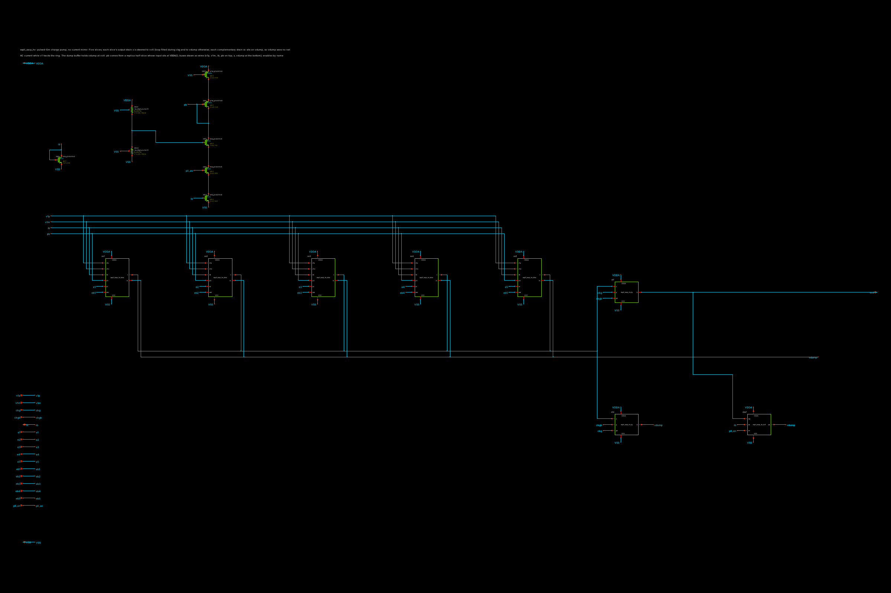
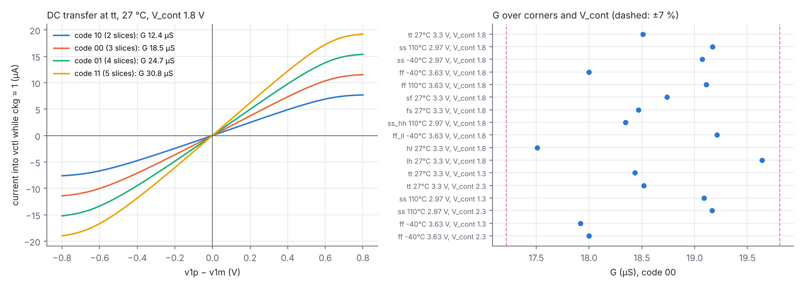
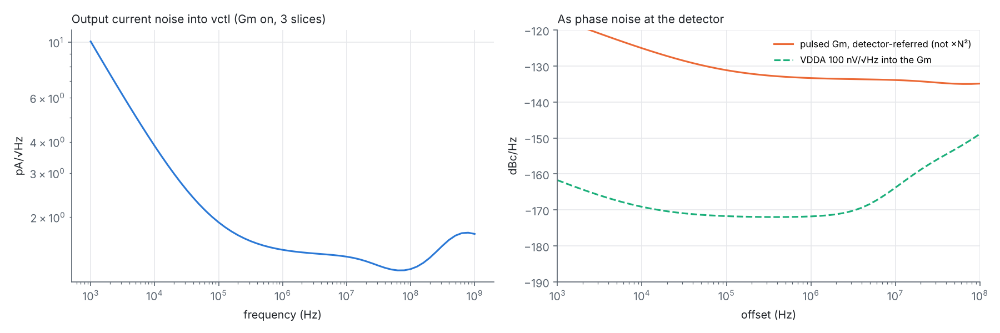
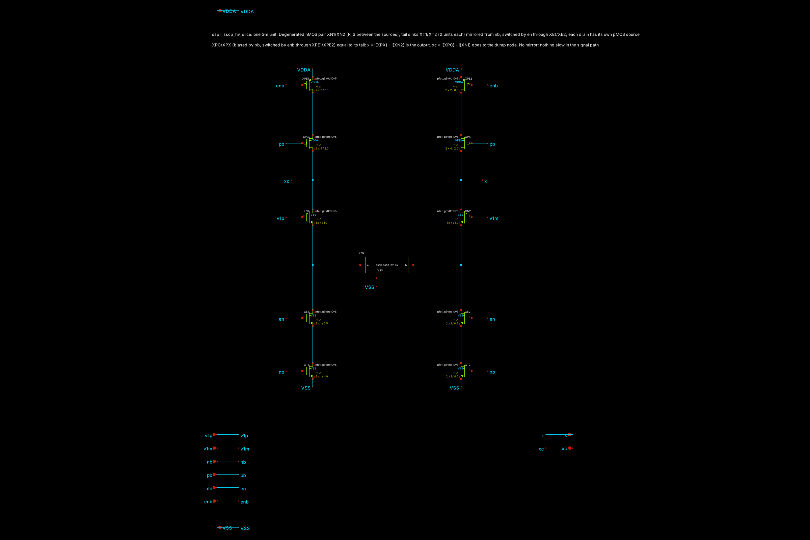
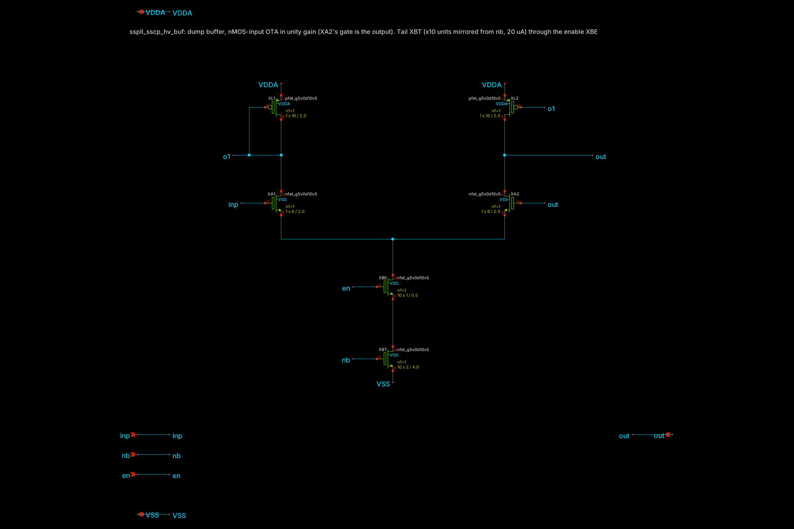
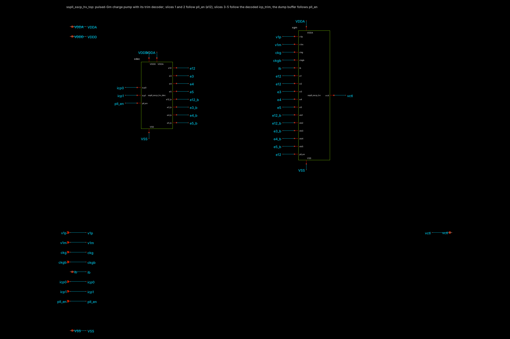

# Step 79: pulsed-Gm charge pump (sub-sampling charge pump) in 5 V devices

*Phase 7, roadmap step 79 (19–20 Nov 2026).* Deliverable: schematic (xschem, hierarchical, LVS-clean), sizing table,
verification over PVT — and, because the charge pump only makes sense with its detector, a whole-detector bench
(SSPD + Gm + clock generator). Design files `design/sscp/sscp_hv.py`, `step79hv_*.py`; schematics `xschem/sscp_hv/`;
data `design/sscp/data/`; methods M10, M11, M16, M18 (`docs/methods.md`).

Reproduce (in `design/sscp`):

```bash
python3 step79hv_size.py --replica   # G sizing of the mirror-less Gm and its step response
python3 step79hv_noisesize.py        # noise-driven resizing (replica size, bias current, current-source lengths)
python3 step79hv_buf.py; python3 step79hv_buf.py --round2   # dump-buffer sizing, both rounds
python3 step79hv_delay.py            # Gm recovery after the SSPD's tracking phase vs pulse delay (sets step 77's gap 1)
python3 step79hv_det.py              # whole detector, beat runs: beta_eff and lock point over corners and V_cont
python3 step79hv_sim.py              # A DC transfer, D dump buffer, B pulsed (DC input), C noise, E VDDA     (M10, M16, M11)
python3 step79hv_cin.py              # Gm input capacitance (the SSPD's C1 node)
python3 step79hv_noise.py            # Gm noise and VDDA into the Gm in the system model                 (M9)
python3 step79hv_plots.py            # docs/img/step79hv_*.png
python3 schematics_hv.py             # xschem/sscp_hv/*, drawing checks, LVS reference                   (M5)
cd ../../xschem && ./lvs.sh sscp_hv/sspll_sscp_hv_top.sch netlist/ref_sscp_hv.spice sspll_sscp_hv_top   # M4
```

## Result in one paragraph

Three of five identical **degenerated nMOS slices** (code 00) turn the SSPD sample v1p − v1m into a current with
**G = 18.51 µS** at tt (17.5–19.6 µS over 11 corners and V_cont 1.3–2.3 V), linear
over ±0.38 V at tt (≥ ±0.23 V everywhere). **There is no current mirror:** each drain has its own pMOS
current source, biased by a replica half-slice. The output drain x is steered to the loop filter during the Gm pulse
(τ = 514 ps, about 2.4 ns after the sample) and to a dump node otherwise; the complementary drain sits on
the dump node, which a buffer and 2 pF hold within 11.7 mV of V_cont. **In the whole detector** (real SSPD,
real clock generator) the loop gain at lock is **β_eff = 0.81 µA/rad** at tt (102 % of the
0.790 target; 0.79 µA/rad with the final C1, section B), and the lock point sits 0.07–0.13 rad from the SSPD's zero crossing at every corner, inside the Gm's linear range. The trim codes give
×0.67 / 1 / ×1.33 / ×1.66. Output noise 1.48 pA/√Hz at 1 MHz
(3.9 at 10 kHz): 224 fs in the system. System, 3.3 V square reference: **1.98 /
1.33 ps**, L(300 kHz) **-117.1 / -124.9 dBc/Hz** (FFNC off / on, typ);
worst 3.70 / 2.50 ps. I(VDDA) 90 µA (0.30 mW).

**This step changed two earlier blocks.** The Gm's input capacitance is 26.5 fF, not 8 fF, so the SSPD's C1
shrank to keep its sampled node (step 78); and the Gm needs about 2 ns after the sample to recover from the SSPD's
tracking swing, so the clock generator now delays the Gm pulse (step 77, section B2 there).



## What happens, how, why

### What happens
After every sample the SSPD holds v1p − v1m = 2A·φ on C1. During the Gm pulse the charge pump turns it into a current
pulse into the loop filter; averaged over the period that is a current proportional to the phase error, with no PFD
and no dead zone:

$$I_{avg} = G\,(2A\varphi)\,\frac{\tau}{T}\quad\Rightarrow\quad \beta = \frac{2A\,G\,\tau}{T}$$

### How it happens
- **Degenerated pair, no mirror.** Each slice is an nMOS pair (4/1 µm) with R_S between the sources and 2 tail units
  (2 µA each) under each source. Each drain has its own pMOS current source equal to its tail, so the output drain
  carries only the change of its transistor's current:

$$i_x = I_P - I_{N2} = \tfrac{1}{2}\,G_{pair}\,(v_{1p} - v_{1m}),\qquad G_{pair} = \frac{1}{1/g_m + R_S/2}$$

  Only one drain (x) feeds the filter, so the output transconductance is half the pair's: three slices give 18.4 µS.
- **Replica bias.** The pMOS gate line pb comes from a replica half-slice (6 copies in parallel) whose input sits at
  VDDA/2 (the SSPD's sampled common mode is 0.48–0.53·VDDA), so the pMOS sources match the tails without a systematic
  offset.
- **Steering.** x goes to vctl through TG_F while ckg = 1, to vdump through TG_D otherwise. The complementary drain xc
  is always on vdump: while v1 tracks the ring, x and xc carry opposite currents into the dump node.
- **Dump node.** A unity-gain 5 V OTA copies vctl onto vdump; 2 pF of MIM holds vdump against the 800 MHz current.
- **Trim (icp_trim).** A 1.8 V decoder on VDDD and four level shifters (with complementary outputs for the pMOS
  enables) turn on 2 / 3 / 4 / 5 slices.

### Why it happens this way
- **No mirror, because a mirror at microamps is slow.** The first version folded the pair's current through a shared
  pMOS mirror (5 × 2/4 µm, 6 µA): its gate node has a pole near 30 MHz. With DC inputs it looked fine, but with the
  real SSPD in front, v1 jumps from the 800 MHz tracking waveform to the held value 0.6 ns before the pulse, and the
  mirror cannot follow: β_eff collapsed to 0.15–0.23 µA/rad
  at tt (target 0.79), with 3–4 fC of charge per period at lock.
- **A pulse 2.4 ns after the sample, because the Gm must recover.** The degeneration resistor and the source
  capacitance (≈ 100 kΩ × 12 fF ≈ 1.2 ns) remember the ±2 V tracking swing. Measured on the locked detector (first
  mirror-less Gm):

| Pulse start after the sample | 0.7 ns | 2.0 ns | 3.0 ns | 4.5 ns |
|---|---|---|---|---|
| charge per period at lock | 4.42 fC | 1.05 fC | 0.68 fC | 0.61 fC |
| gain, fraction of G·τ | 73 % | 114 % | 102 % | 104 % |

  Step 77 added an RC delay so the pulse now starts 2.36 ns after the sample (1.67–3.66 ns over corners).
- **2 pF on the dump node, because the tracking current reaches it.** Without it vdump swung ±90 mV at 800 MHz and was
  up to 90 mV away from vctl when x switched; each switch then put C_x·Δv into the filter.
- **Noise sets the bias.** The phase noise of the pump is S_φ = S_i/(4A²G²d): every current source whose noise reaches
  x counts against a small G. The replica's noise is copied onto pb and into every pMOS source; it was 74 % of the
  total at first. A 6× replica and longer current sources (pMOS L 4 µm, tails L 8 µm) cut the output noise by 6 dB.
- **Degeneration** keeps G a resistor ratio: within ±6 % over corners and V_cont at a fixed code.

## A. Architecture decisions

| Decision | Options | Chosen | Why |
|---|---|---|---|
| Transconductor | plain pair, degenerated pair | **degenerated pair, R_S xhigh-poly** | G within ±6 % over PVT, linear ±0.4 V |
| Output stage | pMOS mirror, own current source per drain | **own pMOS source per drain, replica bias** | the mirror (30 MHz pole) could not follow v1 after tracking: β_eff 0.17 instead of 0.79 |
| Pulsing | switch the tail, steer the output | **steer x between vctl and vdump; xc always on vdump** | constant bias; x + xc cancel on the dump node while v1 tracks |
| Pulse timing | 0.6 ns after the sample, later | **2.4 ns after the sample (step 77 gap-1 delay)** | the Gm recovers from the tracking swing: 4.4 → 0.7 fC per period at lock |
| Dump node | buffer only, buffer + capacitor | **buffer + 2 pF MIM** | ±90 mV of 800 MHz ripple without it |
| Replica | 1 half-slice, 6 | **6 half-slices** | its noise on pb was 74 % of the output noise |
| Current sources | pMOS 4/2, tails 1/4 µm | **pMOS 4/4, tails 1/8 µm** | less gm (and flicker) per µA: output noise −6 dB with the replica |
| Trim | DAC on the tail, slices | **5 equal slices, 2–5 on** | ratio set by device count: ×0.67–1.66 |
| Steering TGs | 2/4 µm, 1/1 µm, 0.5/0.5 µm | **1/1 µm** | smaller injection; 0.5/0.5 µm saved only 0.1–0.3 fC per period |
| Decoder | 5 V logic, 1.8 V logic | **1.8 V on VDDD + level shifters** | device rule (digital = 1.8 V) |

## B. Whole detector: SSPD + Gm + clock generator (method M18, extended)

**Bench (`step79hv_det.py`).** The step-78 beat bench (ring at (16 + 1/32)·f_ref behind a 5 V buffer stage, real
clock generator with the gap-1 delay) with the real Gm on v1 (no placeholder load) and vctl held by an ideal source.
Every reference period gives one sample of the ring phase and one charge packet into vctl; 32 packets cover a whole
ring cycle. β_eff is the slope of charge per period vs phase at the zero of the charge (cubic fit within ±0.6 rad),
divided by T; the zero is the lock point. **Why this bench exists:** with DC sources on v1 the first Gm looked right.
Only the SSPD's real waveform — tracking the ring at 800 MHz for half of every period — showed the mirror's slowness,
the dump-node ripple and the recovery time.

| Condition | β_eff at lock (µA/rad) | ÷ 2A·G·τ/T | lock-point offset (mrad) | max |vdump − vctl| before the pulse |
|---|---|---|---|---|
| tt 27 °C, 3.3 V, V_cont 1.8 V | 0.809 | 109 % | -85 | 11.2 mV |
| tt 27 °C, 3.3 V, V_cont 1.3 V | 0.804 | 109 % | -91 | 14.9 mV |
| tt 27 °C, 3.3 V, V_cont 2.3 V | 0.741 | 100 % | -74 | 17.0 mV |
| ss_hh 110 °C, 2.97 V, V_cont 1.8 V | 0.697 | 75 % | -129 | 22.3 mV |
| ff_ll -40 °C, 3.63 V, V_cont 1.8 V | 0.688 | 96 % | -100 | 17.7 mV |

(These runs used C1 = 2.59 µm, sized for the Gm's input before its final noise resize; the final Gm has 26.5 fF and
C1 = 2.69 µm restores the 42.7 fF node, 1.1 fF more than in these runs: A, and β_eff with it, is about 2.6 % lower in
the final design, 0.79 µA/rad at tt.)

**Reading it.** β_eff is 102 % of the 0.790 µA/rad target at tt in these runs. Against 2A·G·τ/T (τ read at
mid-swing) the measured slope is 100–109 % at tt: the TGs conduct a little beyond the mid-swing points. At ss_hh 110 °C it
is 75 %: most likely the Gm recovers more slowly there (hot, slow corner; not separated further); the trim covers it. The lock point sits -129 to
-74 mrad from the SSPD's zero crossing: inside the Gm's linear range
(±0.38 V ↔ ±0.23 rad at A = 0.81 V/rad).

**Loop gain over PVT and the trim.** β·K_VCO with K_VCO from step 74 HV; the trim code is chosen once per chip:

| Corner | β_eff / tt | K_VCO / tt | product | best code | after trim |
|---|---|---|---|---|---|
| tt 27 °C, 3.3 V | 1.00 | 1.00 | 1.00 | 00 | **1.00** |
| ss_hh 110 °C, 2.97 V | 0.86 | 0.64 | 0.55 | 11 | **0.91** |
| ff_ll -40 °C, 3.63 V | 0.85 | 1.45 | 1.23 | 10 | **0.82** |

## C. DC transfer over corners, V_cont and codes (method M10)



| Condition | V_cont (V) | code | G (µS) | offset (mV) | linear range (V) |
|---|---|---|---|---|---|
| tt 27 °C, 3.3 V | 1.8 | 00 | 18.51 | -0.93 | -0.38 / +0.44 |
| ss 110 °C, 2.97 V | 1.8 | 00 | 19.17 | 4.61 | -0.29 / +0.32 |
| ss -40 °C, 2.97 V | 1.8 | 00 | 19.07 | 6.79 | -0.23 / +0.41 |
| ff -40 °C, 3.63 V | 1.8 | 00 | 18.00 | -5.36 | -0.47 / +0.48 |
| ff 110 °C, 3.63 V | 1.8 | 00 | 19.11 | -6.41 | -0.38 / +0.39 |
| sf 27 °C, 3.3 V | 1.8 | 00 | 18.74 | -0.21 | -0.40 / +0.43 |
| fs 27 °C, 3.3 V | 1.8 | 00 | 18.47 | -1.30 | -0.34 / +0.43 |
| ss_hh 110 °C, 2.97 V | 1.8 | 00 | 18.34 | 4.82 | -0.30 / +0.34 |
| ff_ll -40 °C, 3.63 V | 1.8 | 00 | 19.21 | -5.02 | -0.43 / +0.44 |
| hl 27 °C, 3.3 V | 1.8 | 00 | 17.51 | -0.98 | -0.40 / +0.47 |
| lh 27 °C, 3.3 V | 1.8 | 00 | 19.64 | -0.88 | -0.36 / +0.40 |
| tt 27 °C, 3.3 V | 1.3 | 00 | 18.43 | -6.00 | -0.38 / +0.44 |
| tt 27 °C, 3.3 V | 2.3 | 00 | 18.52 | 4.91 | -0.38 / +0.44 |
| ss 110 °C, 2.97 V | 1.3 | 00 | 19.09 | -1.09 | -0.29 / +0.32 |
| ss 110 °C, 2.97 V | 2.3 | 00 | 19.16 | 12.10 | -0.29 / +0.32 |
| ff -40 °C, 3.63 V | 1.3 | 00 | 17.92 | -10.77 | -0.47 / +0.48 |
| ff -40 °C, 3.63 V | 2.3 | 00 | 18.00 | 0.37 | -0.47 / +0.48 |
| tt 27 °C, 3.3 V | 1.8 | 01 | 24.66 | -0.93 | -0.38 / +0.44 |
| tt 27 °C, 3.3 V | 1.8 | 10 | 12.35 | -0.93 | -0.38 / +0.44 |
| tt 27 °C, 3.3 V | 1.8 | 11 | 30.80 | -0.93 | -0.38 / +0.44 |

**Requirements:** G within ±15 % over PVT at a fixed code ✔ (−5 / +6 %); offset small against the linear range: ≤ 12.1 mV ✔;
linear range ≥ ±0.1 V ✔.

## D. Pulsed operation with DC inputs (method M16)

| Input v1p − v1m | V_cont | charge per period | average current | τ (ckg) |
|---|---|---|---|---|
| +0.0 V | 1.8 V | +0.24 fC | +12.18 nA | 514 ps |
| +0.1 V | 1.8 V | +1.15 fC | +57.41 nA | 514 ps |
| -0.1 V | 1.8 V | -0.65 fC | -32.58 nA | 514 ps |
| +0.0 V | 1.3 V | +0.58 fC | +29.16 nA | 516 ps |
| +0.0 V | 2.3 V | -0.11 fC | -5.32 nA | 512 ps |

Δq/Δv = 9.0 fC/V per period (G·τ = 9.5 fC/V). With DC inputs the Gm is always settled, so the
charge at zero input is the switch injection and the dump-node error alone.

## E. Noise and supply (methods M11, M9)



**Noise-driven sizing (`step79hv_noisesize.py`, R_S re-tuned for G = 18.42 µS in every variant):**

| Variant | R_S L (µm) | G ss / ff | linear range tt | noise 10 k / 100 k / 1 MHz (pA/√Hz) |
|---|---|---|---|---|
| MTM2 RM1 (first) | 16.9 | 1.014 / 0.985 | ±0.41 V | 8.75 / 4.08 / 2.98 |
| MTM2 RM6 | 16.9 | 1.014 / 0.985 | ±0.41 V | 5.69 / 2.58 / 1.82 |
| MTM1 RM6 | 13.6 | 0.938 / 1.038 | ±0.17 V | 4.38 / 1.94 / 1.33 |
| MTM1 RM6 MP4/4 | 13.6 | 0.938 / 1.038 | ±0.17 V | 4.16 / 1.83 / 1.25 |
| MTM1 RM6 MP4/4 MT1/8 | 13.7 | 0.931 / 1.036 | ±0.17 V | 3.27 / 1.52 / 1.10 |
| MTM2 RM6 MP4/4 MT1/8 | 17.2 | 1.036 / 0.972 | ±0.38 V | 3.85 / 1.91 / 1.48 |

The MTM 1 variants (2 µA tails) are quieter still but lose half the linear range (±0.17 V): the lock-point offsets of
section B would sit at its edge. The chosen variant is the last row.

- **Output current noise** (Gm on): 3.85 / 1.91 / 1.48 pA/√Hz at 10 k / 100 k / 1 MHz.
  As detector-referred phase noise: L = -125.1 dBc/Hz (10 kHz), -133.4 dBc/Hz (1 MHz); not ×N².
- **VDDA → filter current:** 1084 nA/V at 1 MHz; as phase |Y|·v/(2AG).
- **I(VDDA)** 89.7 µA → 0.296 mW (slices, replica ×6, divider, buffer).

| Case | Gm (fs) | VDDA into Gm (fs) | jitter off / on (ps) | L(300 kHz) off / on |
|---|---|---|---|---|
| 3.3 typ | 224 | 6 | 1.98 / 1.33 | -117.1 / -124.9 |
| 3.3 pess | 197 | 15 | 2.97 / 2.13 | -112.5 / -118.7 |
| 1.0 typ | 224 | 6 | 2.00 / 1.42 | -116.7 / -123.1 |
| 1.0 pess | 197 | 15 | 3.00 / 2.26 | -112.3 / -118.0 |
| 3.3 worst | 197 | 15 | 3.70 / 2.50 | -111.7 / -118.4 |

Proposal: typ 2.6 / 1.6 ps, −114 / −124 dBc/Hz; max 5.0 / 3.2 ps, −108 / −116 dBc/Hz.

## F. Dump buffer (method M10)

**First run:** BN 4/1, BP 4/2 µm lost tracking at ss 110 °C, 2.97 V, V_cont 2.3 V (vdump 92 mV low): an nMOS-input
follower with a pMOS mirror follows only up to

$$V_{in,max} = V_{DDA} - V_{SG}(L_1) + V_{TN}$$

A wider pMOS fixed the headroom and longer channels the residual error (from the two input devices' different V_DS):

| Variant (first Gm, no dump capacitor) | worst |vdump − vctl| | peaking | f_3dB min |
|---|---|---|---|
| BP4/2 (first) | 92.3 mV | 1.86 dB | 0 MHz |
| BP8/1 | 24.1 mV | 1.80 dB | 530 MHz |
| BP12/1 | 22.3 mV | 1.64 dB | 472 MHz |
| BP16/1 | 23.0 mV | 1.50 dB | 420 MHz |
| BP12/1 BN8/1 | 16.1 mV | 1.53 dB | 530 MHz |
| BP16/2 BN8/2 | 9.4 mV | 1.18 dB | 167 MHz |
| BP24/2 BN8/2 | 9.6 mV | 1.03 dB | 132 MHz |
| BP24/2 BN12/3 | 9.6 mV | 0.81 dB | 105 MHz |
| BP32/3 BN12/3 | 6.9 mV | 0.71 dB | 66 MHz |

**Final (BN 8/2, BP 16/2, 2 pF on vdump):**

| Condition | V_cont 1.3 V | 1.8 V | 2.3 V | f_3dB (MHz) |
|---|---|---|---|---|
| tt 27 °C, 3.3 V | +5.4 mV | +1.0 mV | -4.0 mV | 7.9 |
| ss 110 °C, 2.97 V | +3.4 mV | -2.7 mV | -11.7 mV | 5.0 |
| ss -40 °C, 2.97 V | +1.1 mV | -3.5 mV | -9.4 mV | 7.9 |
| ff -40 °C, 3.63 V | +6.7 mV | +3.2 mV | -0.4 mV | 10.0 |
| ff 110 °C, 3.63 V | +10.6 mV | +6.3 mV | +1.4 mV | 6.3 |

|vdump − vctl| ≤ 11.7 mV at DC; the 2 pF makes the buffer a single-pole loop (f_3dB ≥ 5.0 MHz, no
peaking). The residual DC error comes from the slices' x/xc offset currents into the dump node.

## G. Schematics (hierarchical, real wiring, LVS-clean)

| Level | Cell | Contents |
|---|---|---|
| 1 | `sspll_sscp_hv_rs` | degeneration resistor |
| 2 | `sspll_sscp_hv_slice` | pair, R_S, two tails, two enable switches, two pMOS sources with their enable switches |
| 1 | `sspll_sscp_hv_tg` | 5 V steering TG |
| 1 | `sspll_sscp_hv_buf` | dump buffer (OTA follower) |
| 3 | `sspll_sscp_hv` | five slices, replica bias, steering TGs, dump buffer, 2 pF, bias diode — buses drawn as wires |
| 1 | `sspll_sscp_hv_dec` | 1.8 V trim decoder + 4 level shifters (true and complementary enables) |
| 4 | `sspll_sscp_hv_top` | decoder + core |

netgen against `xschem/netlist/ref_sscp_hv.spice` (= `sscp_hv.full()`): *Circuits match uniquely* and no property
errors for all seven cells; drawing checker clean. (`lvs.sh` now also reports netgen's property errors: a device
multiplier drawn differently from the netlist would otherwise pass unnoticed.)





## H. Sizing table (all devices pass `tools/pdk_limits.py`)

| Device | Model | W per finger (µm) × units | L | Role |
|---|---|---|---|---|
| XN1, XN2 (per slice) | nfet_g5v0d10v5 | 4.0 | 1.0 µm | input pair; L = 1 µm for flicker |
| R_S (per slice) | res_xhigh_po_0p35 | 0.35 | 17.2 µm | degeneration ≈ 98 kΩ |
| XT1, XT2 (per slice) | nfet_g5v0d10v5 | 1.0 × 2 | 8.0 µm | tail sinks, 2 µA per unit |
| XE1, XE2 (per slice) | nfet_g5v0d10v5 | 1.0 × 2 | 0.5 µm | tail enable switches (trim) |
| XPC, XPX (per slice) | pfet_g5v0d10v5 | 4.0 × 2 | 4.0 µm | pMOS current sources on xc / x, 2 µA per unit |
| XPE1, XPE2 (per slice) | pfet_g5v0d10v5 | 2.0 × 2 | 0.5 µm | pMOS enable switches (gate enb) |
| replica XRT | nfet_g5v0d10v5 | 1.0 × 12 | 8.0 µm | replica tails |
| replica XRE | nfet_g5v0d10v5 | 1.0 × 12 | 0.5 µm | replica tail switches (always on) |
| replica XRP | pfet_g5v0d10v5 | 4.0 × 12 | 4.0 µm | replica pMOS diode = pb |
| replica XRPE | pfet_g5v0d10v5 | 2.0 × 12 | 0.5 µm | replica pMOS switches (always on) |
| replica XRD | nfet_g5v0d10v5 | 4.0 × 6 | 1.0 µm | replica input device, gate at VDDA/2 |
| XRC1, XRC2 | res_xhigh_po_0p35 | 0.35 | 150.0 µm | VDDA/2 divider for the replica (≈ 0.86 MΩ each) |
| TG_F, TG_D | nfet_g5v0d10v5 / pfet_g5v0d10v5 | 1.0 / 1.0 | 0.5 µm | steering to vctl / vdump (small, balanced) |
| XA1, XA2 (buffer) | nfet_g5v0d10v5 | 8.0 | 2.0 µm | buffer input pair |
| XL1, XL2 (buffer) | pfet_g5v0d10v5 | 16.0 | 2.0 µm | buffer mirror load |
| XBT (buffer) | nfet_g5v0d10v5 | 2.0 × 10 | 8.0 µm | buffer tail |
| XCDUMP | cap_mim_m3_1 | 22.4 × 22.4 µm × 2 tiles | — | dump-node decoupling, 2 pF |
| decoder | nfet_01v8 / pfet_01v8 | 0.42–0.84 | 0.15 µm | 1.8 V trim logic on VDDD + 4 level shifters (step 75 HV) |

Gate load on ckg / ckgb: one 1 µm nMOS and one 1 µm pMOS gate each (L 0.5 µm) ≈ 4 fF — inside the 40 fF the clock
generator was verified with. Input capacitance on each of v1p / v1m: 26.5 fF at tt
(24–29 fF over corners, codes and ckg).

## I. Requirements handed on

1. **Step 80 (loop filter):** current source into vctl during τ; V_cont window 1.3–2.3 V; β_eff = 0.81 µA/rad at tt
   (×0.85–1.00 over corners before trim).
2. **Step 78 SSPD:** Gm input 26.5 fF per side (C1 = 2.69 µm keeps the node).
3. **Step 77 clock generator:** Gm pulse ≥ 1.6 ns after the sample (done: 1.67–3.66 ns).
4. **Bias generator:** one 2 µA unit into ib.
5. **Layout:** slices in a row, common-centroid pairs, R_S interdigitated; replica next to the slices; x short and
   symmetric to both TGs; vdump and vctl side by side; the 2 pF MIM over the slices.

## J. Problems met and how they were solved

| Problem | Found by | Cause | Solution |
|---|---|---|---|
| Dump buffer lost tracking at ss 110 °C, V_cont 2.3 V (−92 mV) | buffer bench D | V_in,max = VDDA − V_SG + V_TN with a narrow pMOS load | BN 8/2, BP 16/2 µm |
| Pulsed gain 39 % above G·τ, 1.4 fC at zero input | pulsed bench (DC inputs) | vdump moved with the Gm's current (buffer R_out ≈ 10 kΩ) | explained only by the whole-detector bench (next rows) |
| Gm input 26 fF, not 8 fF | `step79hv_cin.py` | the pair's gate capacitance (5 slices, 4/1 µm thick oxide) | C1 of the SSPD shrunk to keep the node (step 78) |
| Whole detector: β_eff 0.17 µA/rad, 4 fC at lock | `step79hv_det.py` | pMOS mirror pole near 30 MHz; v1 changes 0.6 ns before the pulse | no mirror: own pMOS source per drain, replica bias |
| vdump ±90 mV at 800 MHz | locked-detector waveforms | the Gm's tracking current into the dump node | xc on vdump (cancels x), 2 pF MIM |
| Still 4.4 fC at lock, gain 73 % | `step79hv_delay.py` | Gm recovery from the tracking swing (R_S × source C) | Gm pulse 2.4 ns after the sample (step 77 RC delay) |
| Output noise 2.98 pA/√Hz at 1 MHz: L(300 kHz) FFNC on −123.0 | noise bench + ngspice noise summary | replica noise on pb (74 %), current-source gm | replica ×6, pMOS L 4 µm, tails L 8 µm: −6 dB |
| Replica multiplier drawn ×1, netlist ×12: LVS still "match" | review of the drawing | `lvs.sh` read only the topology line | drawing fixed; `lvs.sh` now reports property errors |

## Testbenches

Set-up, method and pitfalls: `docs/testbench_guide.md`, section "5 V pulsed-Gm charge pump benches (step 79)".

## Interview questions (step 79)

The answers are in `learn/phase7_design.ipynb` (v2), step 79.

1. What is a pulsed-Gm charge pump and why does a sub-sampling PLL use one?
2. Derive β = 2A·G·τ/T.
3. Why did the first Gm, which looked right with DC inputs, fail with the real SSPD?
4. Why is the pulse 2.4 ns after the sample and not right after it?
5. What do the dump buffer and the 2 pF do, and what happens without them?
6. Why does each drain have its own current source, and how is the offset between them kept small?
7. Why was the replica bias the largest noise source, and how was that fixed?
8. How do the trim codes work, and why slices rather than a current DAC?
9. Why is the decoder in 1.8 V logic, with complementary enables?
10. How was G measured, and why is its sign negative in the testbench?
